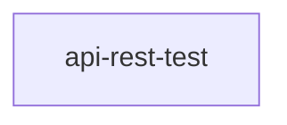
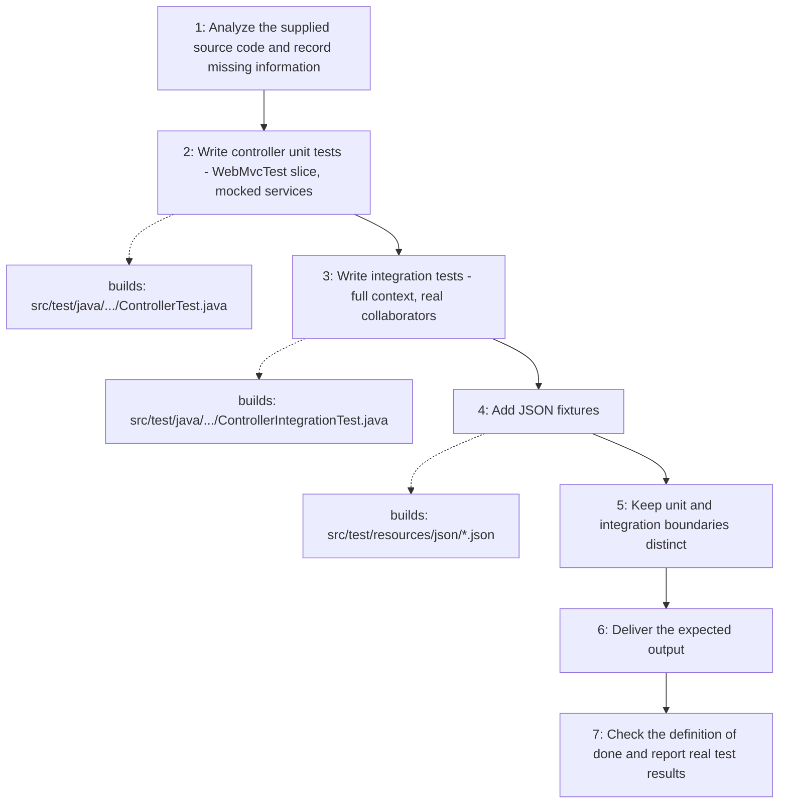

# API REST Test

Generates Spring Boot REST API tests from the actual source code: controller unit tests that load only the MVC slice (`@WebMvcTest`, real `MockMvc`, services and mappers mocked with `@MockitoBean`) and integration tests that run the full application context (`@SpringBootTest` + `@AutoConfigureMockMvc`) against real collaborators and a test database, plus the JSON fixtures they read. It never invents endpoint contracts and never claims tests pass without running them.

## When to use

Use when asked to write, add, or complete tests for REST endpoints or controllers in a Spring Boot project.

## How to run

Ask for REST API tests and point at the controllers to cover, for example: "Use the api-rest-test skill to write controller unit tests and integration tests for `InstantPaymentController`." Supply or let the agent read the controller, DTO, service, mapper, repository, and exception-handler sources.

## Dependency graph

No agent or skill calls this skill yet; it is loaded directly from a user request.

## Workflow graph

