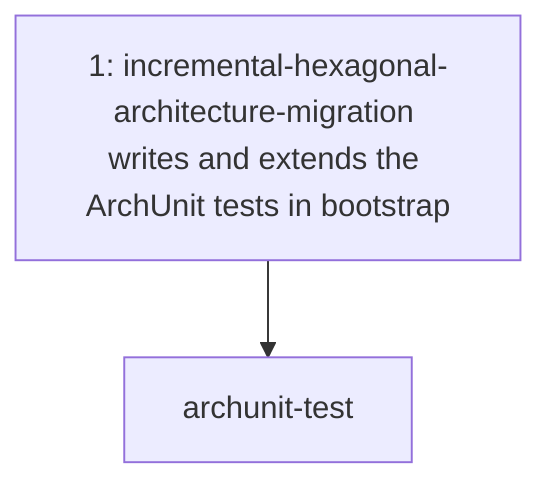
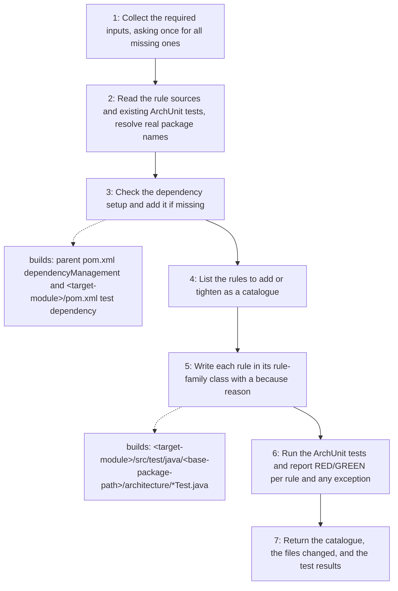

# ArchUnit Test

Writes and maintains ArchUnit tests that enforce the hexagonal architecture
rules of a Java/Maven multi-module project at build time. The tests go in the
composition-root module (`bootstrap`), whose test classpath sees every
production class. The skill holds **how** to write the tests. The calling agent
decides **when** they are written.

## When to use

Use when writing, adding, or tightening ArchUnit architecture tests in the
composition-root module.

## How to run

Ask the agent to "use the `archunit-test` skill" and give four inputs: the
target module (default `bootstrap`), the base package (e.g.
`fr.kevin.llps.payments`), the rule sources (the approved design documents),
and the rules to add or tighten. If any input is missing, the skill asks for it
in one batched question.

## Dependency graph

## Workflow graph

