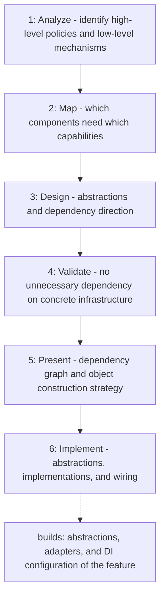

# Dependency Inversion Principle

Applies the Dependency Inversion Principle before classes are created: it
separates high-level business policies from low-level mechanisms, defines
abstractions owned by the consuming layer, and fixes dependency direction and
constructor-injection wiring before any code is written.

## When to use

Use when designing or implementing a feature whose business logic needs
databases, external APIs, messaging, files, or other low-level mechanisms, to
decide abstractions, dependency direction, and object construction first.

## How to run

Ask the agent to design or implement a feature "applying the
`dependency-inversion-principle` skill"; it presents the design deliverables
before creating any class.

## Dependency graph

No agent or skill calls this skill yet; it is loaded directly by the user's
request.

## Workflow graph

