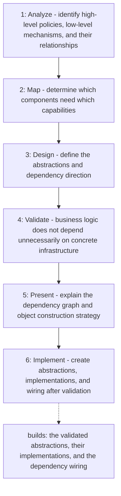

# Dependency Inversion Principle

Applies the Dependency Inversion Principle before classes and their
dependencies are created. High-level business rules and low-level mechanisms
are identified first. Abstractions are defined only where they mark a
meaningful boundary and are owned by the layer that needs them. Dependency
direction and object construction are validated and presented before any code
is written, so business logic depends on contracts while infrastructure
implements them.

## When to use

Use before creating classes and wiring their dependencies: when designing
ports, adapters, services, or any business logic that needs databases,
external APIs, messaging, or files.

## How to run

Ask the agent to apply the `dependency-inversion-principle` skill when
designing a feature's dependencies, for example: "Design the dependencies of
the recall feature, applying the dependency-inversion-principle skill."

## Dependency graph

No agent or skill calls this skill yet; it is loaded directly on request.

## Workflow graph

