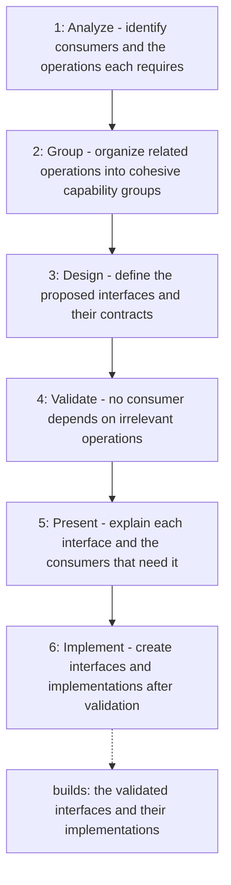

# Interface Segregation Principle

Applies the Interface Segregation Principle before interfaces and their
implementations are created: consumers are analyzed first, operations are
grouped into cohesive, focused contracts, and the design is validated and
presented before any code is written, so no consumer depends on operations it
never uses and no implementation is forced into unsupported methods.

## When to use

Use when designing, creating, or splitting interfaces (ports, contracts,
abstractions) and their implementations, before writing them.

## How to run

Ask the agent to apply the `interface-segregation-principle` skill when
designing an interface, for example: "Design the ports for the payment
repository, applying the interface-segregation-principle skill."

## Dependency graph

No agent or skill calls this skill yet; it is loaded directly on request.

## Workflow graph

