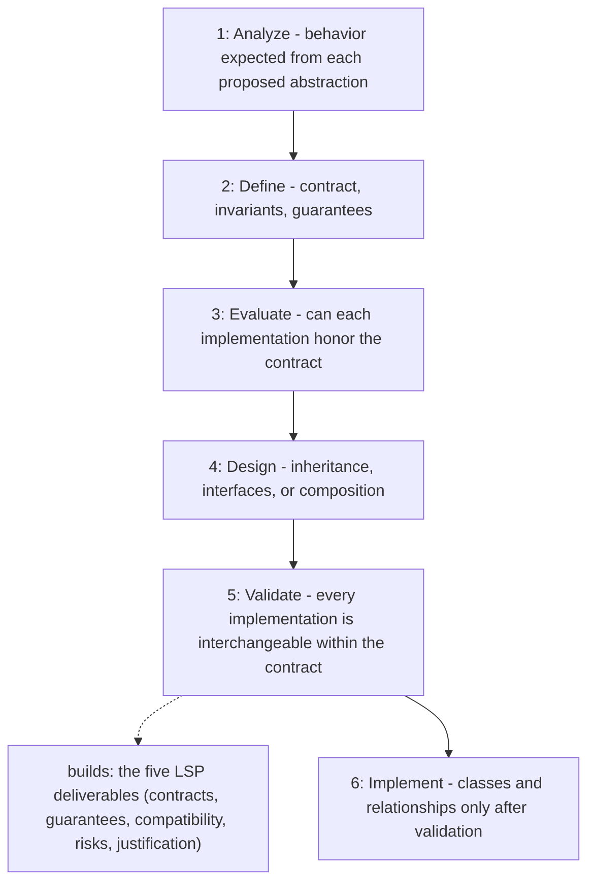

# Liskov Substitution Principle

Applies the Liskov Substitution Principle before any class hierarchy or
interface implementation is created, so every subtype can replace its declared
base type or interface without violating expected behavior. It produces
behavioral contracts and a substitutability review first; classes come last.

## When to use

Use when designing or reviewing base types, interfaces, subclasses, overrides,
or implementations, before writing them.

## How to run

Ask for the skill by name while designing a feature, e.g. "Use the
liskov-substitution-principle skill to design the payment repository
hierarchy before writing classes."

## Dependency graph

No agent or skill calls `liskov-substitution-principle` yet; it is loaded
directly on request.

## Workflow graph

