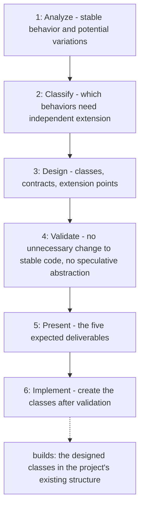

# Open/Closed Principle

Applies the Open/Closed Principle before any class is created: it separates
stable behavior from behavior likely to vary, adds extension points only where
a real variation justifies them, and presents the design before implementing
it, so new behavior can be added without modifying stable code and without
speculative abstractions.

## When to use

Use when designing or creating new classes for a feature, adding a new variant
of an existing behavior, or reviewing a proposed design for extensibility
before implementation.

## How to run

Load the `open-closed-principle` skill, then ask for a design, for example:
"Using the open-closed-principle skill, design the classes for <feature>
before writing any code."

## Dependency graph

No agent or skill calls this skill yet; it is loaded directly by the user or
by the agent performing the design.

## Workflow graph

