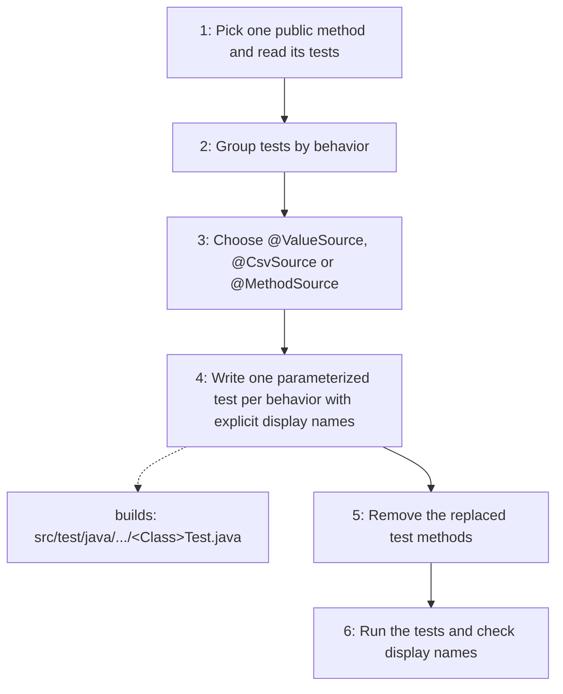

# Parameterized Unit Test

Writes maintainable unit tests with less duplication: when several tests
exercise the same public method with different input data sets or expected
outcomes, they become one JUnit 5 `@ParameterizedTest` whose every invocation
has an explicit display name naming the scenario and its data.

## When to use

Use when several unit tests of one public method differ only in their input
values or expected results, or when adding data-driven cases to a unit test.
General unit-test conventions come from the `unit-test` skill.

## How to run

Ask the agent to "write (or refactor) the unit tests of `<Class>.<method>` with
the parameterized-unit-test skill", then run the test class from the module:
`mvn test -Dtest=<TestClass>`.

## Dependency graph

No agent or skill calls this skill yet; it is loaded directly on request.

## Workflow graph

