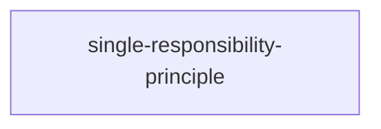
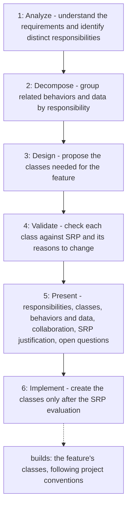

# Single Responsibility Principle

Applies the Single Responsibility Principle before any class is created, so
each proposed class has one clearly defined responsibility and one primary
reason to change. It analyzes the feature, decomposes it into
responsibilities, proposes and validates class boundaries, and presents the
design before implementation, while avoiding overengineering.

## When to use

Use when designing or creating new classes for a feature, before writing any
implementation.

## How to run

Ask the agent to apply the `single-responsibility-principle` skill to a
feature, e.g. "Using the single-responsibility-principle skill, design the
classes for <feature>". The agent presents the SRP design deliverables before
creating any class.

## Dependency graph

No agent or skill calls this skill yet; it is loaded directly on request.

## Workflow graph

