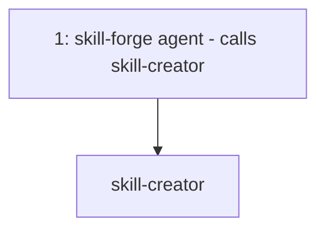
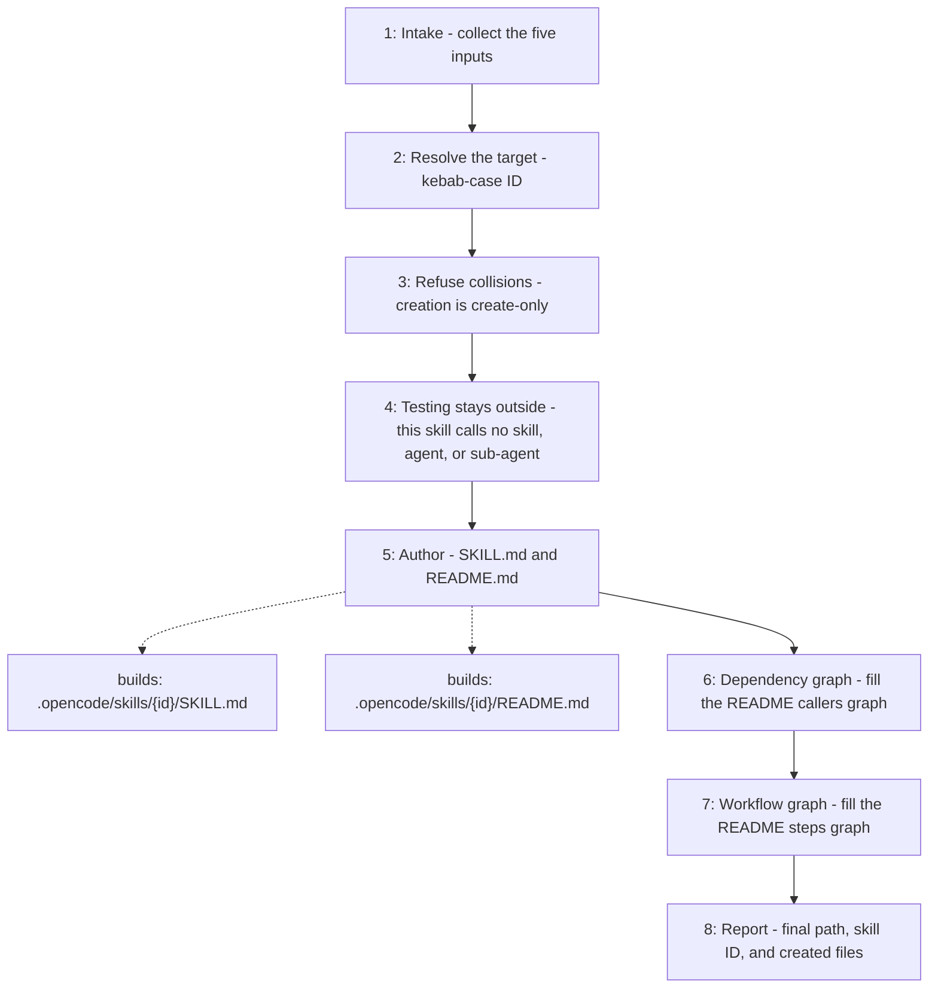

# Skill Creator

Turns five user-provided inputs — responsibility, in-scope, out-of-scope,
instructions and acceptance criteria — into a discoverable, test-first OpenCode
skill. The skill itself calls no skill, agent, or sub-agent, and performs no
rule decomposition, test authoring, or RED/GREEN gating.

## When to use

Use when the user asks to create, define, or scaffold a new skill.

## How to run

Ask for a new skill through the `skill-forge` agent — for example
"create a skill called weather" — and provide the five inputs when asked.

## Dependency graph

## Workflow graph

