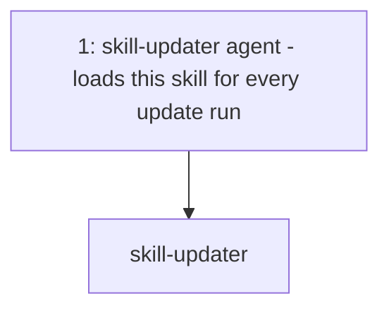
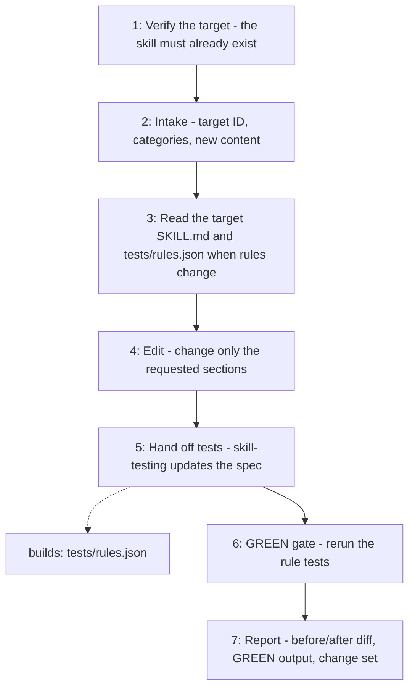

# Skill Updater

Updates exactly one existing OpenCode skill from explicit inputs — target ID,
categories, and new content — then proves the edit with the skill's rule tests.
It never creates a skill: a missing target is reported, not scaffolded.

## When to use

Use when an existing skill must be changed, extended, or corrected, never to
create a new one.

## How to run

Ask the `skill-updater` agent to update a skill, naming the target skill ID, the
categories (responsibility, scope, out-of-scope, workflow, rules, acceptance
criteria), and the exact new content for each.

## Dependency graph

## Workflow graph

