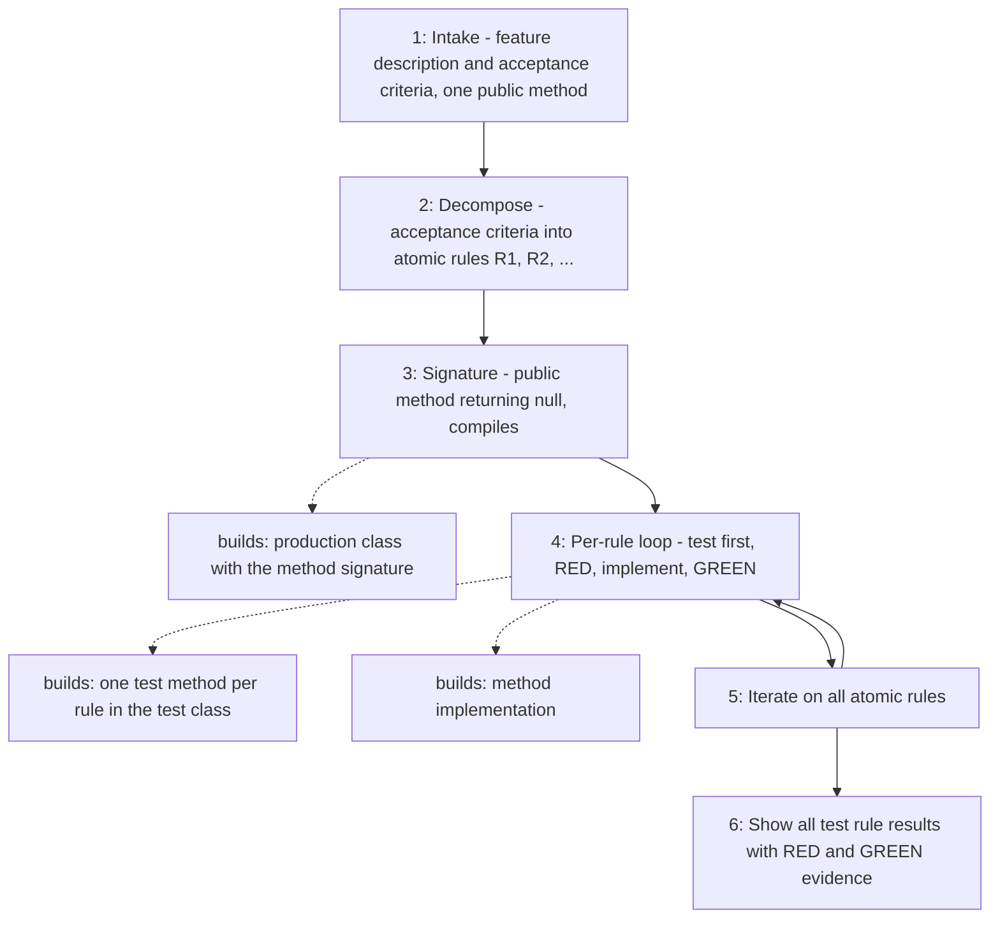

# Test Driven Development

Drives the development of a single public Java method by tests: the
acceptance criteria become atomic rules, and each rule is written as a failing
test (RED), implemented, and proven passing (GREEN) before the next one starts.

## When to use

Use when a feature must be implemented with TDD from a feature description and
its acceptance criteria, scoped to one public method.

## How to run

Ask the agent to "use the `tdd` skill" (or "implement this with TDD") and give
the feature description, the acceptance criteria, and the target class or
method. Without both the description and the criteria the skill only asks for
them.

## Dependency graph

No agent or skill calls `tdd` yet; it is invoked directly by the user.

## Workflow graph

