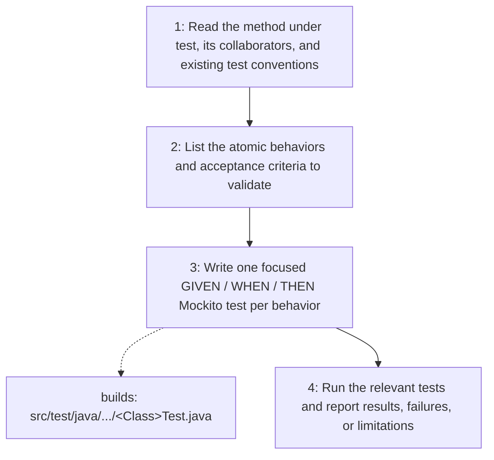

# Unit Test

Writes high-quality, reliable, and maintainable JUnit 5 + Mockito unit tests
that validate the behavior of one public method at a time: `snake_case` test
names, GIVEN / WHEN / THEN sections, mocked collaborators, verified
interactions, and FIRST-compliant execution.

## When to use

Use when a feature or public method needs new or updated unit tests.

## How to run

Ask the agent to "write unit tests for `<Class>.<method>`" (or load the
`unit-test` skill), naming the public method under test and, when available,
its acceptance criteria. The agent lists the atomic behaviors, writes the
tests, runs them, and reports the results.

## Dependency graph

No agent or skill calls this skill yet; it is loaded directly on request.

## Workflow graph

