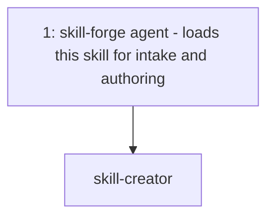
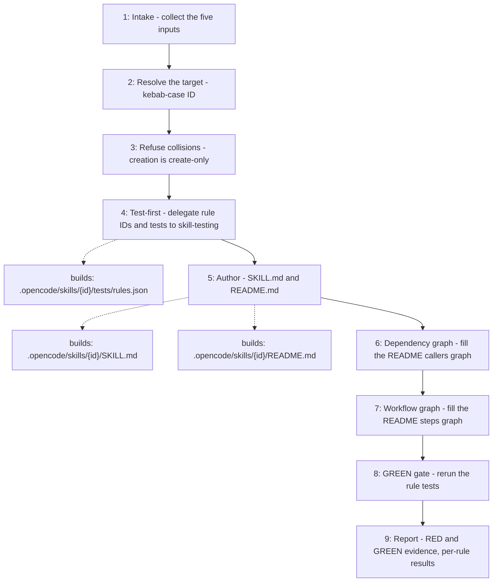

# Skill Creator

Turns five user-provided inputs — responsibility, in-scope, out-of-scope,
instructions and acceptance criteria — into a discoverable, test-first OpenCode
skill. Atomic rules and their failing tests are written before `SKILL.md`, and
success is reported only once the rule tests are GREEN.

## When to use

Use when the user asks to create, define, or scaffold a new skill.

## How to run

Ask for a new skill through the `skill-forge` agent — for example
"create a skill called weather" — and provide the five inputs when asked. The
agent loads this skill for the intake and authoring steps.

## Dependency graph

No other agent or skill calls `skill-creator`; `skill-updater` deliberately
never does, because updating an existing skill is not creation.

## Workflow graph

