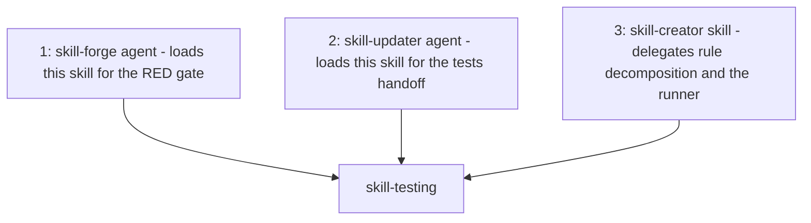
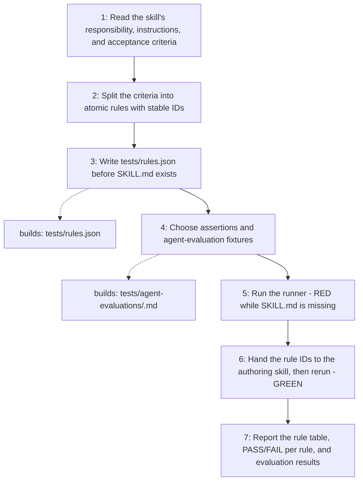

# Skill Testing

Turns a skill's acceptance criteria into atomic, stable rule IDs and executable
checks. `tests/rules.json` is the authoritative specification, and the
zero-dependency runner reports one PASS/FAIL line per static rule, followed by
every agent-evaluation prompt.

## When to use

Use when a skill must be tested, when a skill is written test-first, or when
verifying that an existing skill satisfies its rules.

## How to run

```sh
python3 .opencode/skills/skill-testing/scripts/run-skill-rule-tests.py .opencode/skills/<id>
```

Exit codes: `0` GREEN, `1` RED, `2` bad spec.

## Dependency graph



## Workflow graph


