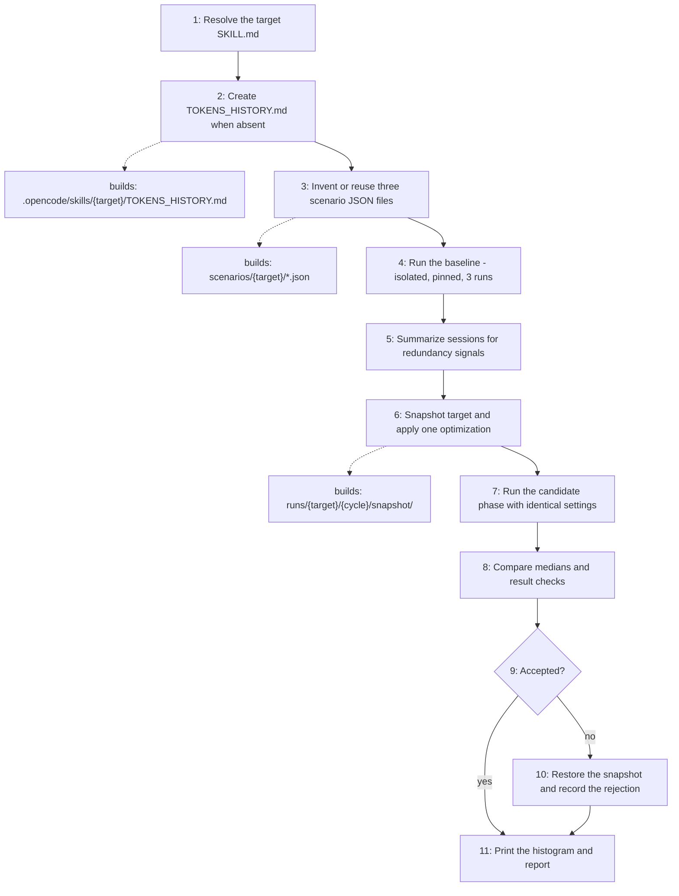

# Skill Tokens Reducer

Measures the real tokens one OpenCode skill consumes across repeated isolated
scenarios, records each run in that skill's `TOKENS_HISTORY.md`, and keeps a
token-saving change only when the same scenarios get cheaper without changing
results. Every total comes from OpenCode's recorded session usage, child
sessions included.

## When to use

Use when a skill's token consumption must be measured, reduced, or tracked over
time.

## How to run

From the project root, ask for one target skill (for example
"measure and reduce skill-updater"). The skill runs the baseline, proposes one
optimization, re-runs the same scenarios, and prints the per-session histogram
after the cycle.

```sh
python3 .opencode/skills/skill-tokens-reducer/scripts/run_skill_scenarios.py \
  --target <target> --phase baseline --runs 3 \
  --model <provider/model#variant> --agent <agent>
```

## Dependency graph

No agent or skill calls this skill yet; it is invoked directly by the user from
a build session.

## Workflow graph


