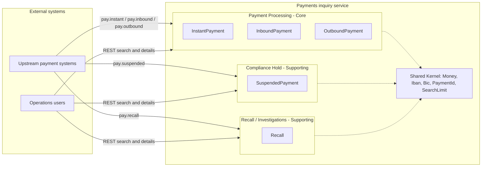
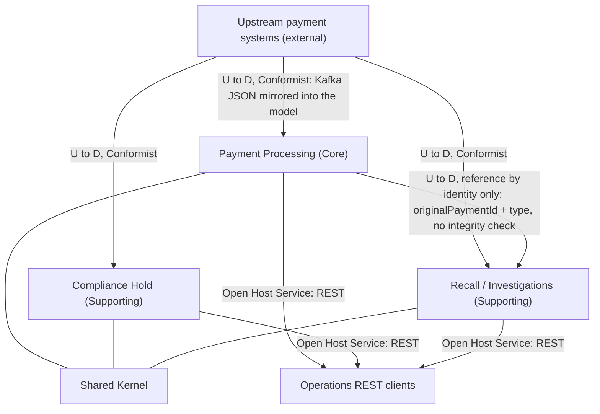
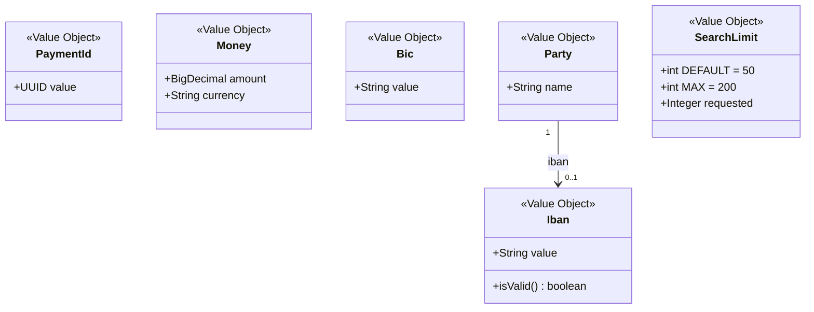
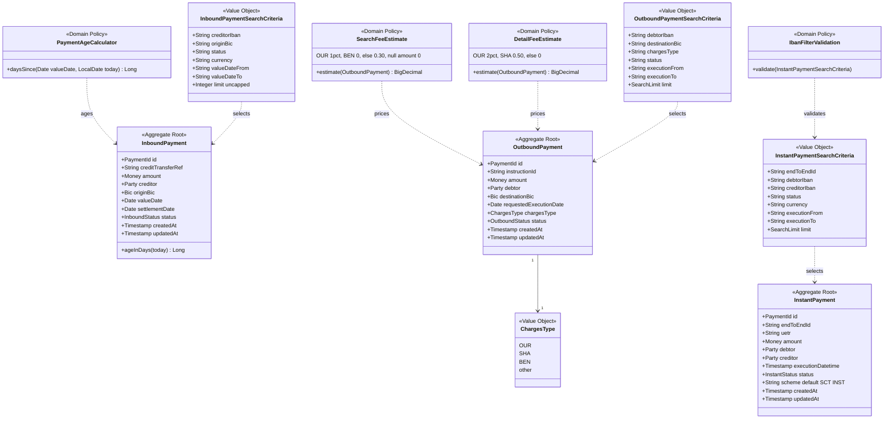
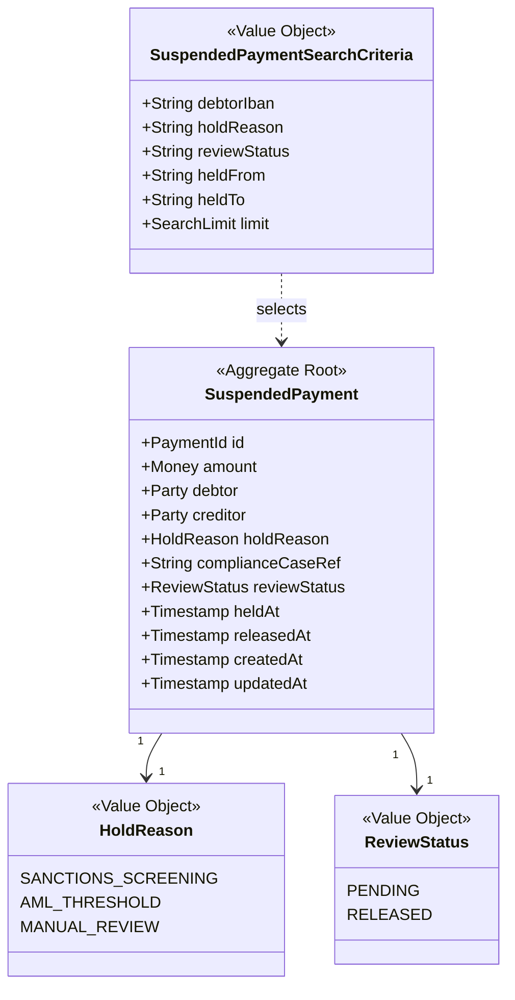
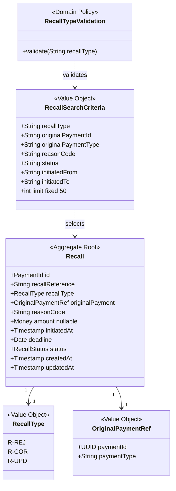

# DDD Domain Analysis — realistic-mess-based-on-jpa-entities-challenge

| | |
|---|---|
| Status | **Validated** (business-rule gate and bounded-context gate approved by the user on 2026-10-25) |
| Scope | `realistic-mess-based-on-jpa-entities-challenge/` only |
| Produced by | DDD Domain Analysis Agent — Phase 1 of the Hexagonal Architecture Migration Orchestrator |
| Next phase | Phase 2 — DDD Test Coverage Guardian |

---

## 1. Executive Summary

The module is a **read-only payments inquiry service**. It ingests five kinds of payment records from Kafka (`pay.instant`, `pay.suspended`, `pay.inbound`, `pay.outbound`, `pay.recall`), upserts them into PostgreSQL through JPA, and exposes one search endpoint and one details endpoint per kind over HTTP.

There are **no commands, no state transitions and no domain events** produced by the application. The business logic is limited to:

- query rules (filter semantics, limits, ordering, input validation),
- derived values (outbound fee estimates, inbound age in days),
- ingestion rules (upsert key, defaults, error policy).

34 business rules were extracted (BR-01 … BR-34). Three Bounded Contexts were validated: **Payment Processing** (instant, inbound, outbound), **Compliance Hold** (suspended) and **Recall / Investigations** (recalls), with a small **Shared Kernel** of payment value objects.

All existing quirks — including the two conflicting outbound fee tables — are **required behavior** and must be preserved by the migration.

## 2. Project Overview and Business Model

- **Type:** Spring Boot 3.5.7 / Java 21 application, entrypoint `fr.kevin.llps.payments.PaymentsApplication`.
- **Actors (inferred):**
  - *Upstream payment systems* publish payment records on Kafka topics (not part of this codebase).
  - *Operations / back-office users* query payments over REST (`InboundPaymentController:44` mentions "ops team asked for it in 2023").
- **Business capability:** give operations a consolidated, searchable view of instant (SCT Inst), inbound and outbound credit transfers, compliance holds and recalls, with a few computed indicators (fees, age).
- **Current flow:** HTTP controllers → services → hand-written `EntityManager` repositories (string-built JPQL) → JPA entities. Kafka listeners bypass services and repositories and `em.merge` entities directly. `OutboundPaymentController.get` bypasses the service layer.

## 3. Artifact Inventory and Analysis Limitations

| Artifact | Path | Used |
|---|---|---|
| Controllers (5) + exception handler | `src/main/java/fr/kevin/llps/payments/controller/` | yes, fully read |
| Services (5) | `.../service/` | yes, fully read |
| Repositories (5) | `.../repository/` | yes, fully read |
| JPA entities (5) | `.../entity/` | yes, fully read |
| DTOs (10) | `.../dto/` | yes, fully read |
| Kafka listeners (5) | `.../kafka/` | yes, fully read |
| Utilities | `.../util/PaymentUtils.java` | yes, fully read |
| DDL / seed data | `src/main/resources/schema.sql`, `data.sql` | yes |
| Configuration | `src/main/resources/application.yml` | yes |
| Tests (6 classes) | `src/test/java/...` | test **names** only; assertions are reviewed in Phase 2 |
| Documentation | repo `README.md` (Domain, Known smells), `AGENTS.md` (root + module) | yes |

**Limitations**

- No business requirement documents, domain experts, API specifications or Kafka schemas were provided. Business meaning is inferred from code, naming, comments, seed data and payments-industry vocabulary (ISO 20022 / SEPA).
- The upstream producers of the Kafka topics are outside the codebase; their contracts are inferred from the listeners.
- Rules marked **I** (inferred) depend on library semantics (Jackson, Hibernate, `java.sql`) and are not confirmed by an existing test. Phase 2 should cover them with characterization tests.
- Value sets marked **A** (assumed) only appear in seed data; the code does not enforce them.

## 4. Domain Overview and Domain Classifications

| Domain | Sub-domains | Classification | Justification |
|---|---|---|---|
| Payment Processing | Instant payments, inbound credit transfers, outbound credit transfers | **Core** (assumed) | Holds the only pricing logic (fees) and the largest share of rules; it is the main subject of the inquiry service. |
| Compliance Hold | Suspended payments under screening / review | **Supporting** | Distinct compliance language; inquiry only. |
| Recall / Investigations | Recalls of previously processed payments | **Supporting** | Distinct exception-handling language; references payments of the Processing context. |
| Shared payment vocabulary | Money, IBAN, BIC, party, search limits, date formats | **Generic** (Shared Kernel) | Standard banking value objects reused by all contexts. |

The Core classification is an assumption: no evidence in the codebase ranks business value.

## 5. Business Rule Catalog

Confidence: **E** = explicit in code, README or tests · **I** = inferred from library semantics, not covered by a known test · **A** = assumed business meaning (not enforced by code).
Validation status: all rules **Approved** at gate 1. Rules marked "locked quirk" are deliberately preserved even though they may look like defects.

### 5.1 Search — common rules

| ID | Rule | Evidence | Conf | Owner | Notes |
|---|---|---|---|---|---|
| BR-01 | Blank or missing filters are ignored. `status`, `currency`, `holdReason`, `reviewStatus`, `chargesType`, `recallType`, `reasonCode`, `originalPaymentType` are trimmed, uppercased and matched exactly. | every `*Repository.search` (e.g. `InstantPaymentRepository.java:42-49`, `SuspendedPaymentRepository.java:32-39`, `RecallRepository.java:28-47`) | E | each context | |
| BR-02 | Instant, suspended and outbound searches use a default limit of 50 and cap any requested limit at 200. | `PaymentUtils.java:18-19,56-64`; `InstantPaymentRepository.java:70`, `SuspendedPaymentRepository.java:54`, `OutboundPaymentRepository.java:60` | E | Shared Kernel | |
| BR-03 | Inbound search uses a default limit of 50 and applies **no maximum cap**. | `InboundPaymentRepository.java:60` | E | Payment Processing | locked quirk |
| BR-04 | Recall search is **always limited to 50 rows**; the requested `limit` is ignored. | `RecallRepository.java:62-69`; README "Known smells" | E | Recall | locked quirk |
| BR-05 | Result ordering: instant by `executionDatetime` desc; suspended by `heldAt` desc; inbound by `valueDate` desc then `createdAt` desc; outbound by `requestedExecutionDate` desc; recall by `initiatedAt` desc. | `InstantPaymentRepository.java:64`, `SuspendedPaymentRepository.java:48`, `InboundPaymentRepository.java:54`, `OutboundPaymentRepository.java:54`, `RecallRepository.java:63` | E | each context | |

### 5.2 Search — type-specific filters

| ID | Rule | Evidence | Conf | Owner | Notes |
|---|---|---|---|---|---|
| BR-06 | Instant `debtorIban` / `creditorIban` filters are case-insensitive **contains** matches (trimmed, uppercased, `%…%`). | `InstantPaymentRepository.java:34-41`; `PaymentUtils.java:66-71` | E | Payment Processing | |
| BR-07 | For instant search only, a non-blank `debtorIban` / `creditorIban` must be 15–34 characters after removing spaces; otherwise the request fails with HTTP 400 `Invalid debtor IBAN` / `Invalid creditor IBAN`. | `InstantPaymentService.java:20-25`; `PaymentUtils.java:32-38`; `GlobalExceptionHandler.java:17-20` | E | Payment Processing | |
| BR-08 | Suspended `debtorIban`, inbound `creditorIban` and outbound `debtorIban` filters are **trimmed exact matches** (not uppercased, not validated). | `SuspendedPaymentRepository.java:28-31`, `InboundPaymentRepository.java:30-33`, `OutboundPaymentRepository.java:29-32` | E | each context | |
| BR-09 | Inbound `originBic` is a case-insensitive contains match. Outbound `destinationBic` is a contains match where the parameter is uppercased but **the column is not** ("2021 hotfix"). | `InboundPaymentRepository.java:34-37`; `OutboundPaymentRepository.java:33-37` | E | Payment Processing | locked quirk |
| BR-10 | Instant `endToEndId` is a trimmed exact match. Recall `originalPaymentId` is an exact UUID match. | `InstantPaymentRepository.java:30-33`; `RecallRepository.java:32-35` | E | Payment Processing / Recall | |
| BR-11 | A date-only instant `executionTo` is interpreted as **end of day (23:59:59)**; a date-only `executionFrom` as 00:00:00. A date-only recall `initiatedTo` is interpreted as **start of day (00:00:00)**, which excludes that day's recalls. | `InstantPaymentRepository.java:100-122`; `RecallRepository.java:55-61,77-87` | E | Payment Processing / Recall | locked quirk (asymmetry) |
| BR-12 | An unparseable instant `executionFrom/To` or recall `initiatedFrom/To` is **silently dropped** (filter not applied). | `InstantPaymentRepository.java:51-62`; `RecallRepository.java:49-60` | E | Payment Processing / Recall | |
| BR-13 | Suspended `heldFrom` / `heldTo` must be `yyyy-MM-dd'T'HH:mm:ss`; an unparseable value is bound as `null`, which makes the comparison unknown and the search return **no rows**. | `SuspendedPaymentRepository.java:40-47`; `PaymentUtils.java:40-50`; verified by `PaymentRepositoryUnitTest.suspendedSearch_heldBoundNotInLegacyTimestampFormat_returnsNoRows` | E | Compliance Hold | locked quirk |
| BR-14 | An invalid inbound `valueDateFrom/To` or outbound `executionFrom/To` (not `yyyy-MM-dd`), or a malformed recall `originalPaymentId`, fails with HTTP **500** and the generic error body: the `IllegalArgumentException` from `Date.valueOf` / `UUID.fromString` is wrapped by `@Repository` exception translation into `InvalidDataAccessApiUsageException`, which the generic handler catches. | `InboundPaymentRepository.java:48,52`; `OutboundPaymentRepository.java:48,52`; `RecallRepository.java:34`; `GlobalExceptionHandler.java:22`; verified by `PaymentApplicationIntegrationTest.search_malformedDateOrIdFilter_returns500` | E | each context | locked quirk; corrected in Phase 2 (was inferred as 400) |
| BR-15 | A non-blank `recallType` must be one of `R-REJ`, `R-COR`, `R-UPD` (trimmed, case-insensitive); otherwise HTTP 400 `Unknown recall type: <value>`. | `RecallService.java:19-28` | E | Recall | |

### 5.3 Details

| ID | Rule | Evidence | Conf | Owner | Notes |
|---|---|---|---|---|---|
| BR-16 | Details of an unknown id return HTTP 404 for all five types. | all `*Controller.get`; `OutboundPaymentController.java:64-66` | E | each context | |
| BR-17 | A malformed UUID on details returns HTTP **500** (generic error body, same translation as BR-14) for instant, suspended, inbound and recall, but HTTP **404** for outbound (no repository involved). | `*Repository.findById` (`UUID.fromString(id.trim())`); `OutboundPaymentController.java:90-92`; verified by `PaymentApplicationIntegrationTest.details_malformedId_returns500`, `outboundDetails_malformedId_returns404` | E | each context | locked quirk; corrected in Phase 2 (was inferred as 400) |
| BR-18 | Outbound details has its own contract: a snake_case map (`instruction_id`, `debtor_iban`, `destination_bic`, `requested_execution_date`, `charges_type`, `created_at`, `updated_at`, …) plus camelCase `estimatedFee`; dates are serialized from raw `java.sql` objects. The search payload is camelCase `OutboundPaymentResponse` without audit timestamps. | `OutboundPaymentController.java:56-89`; `OutboundPaymentResponse` | E | Payment Processing | locked quirk |

### 5.4 Derived values

| ID | Rule | Evidence | Conf | Owner | Notes |
|---|---|---|---|---|---|
| BR-19 | **Search fee estimate** (`estimatedFee` in outbound search): `OUR` → 1 % of amount, HALF_UP, 2 decimals; `BEN` → 0; any other value (`SHA`, empty, unknown) → 0.30; null amount → 0. | `OutboundPaymentService.java:53-64`; `PaymentUtils.java:20` | E | Payment Processing | named policy `SearchFeeEstimate` |
| BR-20 | **Detail fee estimate** (`estimatedFee` in outbound details): `OUR` → 2 % of amount, HALF_UP, 2 decimals; `SHA` → 0.50; any other value → 0. `OUR` with a null amount raises an NPE → HTTP 500. | `OutboundPaymentController.java:67-74`; NPE verified by `PaymentControllerWebTest.outboundDetails_ourWithoutAmount_returns500` | E | Payment Processing | named policy `DetailFeeEstimate`; conflicts with BR-19 by design |
| BR-21 | `ageInDays` of an inbound payment = calendar days from `valueDate` to today (system clock), in both search results and details; negative for a future value date; absent when `valueDate` is null. | `InboundPaymentController.java:44-49`; `InboundPaymentService.java:24-31` | E | Payment Processing | output is date-dependent |
| BR-22 | Timestamps are rendered as `yyyy-MM-dd'T'HH:mm:ss` (instant `executionDatetime`, suspended `heldAt`/`releasedAt`, recall `initiatedAt`); dates as `yyyy-MM-dd` (inbound value/settlement date, outbound requested execution date, recall deadline). | `PaymentUtils.java:16-17`; `InstantPaymentRepository.java:94`; `SuspendedPaymentService.java:36-37`; `RecallService.java:52-53`; `InboundPaymentRepository.java:82-83`; `OutboundPaymentService.java:46` | E | Shared Kernel | |

### 5.5 Kafka ingestion

| ID | Rule | Evidence | Conf | Owner | Notes |
|---|---|---|---|---|---|
| BR-23 | Each topic carries flat JSON records keyed by `id` (UUID); a record with the same `id` **replaces** the stored one (upsert via `em.merge`). An invalid or missing `id` drops the message. | all listeners (`InstantPaymentListener.java:35,49` …) | E | each context | |
| BR-24 | Every upsert sets **both** `created_at` and `updated_at` to the current time; the original creation time is lost on re-delivery. | listeners, e.g. `InstantPaymentListener.java:47-48` | E | each context | locked quirk |
| BR-25 | Any parse or persistence failure is logged at WARN and the message is **dropped**; with auto-commit enabled it is never retried. | listeners `catch (Exception e)`; `application.yml:24` | E | each context | |
| BR-26 | Each topic is consumed by its own consumer group (`jpa-instant-group`, `jpa-suspended-group`, `jpa-inbound-group`, `jpa-outbound-group`, `jpa-recall-group`), ignoring `spring.kafka.consumer.group-id`. | `@KafkaListener` declarations | E | each context | |
| BR-27 | An instant payment whose `scheme` is missing or null defaults to `SCT INST`. | `InstantPaymentListener.java:46` | E | Payment Processing | |
| BR-28 | A recall requires a valid `originalPaymentId` UUID, otherwise it is dropped; the referenced payment's existence is **not** checked. | `RecallListener.java:39`; `schema.sql:69` (no FK) | E | Recall | |
| BR-29 | Missing string fields are stored as `""`; JSON `null` string fields are stored as the literal `"null"`. Date/timestamp fields treat `"null"` and blank as null. | Jackson `asText()` on `MissingNode`/`NullNode`; listener `dateOf`/`timestampOf`; verified by `KafkaListenerUnitTest.instant_onMessage_missingStringFieldsAreEmpty_nullStringFieldsAreLiteralNull_missingAmountIsZero` | E | each context | locked quirk |
| BR-30 | A missing `amount` is stored as 0. | Jackson `decimalValue()` on `MissingNode`; verified by the same test | E | each context | |
| BR-31 | Date fields keep the first 10 characters (`yyyy-MM-dd`). Timestamp fields accept `T` and `Z` separators and a date-only form (→ 00:00:00); `Z` is stripped, **not** converted from UTC. | `InboundPaymentListener.java:54-59`; `InstantPaymentListener.java:55-64`; `RecallListener.java:55-71`; `SuspendedPaymentListener.java:55-64` | E | each context | |

### 5.6 Domain vocabulary (assumed, not enforced)

Kept as unenforced glossary entries (gate 1 decision). The migration must **not** introduce validation on these values.

| ID | Rule | Evidence | Conf |
|---|---|---|---|
| BR-32 | Status values: instant ∈ {PENDING, COMPLETED, REJECTED}; outbound ∈ {ACCEPTED, SENT, REJECTED}; inbound ∈ {RECEIVED, SETTLED, RETURNED}; recall ∈ {INITIATED, ACCEPTED, COMPLETED}; suspended `reviewStatus` ∈ {PENDING, RELEASED}. | `data.sql` | A |
| BR-33 | Hold reasons ∈ {SANCTIONS_SCREENING, AML_THRESHOLD, MANUAL_REVIEW}; charges types ∈ {OUR, SHA, BEN}; recall `originalPaymentType` ∈ {INSTANT, INBOUND, OUTBOUND}; reason codes are ISO 20022 codes (AC04, AM04, BE01). | `data.sql`; `schema.sql:59` (`charges_type VARCHAR(3)`) | A |
| BR-34 | `releasedAt` is set only when `reviewStatus = RELEASED`; `settlementDate` is set only when an inbound payment is `SETTLED`. | `data.sql` | A |

## 6. Business Rule Traceability Matrix

Phase 1 snapshot, based on **test method names** only. **Superseded by `ddd-test-coverage.md`** (Phase 2), which verifies the assertions and lists the tests added since.

| Rule | Context | Implementation | Tests (by name) |
|---|---|---|---|
| BR-01 | all | `*Repository.search` | `PaymentRepositoryUnitTest.*appliesFilters*`, `PaymentApplicationIntegrationTest.*appliesStatusFilter`, `*appliesReviewStatusFilter`, `*appliesChargesTypeFilter`, `*appliesRecallTypeFilter` |
| BR-02 | Shared Kernel | `PaymentUtils.limitOrDefault` | `PaymentUtilsTest.limitOrDefault_*` |
| BR-03 | Payment Processing | `InboundPaymentRepository.search` | `PaymentRepositoryUnitTest.inboundSearch_appliesFiltersAndDefaultLimit` (default only; no-cap —) |
| BR-04 | Recall | `RecallRepository.search` | `PaymentRepositoryUnitTest.recallSearch_alwaysUsesHardcodedLimitOf50` |
| BR-05 | all | `*Repository.search` | `PaymentRepositoryUnitTest.instantSearch_ordersByExecutionDatetimeDescending` (instant only) |
| BR-06 | Payment Processing | `InstantPaymentRepository.search` | `PaymentRepositoryUnitTest.instantSearch_appliesAllFilters_andFormatsExecutionDatetime` |
| BR-07 | Payment Processing | `InstantPaymentService.search`, `PaymentUtils.isValidIban` | `PaymentServiceUnitTest.instantSearch_invalid*Iban_throws`, `instantSearch_validIbans_delegatesToRepository`, `PaymentUtilsTest.isValidIban_*` |
| BR-08 | all | repositories | — |
| BR-09 | Payment Processing | `Inbound/OutboundPaymentRepository.search` | `PaymentRepositoryUnitTest.outboundSearch_appliesParameterizedClauses` (partial) |
| BR-10 | Processing / Recall | repositories | `PaymentRepositoryUnitTest.instantSearch_appliesAllFilters_*`, `recallSearch_appliesFilters` |
| BR-11 | Processing / Recall | `parseEndOfDay`, `parseTimestampValue` | — |
| BR-12 | Processing / Recall | repositories | — |
| BR-13 | Compliance Hold | `SuspendedPaymentRepository.search`, `PaymentUtils.parseTimestamp` | `PaymentUtilsTest.parseTimestamp_*` (parser only) |
| BR-14 | all | repositories + `GlobalExceptionHandler` | — |
| BR-15 | Recall | `RecallService.search` | `PaymentServiceUnitTest.recallSearch_invalidType_throws`, `PaymentControllerWebTest.recallsSearch_invalidType_returns400`, `PaymentApplicationIntegrationTest.recallsSearch_unknownType_returns400` |
| BR-16 | all | controllers | `PaymentControllerWebTest.*Details_foundAndMissing`, `outboundDetails_missing_returns404`, `PaymentApplicationIntegrationTest.details_unknownId_returns404` |
| BR-17 | all | `*Repository.findById`, `OutboundPaymentController.get` | — |
| BR-18 | Payment Processing | `OutboundPaymentController.get` | `PaymentControllerWebTest.outboundDetails_computesFeeFromController`, `PaymentApplicationIntegrationTest.outboundDetails_returnsPayment` |
| BR-19 | Payment Processing | `OutboundPaymentService.estimateFee` | `PaymentServiceUnitTest.outboundSearch_computesFeePerChargesType` |
| BR-20 | Payment Processing | `OutboundPaymentController.get` | `PaymentControllerWebTest.outboundDetails_computesFeeFromController`, `outboundDetails_dbFailure_returns500` |
| BR-21 | Payment Processing | `InboundPaymentController.search`, `InboundPaymentService.getById` | `PaymentControllerWebTest.inboundSearch_computesAgeInDays`, `PaymentServiceUnitTest.inboundGetById_computesAgeInDays` |
| BR-22 | Shared Kernel | `PaymentUtils.FMT/DAY_FMT`, mappers | `PaymentRepositoryUnitTest.instantSearch_appliesAllFilters_andFormatsExecutionDatetime`, `PaymentServiceUnitTest.recallSearch_mapsFieldsAndFormatsDates`, `suspendedSearch_mapsAllFields` |
| BR-23 | all | listeners | `KafkaListenerUnitTest.*_onMessage_persistsRow`, `PaymentApplicationIntegrationTest.kafkaIngestion_persistsAllFivePaymentTypes`, `kafkaIngestion_upsertsBySameId`, `kafkaIngestion_isVisibleThroughSearchApi` |
| BR-24 | all | listeners | — |
| BR-25 | all | listeners | `KafkaListenerUnitTest.*_onMessage_malformedJson_swallowed` |
| BR-26 | all | `@KafkaListener` | — |
| BR-27 | Payment Processing | `InstantPaymentListener` | — |
| BR-28 | Recall | `RecallListener` | `KafkaListenerUnitTest.recall_onMessage_persistsRow` (happy path only) |
| BR-29 | all | listeners | `KafkaListenerUnitTest.suspended_onMessage_nullReleasedAt_staysNull`, `inbound_onMessage_nullSettlementDate_staysNull` (date part only) |
| BR-30 | all | listeners | — |
| BR-31 | all | listener `dateOf` / `timestampOf` | — |
| BR-32 … BR-34 | — | not enforced | — (seed data only) |

## 7. Assumptions, Conflicts, and Open Questions

### Conflicts (resolved by user decision: preserve both)

| ID | Conflict | Decision |
|---|---|---|
| C-01 | Outbound fees differ between search (BR-19: OUR 1 %, BEN 0, else 0.30) and details (BR-20: OUR 2 %, SHA 0.50, else 0). | Model as **two explicitly named policies**, `SearchFeeEstimate` and `DetailFeeEstimate`, both owned by Payment Processing. |
| C-02 | Date-only upper bound is end-of-day for instant (BR-11) and start-of-day for recalls. | Preserve as-is. |
| C-03 | Limit policy differs: capped 200 (BR-02), uncapped inbound (BR-03), fixed 50 recalls (BR-04). | Preserve as-is; three distinct limit policies. |
| C-04 | Malformed id → 500 for four types, 404 for outbound (BR-17). | Preserve as-is. |
| C-05 | IBAN filters: validated + contains for instant, unvalidated exact for the others (BR-06/07/08). | Preserve as-is. |

### Assumptions

- A-01: Kafka records are produced by external upstream payment systems; this service is a downstream read model.
- A-02: Payment Processing is the Core domain (no business ranking available).
- A-03: Value sets BR-32 … BR-34 reflect the business vocabulary but are not invariants.

### Open questions (non-blocking)

- Q-01: Is `ageInDays` meant to use business days or the server time zone? Current behavior: calendar days, system default zone.
- Q-02: Can a recall reference a suspended payment (`originalPaymentType = SUSPENDED`)? Seed data never shows it and the code does not restrict it.
- Q-03: Should timestamps with `Z` be treated as UTC? Current behavior strips `Z` (BR-31).

## 8. Bounded Context Catalog and Responsibilities

### 8.1 Payment Processing (Core)

- **Responsibility:** inquiry over instant (SCT Inst), inbound and outbound credit transfers; ingestion of `pay.instant`, `pay.inbound`, `pay.outbound`.
- **Language:** debtor, creditor, IBAN, BIC, end-to-end id, UETR, instruction id, credit transfer reference, execution date/time, value date, settlement date, charges type, scheme, estimated fee, age in days.
- **Owned rules:** BR-03, BR-06, BR-07, BR-09, BR-10 (endToEndId), BR-11 / BR-12 (instant), BR-18, BR-19, BR-20, BR-21, BR-27, plus its share of BR-01, BR-05, BR-08, BR-14, BR-16, BR-17, BR-23 … BR-26, BR-29 … BR-31.
- **Rationale:** the three flows share the same transfer vocabulary (parties, IBAN/BIC, execution and settlement dates) and the only pricing logic. They are kept as three aggregates inside one context rather than three contexts, because nothing in their language diverges.

### 8.2 Compliance Hold (Supporting)

- **Responsibility:** inquiry over payments suspended for sanctions/AML screening or manual review; ingestion of `pay.suspended`.
- **Language:** hold reason, compliance case reference, review status, held at, released at.
- **Owned rules:** BR-13, plus its share of BR-01, BR-02, BR-05, BR-08, BR-16, BR-17, BR-22 … BR-26, BR-29 … BR-31, BR-34 (assumed).
- **Rationale:** the compliance vocabulary and lifecycle (hold → review → release) are distinct from transfer execution; a suspended payment carries no scheme, BIC or execution date.

### 8.3 Recall / Investigations (Supporting)

- **Responsibility:** inquiry over recalls of previously processed payments; ingestion of `pay.recall`.
- **Language:** recall reference, recall type (R-REJ / R-COR / R-UPD), original payment (id + type), reason code, initiated at, deadline.
- **Owned rules:** BR-04, BR-10 (originalPaymentId), BR-11 / BR-12 (recall), BR-15, BR-28, plus its share of BR-01, BR-05, BR-14, BR-16, BR-17, BR-22 … BR-26, BR-29 … BR-31.
- **Rationale:** a recall is an exception process on another payment, with its own lifecycle and deadline; it refers to Payment Processing only by identity.

### 8.4 Shared Kernel (Generic)

- **Content:** `Money` (amount + currency), `Iban`, `Bic`, `PaymentId`, search `Limit` default/cap (BR-02), date/time rendering (BR-22).
- **Rule:** the kernel holds only value objects and stateless policies; it must not depend on any context.

## 9. Ubiquitous Language Glossary

| Term | Context | Definition | Code representation |
|---|---|---|---|
| Instant payment | Processing | Real-time credit transfer under the SCT Inst scheme. | `InstantPayment` |
| Inbound payment | Processing | Credit transfer received for a creditor account of the bank. | `InboundPayment` |
| Outbound payment | Processing | Credit transfer sent from a debtor account of the bank. | `OutboundPayment` |
| Suspended payment | Compliance Hold | Payment held pending compliance review. | `SuspendedPayment` |
| Recall | Recall | Request to cancel/return a previously processed payment. | `Recall` |
| Debtor / Creditor | Processing, Compliance | Paying / receiving party, identified by name and IBAN. | `debtorName/Iban`, `creditorName/Iban` |
| IBAN | Shared Kernel | Account identifier; considered valid when 15–34 chars without spaces (BR-07). | `String`, `PaymentUtils.isValidIban` |
| BIC | Shared Kernel | Bank identifier (origin BIC for inbound, destination BIC for outbound). | `originBic`, `destinationBic` |
| End-to-end id | Processing | Payer-assigned reference of an instant payment. | `endToEndId` |
| UETR | Processing | Unique end-to-end transaction reference (UUID string). | `uetr` |
| Instruction id | Processing | Reference of an outbound instruction. | `instructionId` |
| Credit transfer reference | Processing | Reference of an inbound credit transfer. | `creditTransferRef` |
| Scheme | Processing | Payment scheme of an instant payment; default `SCT INST`. | `scheme` |
| Execution date/time | Processing | When an instant payment was executed / an outbound payment is requested to execute. | `executionDatetime`, `requestedExecutionDate` |
| Value date | Processing | Date funds are available to the creditor (inbound). | `valueDate` |
| Settlement date | Processing | Date the inbound transfer settled. | `settlementDate` |
| Charges type | Processing | Fee bearer: OUR (debtor), SHA (shared), BEN (beneficiary). | `chargesType` |
| Estimated fee | Processing | Indicative fee; two policies: search (BR-19) and detail (BR-20). | `estimatedFee` |
| Age in days | Processing | Calendar days since the value date (BR-21). | `ageInDays` |
| Hold reason | Compliance Hold | Why a payment is suspended (sanctions screening, AML threshold, manual review). | `holdReason` |
| Compliance case reference | Compliance Hold | Identifier of the compliance case. | `complianceCaseRef` |
| Review status | Compliance Hold | Review outcome (PENDING, RELEASED). | `reviewStatus` |
| Held at / Released at | Compliance Hold | Hold start / release timestamps. | `heldAt`, `releasedAt` |
| Recall type | Recall | R-REJ (reject), R-COR (correction), R-UPD (update) (BR-15). | `recallType` |
| Original payment | Recall | Payment being recalled, referenced by id and type. | `originalPaymentId`, `originalPaymentType` |
| Reason code | Recall | ISO 20022 reason code (e.g. AC04, AM04, BE01). | `reasonCode` |
| Deadline | Recall | Date by which the recall must be answered. | `deadline` |
| Search limit | Shared Kernel | Max rows returned (default 50, cap 200 — with exceptions BR-03/BR-04). | `limit`, `PaymentUtils.limitOrDefault` |

## 10. Domain Model

The current code has **anemic, single-entity records** (JPA entities with public mutable fields, no behavior). The model below names the domain concepts the code expresses; it is analysis, not the target design (Phase 3).

### Entities and Aggregates

Each payment record is its own aggregate root (no child entities, no cross-record invariants):

| Aggregate root | Context | Identity | Notes |
|---|---|---|---|
| `InstantPayment` | Processing | `PaymentId` (UUID from payload) | |
| `InboundPayment` | Processing | `PaymentId` | carries the age-in-days derivation |
| `OutboundPayment` | Processing | `PaymentId` | carries both fee policies |
| `SuspendedPayment` | Compliance Hold | `PaymentId` | |
| `Recall` | Recall | `PaymentId` | references `OriginalPaymentRef` by value |

### Value Objects

`PaymentId`, `Money` (amount `NUMERIC(18,2)` + 3-letter currency), `Iban`, `Bic`, `Party` (name + IBAN), `ChargesType`, `RecallType`, `ReasonCode`, `HoldReason`, `ReviewStatus`, per-type status, `OriginalPaymentRef` (id + type), one search-criteria object per type, `SearchLimit`.

### Domain Services / Policies

| Policy | Rule(s) | Context |
|---|---|---|
| `SearchFeeEstimate` | BR-19 | Processing |
| `DetailFeeEstimate` | BR-20 | Processing |
| `PaymentAgeCalculator` | BR-21 | Processing |
| `IbanFilterValidation` | BR-07 | Processing |
| `RecallTypeValidation` | BR-15 | Recall |
| `SearchLimitPolicy` (capped / uncapped / fixed-50) | BR-02, BR-03, BR-04 | Shared Kernel + contexts |
| `DateRangeInterpretation` (end-of-day vs start-of-day) | BR-11, BR-12, BR-13 | each context |

### Domain Events

None produced by the application. The Kafka messages are **inbound integration events** from upstream systems (A-01): `InstantPaymentRecorded`, `InboundPaymentRecorded`, `OutboundPaymentRecorded`, `PaymentSuspended`, `RecallRecorded` (names are descriptive, not present in code).

## 11. Mermaid Overview Diagram

## 12. Mermaid Context Map

## 13. Mermaid Class Diagrams per Bounded Context

### 13.1 Shared Kernel

### 13.2 Payment Processing

Status types (`InstantStatus`, `InboundStatus`, `OutboundStatus`) are free strings in code; their value sets are assumed (BR-32).

### 13.3 Compliance Hold

`HoldReason` and `ReviewStatus` value sets are assumed (BR-33, BR-32) and unenforced.

### 13.4 Recall / Investigations

`OriginalPaymentRef.paymentType` values INSTANT / INBOUND / OUTBOUND are assumed (BR-33); the referenced payment is not looked up (BR-28).

## 14. Cross-Context Rules and Ownership

| Rule | Shared by | Owner | Handling |
|---|---|---|---|
| BR-02, BR-22 | all contexts | Shared Kernel | single definition, reused |
| BR-01, BR-05, BR-08, BR-14, BR-16, BR-17 | all contexts | each context for its own aggregate | same pattern, context-specific parameters; do not merge (C-03, C-04, C-05) |
| BR-23 … BR-26, BR-29 … BR-31 | all contexts | each context's ingestion adapter | identical policy today; preserve per topic |
| BR-28 / original payment reference | Recall → Processing | Recall | identity reference only; no synchronous call or integrity check |

## 15. User Validation Decisions and Change History

| Date | Gate | Decision |
|---|---|---|
| 2026-10-25 | Scope | Analyze `realistic-mess-based-on-jpa-entities-challenge` only; sources = code, README, AGENTS.md; existing quirks are acceptance criteria. |
| 2026-10-25 | Gate 1 — business rules | Catalog BR-01 … BR-34 approved. BR-32 … BR-34 kept as unenforced glossary entries. |
| 2026-10-25 | Gate 1 — fee conflict | Model BR-19 / BR-20 as two named policies `SearchFeeEstimate` and `DetailFeeEstimate`. |
| 2026-10-25 | Gate 1 — quirks | BR-03, BR-11, BR-13, BR-17, BR-24, BR-29 (and other "locked quirk" rules) preserved as required behavior. |
| 2026-10-25 | Gate 2 — contexts | Three contexts approved: Payment Processing, Compliance Hold, Recall / Investigations, plus a Shared Kernel. |
| 2026-10-25 | Phase 2 evidence | BR-14 and BR-17 corrected from inferred "400" to verified "500" (`@Repository` exception translation). BR-13, BR-20 (NPE → 500), BR-29, BR-30 confirmed by tests and promoted to E. New risk R-08. Pending user acknowledgement at the Phase 2 gate. |

## 16. Remaining Risks, Gaps, and Unresolved Items

| ID | Risk / gap | Impact on migration | Mitigation (next phases) |
|---|---|---|---|
| R-01 | Inferred rules BR-13, BR-14, BR-17 (400 part), BR-20 (NPE), BR-29, BR-30 have no known test. | A refactor can silently change them. | **Mitigated in Phase 2** — see `ddd-test-coverage.md`. |
| R-02 | BR-08, BR-11, BR-12, BR-24, BR-26, BR-27, BR-31 have no identified test. | Same. | **Mitigated in Phase 2** — see `ddd-test-coverage.md`. |
| R-03 | BR-21 depends on the system clock. | Non-deterministic tests; domain policy needs an injectable clock. | Phase 3/4: clock as an outbound port or parameter. |
| R-04 | Shared mutable `SimpleDateFormat` (`PaymentUtils.FMT`) is not thread-safe. | Formatting output (BR-22) must stay byte-identical when replaced. | Phase 2: format assertions; Phase 5: replace while preserving output. |
| R-05 | Listeners write entities directly, bypassing any domain layer. | Ingestion rules live in adapters today. | Phase 4: decide which ingestion rules are domain vs adapter. |
| R-06 | Outbound details contract (BR-18) exposes persistence shape (snake_case, raw `java.sql` types). | Hard to keep identical once entities leave the domain. | Phase 4: dedicated inbound-adapter mapper reproducing the exact JSON. |
| R-07 | Open questions Q-01 … Q-03 unresolved. | None while behavior is preserved. | Keep current behavior. |
| R-08 | BR-14 / BR-17 status codes depend on `@Repository` exception translation. Moving the parsing out of a `@Repository` bean (e.g. into a domain or application service) silently turns these 500s into 400s. | Behavior change during migration. | Keep the characterization tests; the adapter must reproduce the 500. |

## 17. Coverage and Validation Summary

| Check | Result |
|---|---|
| Main source files analyzed | 39 / 39 |
| Resources analyzed | 3 / 3 (`schema.sql`, `data.sql`, `application.yml`) |
| Tests analyzed | 6 / 6 classes, by method name (assertions deferred to Phase 2) |
| Business rules | 34 (31 explicit — 6 promoted from inferred by Phase 2 tests, 3 assumed) |
| Rules with at least one test identified by name | 21 / 31 enforced rules (several only partially) |
| Bounded contexts | 3 + Shared Kernel, all in overview diagram, context map and class diagrams |
| Gate 1 (business rules) | approved 2026-10-25 |
| Gate 2 (bounded contexts) | approved 2026-10-25 |
| Mermaid diagrams | 2 flowcharts + 4 class diagrams |
