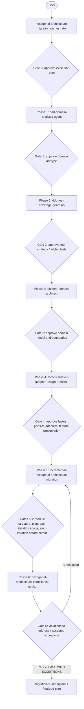

# Agents and Skills Execution Plan — Hexagonal Architecture Migration

- **Run date:** 2026-11-12
- **Module:** `realistic-mess-based-on-jpa-entities-challenge` (Spring Boot 3.5.7 / Java 21, JPA entities, hand-written `EntityManager` repositories)
- **Migration directory:** `docs/migration-2026-11-12/`
- **Git branch:** `demo-hexagonal-architecture-migration`
- **Overall status:** IN PROGRESS
- **Current phase:** 4 — Technical Layers Design (`TECHNICAL_LAYERS_DESIGN_COMPLETE` → plan updated; awaiting phase-exit approval)
- **Last update:** 2026-11-12 04:15

## Phase history

- Phase 0 — 2026-11-12 01:04 — `EXECUTION_PLAN_PENDING` (plan written, approval requested)
- Phase 0 — 2026-11-12 01:06 — `EXECUTION_PLAN_APPROVED` (user approved plan as written)
- Phase 1 — 2026-11-12 01:06 — `IN PROGRESS` (ddd-domain-analysis-agent invoked)
- Phase 1 — 2026-11-12 01:11 — `IN PROGRESS` (agent Gate 1/2 business rule catalog returned; awaiting user answers)
- Phase 1 — 2026-11-12 01:35 — `IN PROGRESS` (Gate 1/2 answered and applied; agent Gate 2/2 bounded contexts returned; awaiting user answers)
- Phase 1 — 2026-11-12 01:48 — `DOMAIN_ANALYSIS_PLAN_UPDATED` (deliverable written; awaiting user phase-exit approval)
- Phase 1 — 2026-11-12 01:52 — `DONE` (user approved phase exit)
- Phase 2 — 2026-11-12 01:52 — `IN PROGRESS` (test baseline verified clean; ddd-test-coverage-guardian invoked)
- Phase 2 — 2026-11-12 02:05 — `IN PROGRESS` (tests written and executed; agent VALIDATION GATE returned; awaiting user answers)
- Phase 2 — 2026-11-12 02:16 — `TEST_COVERAGE_PLAN_UPDATED` (gate answers applied, 400 fix done, full suite green; awaiting phase-exit approval)
- Phase 2 — 2026-11-12 02:25 — `DONE` (user approved phase exit; changes kept uncommitted)
- Phase 3 — 2026-11-12 02:25 — `IN PROGRESS` (isolated-domain-architect invoked)
- Phase 3 — 2026-11-12 02:40 — `IN PROGRESS` (agent Gate 1/2 domain model returned; awaiting user answers)
- Phase 3 — 2026-11-12 02:55 — `IN PROGRESS` (Gate 1/2 answered, domain model APPROVED; agent resumed for port design)
- Phase 3 — 2026-11-12 03:05 — `IN PROGRESS` (agent Gate 2/2 port catalog returned; awaiting user answers)
- Phase 3 — 2026-11-12 03:15 — `IN PROGRESS` (Gate 2/2 answered, port design APPROVED; agent writing isolated-domain-design.md)
- Phase 3 — 2026-11-12 03:30 — `ISOLATED_DOMAIN_DESIGN_PLAN_UPDATED` (deliverable written; awaiting phase-exit approval)
- Phase 3 — 2026-11-12 03:35 — `DONE` (user approved domain model; no boundary adjustments)
- Phase 4 — 2026-11-12 03:35 — `IN PROGRESS` (technical-layer-adapter-design-architect invoked)
- Phase 4 — 2026-11-12 03:50 — `IN PROGRESS` (agent VALIDATION GATE returned with full design; awaiting user answers)
- Phase 4 — 2026-11-12 04:00 — `IN PROGRESS` (gate answered, design APPROVED; agent writing technical-layer-design.md)
- Phase 4 — 2026-11-12 04:15 — `TECHNICAL_LAYERS_DESIGN_PLAN_UPDATED` (deliverable written; awaiting phase-exit approval)

## Overview diagram

Skills used inside each step are recorded only once reported by the subagent (`▶ Skill invoked` announcements); none are pre-assumed here.

## Step table

| Step | Phase | Agent / skill | Invoked by | Purpose | Input artifacts | Output artifacts | Approval gate | Status |
|---|---|---|---|---|---|---|---|---|
| 0 | 0 | hexagonal-architecture-migration-orchestrator | user | Create migration dir, write this plan | AGENTS.md (root + module) | `agents-skills-execution-plan.md` | yes — user | DONE |
| 1 | 1 | ddd-domain-analysis-agent | orchestrator | Domain model, glossary, bounded contexts, business rules/invariants, dependency map, risks | source code, README, AGENTS.md | `ddd-domain-analysis.md` | yes — user | DONE |
| 2 | 2 | ddd-test-coverage-guardian | orchestrator | Coverage assessment, rule-to-test matrix, characterization/regression tests, acceptance criteria | Phase 1 artifacts, committed existing tests | `ddd-test-coverage.md` + test changes + `GlobalExceptionHandler` fix | yes — user | DONE |
| 3 | 3 | isolated-domain-architect | orchestrator | Isolated domain model, packages, dependency rules, ports, extraction strategy | Phase 1–2 artifacts | `isolated-domain-design.md` | yes — user | DONE |
| 4 | 4 | technical-layer-adapter-design-architect | orchestrator | Hexagon diagram, port/adapter inventory, use cases, layer matrix, package structure | Phase 1–3 artifacts | `technical-layer-design.md` | yes — user | IN PROGRESS (deliverable done, exit gate pending) |
| 5.1..5.n | 5 | incremental-hexagonal-architecture-migration | orchestrator | Iterative TDD migration, ArchUnit checks, tests after each increment | Phase 1–4 artifacts | code changes, migration log/backlog | yes — user at each sub-gate | PLANNED |
| 6.1..6.n | 6 | hexagonal-architecture-compliance-auditor | orchestrator | Independent compliance audit, full build | all previous artifacts, code | compliance audit report | yes — user | PLANNED |
| 7 | final | hexagonal-architecture-migration-orchestrator | orchestrator | Consolidated summary, finalize plan | all artifacts | `migration-summary.md`, finalized plan | no | PLANNED |

## Step details

### Step 0 — Execution plan
1. Read root and module `AGENTS.md`.
2. Checked for prior run artifacts: none found (no `docs/migration-*`, no domain analysis, no prior plan).
3. Observed working tree: `PaymentUtilsTest.java` modified and 19 untracked test classes (comments reference rule IDs such as `BR-SHR-04`), apparently from an earlier Phase 2 attempt whose documentation is missing. Their treatment is a user decision (see open points).
4. Created `docs/migration-2026-11-12/` and wrote this plan.
5. User validation (Gate 0, relayed by coordinator, 2026-11-12 01:06):
   - Q1 execution plan: **APPROVED as written**.
   - Q2 earlier attempt's test changes: **DELETE** — revert `util/PaymentUtilsTest.java` to HEAD and delete the 19 untracked test classes; leave `prompts/` untouched.
   - Q3 Phase 1 sources: **code + README.md + AGENTS.md files only**; no extra business documents or domain experts.
6. Attempted the deletion (`git checkout -- .../PaymentUtilsTest.java` + `rm` of untracked test files): **DENIED by the Claude Code permission classifier (irreversible local destruction)**. Not worked around. Files remain in place; the Phase 1 brief instructs the analyst to ignore them.
- Commands run: `mkdir -p docs/migration-2026-11-12` (exit 0); deletion command (denied, not executed). No tests run yet.

### Step 1 — DDD Domain Analysis
1. Briefed `ddd-domain-analysis-agent` (sources: code, README.md, AGENTS.md files; ignore the orphaned untracked tests and modified PaymentUtilsTest).
2. Agent completed inventory, rule extraction, context discovery (read-only). Draft: `ddd-domain-analysis.draft.md` (75 PROPOSED rules BR-SHR/API/ING/INS/SUS/INB/OUT/RCL/DAT, dependency map, risks R-01..R-09).
3. Agent VALIDATION GATE 1/2 (rule catalog): Q1 accept catalog, Q2 treatment of inferred (INF) rules, Q3 glossary business codes, Q4 missing rules — relayed to user, pending. Gate 2/2 (bounded contexts) follows.
4. User answers Gate 1/2: Q1 (a) accept all 75 rules; Q2 (a) preserve INF rules, Phase 2 pins each with a characterization test; Q3 (a) business codes listed as observed values, meaning = open question; Q4 (a) nothing to add. Relayed verbatim; applied in draft (E-T/E-C rules VALIDATED; INF rules VALIDATED, PENDING CHARACTERIZATION TEST).
5. Agent VALIDATION GATE 2/2 (bounded contexts): Q1 context split, Q2 naming 'Compliance Hold', Q3 Shared Kernel contents, Q4 Recalls relationship, Q5 classification, Q6 placement of ingestion/REST error rules — relayed to user.
6. User answers Gate 2/2 (relayed verbatim): Q1 (a) five contexts + Shared Kernel; Q2 (b) context named "Suspended Payments"; Q3 (a) Shared Kernel as proposed (PaymentId, Money, API date/time formats, limit policy, IBAN length validation, code-filter normalization); Q4 (a) Recalls Separate Ways; Q5 (b) all payment contexts Supporting; Q6 (a) ingestion and REST error contract in each context's adapters.
7. Agent finalized `ddd-domain-analysis.md` (18 sections, 830 lines; 75 rules: 64 V, 11 V-PT needing Phase 2 characterization tests; conflicts C-01..C-06; risks R-01..R-10; open questions OQ-01, OQ-03, OQ-04), ran quality review, deleted the draft. Orchestrator verified the file exists.
- Agent commands: read-only git/cat/find/grep (exit 0); python edit script (exit 0); `rm` draft (exit 0); `npx @mermaid-js/mermaid-cli` render **denied** by permission classifier — Mermaid diagrams reviewed manually only. No Maven run.
- Phase-exit approval: **APPROVED** by user (2026-11-12 01:52).

### Step 2 — DDD Test Coverage Guardian
1. User answers before Phase 2: earlier-attempt tests to be deleted by the user (done — verified 01:52 with `git status --short .`: only `.claude/skills/dependency-inversion-principle/`, `docs/migration-2026-11-12/`, `prompts/` untracked; `src/test` matches HEAD); `.claude/skills/dependency-inversion-principle/` is intentional and usable by later phases; Docker available; no specific constraints or priority workflows — cover all rules incl. the 11 V-PT rules.
2. Briefed `ddd-test-coverage-guardian`.
3. Agent wrote characterization/regression tests for all 75 rules (+ C-01..C-06), produced `ddd-test-coverage.md` (assessment, rule-to-test matrix, findings, gaps, execution strategy, acceptance criteria MAC-01..MAC-08). No production code changed.
4. Findings: 6 V-PT rules differ from the analysis (BR-SHR-03, BR-API-05 non-outbound, BR-API-07, BR-INB-04, BR-OUT-04, BR-RCL-03): `@Repository` exception translation turns IllegalArgumentException into 500 generic body instead of 400; tests pin actual behavior. 5 V-PT confirmed as written (BR-API-08, BR-ING-06, BR-ING-07, BR-SUS-04, BR-OUT-07). New observations N-01 (non-GET -> 500), N-02 (answers OQ-04: outbound details date formats), N-03 (instant IBAN with inner spaces never matches); OQ-03 answered (limit=0 -> []). New risk R-11 (moving parsing out of @Repository would silently turn 500 into 400).
5. Agent VALIDATION GATE: Q1 treatment of the 6 divergent rules + N-01, Q2 test organization, Q3 commit approval — relayed to user.
6. User answers (relayed verbatim): Q1 (b) FIX TO 400 for BR-SHR-03, BR-API-05 (instant/suspended/inbound/recall), BR-API-07, BR-INB-04, BR-OUT-04, BR-RCL-03 — production change explicitly approved; outbound invalid-UUID stays 404; N-01 (non-GET -> 500) out of scope, kept and pinned; minimal fix, no other cleanup. Q2 (a) keep tests in existing classes with per-context sections. Q3 (c) do not commit yet.
7. Agent applied the fix test-first: RED (`GlobalExceptionHandlerTest` compile failure exit 1; `PaymentApplicationIntegrationTest` exit 1, 13 failures on expected 400) then GREEN. Production change limited to `controller/GlobalExceptionHandler.java` (+22/-1): new `@ExceptionHandler(InvalidDataAccessApiUsageException)` mapping an `IllegalArgumentException` cause to 400, null message -> `{"error":"Bad request"}`. Updated `ddd-test-coverage.md` and targeted sections of `ddd-domain-analysis.md` (§5, §6, §16, §17, §18, header): all 75 rules now V, 0 V-PT; OQ-03/OQ-04 answered; R-09 resolved; R-11 reworded.
- Final agent `mvn test`: exit 0, **307 tests** (fast 163, Docker 144), 0 failures/errors/skipped.
- Orchestrator verification: `git diff -- src/main` shows only `GlobalExceptionHandler.java`; independent fast-tier run `mvn test -Dtest='PaymentServiceUnitTest,KafkaListenerUnitTest,PaymentControllerWebTest,PaymentUtilsTest,GlobalExceptionHandlerTest'` exit 0, 163 tests, 0 failures. Docker tier not re-run by orchestrator.
- Phase-exit approval: **APPROVED** by user (2026-11-12 02:25); coordinator independently verified only `GlobalExceptionHandler.java` changed in src/main.

### Step 3 — Isolated Domain Design
1. Briefed `isolated-domain-architect` with Phase 1–2 artifacts, bounded-context decisions, R-11, and availability of `.claude/skills/dependency-inversion-principle/`.
2. Agent analysed current code (38 main classes) and proposed the isolated domain model: packages `domain.{sharedkernel,instant,suspended,inbound,outbound,recall}`, dependency rules DR-1..DR-5, Shared Kernel value objects (PaymentId, Money, SearchLimit, CodeFilter, Iban, TimestampBound, IsoDateBound, ApiDateTimeFormat), per-context aggregates and search criteria, two separate outbound fee policies (SearchFeePolicy / DetailsFeePolicy, C-01), mapping boundary (Jpa<Type>Mapper), extraction order Suspended -> Recalls -> Instant -> Inbound -> Outbound, design risks DR-R1..DR-R10. No file written yet (isolated-domain-design.md after Gate 2/2).
3. Agent VALIDATION GATE 1/2 (domain model): Q1 nullable representation, Q2 domain exception base type, Q3 negative limit location, Q4 BR-INB-08 single ageInDays, Q5 BR-OUT-10 unused getById, Q6 PaymentUtils fate, Q7 parsing fidelity, Q8 approve domain model — relayed to user.
4. User answers Gate 1/2 (relayed verbatim): Q1 (a) immutable final classes + Optional accessors; Q2 (b) domain exceptions extend RuntimeException with explicit REST handlers giving identical status/body (outbound invalid id stays 404); Q3 (a) negative limit rejected in domain SearchLimit with exact message, limit=0 allowed; Q4 (b) keep two separate ageInDays computations (no unification); Q5 (a) drop BR-OUT-10 getById, retire outboundGetById_foundAndMissing; Q6 (a) PaymentUtils kept until last context, then deleted with unused-helper tests; Q7 (a) reproduce legacy parsing grammars exactly, pinned in Phase 5; Q8 (a) domain model APPROVED with answers applied.
5. Agent resumed for port design (Gate 2/2 port catalog pending).
6. Agent applied Gate 1 answers and designed 25 ports (per context: input ports Search<X>s, Get<X>Details, Record<X>; output ports Load<X>s, Save<X>), REST exception-handler catalog for RuntimeException-based domain exceptions, persistence/Kafka adapter responsibilities, transaction constraint DR-R3 (@Transactional stays on listener), architecture diagram; new risk DR-R11 (unmapped domain exception -> silent 500). No file written yet.
7. Agent VALIDATION GATE 2/2 (port catalog): Q1 clock source, Q2 placement of the two ageInDays computations, Q3 domain exception structure, Q4 repository port ownership, Q5 fate of existing IllegalArgumentException / InvalidDataAccessApiUsageException handlers, Q6 approve port design — relayed to user.
8. User answers Gate 2/2 (relayed verbatim): Q1 (a) inject java.time.Clock, no custom port; Q2 free-text "centralize ageInDays" — REVERSES Gate 1 Q4: single centralized ageInDays computation for search and details, structural tests remapped to use-case tests; Q3 (b) independent RuntimeException-based domain exceptions, one explicit REST handler each, outbound invalid id stays 404; Q4 (a) repository ports owned by the domain per context package; Q5 (a) keep existing IllegalArgumentException / InvalidDataAccessApiUsageException handlers; Q6 (a) port design APPROVED.
9. Agent resumed to write `isolated-domain-design.md`.
10. Agent wrote `isolated-domain-design.md` (941 lines, 22 sections, 9 Mermaid blocks): domain model, DR-1..DR-5, rule ownership for 75 rules, mapping boundary, 25 ports, error contract, transaction constraint, extraction order Suspended -> Recalls -> Instant -> Inbound -> Outbound -> PaymentUtils deletion, test remapping, validation history (incl. Gate 1 Q4 reversal, D-07). Quality review done. Orchestrator verified file exists and `git status` shows no source changes from Phase 3.
- Commands (agent): read-only, exit 0; no Maven; Mermaid not rendered.
- Phase-exit approval: **APPROVED** by user (2026-11-12 03:35); no domain boundary adjustments.

### Step 4 — Technical Layers Design
1. Briefed `technical-layer-adapter-design-architect` with Phase 1–3 artifacts and approved decisions.
2. Agent produced the full design (not yet written): layer responsibility matrix, 25 port-to-adapter mappings, 15 plain-Java use-case services wired in bootstrap, `RestDomainExceptionHandler` at HIGHEST_PRECEDENCE, dependency rules TL-DR-1..8, ArchUnit rules AR-01..AR-12, feature-preservation matrix, risks TL-R1..TL-R5. Recommended physical structure: Maven multi-module (domain, application, adapter-rest, adapter-kafka, adapter-persistence-jpa, bootstrap).
3. Agent VALIDATION GATE: Q1 physical structure, Q2 legacy code location, Q3 schema/data.sql location, Q4 outbound Kafka adapter name, Q5 outbound details date rendering, Q6 feature inventory completeness, Q7 overall approval — relayed to user.
4. User answers (relayed verbatim): Q1 (a) Maven multi-module (domain, application, adapter-rest, adapter-kafka, adapter-persistence-jpa, bootstrap; jpa-payments- artifactIds), README/AGENTS.md run-command updates acceptable in Phase 5 with confirmation; Q2 (a) iteration 0 moves legacy into bootstrap, entities into adapter-persistence-jpa; Q3 (a) schema.sql/data.sql in adapter-persistence-jpa resources; Q4 (a) rename to KafkaOutboundPaymentListener (user approves retiring misnaming smell); Q5 (b) explicit DateTimeFormatter in UTC, no java.sql in REST adapter, byte-identical output pinned by tests; Q6 (a) inventory complete; Q7 (a) APPROVED.
5. Agent resumed to write `technical-layer-design.md`.
6. Agent wrote `technical-layer-design.md` (601 lines, 15 sections, 5 Mermaid diagrams): module structure, layer matrix, 25 port/adapter mappings, 15 services, error handling, persistence mapping, §8.3 outbound details UTC formatter design with Jackson parity tests (Q5 b), TL-DR-1..10, ArchUnit AR-01..AR-18, feature-preservation matrix, decisions TD-01..TD-14, risks TL-R1..TL-R7, validation history. Orchestrator verified the file exists and no source changes from Phase 4.
- Commands (agent): read-only, exit 0; one file written; no Maven; Mermaid not rendered.
- Phase-exit approval: pending user.
- Skills used: `dependency-inversion-principle` (archunit-test SKILL.md read for reference only).
- Commands (agent): read-only, exit 0; no Maven; Mermaid not rendered.
- Skills used: `dependency-inversion-principle`.
- Skills used: none yet (dependency-inversion-principle SKILL.md read for reference, to be loaded at port design).
- Commands (agent): read-only ls/wc/find/cat/grep, exit 0. No Maven, no writes.
- Skills used: `unit-test`.
- Commands (agent): `docker info`/`mvn -v` OK; baseline `mvn test` exit 0 (83 tests); throwaway probe test run (exit 0, deleted); fast tier + GlobalExceptionHandlerTest exit 0 (160 tests); Docker tier exit 0 (144 tests); full `mvn test` exit 0, **304 tests, 0 failures/errors/skipped**.
- Orchestrator verified: `ddd-test-coverage.md` exists; `git diff --stat` 6 test files modified (+2054/-1) plus new `controller/GlobalExceptionHandlerTest.java`.
- Deviation: agent placed new tests in existing test classes without prior approval (now asked as Q2).
- Skills used: none reported.
- Commands (agent): read-only git/find/cat/grep, exit 0 (one `git show` path error exit 1, re-run OK). No Maven run.

### Steps 2–7
Not started.

## Artifacts index

- [agents-skills-execution-plan.md](agents-skills-execution-plan.md)
- [ddd-domain-analysis.md](ddd-domain-analysis.md) — Phase 1
- [ddd-test-coverage.md](ddd-test-coverage.md) — Phase 2
- [isolated-domain-design.md](isolated-domain-design.md) — Phase 3
- [technical-layer-design.md](technical-layer-design.md) — Phase 4

## Deviations and open points

- Orphaned untracked tests from a previous attempt: user decided DELETE. Deletion denied to the orchestrator by the permission classifier; the user performed it. Resolved and verified 01:52.
- The orchestrator is running as a subagent (not the main session) without direct user access; every gate is relayed back to the invoking session, and phase subagents may be unavailable from this context.
- Phase 1: Mermaid diagrams in `ddd-domain-analysis.md` not validated with a renderer (mermaid-cli download denied).
- 2026-11-12 01:48 working-tree check: `PaymentUtilsTest.java` modification is gone (matches HEAD), but the 19 earlier-attempt test classes are now **staged (`A`) instead of deleted**, and a new untracked `.claude/skills/dependency-inversion-principle/` appeared. Neither change was made by the orchestrator or Phase 1 agent. Resolved 01:52: user deleted the 19 files themselves; skills directory confirmed intentional.
- Phase 2: G-01 (rule text vs code) resolved by user decision to fix to 400; ddd-domain-analysis.md updated by the Phase 2 agent per orchestrator instruction (targeted sections only). Deviation: user-approved production change in Phase 2 (`GlobalExceptionHandler`). Side effect: any repository IllegalArgumentException now maps to 400 (R-11). Module AGENTS.md fast-tier command does not list `GlobalExceptionHandlerTest`. All changes uncommitted per user.
- Phase 3: user reversed Gate 1 Q4 at Gate 2 (ageInDays now centralized in one computation).
