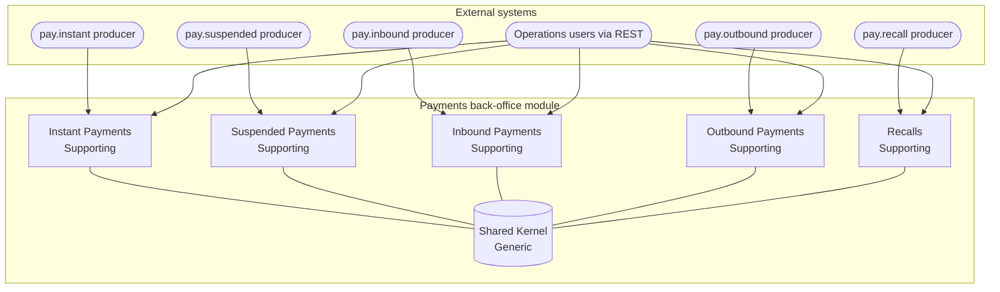
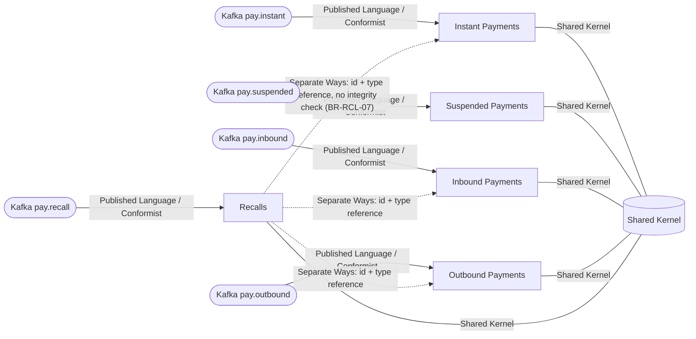
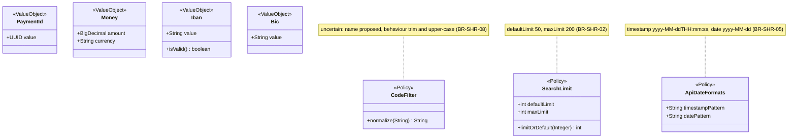
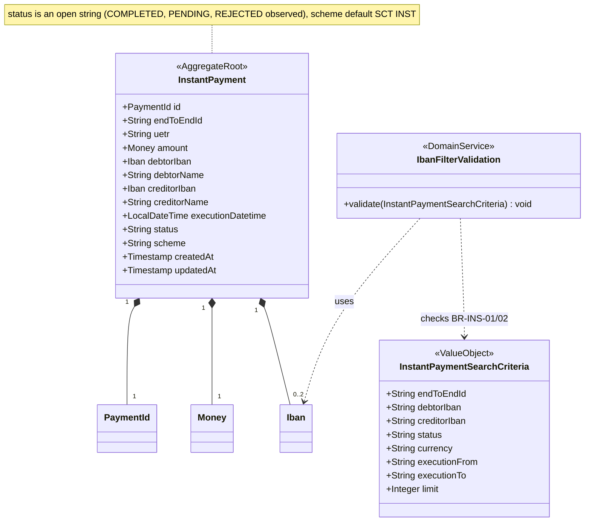
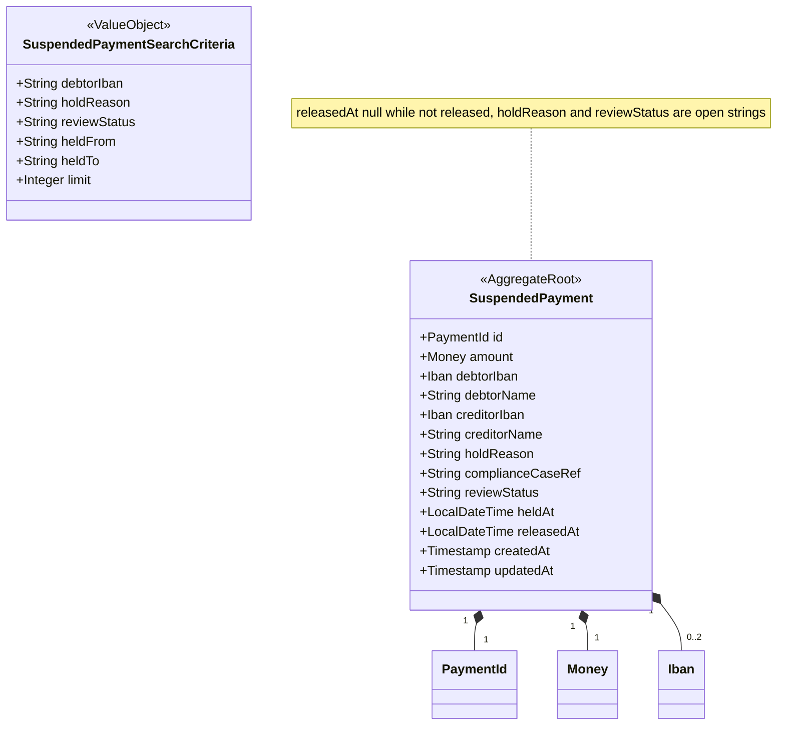
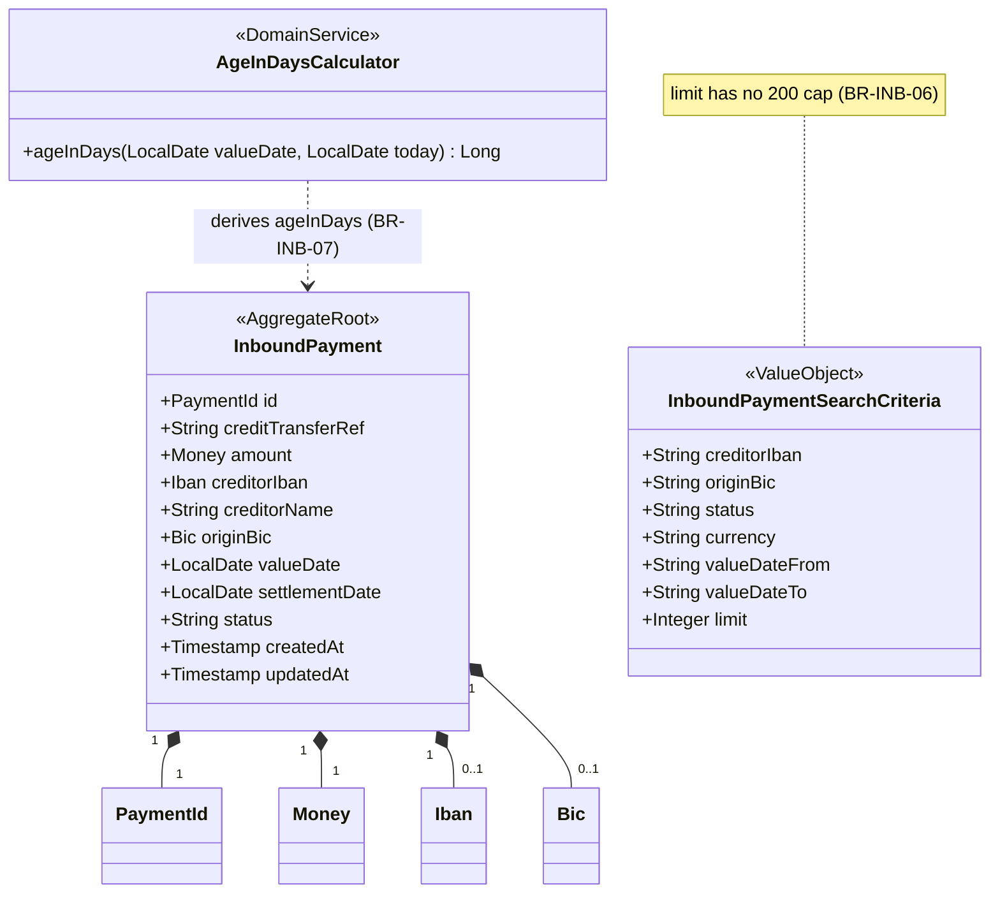
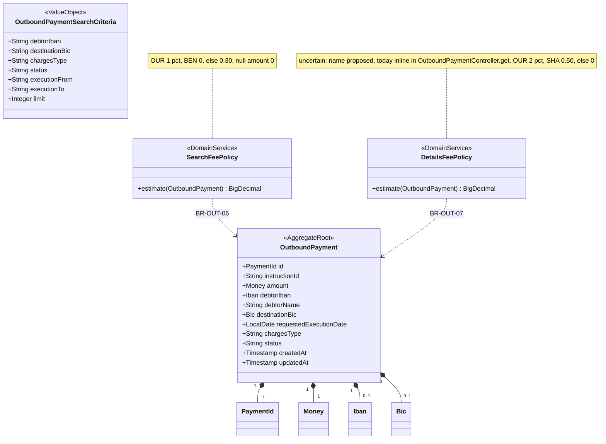
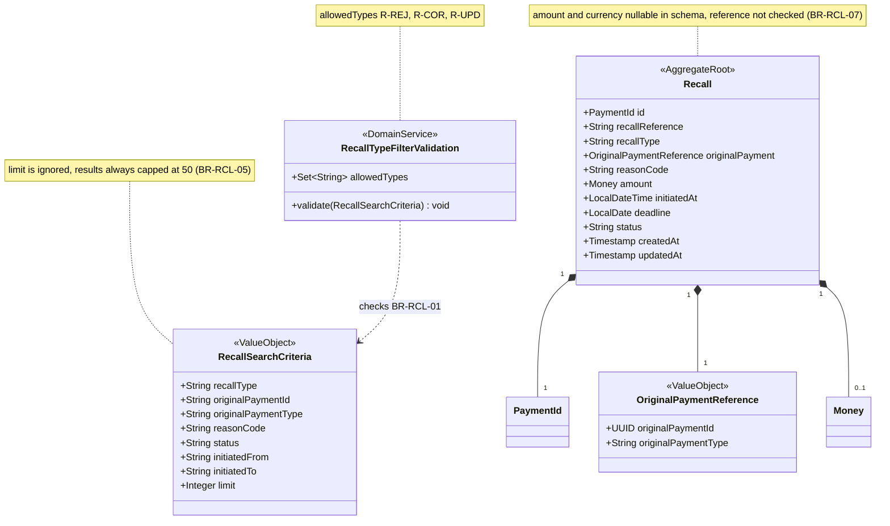
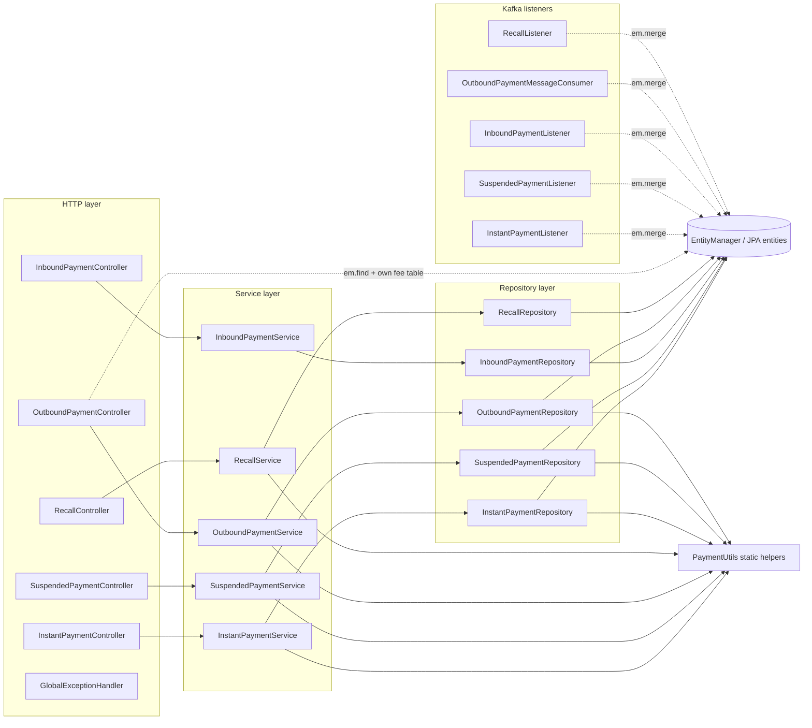

# DDD Domain Analysis — realistic-mess-based-on-jpa-entities-challenge

- **Status:** FINAL. Gate 1 (business rules) and Gate 2 (bounded contexts) validated on 2026-11-12 (user answers relayed verbatim by `hexagonal-architecture-migration-orchestrator`). Rule entries updated after the Phase 2 gate (decision P2-Q1, see §16).
- **Produced by:** `ddd-domain-analysis-agent`, Phase 1 of the hexagonal-architecture migration.
- **Module:** `realistic-mess-based-on-jpa-entities-challenge` (Spring Boot 3.5.7, Java 21, JPA entities, hand-written `EntityManager` repositories with string-built JPQL).
- **Baseline:** branch `demo-hexagonal-architecture-migration`, committed code at HEAD (last `src/main` change: `7dc2096`).
- **Downstream consumer:** `ddd-test-coverage-guardian` (Phase 2) uses the rule IDs below.

---

## 1. Executive Summary

The module is a **read-only payment operations back-office**. Five independent record types (instant payments, suspended payments, inbound payments, outbound payments, recalls) are ingested from five Kafka topics with a full-replace upsert keyed by a producer-supplied UUID, stored in five Postgres tables, and exposed through one search endpoint and one details endpoint per type. Kafka is the only write path; HTTP is GET-only.

Business logic is thin and scattered across controllers, services, repositories and listeners. The only computed business values are the **outbound estimated fee** (two intentionally divergent fee tables) and the **inbound age in days**. Most rules are search-filter semantics, limits, formats and error mapping, many of which differ between types on purpose.

Results:
- **75 business rules** with stable IDs, all **validated** by the user as the behaviour baseline (intentional quirks included). 11 of them (wholly or partly inferred) are **validated pending a characterization test** to be written in Phase 2.
- **5 bounded contexts + 1 Shared Kernel**, all payment contexts classified **Supporting**, Shared Kernel **Generic**.
- Each aggregate is a **single entity** with no child entities; no invariant spans aggregates. Recalls reference original payments by id + type only (**Separate Ways**).
- Kafka ingestion and the REST error contract are **adapter concerns** owned by each context, not domain contexts.

## 2. Project Overview and Business Model

| Payment type | Table | Search API | Details API | Kafka topic |
|---|---|---|---|---|
| Instant payment | `instant_payments` | `GET /api/v1/instant-payments/search` | `GET /api/v1/instant-payments/{id}` | `pay.instant` |
| Suspended payment | `suspended_payments` | `GET /api/v1/suspended-payments/search` | `GET /api/v1/suspended-payments/{id}` | `pay.suspended` |
| Inbound payment | `inbound_payments` | `GET /api/v1/inbound-payments/search` | `GET /api/v1/inbound-payments/{id}` | `pay.inbound` |
| Outbound payment | `outbound_payments` | `GET /api/v1/outbound-payments/search` | `GET /api/v1/outbound-payments/{id}` | `pay.outbound` |
| Recall | `recalls` | `GET /api/v1/recalls/search` | `GET /api/v1/recalls/{id}` | `pay.recall` |

Business model (inferred from code and README, no business documents available): operations staff query the state of payments that are processed elsewhere. External systems publish payment state changes as flat JSON events; this application maintains a queryable read store and adds two derived values (outbound fee estimate, inbound age). It does not initiate, approve, release or recall payments itself.

Current flow: HTTP controller → service → `EntityManager` repository → JPA entity. Kafka listeners bypass that flow and call `em.merge` directly. `OutboundPaymentController.get` bypasses the service and queries the `EntityManager` itself.

## 3. Artifact Inventory and Analysis Limitations

| Artifact | Path (module-relative) | Used |
|---|---|---|
| Controllers: `InstantPaymentController`, `SuspendedPaymentController`, `InboundPaymentController`, `OutboundPaymentController`, `RecallController`, `GlobalExceptionHandler` | `src/main/java/fr/kevin/llps/payments/controller/` | yes |
| Services: `InstantPaymentService`, `SuspendedPaymentService`, `InboundPaymentService`, `OutboundPaymentService`, `RecallService` | `.../service/` | yes |
| Repositories (5) | `.../repository/` | yes |
| Entities (5, public mutable fields, `java.sql` types) | `.../entity/` | yes |
| DTOs (5 `*SearchRequest`, 5 `*Response`) | `.../dto/` | yes |
| Kafka listeners: `InstantPaymentListener`, `SuspendedPaymentListener`, `InboundPaymentListener`, `OutboundPaymentMessageConsumer`, `RecallListener` | `.../kafka/` | yes |
| `PaymentUtils` | `.../util/` | yes |
| `application.yml`, `schema.sql`, `data.sql` | `src/main/resources/` | yes |
| `docker-compose.yml`, `pom.xml` | module root | yes (environment only) |
| Committed tests: `PaymentControllerWebTest`, `PaymentServiceUnitTest`, `KafkaListenerUnitTest`, `PaymentUtilsTest` (HEAD version), `PaymentRepositoryUnitTest` (Docker), `PaymentApplicationIntegrationTest` (Docker) | `src/test/java/fr/kevin/llps/payments/` | yes |
| `../README.md`, `../AGENTS.md`, `./AGENTS.md` | repo / module | yes |
| Business requirements, domain experts | — | **not available** (user confirmed) |
| API contract (OpenAPI), event schemas | — | **not available**; inferred from code |

**Excluded on user instruction:** the 19 untracked test classes (orphaned from an aborted earlier attempt, deletion pending), the working-tree modification of `PaymentUtilsTest.java`, and `prompts/`.

**Limitations:**
- The business meaning of status, type, reason and hold codes is not documented anywhere in the sources (open question OQ-01).
- Rules marked INF are derived from JDK / Spring / Hibernate / Jackson semantics and were not executed in this phase; no tests were run.
- The JSON rendering of `java.sql.Date`/`Timestamp` values in the outbound details map was not verified by execution.
- Kafka producers and their contracts are external and unknown.

## 4. Domain Overview and Domain Classifications

| Subdomain / context | Classification | Justification |
|---|---|---|
| Instant Payments | Supporting | Read-only monitoring; no differentiating logic (user decision G2-Q5). |
| Suspended Payments | Supporting | Read-only view of holds decided elsewhere. |
| Inbound Payments | Supporting | Read-only view plus derived age in days. |
| Outbound Payments | Supporting | Read-only view plus fee estimation; user decided this is not a core differentiator. |
| Recalls | Supporting | Read-only view of recalls, with recall-type validation on search. |
| Shared Kernel | Generic | Common value objects and policies (ids, money, IBAN length, limits, formats). |

There is no Core domain in this module (user decision: read-only back-office, no core differentiator).

## 5. Business Rule Catalog

Confidence: **E-T** explicit in code and asserted by a committed test; **E-C** explicit in code, not asserted by a committed test; **INF** inferred from framework/JDK semantics.
Status: **V** = validated (Gate 1); **V-PT** = validated, pending characterization test (Phase 2 pins it; confirmed once the test passes). "(part)" means only the inferred part is pending.

All rules describe **existing behaviour to preserve unchanged**, quirks included.

### 5.1 Shared Kernel (BR-SHR) — owner: Shared Kernel

| ID | Rule | Evidence | Conf. | Status |
|---|---|---|---|---|
| BR-SHR-01 | Every record is identified by a UUID `id` supplied by the producer (no generation); the id is the upsert key. | entities `@Id` without generator; listeners `UUID.fromString(node.path("id").asText())`; IT `kafkaIngestion_upsertsBySameId` | E-T | V |
| BR-SHR-02 | Search limit policy: absent → 50; > 200 → 200; any other value used as given. Applies to instant, suspended, outbound. | `PaymentUtils.limitOrDefault` L56-64; `PaymentUtilsTest.limitOrDefault_*` | E-T | V |
| BR-SHR-03 | A negative `limit` reaches `TypedQuery.setMaxResults`; Hibernate's `IllegalArgumentException` is translated by Spring (`@Repository`) into `InvalidDataAccessApiUsageException` and mapped to HTTP 400 `{"error":"max-results cannot be negative"}` (instant, suspended, inbound, outbound; recalls ignore `limit`, BR-RCL-05). `limit=0` returns HTTP 200 `[]` (answers OQ-03). | `limitOrDefault` passes negatives through; `GlobalExceptionHandler.handleInvalidDataAccessApiUsage`; IT `should_return_400_when_limit_is_negative`, `should_return_empty_list_when_limit_is_zero` | E-T | V (decision P2-Q1 (2026-11-12): fixed from the observed 500) |
| BR-SHR-04 | IBAN validity = non-null and length 15..34 after removing spaces; no checksum or country check. | `PaymentUtils.isValidIban` L32-38; `PaymentUtilsTest.isValidIban_*` | E-T | V |
| BR-SHR-05 | API timestamps are rendered `yyyy-MM-dd'T'HH:mm:ss` (JVM default time zone, no offset); dates `yyyy-MM-dd`; null stays null. | `PaymentUtils.FMT`/`DAY_FMT` L16-17; mappers; `PaymentServiceUnitTest`, `PaymentRepositoryUnitTest` | E-T | V |
| BR-SHR-06 | `PaymentUtils.parseTimestamp` accepts only `yyyy-MM-dd'T'HH:mm:ss` (after trim) and silently returns null for blank or unparsable input. | `PaymentUtils` L40-50; `PaymentUtilsTest.parseTimestamp_*` | E-T | V |
| BR-SHR-07 | Utility contract kept: `formatAmount` (null → `"0.00"`, HALF_UP to 2 decimals), `now()` (FMT), `likePattern` (trim + upper-case wrapped in `%`, blank → null), `randomId()`. `formatAmount`, `now`, `randomId` are unused by production code but tested. | `PaymentUtils`; `PaymentUtilsTest` | E-T | V |
| BR-SHR-08 | Code-like equality filters (status, currency, charges type, hold reason, review status, recall type, original payment type, reason code) are trimmed and upper-cased, then matched exactly: input is case-insensitive, stored values must be upper-case to match. | all repositories; `PaymentRepositoryUnitTest` (lower-case inputs) | E-T | V |
| BR-SHR-09 | Amount has 2 fractional digits (`NUMERIC(18,2)`); amount and currency are NOT NULL for all types except recalls; currency is at most 3 characters. | `schema.sql` | E-C | V |
| BR-SHR-10 | Status and type vocabularies are open strings: nothing validates them on ingestion. Only recall type is validated, and only as a search filter (BR-RCL-01). | entities (`String`), listeners, `RecallService` | E-C | V |

### 5.2 REST API and error contract (BR-API) — owner: each context's REST adapter

| ID | Rule | Evidence | Conf. | Status |
|---|---|---|---|---|
| BR-API-01 | All REST endpoints are read-only GET: one search and one details endpoint per type. | controllers | E-T | V |
| BR-API-02 | `IllegalArgumentException` → HTTP 400 with body `{"error": <exception message>}`. | `GlobalExceptionHandler` L17-20; `PaymentControllerWebTest.recallsSearch_invalidType_returns400` | E-T | V |
| BR-API-03 | Any other exception → HTTP 500 with body `{"error":"Something went wrong, contact support with the trace id"}`, logged at ERROR. | `GlobalExceptionHandler` L22-27; web tests `instantSearch_serviceFailure_returns500`, `outboundDetails_dbFailure_returns500` | E-T | V |
| BR-API-04 | Details of an unknown, well-formed id → HTTP 404 with empty body, for all five types. | controllers; web tests `*Details_foundAndMissing`, `outboundDetails_missing_returns404`; IT `details_unknownId_returns404` | E-T | V |
| BR-API-05 | Details with a malformed UUID: instant, suspended, inbound, recall → HTTP 400 `{"error":"Invalid UUID string: <id>"}` (repository `UUID.fromString`, translated by Spring and mapped by `GlobalExceptionHandler.handleInvalidDataAccessApiUsage`); **outbound → HTTP 404** with empty body (controller catches `IllegalArgumentException`). | repositories `findById`; `OutboundPaymentController` L90-92; IT `should_return_400_with_invalid_uuid_message_when_details_id_is_not_a_uuid`, `should_return_404_with_empty_body_when_outbound_details_id_is_not_a_uuid` | E-T | V (decision P2-Q1 (2026-11-12): 4 types fixed from the observed 500) |
| BR-API-06 | The path id is trimmed before UUID parsing for instant, suspended, inbound, recall; outbound details does not trim. | repositories `id.trim()`; `OutboundPaymentController` L63 | E-C | V |
| BR-API-07 | An `IllegalArgumentException` without a message (e.g. `java.sql.Date.valueOf` on a malformed date), thrown directly or translated from a repository into `InvalidDataAccessApiUsageException`, → HTTP 400 with body `{"error":"Bad request"}`. An `InvalidDataAccessApiUsageException` not caused by an `IllegalArgumentException` stays HTTP 500 (BR-API-03). | `GlobalExceptionHandler.badRequest` / `handleInvalidDataAccessApiUsage`; `GlobalExceptionHandlerTest`; IT `should_return_400_with_default_message_when_a_date_filter_is_not_a_strict_iso_date` | E-T | V (decision P2-Q1 (2026-11-12): replaces the inferred 500; before the fix the direct case threw an NPE in the handler and the repository case returned the generic 500) |
| BR-API-08 | A non-integer `limit` query parameter (type mismatch) falls into the generic handler → HTTP 500. | `GlobalExceptionHandler` (no type-mismatch handler) | E-T | V (confirmed by Phase 2 test) |
| BR-API-09 | Response field names are the camelCase DTO field names, except outbound details (snake_case map plus camelCase `estimatedFee`). Null fields are serialized as `null`. | DTOs; `OutboundPaymentController` L75-88; IT `outboundDetails_returnsPayment` | E-T | V |

### 5.3 Event ingestion (BR-ING) — owner: each context's Kafka adapter

| ID | Rule | Evidence | Conf. | Status |
|---|---|---|---|---|
| BR-ING-01 | Topics `pay.instant`, `pay.suspended`, `pay.inbound`, `pay.outbound`, `pay.recall`; payload is a flat JSON string. | listeners; README; IT | E-T | V |
| BR-ING-02 | Each listener uses its own consumer group (`jpa-instant-group`, `jpa-suspended-group`, `jpa-inbound-group`, `jpa-outbound-group`, `jpa-recall-group`), ignoring `spring.kafka.consumer.group-id: jpa-payments`. | `@KafkaListener(groupId=...)`; `application.yml` | E-C | V |
| BR-ING-03 | Ingestion is a full-replace upsert (`em.merge`) by `id`: a later event with the same id overwrites every column. | listeners; IT `kafkaIngestion_upsertsBySameId` | E-T | V |
| BR-ING-04 | `createdAt` and `updatedAt` are both set to the consumer's current time on every message, so an update overwrites the original `createdAt`. | listeners (e.g. `InstantPaymentListener` L47-48); `KafkaListenerUnitTest` (`createdAt` not null) | E-C | V |
| BR-ING-05 | Malformed JSON, missing or invalid `id`, unparsable dates, and any exception raised before or during `merge` are logged at WARN and the message is skipped (no retry, no dead-letter). | listeners `catch (Exception e)`; `KafkaListenerUnitTest.*_malformedJson_swallowed` | E-T | V |
| BR-ING-06 | Failures raised at transaction commit (e.g. column length or NOT NULL violations flushed after `merge`) are outside the try/catch and propagate to the Kafka container error handler. | `@Transactional` + `em.merge` without explicit flush | E-T | V (confirmed by Phase 2 test) |
| BR-ING-07 | Missing text fields become `""`; explicit JSON `null` text fields become the literal string `"null"`; missing or null `amount` becomes `0`. | `node.path(...).asText()`, `decimalValue()` | E-T | V (confirmed by Phase 2 test) |
| BR-ING-08 | Timestamp parsing: null, blank or `"null"` → null; `T` replaced by a space and `Z` removed (no time-zone conversion); a 10-character date gets ` 00:00:00`. | `timestampOf` in instant, suspended, recall listeners; `KafkaListenerUnitTest` | E-T | V |
| BR-ING-09 | Date parsing: null, blank or `"null"` → null; the first 10 characters are parsed as `yyyy-MM-dd`. | `dateOf` in inbound, outbound, recall listeners; `KafkaListenerUnitTest` | E-T | V |
| BR-ING-10 | Instant: `scheme` defaults to `"SCT INST"` when missing or null. The event field is `executionDateTime`; the API field is `executionDatetime`. | `InstantPaymentListener` L44-46; `KafkaListenerUnitTest.instant_onMessage_persistsRow` | E-T (value) / E-C (default) | V |
| BR-ING-11 | Recall: `originalPaymentId` must be a valid UUID, otherwise the recall event is dropped (swallowed). | `RecallListener` L38 | E-C | V |
| BR-ING-12 | No business validation on ingestion (statuses, IBAN, currency, charges type, recall type, existence of the original payment). | listeners | E-C | V |

### 5.4 Instant Payments (BR-INS) — owner: Instant Payments

| ID | Rule | Evidence | Conf. | Status |
|---|---|---|---|---|
| BR-INS-01 | Search rejects an invalid debtor IBAN filter (BR-SHR-04) with 400 `"Invalid debtor IBAN"`; checked before the creditor IBAN. Blank filters are ignored. | `InstantPaymentService` L20-22; `PaymentServiceUnitTest.instantSearch_invalidDebtorIban_throws` | E-T | V |
| BR-INS-02 | Search rejects an invalid creditor IBAN filter with 400 `"Invalid creditor IBAN"`. | `InstantPaymentService` L23-25; `instantSearch_invalidCreditorIban_throws` | E-T | V |
| BR-INS-03 | `endToEndId` filter: trimmed, exact, case-sensitive. | `InstantPaymentRepository` L30-33; repo test; IT `kafkaIngestion_isVisibleThroughSearchApi` | E-T | V |
| BR-INS-04 | `debtorIban` / `creditorIban` filters: case-insensitive contains (`UPPER(col) LIKE %TRIM(UPPER(x))%`). Through the API only values passing BR-SHR-04 reach it; inner spaces are not removed from the pattern. | repo L34-41; `PaymentRepositoryUnitTest.instantSearch_appliesAllFilters_*` | E-T | V |
| BR-INS-05 | `status` and `currency` filters follow BR-SHR-08. | repo L42-49; IT `instantSearch_appliesStatusFilter` | E-T | V |
| BR-INS-06 | `executionFrom` is an inclusive lower bound; `T` accepted; date-only → `00:00:00`; unparsable → filter silently ignored. | repo L50-56, `parseTimestampValue` L100-110; repo test | E-T (valid) / E-C (ignored) | V |
| BR-INS-07 | `executionTo` is an inclusive upper bound; date-only → end of day `23:59:59`; unparsable → filter silently ignored. | repo L57-63, `parseEndOfDay` L112-122; repo test (`2026-10-31`) | E-T | V |
| BR-INS-08 | Results ordered by `executionDatetime` descending; limit per BR-SHR-02. | repo L64, L70; `instantSearch_ordersByExecutionDatetimeDescending` | E-T | V |
| BR-INS-09 | Details return the same `InstantPaymentResponse` shape as search; unknown id → 404. | controller; repo `findById`; IT `instantDetails_returnsPayment` | E-T | V |

### 5.5 Suspended Payments (BR-SUS) — owner: Suspended Payments

| ID | Rule | Evidence | Conf. | Status |
|---|---|---|---|---|
| BR-SUS-01 | `debtorIban` filter: trimmed, exact, case-sensitive; no IBAN validation (unlike instant). | `SuspendedPaymentRepository` L28-31; repo test | E-T | V |
| BR-SUS-02 | `holdReason` and `reviewStatus` filters follow BR-SHR-08. | repo L32-39; repo test; IT `suspendedSearch_appliesReviewStatusFilter` (PENDING → 2) | E-T | V |
| BR-SUS-03 | `heldFrom` / `heldTo` are inclusive bounds parsed with BR-SHR-06 (`yyyy-MM-dd'T'HH:mm:ss` only). | repo L40-47; `suspendedSearch_appliesParameterizedFilters` | E-T | V |
| BR-SUS-04 | An unparsable or date-only `heldFrom`/`heldTo` still adds the clause with a null parameter, which yields an **empty result** (unlike instant and recall, where the filter is ignored). | repo L40-47 + `parseTimestamp` returning null | E-T | V (confirmed by Phase 2 test) |
| BR-SUS-05 | Ordered by `heldAt` descending; limit per BR-SHR-02. | repo L48, L54 | E-C | V |
| BR-SUS-06 | `releasedAt` is null while the hold is not released; `heldAt` and `releasedAt` are rendered per BR-SHR-05. Search and details produce the same response shape. | seed rows `...0201`/`...0203`; `KafkaListenerUnitTest.suspended_onMessage_nullReleasedAt_staysNull`; `PaymentServiceUnitTest.suspended*` | E-T | V |

### 5.6 Inbound Payments (BR-INB) — owner: Inbound Payments

| ID | Rule | Evidence | Conf. | Status |
|---|---|---|---|---|
| BR-INB-01 | `creditorIban` filter: trimmed, exact, case-sensitive. | `InboundPaymentRepository` L30-33; repo test | E-T | V |
| BR-INB-02 | `originBic` filter: case-insensitive contains. | repo L34-37; repo test (`bnpa`) | E-T | V |
| BR-INB-03 | `status` and `currency` filters follow BR-SHR-08. | repo L38-45; IT `inboundSearch_appliesStatusFilter` | E-T | V |
| BR-INB-04 | `valueDateFrom` / `valueDateTo` are inclusive and strictly `yyyy-MM-dd`; a malformed date raises a message-less `IllegalArgumentException` → HTTP 400 `{"error":"Bad request"}` (BR-API-07). | repo L46-53; repo tests; IT `should_return_400_with_default_message_when_a_date_filter_is_not_a_strict_iso_date` | E-T | V (decision P2-Q1 (2026-11-12): invalid part fixed from the observed 500) |
| BR-INB-05 | Ordered by `valueDate` descending, then `createdAt` descending. | repo L54 | E-C | V |
| BR-INB-06 | Limit: absent → 50; **no 200 cap**, any given value is used as is. | repo L60 | E-C | V |
| BR-INB-07 | `ageInDays` = whole days between `valueDate` and the server's current local date; negative for a future value date; null when `valueDate` is null. The value depends on the current date. | `InboundPaymentController` L45-49; `InboundPaymentService` L26-29; `inboundSearch_computesAgeInDays`; `inboundGetById_computesAgeInDays` | E-T | V |
| BR-INB-08 | `ageInDays` is computed in the controller for search results and in the service for details (same formula, two places). | idem | E-T | V |

### 5.7 Outbound Payments (BR-OUT) — owner: Outbound Payments

| ID | Rule | Evidence | Conf. | Status |
|---|---|---|---|---|
| BR-OUT-01 | `debtorIban` filter: trimmed, exact, case-sensitive. | `OutboundPaymentRepository` L29-32; repo test | E-T | V |
| BR-OUT-02 | `destinationBic` filter: contains, with the input upper-cased but the column **not** upper-cased, so it effectively matches only upper-case stored BICs. | repo L33-37 (comment: 2021 hotfix); `outboundSearch_appliesParameterizedClauses` (`abna`) | E-T | V |
| BR-OUT-03 | `chargesType` and `status` filters follow BR-SHR-08. | repo L38-45; IT `outboundSearch_appliesChargesTypeFilter` | E-T | V |
| BR-OUT-04 | `executionFrom` / `executionTo` filter `requestedExecutionDate`, inclusive, strictly `yyyy-MM-dd`; a malformed date → HTTP 400 `{"error":"Bad request"}` (BR-API-07). | repo L46-53; repo tests; IT `should_return_400_with_default_message_when_a_date_filter_is_not_a_strict_iso_date` | E-T | V (decision P2-Q1 (2026-11-12): invalid part fixed from the observed 500) |
| BR-OUT-05 | Ordered by `requestedExecutionDate` descending; limit per BR-SHR-02. | repo L54, L60 | E-C | V |
| BR-OUT-06 | **Search fee policy** (service): amount null → 0; `OUR` → 1 % of amount, HALF_UP, scale 2; `BEN` → 0; anything else (including `SHA`, null, unknown) → 0.30 (`PaymentUtils.DEFAULT_FEE`). | `OutboundPaymentService.estimateFee` L53-64; `outboundSearch_computesFeePerChargesType` | E-T | V |
| BR-OUT-07 | **Details fee policy** (controller, bypasses the service): `OUR` → 2 % of amount, HALF_UP, scale 2; `SHA` → 0.50; anything else (including `BEN`, null, unknown) → 0. A null amount with `OUR` raises an NPE → 500. | `OutboundPaymentController.get` L67-74; `outboundDetails_computesFeeFromController` (1000 OUR → 20.00) | E-T | V (confirmed by Phase 2 test) |
| BR-OUT-08 | BR-OUT-06 and BR-OUT-07 intentionally diverge and both must be preserved. Seeds: `...0401` SHA 780.00 → search 0.30 / details 0.50; `...0402` OUR 15600.75 → search 156.01 / details 312.02; `...0403` BEN 95.00 → 0 / 0. | README "Known smells"; AGENTS.md; both tests above | E-T | V |
| BR-OUT-09 | The details payload is a snake_case map: `id, instruction_id, amount, currency, debtor_iban, debtor_name, destination_bic, requested_execution_date, charges_type, status, created_at, updated_at, estimatedFee`. It differs from the search payload and exposes audit timestamps. | controller L75-88; IT `outboundDetails_returnsPayment` (`$.instruction_id`) | E-T (`instruction_id`, `estimatedFee`) / E-C (others) | V |
| BR-OUT-10 | `OutboundPaymentService.getById` exists but no endpoint uses it. | grep of controllers | E-C | V |

### 5.8 Recalls (BR-RCL) — owner: Recalls

| ID | Rule | Evidence | Conf. | Status |
|---|---|---|---|---|
| BR-RCL-01 | Allowed recall types for the search filter: `R-REJ`, `R-COR`, `R-UPD` (trimmed, case-insensitive); otherwise 400 `"Unknown recall type: <raw input>"`. | `RecallService` L19, L25-28; `recallSearch_invalidType_throws`; web test; IT `recallsSearch_unknownType_returns400` | E-T | V |
| BR-RCL-02 | `recallType`, `originalPaymentType`, `reasonCode` and `status` filters follow BR-SHR-08. | `RecallRepository` L28-47; `recallSearch_appliesFilters` | E-T | V |
| BR-RCL-03 | The `originalPaymentId` filter must be a UUID; malformed → HTTP 400 `{"error":"Invalid UUID string: <value>"}`. | repo L32-35; repo tests; IT `should_return_400_with_invalid_uuid_message_when_recall_original_payment_id_is_not_a_uuid` | E-T | V (decision P2-Q1 (2026-11-12): invalid part fixed from the observed 500) |
| BR-RCL-04 | `initiatedFrom` / `initiatedTo` are inclusive; date-only → `00:00:00` for **both** bounds (a date-only `initiatedTo` excludes that day); unparsable → filter ignored. | repo L48-61, `parseTimestampValue` L77-87; repo test | E-T (valid) / E-C (rest) | V |
| BR-RCL-05 | Search results are always capped at 50; the `limit` parameter is ignored. | repo L62-69; `recallSearch_alwaysUsesHardcodedLimitOf50` | E-T | V |
| BR-RCL-06 | Ordered by `initiatedAt` descending. | repo L63 | E-C | V |
| BR-RCL-07 | A recall references an original payment by (`originalPaymentId`, `originalPaymentType`); observed types `INSTANT`, `INBOUND`, `OUTBOUND`. The reference is not checked for existence or type consistency. | entity `Recall`; seeds `...0501`-`...0503`; `RecallListener` | E-C | V |
| BR-RCL-08 | `initiatedAt` is rendered per BR-SHR-05 and `deadline` as `yyyy-MM-dd`. | `RecallService.toResponse` L52-53; `recallSearch_mapsFieldsAndFormatsDates` | E-T | V |

### 5.9 Data and environment (BR-DAT) — owner: persistence adapters / test infrastructure

| ID | Rule | Evidence | Conf. | Status |
|---|---|---|---|---|
| BR-DAT-01 | `schema.sql` is the only DDL source (`ddl-auto: none`, `CREATE TABLE IF NOT EXISTS`); five tables, one per type. | `application.yml`; `schema.sql` | E-C | V |
| BR-DAT-02 | `data.sql` deletes all rows of the five tables and re-inserts 3 seed rows per type at every startup; integration tests assert those seeds (3 instant rows, `E2E-INST-0001`, 2 PENDING suspended, 1 RECEIVED inbound, 1 OUR outbound, 1 R-COR recall). | `data.sql`; `PaymentApplicationIntegrationTest` | E-T | V |
| BR-DAT-03 | Ids prefixed `00000000-0000-0000-0000-0000000009` are reserved for Kafka-ingestion tests and cleaned before each integration test. | IT `@BeforeEach`; AGENTS.md | E-T | V |

## 6. Business Rule Traceability Matrix

| Rule | Context / owner | Implementation | Committed test(s) | Status |
|---|---|---|---|---|
| BR-SHR-01 | Shared Kernel | entities, all listeners | IT `kafkaIngestion_upsertsBySameId` | V |
| BR-SHR-02 | Shared Kernel | `PaymentUtils.limitOrDefault` | `PaymentUtilsTest` | V |
| BR-SHR-03 | Shared Kernel | `limitOrDefault` + repositories + `GlobalExceptionHandler` | `PaymentUtilsTest`, `PaymentRepositoryUnitTest`, IT | V |
| BR-SHR-04 | Shared Kernel | `PaymentUtils.isValidIban` | `PaymentUtilsTest` | V |
| BR-SHR-05 | Shared Kernel | `PaymentUtils.FMT`/`DAY_FMT`, mappers | `PaymentServiceUnitTest`, `PaymentRepositoryUnitTest` | V |
| BR-SHR-06 | Shared Kernel | `PaymentUtils.parseTimestamp` | `PaymentUtilsTest` | V |
| BR-SHR-07 | Shared Kernel | `PaymentUtils` | `PaymentUtilsTest` | V |
| BR-SHR-08 | Shared Kernel | all repositories | `PaymentRepositoryUnitTest` | V |
| BR-SHR-09 | Shared Kernel | `schema.sql` | none | V |
| BR-SHR-10 | Shared Kernel | entities, listeners, `RecallService` | none | V |
| BR-API-01 | all contexts (REST adapters) | controllers | `PaymentControllerWebTest` | V |
| BR-API-02 | all (REST adapters) | `GlobalExceptionHandler` | `PaymentControllerWebTest` | V |
| BR-API-03 | all (REST adapters) | `GlobalExceptionHandler` | `PaymentControllerWebTest` | V |
| BR-API-04 | all (REST adapters) | controllers | `PaymentControllerWebTest`, IT | V |
| BR-API-05 | all (REST adapters) | repositories `findById`, `OutboundPaymentController.get`, `GlobalExceptionHandler` | `PaymentControllerWebTest`, IT | V |
| BR-API-06 | all (REST adapters) | repositories `findById`, `OutboundPaymentController.get` | none | V |
| BR-API-07 | all (REST adapters) | `GlobalExceptionHandler` | `GlobalExceptionHandlerTest`, IT | V |
| BR-API-08 | all (REST adapters) | `GlobalExceptionHandler` | `PaymentControllerWebTest` | V |
| BR-API-09 | all (REST adapters) | DTOs, `OutboundPaymentController.get` | IT `outboundDetails_returnsPayment` | V |
| BR-ING-01 | all (Kafka adapters) | listeners | `KafkaListenerUnitTest`, IT | V |
| BR-ING-02 | all (Kafka adapters) | `@KafkaListener` | none | V |
| BR-ING-03 | all (Kafka adapters) | `em.merge` | IT `kafkaIngestion_upsertsBySameId` | V |
| BR-ING-04 | all (Kafka adapters) | listeners | `KafkaListenerUnitTest` (partial) | V |
| BR-ING-05 | all (Kafka adapters) | listeners | `KafkaListenerUnitTest` | V |
| BR-ING-06 | all (Kafka adapters) | `@Transactional` listeners | `KafkaListenerUnitTest`, IT | V |
| BR-ING-07 | all (Kafka adapters) | listeners | `KafkaListenerUnitTest`, IT | V |
| BR-ING-08 | Instant, Suspended, Recalls (Kafka adapters) | `timestampOf` | `KafkaListenerUnitTest` | V |
| BR-ING-09 | Inbound, Outbound, Recalls (Kafka adapters) | `dateOf` | `KafkaListenerUnitTest` | V |
| BR-ING-10 | Instant Payments | `InstantPaymentListener` | `KafkaListenerUnitTest` | V |
| BR-ING-11 | Recalls | `RecallListener` | none | V |
| BR-ING-12 | all (Kafka adapters) | listeners | none | V |
| BR-INS-01..02 | Instant Payments | `InstantPaymentService` | `PaymentServiceUnitTest` | V |
| BR-INS-03..08 | Instant Payments | `InstantPaymentRepository` | `PaymentRepositoryUnitTest`, IT | V |
| BR-INS-09 | Instant Payments | controller, repository | `PaymentControllerWebTest`, IT | V |
| BR-SUS-01..03 | Suspended Payments | `SuspendedPaymentRepository` | `PaymentRepositoryUnitTest`, IT | V |
| BR-SUS-04 | Suspended Payments | repository + `PaymentUtils.parseTimestamp` | `PaymentRepositoryUnitTest`, IT | V |
| BR-SUS-05 | Suspended Payments | repository | none | V |
| BR-SUS-06 | Suspended Payments | `SuspendedPaymentService`, listener | `PaymentServiceUnitTest`, `KafkaListenerUnitTest` | V |
| BR-INB-01..03 | Inbound Payments | `InboundPaymentRepository` | `PaymentRepositoryUnitTest`, IT | V |
| BR-INB-04 | Inbound Payments | repository + `GlobalExceptionHandler` | `PaymentRepositoryUnitTest`, IT | V |
| BR-INB-05..06 | Inbound Payments | repository | none | V |
| BR-INB-07..08 | Inbound Payments | `InboundPaymentController`, `InboundPaymentService` | `PaymentControllerWebTest`, `PaymentServiceUnitTest` | V |
| BR-OUT-01..03 | Outbound Payments | `OutboundPaymentRepository` | `PaymentRepositoryUnitTest`, IT | V |
| BR-OUT-04 | Outbound Payments | repository + `GlobalExceptionHandler` | `PaymentRepositoryUnitTest`, IT | V |
| BR-OUT-05 | Outbound Payments | repository | none | V |
| BR-OUT-06 | Outbound Payments | `OutboundPaymentService.estimateFee` | `PaymentServiceUnitTest` | V |
| BR-OUT-07 | Outbound Payments | `OutboundPaymentController.get` | `PaymentControllerWebTest`, IT | V |
| BR-OUT-08 | Outbound Payments | service + controller | `PaymentServiceUnitTest`, `PaymentControllerWebTest` | V |
| BR-OUT-09 | Outbound Payments | `OutboundPaymentController.get` | IT `outboundDetails_returnsPayment` | V |
| BR-OUT-10 | Outbound Payments | `OutboundPaymentService.getById` | `PaymentServiceUnitTest.outboundGetById_foundAndMissing` | V |
| BR-RCL-01 | Recalls | `RecallService` | `PaymentServiceUnitTest`, `PaymentControllerWebTest`, IT | V |
| BR-RCL-02 | Recalls | `RecallRepository` | `PaymentRepositoryUnitTest` | V |
| BR-RCL-03 | Recalls | repository + `GlobalExceptionHandler` | `PaymentRepositoryUnitTest`, IT | V |
| BR-RCL-04 | Recalls | repository | `PaymentRepositoryUnitTest` (valid only) | V |
| BR-RCL-05 | Recalls | repository | `PaymentRepositoryUnitTest` | V |
| BR-RCL-06..07 | Recalls | repository, entity, listener | none | V |
| BR-RCL-08 | Recalls | `RecallService.toResponse` | `PaymentServiceUnitTest` | V |
| BR-DAT-01 | persistence adapters | `schema.sql`, `application.yml` | none (indirect: all Docker tests) | V |
| BR-DAT-02..03 | persistence adapters / tests | `data.sql`, IT | `PaymentApplicationIntegrationTest` | V |

**Rules without any committed test (Phase 2 input):** BR-SHR-03, BR-SHR-09, BR-SHR-10, BR-API-05 (4 types), BR-API-06, BR-API-07, BR-API-08, BR-ING-02, BR-ING-06, BR-ING-07, BR-ING-11, BR-ING-12, BR-SUS-04, BR-SUS-05, BR-INB-05, BR-INB-06, BR-OUT-05, BR-RCL-06, BR-RCL-07, BR-DAT-01; plus the untested parts of BR-ING-04, BR-ING-10 (default), BR-INS-06 (ignored), BR-INB-04, BR-OUT-04, BR-OUT-07, BR-OUT-09, BR-RCL-03, BR-RCL-04.

**Phase 2 update (2026-11-12):** every rule now has committed tests; the full rule-to-test matrix is in `docs/migration-2026-11-12/ddd-test-coverage.md`.

## 7. Assumptions, Conflicts, and Open Questions

**Conflicts (intentional, preserved by decision G1-Q1):**
- C-01: two outbound fee policies (BR-OUT-06 vs BR-OUT-07).
- C-02: malformed details id → 400 for four types, 404 for outbound (BR-API-05).
- C-03: limit policy differs per type: capped (BR-SHR-02), uncapped (BR-INB-06), fixed 50 (BR-RCL-05).
- C-04: date-only upper bound: end of day for instant (BR-INS-07), start of day for recalls (BR-RCL-04); unparsable bound ignored for instant/recall but empties the result for suspended (BR-SUS-04).
- C-05: IBAN filter: validated + contains for instant (BR-INS-01/04), exact and unvalidated for suspended, inbound, outbound.
- C-06: field naming: event `executionDateTime` vs API `executionDatetime` (BR-ING-10); snake_case outbound details (BR-OUT-09).

**Assumptions:**
- A-01: the application is a read model of payments processed elsewhere (inferred from GET-only API and Kafka-only writes).
- A-02: Kafka producers are external systems; their contracts are not available.
- A-03: all timestamps are interpreted in the JVM default time zone.

**Open questions:**
- OQ-01: business meaning of all observed codes (recall types R-REJ/R-COR/R-UPD, reason codes AC04/AM04/BE01, statuses, hold reasons, review statuses, charges types). Recorded as observed values only (decision G1-Q3).
- OQ-02: whether the recall reference should ever be validated against the original payment (today: no; Separate Ways, decision G2-Q4).
- OQ-03: behaviour of `limit=0` (part of BR-SHR-03 characterization).
- OQ-04: exact JSON rendering of `requested_execution_date`, `created_at`, `updated_at` in the outbound details map (to be pinned by a Phase 2 test).

## 8. Bounded Context Catalog and Responsibilities

| Context | Classification | Responsibility | Aggregate root | Owned rules | Inbound adapters (current classes) |
|---|---|---|---|---|---|
| **Instant Payments** | Supporting | Query SCT Inst payment executions; validate IBAN filters. | `InstantPayment` | BR-INS-01..09, BR-ING-10 | `InstantPaymentController`, `InstantPaymentListener` |
| **Suspended Payments** | Supporting | Query payments held for compliance review (sanctions, AML, manual review) and their release. | `SuspendedPayment` | BR-SUS-01..06 | `SuspendedPaymentController`, `SuspendedPaymentListener` |
| **Inbound Payments** | Supporting | Query incoming credit transfers; compute age since value date. | `InboundPayment` | BR-INB-01..08 | `InboundPaymentController`, `InboundPaymentListener` |
| **Outbound Payments** | Supporting | Query outgoing transfers; estimate fees with the search policy and the details policy. | `OutboundPayment` | BR-OUT-01..10 | `OutboundPaymentController`, `OutboundPaymentMessageConsumer` |
| **Recalls** | Supporting | Query recall requests on earlier payments; validate recall-type filter. | `Recall` | BR-RCL-01..08, BR-ING-11 | `RecallController`, `RecallListener` |
| **Shared Kernel** | Generic | PaymentId, Money, IBAN length validation, limit policy, code-filter normalization, API date/time formats. | — | BR-SHR-01..10 | — |

Cross-cutting adapter rules (decision G2-Q6): BR-API-* are preserved by each context's REST adapter (the shared `GlobalExceptionHandler` mapping must keep the same behaviour); BR-ING-* are preserved by each context's Kafka adapter; BR-DAT-* are preserved by the persistence adapters and test infrastructure.

**Boundary rationale:**
- Each type has its own vocabulary, table, topic, endpoints, search criteria and rule set; no code path joins two types; there is no shared lifecycle.
- Shared words carry different meanings per type (see C-03, C-04, C-05), which is the signal of separate models.
- The Shared Kernel contains only concepts whose semantics are identical wherever they are used (decision G2-Q3).

## 9. Ubiquitous Language Glossary

| Term | Context | Definition (from code) | Code name |
|---|---|---|---|
| Payment id | Shared Kernel | UUID chosen by the producer; identity and upsert key. | `id` |
| Money / amount, currency | Shared Kernel | Decimal amount (2 fractional digits) with a 3-character currency code. | `amount`, `currency` |
| IBAN | Shared Kernel | Account identifier; valid if 15..34 characters after removing spaces. | `*Iban` |
| BIC | Shared Kernel (type) | Bank identifier code, up to 11 characters. | `originBic`, `destinationBic` |
| Search limit | Shared Kernel | Max rows returned; default 50, cap 200 (except inbound: no cap; recalls: fixed 50). | `limit` |
| Debtor | Instant, Suspended, Outbound | Party whose account is debited (IBAN + name). | `debtorIban`, `debtorName` |
| Creditor | Instant, Suspended, Inbound | Party whose account is credited (IBAN + name). | `creditorIban`, `creditorName` |
| Instant payment | Instant Payments | A real-time credit transfer execution. | `InstantPayment` |
| End-to-end id | Instant Payments | Business reference of the instant payment; exact-match search key. | `endToEndId` |
| UETR | Instant Payments | Unique end-to-end transaction reference (UUID-like string). | `uetr` |
| Scheme | Instant Payments | Payment scheme; defaults to `SCT INST`. | `scheme` |
| Execution date-time | Instant Payments | When the instant payment was executed. | `executionDatetime` (event: `executionDateTime`) |
| Suspended payment | Suspended Payments | A payment put on hold pending compliance review. | `SuspendedPayment` |
| Hold reason | Suspended Payments | Why the payment is held. Observed: `SANCTIONS_SCREENING`, `AML_THRESHOLD`, `MANUAL_REVIEW` (meaning: OQ-01). | `holdReason` |
| Compliance case reference | Suspended Payments | Reference of the compliance case handling the hold. | `complianceCaseRef` |
| Review status | Suspended Payments | Observed: `PENDING`, `RELEASED` (OQ-01). | `reviewStatus` |
| Held at / released at | Suspended Payments | When the hold started / ended (null while not released). | `heldAt`, `releasedAt` |
| Inbound payment | Inbound Payments | An incoming credit transfer received from another bank. | `InboundPayment` |
| Credit transfer reference | Inbound Payments | Business reference of the inbound transfer. | `creditTransferRef` |
| Origin BIC | Inbound Payments | BIC of the sending bank. | `originBic` |
| Value date / settlement date | Inbound Payments | Value date of the funds / date of settlement (nullable). | `valueDate`, `settlementDate` |
| Age in days | Inbound Payments | Days elapsed from value date to today. | `ageInDays` |
| Outbound payment | Outbound Payments | An outgoing transfer sent to another bank. | `OutboundPayment` |
| Instruction id | Outbound Payments | Business reference of the outbound instruction. | `instructionId` |
| Destination BIC | Outbound Payments | BIC of the receiving bank. | `destinationBic` |
| Requested execution date | Outbound Payments | Date on which execution is requested. | `requestedExecutionDate` |
| Charges type | Outbound Payments | Who bears the charges. Observed: `OUR`, `SHA`, `BEN` (business meaning: OQ-01). | `chargesType` |
| Estimated fee | Outbound Payments | Fee computed from charges type and amount; two policies (search, details). | `estimatedFee` |
| Recall | Recalls | A request concerning an earlier payment. | `Recall` |
| Recall reference | Recalls | Business reference of the recall. | `recallReference` |
| Recall type | Recalls | Observed and allowed in search: `R-REJ`, `R-COR`, `R-UPD` (meaning: OQ-01). | `recallType` |
| Original payment | Recalls | The payment the recall refers to, by id and type (`INSTANT`, `INBOUND`, `OUTBOUND`). | `originalPaymentId`, `originalPaymentType` |
| Reason code | Recalls | Observed: `AC04`, `AM04`, `BE01` (meaning: OQ-01). | `reasonCode` |
| Initiated at / deadline | Recalls | When the recall was initiated / its deadline date. | `initiatedAt`, `deadline` |
| Status | all payment contexts | Open string. Observed: instant `COMPLETED`, `PENDING`, `REJECTED`; inbound `SETTLED`, `RECEIVED`, `RETURNED`; outbound `SENT`, `ACCEPTED`, `REJECTED`; recall `INITIATED`, `ACCEPTED`, `COMPLETED` (OQ-01). | `status` |

## 10. Domain Model

**Aggregates.** Five aggregates, each a single root entity with no child entities. None has a behaviour-rich lifecycle today: state is replaced wholesale by ingestion events (BR-ING-03). Identity = `PaymentId` from the producer.

**Value objects (proposed from evidence):**
- Shared Kernel: `PaymentId` (UUID), `Money` (amount scale 2, currency), `Iban` (length rule BR-SHR-04), `Bic`, `SearchLimit` (BR-SHR-02), `CodeFilter` normalization (BR-SHR-08).
- Instant: `EndToEndId`, `Uetr`, `Scheme`, `InstantPaymentStatus` (open string), `InstantPaymentSearchCriteria`.
- Suspended: `HoldReason`, `ReviewStatus`, `ComplianceCaseRef`, `HoldPeriod` (`heldAt`, `releasedAt`), `SuspendedPaymentSearchCriteria`.
- Inbound: `CreditTransferRef`, `InboundPaymentStatus`, `InboundPaymentSearchCriteria`.
- Outbound: `InstructionId`, `ChargesType` (open string; `OUR`, `SHA`, `BEN` drive fees), `OutboundPaymentStatus`, `OutboundPaymentSearchCriteria`.
- Recalls: `RecallReference`, `RecallType` (allowed set for search), `ReasonCode`, `OriginalPaymentReference` (`originalPaymentId`, `originalPaymentType`), `RecallSearchCriteria`.

Status and code types must stay open strings (BR-SHR-10, BR-ING-12): turning them into closed enums would reject currently accepted data.

**Domain services / policies:**
- Outbound: `SearchFeePolicy` (BR-OUT-06) and `DetailsFeePolicy` (BR-OUT-07); both kept, deliberately different.
- Inbound: `AgeInDaysCalculator` (BR-INB-07), depends on the current date (needs a clock abstraction to be testable).
- Instant: IBAN filter validation (BR-INS-01/02).
- Recalls: recall-type filter validation (BR-RCL-01).

**Domain events.** No domain events are emitted. Incoming integration events per topic (`pay.*`) are upsert commands from external producers.

**Repositories (ports, conceptual).** Per context: search by criteria and find by id (read), and upsert by id (write from ingestion).

## 11. Overview Diagram (all Bounded Contexts)

## 12. Context Map

## 13. Class Diagrams per Bounded Context

Fields reflect the current entities and DTOs. Types are the proposed domain types; `<<open string>>` marks code-like values that must stay unvalidated. Elements marked `uncertain` are proposals without direct code counterpart.

### 13.1 Shared Kernel

### 13.2 Instant Payments

### 13.3 Suspended Payments

### 13.4 Inbound Payments

### 13.5 Outbound Payments

### 13.6 Recalls

## 14. Cross-Context Rules and Ownership

| Rule | Spans | Owner | Handling |
|---|---|---|---|
| BR-RCL-07 | Recalls → Instant, Inbound, Outbound | Recalls | Id + type reference only; no lookup, no integrity check (Separate Ways). |
| BR-SHR-01..10 | all five contexts | Shared Kernel | Single shared implementation; changes require agreement of all contexts. |
| BR-API-01..09 | all REST adapters | each context's REST adapter | Same error mapping per adapter; outbound keeps its own 404-on-invalid-UUID and snake_case details. |
| BR-ING-01..12 | all Kafka adapters | each context's Kafka adapter | Same parsing, upsert and swallow semantics per adapter; each keeps its own consumer group. |
| BR-DAT-01..03 | all persistence adapters | persistence / test infrastructure | Schema, seeds and reserved test-id prefix unchanged. |

## 15. Current Domain-to-Infrastructure Dependency Map

| Domain concern | Where it lives today | Infrastructure it is coupled to |
|---|---|---|
| Search filter semantics, ordering, limits | repositories (JPQL strings) | JPA `EntityManager`, `TypedQuery`, request DTOs |
| Response mapping and formatting | instant/inbound repositories (return DTOs); suspended/outbound/recall services (map entities) | DTOs, `java.sql` types, shared `SimpleDateFormat` |
| IBAN validation, recall-type validation | services | `IllegalArgumentException` → HTTP 400 via `GlobalExceptionHandler` |
| Search fee policy | `OutboundPaymentService` | JPA entity `OutboundPayment` |
| Details fee policy and details payload | `OutboundPaymentController` | `EntityManager`, JPA entity, HTTP map |
| Age in days | `InboundPaymentController` and `InboundPaymentService` | system clock (`LocalDate.now()`) |
| Event parsing and upsert | listeners | Jackson `ObjectMapper`, `EntityManager.merge`, `@Transactional`, Kafka |
| Domain model | JPA entities with public mutable fields | `jakarta.persistence` annotations, `java.sql.Date`/`Timestamp` |

Key couplings to remove during the migration: request DTOs passed into repositories; repositories returning response DTOs (instant, inbound); business logic in controllers (inbound age, outbound details fee); domain state held in JPA entities; static `PaymentUtils` with a shared mutable formatter.

## 16. User Validation Decisions and Change History

| Date | Gate | Question | Decision (verbatim answer) |
|---|---|---|---|
| 2026-11-12 | Phase 1 scope | Target and sources | This module only; sources = code + README + AGENTS.md; ignore untracked files, working-tree `PaymentUtilsTest` change and `prompts/`. |
| 2026-11-12 | G1-Q1 | Accept the rule catalog as baseline | (a) Yes, accept all rules as written. |
| 2026-11-12 | G1-Q2 | Treatment of INF rules | (a) Preserve them — Phase 2 pins each with a characterization test; confirmed once its test passes. |
| 2026-11-12 | G1-Q3 | Glossary business codes | (a) List them as observed values and record their meaning as an open question. |
| 2026-11-12 | G1-Q4 | Missing rules | (a) No, nothing to add. |
| 2026-11-12 | G2-Q1 | Context split | (a) Five contexts + Shared Kernel, as proposed. |
| 2026-11-12 | G2-Q2 | Suspended context name | (b) Keep "Suspended Payments" (not "Compliance Hold"); aggregate `SuspendedPayment`. |
| 2026-11-12 | G2-Q3 | Shared Kernel contents | (a) As proposed: PaymentId, Money, API date/time formats, limit policy, IBAN length validation, code-filter normalization. |
| 2026-11-12 | G2-Q4 | Recalls relationship | (a) Separate Ways — id + type reference, no integrity check (BR-RCL-07). |
| 2026-11-12 | G2-Q5 | Classification | (b) All payment contexts Supporting (read-only back-office, no core differentiator). |
| 2026-11-12 | G2-Q6 | Ingestion and REST error contract | (a) In adapters — each context owns its inbound adapters and preserves these rules; no dedicated context. |
| 2026-11-12 | P2-Q1 (Phase 2 gate) | Characterization showed BR-SHR-03, BR-API-05 (4 types), BR-API-07, BR-INB-04, BR-OUT-04, BR-RCL-03 return HTTP 500 (Spring `@Repository` exception translation) instead of the inferred 400 | (b) Fix to 400: the analysis's 400 is the intended behaviour; production change approved; outbound malformed-id details stay 404; N-01 (non-GET → 500) out of scope, kept as is. Message-less input errors return `{"error":"Bad request"}`. |
| 2026-11-12 | P2-Q2 (Phase 2 gate) | Test organization | (a) Keep new tests in the existing test classes, in per-bounded-context sections. |

Change history:
- Draft v1: 75 rules proposed, contexts proposed with "Compliance Hold" naming and Outbound as Core candidate.
- After Gate 1: rule statuses set (V / V-PT); codes recorded as observed values with OQ-01.
- After Gate 2: context renamed back to "Suspended Payments"; all payment contexts Supporting; BR-API/BR-ING assigned to adapters; final document produced; draft removed.
- After Phase 2 gate (2026-11-12): all 11 V-PT rules pinned by tests and set to V; BR-SHR-03, BR-API-05, BR-API-07, BR-INB-04, BR-OUT-04, BR-RCL-03 rewritten to the 400 behaviour implemented in `GlobalExceptionHandler` (decision P2-Q1); OQ-03 and OQ-04 answered; risk R-11 added.

## 17. Remaining Risks, Gaps, and Unresolved Items

| ID | Risk / gap | Impact on migration | Related rules |
|---|---|---|---|
| R-01 | Shared, non-thread-safe `SimpleDateFormat` (`PaymentUtils.FMT`/`DAY_FMT`). | Output format must stay identical when replaced (e.g. by `DateTimeFormatter`). | BR-SHR-05/06 |
| R-02 | Formatting and parsing depend on the JVM default time zone. | A changed zone handling would shift timestamps. | BR-SHR-05, BR-ING-08 |
| R-03 | `ageInDays` depends on the current date. | Tests need relative dates or an injectable clock. | BR-INB-07 |
| R-04 | Silent event loss on parse errors; `createdAt` overwritten on every upsert. | Must be preserved, not "fixed". | BR-ING-04/05 |
| R-05 | Literal `"null"` strings persisted from JSON nulls. | Preserve; characterize first. | BR-ING-07 |
| R-06 | `data.sql` is destructive and seeds are test fixtures. | Seed data and table names must not change. | BR-DAT-02 |
| R-07 | Recall references have no integrity check. | Do not add validation during migration. | BR-RCL-07 |
| R-08 | Divergent fee tables, limits, date bounds and invalid-UUID status codes are easy to unify by accident. | Highest regression risk; covered by C-01..C-06. | BR-OUT-06..08, BR-API-05, BR-INB-06, BR-RCL-04/05, BR-SUS-04 |
| R-09 | ~~11 rules pending characterization tests.~~ Resolved in Phase 2: all 11 pinned and confirmed (6 after the P2-Q1 fix). | None remaining. | see §5 |
| R-10 | `GlobalExceptionHandler` is shared by all REST adapters. Since P2-Q1 it also maps `InvalidDataAccessApiUsageException` caused by `IllegalArgumentException` to 400 (`{"error":"Bad request"}` when the message is null). | Splitting it per context must keep identical behaviour, including the message-less exception case. | BR-API-02/03/07/08 |
| R-11 | The 400 for malformed ids, dates and negative limits relies on Spring translating repository `IllegalArgumentException`s into `InvalidDataAccessApiUsageException` and on the `IllegalArgumentException` handler. Moving parsing into the domain/application layer, or into adapters that throw other exception types, must keep the same status **and** body (`Invalid UUID string: ...`, `max-results cannot be negative`, `Bad request`). Side effect: any other repository `IllegalArgumentException` (e.g. an invalid JPQL string) would also surface as 400 instead of 500. | Pinned by `GlobalExceptionHandlerTest` and the integration tests; keep green in Phase 5. | BR-SHR-03, BR-API-05, BR-API-07, BR-INB-04, BR-OUT-04, BR-RCL-03 |

Unresolved items: OQ-01 (business meaning of codes). OQ-03 (`limit=0` → HTTP 200 `[]`) and OQ-04 (outbound details: `requested_execution_date` `"2026-10-16"`, `created_at`/`updated_at` Jackson ISO-8601 in UTC with milliseconds) were answered by Phase 2 tests. OQ-02 is resolved for now by decision G2-Q4.

## 18. Coverage and Validation Summary

| Item | Result |
|---|---|
| Rules extracted | 75 (SHR 10, API 9, ING 12, INS 9, SUS 6, INB 8, OUT 10, RCL 8, DAT 3) |
| Validated (V) | 75 (64 at Gate 1 + 11 confirmed by Phase 2 tests, 6 of them after the P2-Q1 fix) |
| Validated pending characterization test (V-PT, whole or part) | 0 (was 11: BR-SHR-03, BR-API-05, BR-API-07, BR-API-08, BR-ING-06, BR-ING-07, BR-SUS-04, BR-INB-04, BR-OUT-04, BR-OUT-07, BR-RCL-03; all pinned in Phase 2) |
| Rejected / pending decision | 0 / 0 |
| Production classes covered by the analysis | 38 of 38 in `src/main/java` + 3 resources |
| Committed test classes reviewed | 6 of 6 |
| Bounded contexts | 5 + Shared Kernel, all present in the overview diagram (§11) and context map (§12), each with a class diagram (§13) |
| Gate 1 (business rules) | Completed 2026-11-12 |
| Gate 2 (bounded contexts) | Completed 2026-11-12 |
| Mermaid diagrams | 9 (overview, context map, 6 class diagrams, dependency map) |
