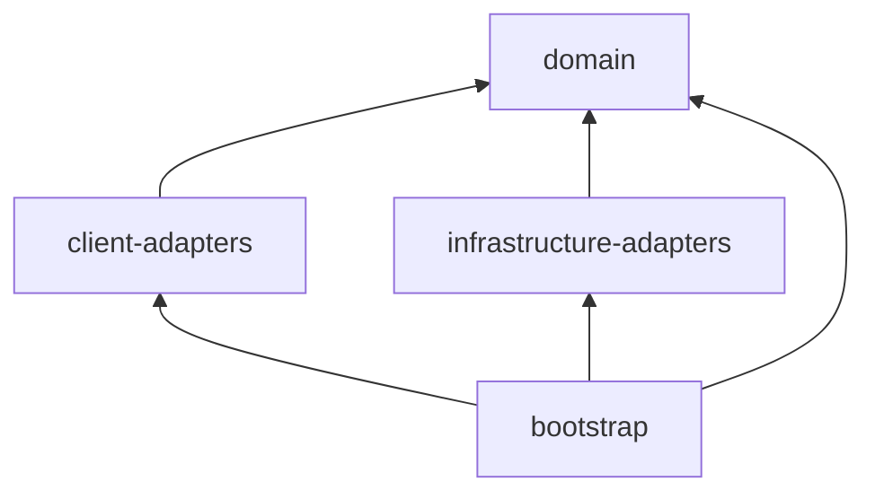
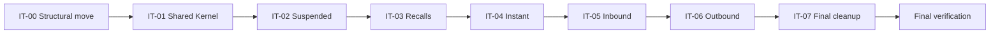

# Hexagonal Migration Plan — realistic-mess-based-on-jpa-entities-challenge

- **Status:** APPROVED (2026-11-12). IT-00 `APPROVED`; IT-01 scope awaiting approval.
- **Owner:** `incremental-hexagonal-architecture-migration` (Phase 5 of the orchestrated migration).
- **Baseline:** commit `142a3a2` on branch `hexagonal-architecture-migration-2`. Baseline `mvn test`: **307 tests, 0 failures** (run 2026-11-12 in a detached worktree of `142a3a2`).
- **Source of truth** for iteration planning, ArchUnit catalogue, temporary exceptions and validation history.

## 1. Objective

Migrate the module to Hexagonal Architecture (Ports and Adapters) in small, test-first, user-validated iterations, preserving every existing behaviour, quirk and contract (URLs, JSON shapes, Kafka topics and group ids, persistence, seeds), as defined by the approved designs.

## 2. References

| Document | Use |
|---|---|
| [`isolated-domain-design.md`](isolated-domain-design.md) | domain packages, aggregates, value objects, 25 ports, error contract, DR-1..DR-5 |
| [`technical-layer-design.md`](technical-layer-design.md) | Maven modules, adapters, wiring, AR-01..AR-18, feature-preservation matrix |
| [`ddd-domain-analysis.md`](ddd-domain-analysis.md) | **business-rule list only** (75 rules) |
| [`ddd-test-coverage.md`](ddd-test-coverage.md) | rule-to-test matrix, MAC-01..MAC-08 |
| `../../AGENTS.md`, `../../../AGENTS.md`, `../java-coding-conventions.md` | conventions and intentional smells |

## 3. Current State (after IT-00, reworked)

- Module `pom.xml` is a `packaging=pom` parent (parent `spring-boot-starter-parent` 3.5.7, artifactId unchanged) with **four** children whose directory = artifactId: `domain`, `client-adapters`, `infrastructure-adapters`, `bootstrap`. Root aggregator unchanged.
- `bootstrap` holds `PaymentsApplication`, every legacy package unchanged (`controller`, `service`, `repository`, `kafka`, `dto`, `util`), `application.yml`, the 7 legacy test classes and `architecture/CyclesTest`.
- `infrastructure-adapters` holds the 5 entities (`fr.kevin.llps.payments.entity`, unchanged), `schema.sql` and `data.sql` (unchanged).
- `domain` and `client-adapters` are empty.
- Parent properties: `surefire.failIfNoSpecifiedTests=false` (module-root `-Dtest=` commands keep working), `spring-boot.run.skip=true` (overridden to `false` in bootstrap, so `mvn spring-boot:run` from the module directory still runs the app).

## 4. Target Architecture

As specified in `technical-layer-design.md` §3–§4 (revised at the IT-00 gate) and `isolated-domain-design.md` §6, §11.

| Module | Holds | Packages |
|---|---|---|
| `domain` | domain model, shared kernel, repository (output) ports, input ports, use-case services; no dependencies | model: `domain.{sharedkernel,<ctx>}`; use cases: `domain.<ctx>.usecase`, input ports/queries/commands/views: `domain.<ctx>.usecase.port.in` |
| `client-adapters` | driving adapters: REST controllers, REST exception handlers, Kafka listeners | `adapter.in.rest[.<ctx>]`, `adapter.in.kafka.<ctx>` |
| `infrastructure-adapters` | driven adapters: JPA adapters, mappers, entities, `schema.sql`, `data.sql` | `adapter.out.persistence.<ctx>`, `entity` |
| `bootstrap` | composition root, `application.yml`, integration and ArchUnit tests | `fr.kevin.llps.payments`, `bootstrap.config` |

Separations no longer enforced by Maven are enforced by ArchUnit: domain model ↛ `..usecase..` (AR-04, DR-6), use cases framework-free (domain POM + AR-01 + AR-05), REST ↮ Kafka adapters (AR-10), persistence ↛ `..usecase..` (AR-09), driving adapters only via `..usecase.port.in..` (AR-08).

## 5. Business-Rule Inventory (75 rules, from `ddd-domain-analysis.md`)

| Rule | Statement (abridged) | Iteration(s) |
|---|---|---|
| BR-SHR-01 | Every record is identified by a UUID `id` supplied by the producer (no generation); the id is the upsert key. | IT-01 |
| BR-SHR-02 | Search limit policy: absent → 50; > 200 → 200; any other value used as given | IT-01 |
| BR-SHR-03 | A negative `limit` reaches `TypedQuery.setMaxResults`; Hibernate's `IllegalArgumentException` is translated by Spring (`@Repository`) into ... | IT-01 |
| BR-SHR-04 | IBAN validity = non-null and length 15..34 after removing spaces; no checksum or country check. | IT-01 |
| BR-SHR-05 | API timestamps are rendered `yyyy-MM-dd'T'HH:mm:ss` (JVM default time zone, no offset); dates `yyyy-MM-dd`; null stays null. | IT-01 |
| BR-SHR-06 | `PaymentUtils.parseTimestamp` accepts only `yyyy-MM-dd'T'HH:mm:ss` (after trim) and silently returns null for blank or unparsable input. | IT-01 |
| BR-SHR-07 | Utility contract kept: `formatAmount` (null → `"0.00"`, HALF_UP to 2 decimals), `now()` (FMT), `likePattern` (trim + upper-case wrapped in `%`, ... | IT-07 (retired with PaymentUtils, approved D-09) |
| BR-SHR-08 | Code-like equality filters (status, currency, charges type, hold reason, review status, recall type, original payment type, reason code) are ... | IT-01 |
| BR-SHR-09 | Amount has 2 fractional digits (`NUMERIC(18,2)`); amount and currency are NOT NULL for all types except recalls; currency is at most 3 characters. | IT-01 (Money) + persistence constraints |
| BR-SHR-10 | Status and type vocabularies are open strings: nothing validates them on ingestion | IT-01 |
| BR-API-01 | All REST endpoints are read-only GET: one search and one details endpoint per type. | IT-02..IT-07 |
| BR-API-02 | `IllegalArgumentException` → HTTP 400 with body `{"error": <exception message>}`. | IT-02..IT-07 (handler moves in IT-07) |
| BR-API-03 | Any other exception → HTTP 500 with body `{"error":"Something went wrong, contact support with the trace id"}`, logged at ERROR. | IT-02..IT-07 |
| BR-API-04 | Details of an unknown, well-formed id → HTTP 404 with empty body, for all five types. | IT-02..IT-07 |
| BR-API-05 | Details with a malformed UUID: instant, suspended, inbound, recall → HTTP 400 `{"error":"Invalid UUID string: <id>"}` (repository ... | IT-02..IT-07 |
| BR-API-06 | The path id is trimmed before UUID parsing for instant, suspended, inbound, recall; outbound details does not trim. | IT-02..IT-06 (outbound no-trim in IT-06) |
| BR-API-07 | An `IllegalArgumentException` without a message (e.g | IT-02..IT-07 |
| BR-API-08 | A non-integer `limit` query parameter (type mismatch) falls into the generic handler → HTTP 500. | IT-02..IT-07 |
| BR-API-09 | Response field names are the camelCase DTO field names, except outbound details (snake_case map plus camelCase `estimatedFee`) | IT-02..IT-07 |
| BR-ING-01 | Topics `pay.instant`, `pay.suspended`, `pay.inbound`, `pay.outbound`, `pay.recall`; payload is a flat JSON string. | IT-02..IT-06 |
| BR-ING-02 | Each listener uses its own consumer group (`jpa-instant-group`, `jpa-suspended-group`, `jpa-inbound-group`, `jpa-outbound-group`, ... | IT-02..IT-06 |
| BR-ING-03 | Ingestion is a full-replace upsert (`em.merge`) by `id`: a later event with the same id overwrites every column. | IT-02..IT-06 |
| BR-ING-04 | `createdAt` and `updatedAt` are both set to the consumer's current time on every message, so an update overwrites the original `createdAt`. | IT-02..IT-06 |
| BR-ING-05 | Malformed JSON, missing or invalid `id`, unparsable dates, and any exception raised before or during `merge` are logged at WARN and the message is ... | IT-02..IT-06 |
| BR-ING-06 | Failures raised at transaction commit (e.g | IT-02..IT-06 |
| BR-ING-07 | Missing text fields become `""`; explicit JSON `null` text fields become the literal string `"null"`; missing or null `amount` becomes `0`. | IT-02..IT-06 |
| BR-ING-08 | Timestamp parsing: null, blank or `"null"` → null; `T` replaced by a space and `Z` removed (no time-zone conversion); a 10-character date gets ` ... | IT-02..IT-06 |
| BR-ING-09 | Date parsing: null, blank or `"null"` → null; the first 10 characters are parsed as `yyyy-MM-dd`. | IT-02..IT-06 |
| BR-ING-10 | Instant: `scheme` defaults to `"SCT INST"` when missing or null | IT-04 |
| BR-ING-11 | Recall: `originalPaymentId` must be a valid UUID, otherwise the recall event is dropped (swallowed). | IT-03 |
| BR-ING-12 | No business validation on ingestion (statuses, IBAN, currency, charges type, recall type, existence of the original payment). | IT-02..IT-06 |
| BR-INS-01 | Search rejects an invalid debtor IBAN filter (BR-SHR-04) with 400 `"Invalid debtor IBAN"`; checked before the creditor IBAN. Blank filters are ... | IT-04 |
| BR-INS-02 | Search rejects an invalid creditor IBAN filter with 400 `"Invalid creditor IBAN"`. | IT-04 |
| BR-INS-03 | `endToEndId` filter: trimmed, exact, case-sensitive. | IT-04 |
| BR-INS-04 | `debtorIban` / `creditorIban` filters: case-insensitive contains (`UPPER(col) LIKE %TRIM(UPPER(x))%`) | IT-04 |
| BR-INS-05 | `status` and `currency` filters follow BR-SHR-08. | IT-04 |
| BR-INS-06 | `executionFrom` is an inclusive lower bound; `T` accepted; date-only → `00:00:00`; unparsable → filter silently ignored. | IT-04 |
| BR-INS-07 | `executionTo` is an inclusive upper bound; date-only → end of day `23:59:59`; unparsable → filter silently ignored. | IT-04 |
| BR-INS-08 | Results ordered by `executionDatetime` descending; limit per BR-SHR-02. | IT-04 |
| BR-INS-09 | Details return the same `InstantPaymentResponse` shape as search; unknown id → 404. | IT-04 |
| BR-SUS-01 | `debtorIban` filter: trimmed, exact, case-sensitive; no IBAN validation (unlike instant). | IT-02 |
| BR-SUS-02 | `holdReason` and `reviewStatus` filters follow BR-SHR-08. | IT-02 |
| BR-SUS-03 | `heldFrom` / `heldTo` are inclusive bounds parsed with BR-SHR-06 (`yyyy-MM-dd'T'HH:mm:ss` only). | IT-02 |
| BR-SUS-04 | An unparsable or date-only `heldFrom`/`heldTo` still adds the clause with a null parameter, which yields an **empty result** (unlike instant and ... | IT-02 |
| BR-SUS-05 | Ordered by `heldAt` descending; limit per BR-SHR-02. | IT-02 |
| BR-SUS-06 | `releasedAt` is null while the hold is not released; `heldAt` and `releasedAt` are rendered per BR-SHR-05. Search and details produce the same ... | IT-02 |
| BR-INB-01 | `creditorIban` filter: trimmed, exact, case-sensitive. | IT-05 |
| BR-INB-02 | `originBic` filter: case-insensitive contains. | IT-05 |
| BR-INB-03 | `status` and `currency` filters follow BR-SHR-08. | IT-05 |
| BR-INB-04 | `valueDateFrom` / `valueDateTo` are inclusive and strictly `yyyy-MM-dd`; a malformed date raises a message-less `IllegalArgumentException` → HTTP ... | IT-05 |
| BR-INB-05 | Ordered by `valueDate` descending, then `createdAt` descending. | IT-05 |
| BR-INB-06 | Limit: absent → 50; **no 200 cap**, any given value is used as is. | IT-05 |
| BR-INB-07 | `ageInDays` = whole days between `valueDate` and the server's current local date; negative for a future value date; null when `valueDate` is null | IT-05 |
| BR-INB-08 | `ageInDays` is computed in the controller for search results and in the service for details (same formula, two places). | IT-05 (centralized per approved Gate 2 Q2) |
| BR-OUT-01 | `debtorIban` filter: trimmed, exact, case-sensitive. | IT-06 |
| BR-OUT-02 | `destinationBic` filter: contains, with the input upper-cased but the column **not** upper-cased, so it effectively matches only upper-case stored ... | IT-06 |
| BR-OUT-03 | `chargesType` and `status` filters follow BR-SHR-08. | IT-06 |
| BR-OUT-04 | `executionFrom` / `executionTo` filter `requestedExecutionDate`, inclusive, strictly `yyyy-MM-dd`; a malformed date → HTTP 400 `{"error":"Bad ... | IT-06 |
| BR-OUT-05 | Ordered by `requestedExecutionDate` descending; limit per BR-SHR-02. | IT-06 |
| BR-OUT-06 | **Search fee policy** (service): amount null → 0; `OUR` → 1 % of amount, HALF_UP, scale 2; `BEN` → 0; anything else (including `SHA`, null, ... | IT-06 |
| BR-OUT-07 | **Details fee policy** (controller, bypasses the service): `OUR` → 2 % of amount, HALF_UP, scale 2; `SHA` → 0.50; anything else (including `BEN`, ... | IT-06 |
| BR-OUT-08 | BR-OUT-06 and BR-OUT-07 intentionally diverge and both must be preserved | IT-06 |
| BR-OUT-09 | The details payload is a snake_case map: `id, instruction_id, amount, currency, debtor_iban, debtor_name, destination_bic, ... | IT-06 |
| BR-OUT-10 | `OutboundPaymentService.getById` exists but no endpoint uses it. | IT-06 (dropped, approved retirement) |
| BR-RCL-01 | Allowed recall types for the search filter: `R-REJ`, `R-COR`, `R-UPD` (trimmed, case-insensitive); otherwise 400 `"Unknown recall type: <raw input>"`. | IT-03 |
| BR-RCL-02 | `recallType`, `originalPaymentType`, `reasonCode` and `status` filters follow BR-SHR-08. | IT-03 |
| BR-RCL-03 | The `originalPaymentId` filter must be a UUID; malformed → HTTP 400 `{"error":"Invalid UUID string: <value>"}`. | IT-03 |
| BR-RCL-04 | `initiatedFrom` / `initiatedTo` are inclusive; date-only → `00:00:00` for **both** bounds (a date-only `initiatedTo` excludes that day); ... | IT-03 |
| BR-RCL-05 | Search results are always capped at 50; the `limit` parameter is ignored. | IT-03 |
| BR-RCL-06 | Ordered by `initiatedAt` descending. | IT-03 |
| BR-RCL-07 | A recall references an original payment by (`originalPaymentId`, `originalPaymentType`); observed types `INSTANT`, `INBOUND`, `OUTBOUND` | IT-03 |
| BR-RCL-08 | `initiatedAt` is rendered per BR-SHR-05 and `deadline` as `yyyy-MM-dd`. | IT-03 |
| BR-DAT-01 | `schema.sql` is the only DDL source (`ddl-auto: none`, `CREATE TABLE IF NOT EXISTS`); five tables, one per type. | IT-00, IT-07 |
| BR-DAT-02 | `data.sql` deletes all rows of the five tables and re-inserts 3 seed rows per type at every startup; integration tests assert those seeds (3 ... | IT-00, IT-07 |
| BR-DAT-03 | Ids prefixed `00000000-0000-0000-0000-0000000009` are reserved for Kafka-ingestion tests and cleaned before each integration test. | IT-00, IT-07 |

Counts: SHR 10, API 9, ING 12, INS 9, SUS 6, INB 8, OUT 10, RCL 8, DAT 3 = **75**. Cross-cutting rules (API, ING) are re-verified per context in each context iteration; their context-specific tests move with the context (MAC-07).

## 6. Iterations

Common definition of done for every iteration: TDD (RED → GREEN → refactor); ArchUnit rules added or tightened **before** the code they constrain; the legacy classes of the scope deleted and their tests remapped with unchanged inputs and expected values (MAC-07); full `mvn test` (Docker) green with the count ≥ 307 minus approved retirements, plus new tests; all ArchUnit GREEN; final compilation gate `mvn -B clean verify`; tracking updated; user validation; commit scoped to the iteration.

### IT-00 — Structural move (Maven multi-module)

| Field | Value |
|---|---|
| Bounded Context | none (structure) |
| Business rules | none changed; all 75 kept green by the unchanged 307 tests; BR-DAT-01..03 verified through the moved seeds |
| Scope | parent + 4 child POMs (`domain`, `client-adapters`, `infrastructure-adapters`, `bootstrap`); `git mv` of all legacy code, resources and tests (100 % renames, no content change) |
| ArchUnit | AR-15 `CyclesTest` |
| Completion | 307 legacy tests + 1 ArchUnit green; `mvn spring-boot:run` from the module dir starts the app |
| Status | `APPROVED` (first presentation: `CHANGES_REQUESTED`, six modules → four modules) |

### IT-01 — Shared Kernel (domain only)

| Field | Value |
|---|---|
| Bounded Context | Shared Kernel |
| Business rules | BR-SHR-01, -02, -03, -04, -05, -06, -08, -09, -10; grammar parts of BR-INS-06/07, BR-RCL-04, BR-INB-04, BR-OUT-04; BR-API-05 (UUID message) and BR-API-07 (message-less date error) at domain level |
| Target classes | `domain.sharedkernel`: `PaymentId`, `Money`, `SearchLimit`, `CodeFilter`, `Iban`, `TimestampBound`, `IsoDateBound`, `ApiDateTimeFormat`, `InvalidPaymentIdException`, `NegativeSearchLimitException`, `MalformedDateException` |
| Adapters | none |
| Tests | plain JUnit/AssertJ unit tests in the `domain` module (no Spring, MAC-08), replicating the `PaymentUtilsTest` cases for limit, IBAN and timestamp parsing plus grammar characterization tests (`Timestamp.valueOf`, `Date.valueOf`, lenient `SimpleDateFormat` grammars, D-10). `PaymentUtils` and its tests untouched. |
| ArchUnit (test-first) | AR-01, AR-03, AR-04 (`DomainIsolationTest`); AR-17 domain part (no public non-final fields in `..domain..`) |
| Risks | DR-R2 grammar narrowing (pinned by characterization tests); DR-R4 UUID message |
| Deliverables | domain classes + tests; no legacy deletion |
| Completion | domain tests green without Docker; full suite green |

### IT-02 — Suspended Payments

| Field | Value |
|---|---|
| Bounded Context | Suspended Payments |
| Business rules | BR-SUS-01..06; suspended slice of BR-API-01..09 and BR-ING-01..09/12 |
| Target classes / ports | `domain.suspended`: `SuspendedPayment`, `SuspendedPaymentSearchCriteria`, `LoadSuspendedPayments`, `SaveSuspendedPayment`; `domain.suspended.usecase[.port.in]`: `SearchSuspendedPayments`, `GetSuspendedPaymentDetails`, `RecordSuspendedPayment`, query/command records, 3 services |
| Adapters | `RestSuspendedPaymentController` (+ response record, mapper), `RestDomainExceptionHandler` (`@Order(HIGHEST_PRECEDENCE)`, handlers for SK exceptions), `KafkaSuspendedPaymentListener`, `JpaSuspendedPaymentRepositoryAdapter` + `JpaSuspendedPaymentMapper`; `bootstrap.config.ClockConfiguration`, `SuspendedUseCaseConfiguration`; test-only `@SpringBootConfiguration` in `client-adapters` and `infrastructure-adapters` |
| Legacy deleted | `SuspendedPaymentController`, `SuspendedPaymentService`, `SuspendedPaymentRepository`, `SuspendedPaymentListener`, `SuspendedPayment{SearchRequest,Response}` |
| Tests | domain unit tests; use-case tests with fixed `Clock`; `@WebMvcTest` with `@MockitoBean` input ports; Kafka listener unit tests mocking `RecordSuspendedPayment`; `@DataJpaTest` + Testcontainers adapter tests; suspended methods of the 4 legacy test classes remapped (MAC-07); IT unchanged |
| ArchUnit (test-first) | AR-05, AR-06, AR-08, AR-09, AR-10, AR-11 (+ temporary exception), AR-12, AR-13, AR-14, AR-16, AR-17 (rest), AR-18 (+ temporary exception) |
| Risks | TL-R1 advice order; TL-R4 slices outside bootstrap; DR-R8 `matchesNothing`; BR-ING-06 commit-time propagation (DR-R3) |
| Completion | all suspended tests green in their new modules; no suspended legacy class left |

### IT-03 — Recalls

| Field | Value |
|---|---|
| Business rules | BR-RCL-01..08, BR-ING-11; recall slice of BR-API-* and BR-ING-* |
| Target classes / ports | `domain.recall`: `Recall`, `RecallType`, `OriginalPaymentReference`, `RecallSearchCriteria`, `UnknownRecallTypeException`, `LoadRecalls`, `SaveRecall`; application ports and services |
| Adapters | `RestRecallController`, `KafkaRecallListener`, `JpaRecallRepositoryAdapter` / `JpaRecallMapper`, `RecallUseCaseConfiguration`; handler for `UnknownRecallTypeException` |
| Legacy deleted | `RecallController`, `RecallService`, `RecallRepository`, `RecallListener`, `Recall{SearchRequest,Response}` |
| ArchUnit (test-first) | AR-02, AR-07 (first time two contexts exist); AR-11/AR-18 exceptions narrowed |
| Risks | error order type → UUID (DR-R1); fixed limit 50 ignoring request; date-only `initiatedTo` at 00:00:00 |

### IT-04 — Instant Payments

| Field | Value |
|---|---|
| Business rules | BR-INS-01..09, BR-ING-10; instant slice of BR-API-* and BR-ING-* |
| Target classes / ports | `domain.instant`: `InstantPayment` (`DEFAULT_SCHEME`), `InstantPaymentSearchCriteria`, `InvalidIbanFilterException`, `LoadInstantPayments`, `SaveInstantPayment`; application ports and services |
| Adapters | `RestInstantPaymentController`, `KafkaInstantPaymentListener`, `JpaInstantPaymentRepositoryAdapter` / mapper, configuration; handler for `InvalidIbanFilterException` |
| Legacy deleted | `InstantPayment{Controller,Service,Repository,Listener}`, `InstantPayment{SearchRequest,Response}` |
| ArchUnit | AR-11/AR-18 exceptions narrowed |
| Risks | IBAN check order debtor → creditor; `UPPER LIKE` contains with inner spaces kept (N-03); lenient 23:59:59 upper bound |

### IT-05 — Inbound Payments

| Field | Value |
|---|---|
| Business rules | BR-INB-01..08; inbound slice of BR-API-* and BR-ING-* |
| Target classes / ports | `domain.inbound`: `InboundPayment.ageInDaysOn(LocalDate)`, `InboundPaymentSearchCriteria`, `LoadInboundPayments`, `SaveInboundPayment`; `InboundPaymentView`; application ports and services with `Clock` |
| Adapters | `RestInboundPaymentController`, `KafkaInboundPaymentListener`, `JpaInboundPaymentRepositoryAdapter` / mapper, configuration |
| Legacy deleted | `InboundPayment{Controller,Service,Repository,Listener}`, `InboundPayment{SearchRequest,Response}` |
| Tests | BR-INB-08 structural tests remapped to use-case tests (approved, Phase 3 §22.3) |
| ArchUnit | AR-11/AR-18 exceptions narrowed |
| Risks | date-dependent `ageInDays` (fixed `Clock` in unit tests); uncapped limit; `IsoDateBound` → 400 `Bad request` |

### IT-06 — Outbound Payments

| Field | Value |
|---|---|
| Business rules | BR-OUT-01..09 (BR-OUT-10 dropped: `outboundGetById_foundAndMissing` retired, approved); outbound slice of BR-API-* (incl. invalid id → 404, no trim) and BR-ING-* |
| Target classes / ports | `domain.outbound`: `OutboundPayment`, `ChargesType`, `SearchFeePolicy`, `DetailsFeePolicy`, `FeeNotComputableException`, `OutboundPaymentSearchCriteria`, `LoadOutboundPayments`, `SaveOutboundPayment`; `OutboundPaymentWithFee`; application ports and services |
| Adapters | `RestOutboundPaymentController`, `RestOutboundPaymentDetailsFormatter` (explicit UTC formatter, zone from `Clock`), **`KafkaOutboundPaymentListener`** (approved rename), `JpaOutboundPaymentRepositoryAdapter` / mapper, configuration |
| Legacy deleted | `OutboundPaymentController`, `OutboundPaymentService`, `OutboundPaymentRepository`, `OutboundPaymentMessageConsumer`, `OutboundPayment{SearchRequest,Response}` |
| Tests | Jackson parity tests for the details formatter written **before** the switch (TLD §8.3: zones × values incl. DST gap/overlap, sub-ms truncation, `java.sql.Date`); web slice for the 13-key map; both fee tables (C-01) unchanged; N-02 IT unchanged. Removing the `PaymentControllerWebTest` `EntityManager` mocks requires approval at that gate. |
| ArchUnit | AR-11 and AR-18 temporary exceptions **removed** (no legacy `repository`/`kafka`/`service` left) |
| Risks | TL-R2 timestamp drift; DR-R5 BigDecimal scales; C-01/C-02 preserved |

### IT-07 — Final cleanup

| Field | Value |
|---|---|
| Business rules | BR-SHR-07 retired with `PaymentUtils` (approved D-09); BR-API-02/03/07/08 kept by the legacy handler; BR-DAT-01..03 re-verified |
| Scope | delete `PaymentUtils` and its unused-helper tests (approved); move `GlobalExceptionHandler` + `GlobalExceptionHandlerTest` to `client-adapters` (`fr.kevin.llps.payments.adapter.in.rest`), renamed `RestGlobalExceptionHandler` / `RestGlobalExceptionHandlerTest`, body and assertions unchanged (approved); trim `bootstrap` POM to what the composition root needs; confirm README / module `AGENTS.md` commands |
| ArchUnit | AR-16 applies to `RestGlobalExceptionHandler` with no exception; every temporary exception removed |
| Completion | bootstrap contains only entry point, configuration, `application.yml`, integration and ArchUnit tests |

## 7. Sequencing

Order rationale: structure first; Shared Kernel before any context (every context depends on it); then the approved extraction order, lowest risk first (Suspended has no business validation; Outbound carries the two fee tables and the timestamp-rendering risk). Each iteration starts only after the previous one is approved and committed.

## 8. Traceability Matrix (rule group → iteration → tests)

| Rules | Iteration | Unit-level tests (target) | Integration-level tests |
|---|---|---|---|
| BR-SHR-01..06, -08..-10 | IT-01 (domain) then each context | `domain.sharedkernel.*Test` | IT (unchanged) |
| BR-SHR-07 | IT-07 (retired) | `PaymentUtilsTest` until IT-07 | — |
| BR-SUS-01..06 | IT-02 | `domain.suspended.*Test`, `domain.suspended.usecase.*Test`, `RestSuspendedPaymentControllerTest`, `JpaSuspendedPaymentRepositoryAdapterTest` | IT suspended tests |
| BR-RCL-01..08, BR-ING-11 | IT-03 | `domain.recall.*Test`, use cases, `RestRecallControllerTest`, `KafkaRecallListenerTest`, `JpaRecallRepositoryAdapterTest` | IT recall tests |
| BR-INS-01..09, BR-ING-10 | IT-04 | `domain.instant.*Test`, use cases, REST/Kafka/JPA adapter tests | IT instant tests |
| BR-INB-01..08 | IT-05 | `domain.inbound.*Test`, use cases (fixed `Clock`), adapter tests | IT inbound tests |
| BR-OUT-01..09 | IT-06 | `SearchFeePolicyTest`, `DetailsFeePolicyTest`, criteria, formatter parity, adapter tests | IT outbound tests (incl. N-02) |
| BR-API-01..09 | IT-02..IT-07 | `Rest*ControllerTest`, `RestDomainExceptionHandlerTest`, `GlobalExceptionHandlerTest` (→ `RestGlobalExceptionHandlerTest` in IT-07) | IT error-contract tests |
| BR-ING-01..12 | IT-02..IT-06 | `Kafka*ListenerTest`, `Record*ServiceTest` | IT Kafka ingestion tests (Awaitility, `...09` ids) |
| BR-DAT-01..03 | IT-00, IT-07 | — | IT seed assertions |

The per-test mapping is maintained in §11 as tests are moved.

## 9. ArchUnit Rule Catalogue and Temporary Exceptions

Location: `bootstrap/src/test/java/fr/kevin/llps/payments/architecture/`. Command: `mvn test -Dtest='*ArchitectureTest,*IsolationTest,*DependenciesTest,PortsTest,CyclesTest,CodingConventionsTest'` from the module directory.

| ID | Rule | Class | Source | Introduced | Current result |
|---|---|---|---|---|---|
| AR-15 | no cycles between `fr.kevin.llps.payments.(*)..` slices | `CyclesTest` | TLD §4.2/§9.2 | IT-00 | GREEN (2026-11-12) |
| AR-01, AR-03, AR-04 | domain isolation (AR-04 also forbids domain model → `..usecase..` inside the `domain` module) | `DomainIsolationTest` | DR-1, DR-3, DR-4 | IT-01 (planned) | — |
| AR-17 (domain) | no public non-final fields in `..domain..` | `CodingConventionsTest` | conventions | IT-01 (planned) | — |
| AR-05, AR-06 | `..domain.*.usecase..` framework-free; onion (applicationServices = `..domain.*.usecase..`) | `HexagonalArchitectureTest` | TL-DR-3, §3 | IT-02 (planned) | — |
| AR-08..AR-13 | adapter dependencies (AR-10 now the only REST ↮ Kafka separation; AR-09 the only persistence ↛ `..usecase..` separation) | `AdapterDependenciesTest` | TL-DR-1/2/4/5/6/9, §6 | IT-02 (planned) | — |
| AR-14 | ports are interfaces | `PortsTest` | IDD §11 | IT-02 (planned) | — |
| AR-16, AR-17 (rest), AR-18 | naming, injection, `System.out`, `@Transactional` placement | `CodingConventionsTest` | conventions, TL-DR-10 | IT-02 (planned) | — |
| AR-02, AR-07 | context slices independent | `DomainIsolationTest`, `HexagonalArchitectureTest` | DR-2, TL-DR-7 | IT-03 (planned) | — |

Temporary exceptions (none active today):

| Rule | Exception scope | Added | Removed by |
|---|---|---|---|
| AR-11 | legacy `controller`, `service`, `repository`, `kafka` packages may access `entity` / `EntityManager` | IT-02 (planned) | IT-06 |
| AR-18 | legacy `kafka` package listeners keep `@Transactional` | IT-02 (planned) | IT-06 |

## 10. Test Strategy

- **Tiers:** domain and application tests are plain JUnit 5 + AssertJ (+ Mockito) with no Spring, Docker or Kafka (MAC-08); REST adapter `@WebMvcTest` slices with `@MockitoBean` input ports; Kafka adapter plain unit tests mocking `Record<X>`; persistence adapter `@DataJpaTest` + Testcontainers (Docker); `bootstrap` keeps `PaymentApplicationIntegrationTest` unchanged and the ArchUnit tests.
- **TDD:** each public method is driven test-first (`tdd`, `unit-test`, `parameterized-unit-test`, `api-rest-test` skills); ArchUnit rules first.
- **Remapping (MAC-07):** a legacy test is deleted only when its equivalent with the same inputs and expected values exists in the new location; each remap is listed in §11. Retirements beyond those already approved need user approval.
- **Counts (MAC-01/02):** baseline 307; after each iteration the count must be ≥ 307 minus approved retirements, excluding new ArchUnit tests from the comparison.
- **Conventions:** snake_case test names, GIVEN/WHEN/THEN, `@MockitoBean`, Awaitility (no sleeps), Kafka test ids in the `...09` range.

## 11. Iteration Tracking

| ID | Context | Status | Tests (full suite) | ArchUnit | Final compilation gate | User validation | Commit |
|---|---|---|---|---|---|---|---|
| IT-00 | structure | `APPROVED` (after one `CHANGES_REQUESTED`) | 308 = 307 legacy (per-class counts identical to baseline) + 1 ArchUnit, 0 failures | AR-15 GREEN | `mvn -B clean verify`: exit 0, 308 tests, BUILD SUCCESS (reworked layout) | 1st: changes requested; 2nd: approved 2026-11-12 | see §15 / commit below |
| IT-01 | Shared Kernel | `NOT_STARTED` | | | | | |
| IT-02 | Suspended | `NOT_STARTED` | | | | | |
| IT-03 | Recalls | `NOT_STARTED` | | | | | |
| IT-04 | Instant | `NOT_STARTED` | | | | | |
| IT-05 | Inbound | `NOT_STARTED` | | | | | |
| IT-06 | Outbound | `NOT_STARTED` | | | | | |
| IT-07 | Final cleanup | `NOT_STARTED` | | | | | |

Test remapping log: (empty, filled from IT-02).

## 12. Risks and Open Issues

| ID | Risk / issue | Mitigation |
|---|---|---|
| PL-R1 | Running tests from inside a single child module needs installed siblings | run from the module directory (reactor); documented commands unchanged |
| PL-R2 | `domain` and `client-adapters` produce empty jars until filled (jar-plugin warning) | accepted; disappears in IT-01/IT-02 |
| PL-R3 | (closed) `GlobalExceptionHandler` vs AR-16 | renamed `RestGlobalExceptionHandler` on its IT-07 move (approved) |
| PL-R5 | Four modules: REST vs Kafka, model vs use cases and persistence vs use cases separations are no longer compile-time | ArchUnit AR-04, AR-05, AR-08, AR-09, AR-10 added test-first in IT-01/IT-02 |
| PL-R6 | Plain artifactIds (`domain`, `bootstrap`, ...) under groupId `fr.kevin.llps.payments` shared with the other two apps in the root reactor | no clash today (root `mvn -q validate` exit 0); TL-R8 |
| PL-R4 | Shared Kernel classes are unused by production code at the end of IT-01 | consumed from IT-02 on; ArchUnit/auditor run after IT-07 |
| TL-R1..TL-R7, DR-R1..DR-R11 | as in the design documents | per iteration as listed above |

## 13. Acceptance Criteria

AC-01..AC-21 of the migration agent and MAC-01..MAC-08 of `ddd-test-coverage.md` apply. In particular: domain POM without production dependencies; ArchUnit only in `bootstrap`, GREEN before each final compilation gate; every temporary exception removed by IT-07; behaviour unchanged except approved retirements; commits only after user validation.

## 14. Verification Log

| Date | Iteration | Command (from module dir unless stated) | Result |
|---|---|---|---|
| 2026-11-12 | baseline | `mvn -B test` in a detached worktree of `142a3a2` | exit 0; 307 tests, 0 failures |
| 2026-11-12 | IT-00 (first layout, six modules) | `mvn -B test`, `mvn -B clean verify`, fast tier, `spring-boot:run` | all green (308 / 157 tests); superseded by the rework below |
| 2026-11-12 | IT-00 rework | `git diff --cached -M --summary` | all moves are 100 % renames |
| 2026-11-12 | IT-00 rework | `mvn -B dependency:tree -pl domain` | test-scope JUnit, AssertJ, Mockito only; no compile dependency |
| 2026-11-12 | IT-00 rework | final compilation gate `mvn -B clean verify` (Docker) | exit 0; 308 tests, 0 failures; reactor parent, domain, client-adapters, infrastructure-adapters, bootstrap SUCCESS; per-class counts identical to baseline plus `CyclesTest` (1) |
| 2026-11-12 | IT-00 rework | `mvn -B test -Dtest=CyclesTest` (within the gate run) | AR-15 GREEN |
| 2026-11-12 | IT-00 rework | `docker compose up -d && mvn -B spring-boot:run` + `curl` | app started on 8082; instant search 200; outbound details `...0401` `created_at` `2026-10-16T06:00:00.000+00:00`, `estimatedFee` 0.50; app and stack stopped afterwards |
| 2026-11-12 | IT-00 rework | repo root `mvn -B -q validate` | exit 0 |

## 15. Validation History

| Date | Gate | Answer (relayed by the orchestrator) |
|---|---|---|
| 2026-11-12 | Phase 1 Q1 build constraints | (a) none |
| 2026-11-12 | Phase 1 Q2 run command | (a) keep `mvn spring-boot:run` via `spring-boot.run.skip`; verified working in IT-00, so no README / AGENTS.md change |
| 2026-11-12 | Phase 1 Q3 module structure, POMs, graph, IT-00 placement, ArchUnit plan | (a) approved |
| 2026-11-12 | IT-00 validation (1st) | **CHANGES_REQUESTED**: "only two adapters modules must exist : client-adapters and infrastructure-adapters. Domain must be named domain only"; clarified "Drop prefixes, keep application"; corrected: "application must be merged in domain" → four modules `domain`, `client-adapters`, `infrastructure-adapters`, `bootstrap`, plain artifactIds |
| 2026-11-12 | Plan gate Q2 (AR-16 / `GlobalExceptionHandler`) | (a) rename to `RestGlobalExceptionHandler` (and its test) when it moves in IT-07, body unchanged; no exception |
| 2026-11-12 | Plan gate Q3 (Shared Kernel) | (a) separate IT-01 (domain only) before IT-02 Suspended |
| 2026-11-12 | Plan gate Q4 (plan approval) | deferred; re-presented with the reworked IT-00 |
| 2026-11-12 | IT-00 gate (2nd) Q1 use-case packages | (b) `domain.<ctx>.usecase` (services) and `domain.<ctx>.usecase.port.in` (input ports, queries, commands, views); AR-01..AR-08, DR-2, TL-DR-7 retargeted |
| 2026-11-12 | IT-00 validation (2nd) | **APPROVED AND COMMIT** |
| 2026-11-12 | Migration plan | **APPROVED** (with the use-case package answer applied) |
