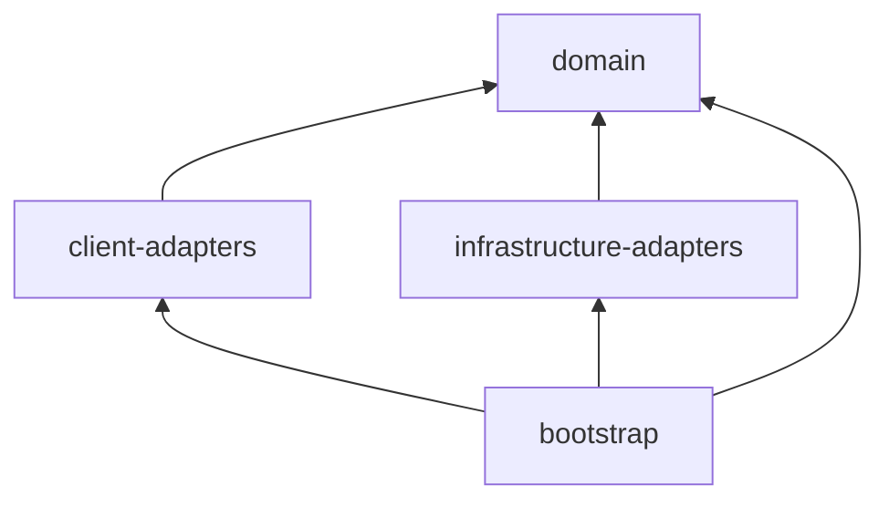
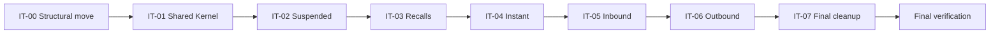

# Hexagonal Migration Plan — realistic-mess-based-on-jpa-entities-challenge

- **Status:** APPROVED (2026-11-12). IT-00..IT-06 `APPROVED`; IT-07 scope awaiting approval.
- **Owner:** `incremental-hexagonal-architecture-migration` (Phase 5 of the orchestrated migration).
- **Baseline:** commit `142a3a2` on branch `hexagonal-architecture-migration-2`. Baseline `mvn test`: **307 tests, 0 failures** (run 2026-11-12 in a detached worktree of `142a3a2`).
- **Source of truth** for iteration planning, ArchUnit catalogue, temporary exceptions and validation history.

## 1. Objective

Migrate the module to Hexagonal Architecture (Ports and Adapters) in small, test-first, user-validated iterations, preserving every existing behaviour, quirk and contract (URLs, JSON shapes, Kafka topics and group ids, persistence, seeds), as defined by the approved designs.

## 2. References

| Document | Use |
|---|---|
| [`isolated-domain-design.md`](isolated-domain-design.md) | domain packages, aggregates, value objects, 25 ports, error contract, DR-1..DR-5 |
| [`technical-layer-design.md`](technical-layer-design.md) | Maven modules, adapters, wiring, AR-01..AR-18, feature-preservation matrix |
| [`ddd-domain-analysis.md`](ddd-domain-analysis.md) | **business-rule list only** (75 rules) |
| [`ddd-test-coverage.md`](ddd-test-coverage.md) | rule-to-test matrix, MAC-01..MAC-08 |
| `../../AGENTS.md`, `../../../AGENTS.md`, `../java-coding-conventions.md` | conventions and intentional smells |

## 3. Current State (after IT-00, reworked)

- Module `pom.xml` is a `packaging=pom` parent (parent `spring-boot-starter-parent` 3.5.7, artifactId unchanged) with **four** children whose directory = artifactId: `domain`, `client-adapters`, `infrastructure-adapters`, `bootstrap`. Root aggregator unchanged.
- `bootstrap` holds `PaymentsApplication`, every legacy package unchanged (`controller`, `service`, `repository`, `kafka`, `dto`, `util`), `application.yml`, the 7 legacy test classes and `architecture/CyclesTest`.
- `infrastructure-adapters` holds the 5 entities (`fr.kevin.llps.payments.entity`, unchanged), `schema.sql` and `data.sql` (unchanged).
- `domain` and `client-adapters` are empty.
- Parent properties: `surefire.failIfNoSpecifiedTests=false` (module-root `-Dtest=` commands keep working), `spring-boot.run.skip=true` (overridden to `false` in bootstrap, so `mvn spring-boot:run` from the module directory still runs the app).

## 4. Target Architecture

As specified in `technical-layer-design.md` §3–§4 (revised at the IT-00 gate) and `isolated-domain-design.md` §6, §11.

| Module | Holds | Packages |
|---|---|---|
| `domain` | domain model, shared kernel, use-case services, commands, queries, input and output ports; no dependencies | `domain.sharedkernel`; per context `domain.<ctx>` (aggregate + `*Service`), `.command` (`*Command`), `.query` (`*Query`, `*Criteria`), `.port.in` / `.port.out` (interfaces only) |
| `client-adapters` | driving adapters: REST controllers, REST exception handlers, Kafka listeners | `adapter.in.rest[.<ctx>]`, `adapter.in.kafka.<ctx>` |
| `infrastructure-adapters` | driven adapters: JPA adapters, mappers, entities, `schema.sql`, `data.sql` | `adapter.out.persistence.<ctx>`, `entity` |
| `bootstrap` | composition root, `application.yml`, integration and ArchUnit tests | `fr.kevin.llps.payments`, `bootstrap.config` |

Separations no longer enforced by Maven are enforced by ArchUnit: domain model (aggregates, `command`, `query`, shared kernel) ↛ `*Service` / ports (AR-04, AR-06, DR-6), use cases framework-free (domain POM + AR-01 + AR-05), REST ↮ Kafka adapters (AR-10), driven adapters ↛ `*Service` / `port.in` (AR-09), driving adapters ↛ `*Service` / `port.out` (AR-08); every adapter may use commands and queries.

## 5. Business-Rule Inventory (75 rules, from `ddd-domain-analysis.md`)

| Rule | Statement (abridged) | Iteration(s) |
|---|---|---|
| BR-SHR-01 | Every record is identified by a UUID `id` supplied by the producer (no generation); the id is the upsert key. | IT-01 |
| BR-SHR-02 | Search limit policy: absent → 50; > 200 → 200; any other value used as given | IT-01 |
| BR-SHR-03 | A negative `limit` reaches `TypedQuery.setMaxResults`; Hibernate's `IllegalArgumentException` is translated by Spring (`@Repository`) into ... | IT-01 |
| BR-SHR-04 | IBAN validity = non-null and length 15..34 after removing spaces; no checksum or country check. | IT-01 |
| BR-SHR-05 | API timestamps are rendered `yyyy-MM-dd'T'HH:mm:ss` (JVM default time zone, no offset); dates `yyyy-MM-dd`; null stays null. | IT-01 |
| BR-SHR-06 | `PaymentUtils.parseTimestamp` accepts only `yyyy-MM-dd'T'HH:mm:ss` (after trim) and silently returns null for blank or unparsable input. | IT-01 |
| BR-SHR-07 | Utility contract kept: `formatAmount` (null → `"0.00"`, HALF_UP to 2 decimals), `now()` (FMT), `likePattern` (trim + upper-case wrapped in `%`, ... | IT-07 (retired with PaymentUtils, approved D-09) |
| BR-SHR-08 | Code-like equality filters (status, currency, charges type, hold reason, review status, recall type, original payment type, reason code) are ... | IT-01 |
| BR-SHR-09 | Amount has 2 fractional digits (`NUMERIC(18,2)`); amount and currency are NOT NULL for all types except recalls; currency is at most 3 characters. | IT-01 (Money) + persistence constraints |
| BR-SHR-10 | Status and type vocabularies are open strings: nothing validates them on ingestion | IT-01 |
| BR-API-01 | All REST endpoints are read-only GET: one search and one details endpoint per type. | IT-02..IT-07 |
| BR-API-02 | `IllegalArgumentException` → HTTP 400 with body `{"error": <exception message>}`. | IT-02..IT-07 (handler moves in IT-07) |
| BR-API-03 | Any other exception → HTTP 500 with body `{"error":"Something went wrong, contact support with the trace id"}`, logged at ERROR. | IT-02..IT-07 |
| BR-API-04 | Details of an unknown, well-formed id → HTTP 404 with empty body, for all five types. | IT-02..IT-07 |
| BR-API-05 | Details with a malformed UUID: instant, suspended, inbound, recall → HTTP 400 `{"error":"Invalid UUID string: <id>"}` (repository ... | IT-02..IT-07 |
| BR-API-06 | The path id is trimmed before UUID parsing for instant, suspended, inbound, recall; outbound details does not trim. | IT-02..IT-06 (outbound no-trim in IT-06) |
| BR-API-07 | An `IllegalArgumentException` without a message (e.g | IT-02..IT-07 |
| BR-API-08 | A non-integer `limit` query parameter (type mismatch) falls into the generic handler → HTTP 500. | IT-02..IT-07 |
| BR-API-09 | Response field names are the camelCase DTO field names, except outbound details (snake_case map plus camelCase `estimatedFee`) | IT-02..IT-07 |
| BR-ING-01 | Topics `pay.instant`, `pay.suspended`, `pay.inbound`, `pay.outbound`, `pay.recall`; payload is a flat JSON string. | IT-02..IT-06 |
| BR-ING-02 | Each listener uses its own consumer group (`jpa-instant-group`, `jpa-suspended-group`, `jpa-inbound-group`, `jpa-outbound-group`, ... | IT-02..IT-06 |
| BR-ING-03 | Ingestion is a full-replace upsert (`em.merge`) by `id`: a later event with the same id overwrites every column. | IT-02..IT-06 |
| BR-ING-04 | `createdAt` and `updatedAt` are both set to the consumer's current time on every message, so an update overwrites the original `createdAt`. | IT-02..IT-06 |
| BR-ING-05 | Malformed JSON, missing or invalid `id`, unparsable dates, and any exception raised before or during `merge` are logged at WARN and the message is ... | IT-02..IT-06 |
| BR-ING-06 | Failures raised at transaction commit (e.g | IT-02..IT-06 |
| BR-ING-07 | Missing text fields become `""`; explicit JSON `null` text fields become the literal string `"null"`; missing or null `amount` becomes `0`. | IT-02..IT-06 |
| BR-ING-08 | Timestamp parsing: null, blank or `"null"` → null; `T` replaced by a space and `Z` removed (no time-zone conversion); a 10-character date gets ` ... | IT-02..IT-06 |
| BR-ING-09 | Date parsing: null, blank or `"null"` → null; the first 10 characters are parsed as `yyyy-MM-dd`. | IT-02..IT-06 |
| BR-ING-10 | Instant: `scheme` defaults to `"SCT INST"` when missing or null | IT-04 |
| BR-ING-11 | Recall: `originalPaymentId` must be a valid UUID, otherwise the recall event is dropped (swallowed). | IT-03 |
| BR-ING-12 | No business validation on ingestion (statuses, IBAN, currency, charges type, recall type, existence of the original payment). | IT-02..IT-06 |
| BR-INS-01 | Search rejects an invalid debtor IBAN filter (BR-SHR-04) with 400 `"Invalid debtor IBAN"`; checked before the creditor IBAN. Blank filters are ... | IT-04 |
| BR-INS-02 | Search rejects an invalid creditor IBAN filter with 400 `"Invalid creditor IBAN"`. | IT-04 |
| BR-INS-03 | `endToEndId` filter: trimmed, exact, case-sensitive. | IT-04 |
| BR-INS-04 | `debtorIban` / `creditorIban` filters: case-insensitive contains (`UPPER(col) LIKE %TRIM(UPPER(x))%`) | IT-04 |
| BR-INS-05 | `status` and `currency` filters follow BR-SHR-08. | IT-04 |
| BR-INS-06 | `executionFrom` is an inclusive lower bound; `T` accepted; date-only → `00:00:00`; unparsable → filter silently ignored. | IT-04 |
| BR-INS-07 | `executionTo` is an inclusive upper bound; date-only → end of day `23:59:59`; unparsable → filter silently ignored. | IT-04 |
| BR-INS-08 | Results ordered by `executionDatetime` descending; limit per BR-SHR-02. | IT-04 |
| BR-INS-09 | Details return the same `InstantPaymentResponse` shape as search; unknown id → 404. | IT-04 |
| BR-SUS-01 | `debtorIban` filter: trimmed, exact, case-sensitive; no IBAN validation (unlike instant). | IT-02 |
| BR-SUS-02 | `holdReason` and `reviewStatus` filters follow BR-SHR-08. | IT-02 |
| BR-SUS-03 | `heldFrom` / `heldTo` are inclusive bounds parsed with BR-SHR-06 (`yyyy-MM-dd'T'HH:mm:ss` only). | IT-02 |
| BR-SUS-04 | An unparsable or date-only `heldFrom`/`heldTo` still adds the clause with a null parameter, which yields an **empty result** (unlike instant and ... | IT-02 |
| BR-SUS-05 | Ordered by `heldAt` descending; limit per BR-SHR-02. | IT-02 |
| BR-SUS-06 | `releasedAt` is null while the hold is not released; `heldAt` and `releasedAt` are rendered per BR-SHR-05. Search and details produce the same ... | IT-02 |
| BR-INB-01 | `creditorIban` filter: trimmed, exact, case-sensitive. | IT-05 |
| BR-INB-02 | `originBic` filter: case-insensitive contains. | IT-05 |
| BR-INB-03 | `status` and `currency` filters follow BR-SHR-08. | IT-05 |
| BR-INB-04 | `valueDateFrom` / `valueDateTo` are inclusive and strictly `yyyy-MM-dd`; a malformed date raises a message-less `IllegalArgumentException` → HTTP ... | IT-05 |
| BR-INB-05 | Ordered by `valueDate` descending, then `createdAt` descending. | IT-05 |
| BR-INB-06 | Limit: absent → 50; **no 200 cap**, any given value is used as is. | IT-05 |
| BR-INB-07 | `ageInDays` = whole days between `valueDate` and the server's current local date; negative for a future value date; null when `valueDate` is null | IT-05 |
| BR-INB-08 | `ageInDays` is computed in the controller for search results and in the service for details (same formula, two places). | IT-05 (centralized per approved Gate 2 Q2) |
| BR-OUT-01 | `debtorIban` filter: trimmed, exact, case-sensitive. | IT-06 |
| BR-OUT-02 | `destinationBic` filter: contains, with the input upper-cased but the column **not** upper-cased, so it effectively matches only upper-case stored ... | IT-06 |
| BR-OUT-03 | `chargesType` and `status` filters follow BR-SHR-08. | IT-06 |
| BR-OUT-04 | `executionFrom` / `executionTo` filter `requestedExecutionDate`, inclusive, strictly `yyyy-MM-dd`; a malformed date → HTTP 400 `{"error":"Bad ... | IT-06 |
| BR-OUT-05 | Ordered by `requestedExecutionDate` descending; limit per BR-SHR-02. | IT-06 |
| BR-OUT-06 | **Search fee policy** (service): amount null → 0; `OUR` → 1 % of amount, HALF_UP, scale 2; `BEN` → 0; anything else (including `SHA`, null, ... | IT-06 |
| BR-OUT-07 | **Details fee policy** (controller, bypasses the service): `OUR` → 2 % of amount, HALF_UP, scale 2; `SHA` → 0.50; anything else (including `BEN`, ... | IT-06 |
| BR-OUT-08 | BR-OUT-06 and BR-OUT-07 intentionally diverge and both must be preserved | IT-06 |
| BR-OUT-09 | The details payload is a snake_case map: `id, instruction_id, amount, currency, debtor_iban, debtor_name, destination_bic, ... | IT-06 |
| BR-OUT-10 | `OutboundPaymentService.getById` exists but no endpoint uses it. | IT-06 (dropped, approved retirement) |
| BR-RCL-01 | Allowed recall types for the search filter: `R-REJ`, `R-COR`, `R-UPD` (trimmed, case-insensitive); otherwise 400 `"Unknown recall type: <raw input>"`. | IT-03 |
| BR-RCL-02 | `recallType`, `originalPaymentType`, `reasonCode` and `status` filters follow BR-SHR-08. | IT-03 |
| BR-RCL-03 | The `originalPaymentId` filter must be a UUID; malformed → HTTP 400 `{"error":"Invalid UUID string: <value>"}`. | IT-03 |
| BR-RCL-04 | `initiatedFrom` / `initiatedTo` are inclusive; date-only → `00:00:00` for **both** bounds (a date-only `initiatedTo` excludes that day); ... | IT-03 |
| BR-RCL-05 | Search results are always capped at 50; the `limit` parameter is ignored. | IT-03 |
| BR-RCL-06 | Ordered by `initiatedAt` descending. | IT-03 |
| BR-RCL-07 | A recall references an original payment by (`originalPaymentId`, `originalPaymentType`); observed types `INSTANT`, `INBOUND`, `OUTBOUND` | IT-03 |
| BR-RCL-08 | `initiatedAt` is rendered per BR-SHR-05 and `deadline` as `yyyy-MM-dd`. | IT-03 |
| BR-DAT-01 | `schema.sql` is the only DDL source (`ddl-auto: none`, `CREATE TABLE IF NOT EXISTS`); five tables, one per type. | IT-00, IT-07 |
| BR-DAT-02 | `data.sql` deletes all rows of the five tables and re-inserts 3 seed rows per type at every startup; integration tests assert those seeds (3 ... | IT-00, IT-07 |
| BR-DAT-03 | Ids prefixed `00000000-0000-0000-0000-0000000009` are reserved for Kafka-ingestion tests and cleaned before each integration test. | IT-00, IT-07 |

Counts: SHR 10, API 9, ING 12, INS 9, SUS 6, INB 8, OUT 10, RCL 8, DAT 3 = **75**. Cross-cutting rules (API, ING) are re-verified per context in each context iteration; their context-specific tests move with the context (MAC-07).

## 6. Iterations

Common definition of done for every iteration: TDD (RED → GREEN → refactor); ArchUnit rules added or tightened **before** the code they constrain; the legacy classes of the scope deleted and their tests remapped with unchanged inputs and expected values (MAC-07); full `mvn test` (Docker) green with the count ≥ 307 minus approved retirements, plus new tests; all ArchUnit GREEN; final compilation gate `mvn -B clean verify`; tracking updated; user validation; commit scoped to the iteration.

### IT-00 — Structural move (Maven multi-module)

| Field | Value |
|---|---|
| Bounded Context | none (structure) |
| Business rules | none changed; all 75 kept green by the unchanged 307 tests; BR-DAT-01..03 verified through the moved seeds |
| Scope | parent + 4 child POMs (`domain`, `client-adapters`, `infrastructure-adapters`, `bootstrap`); `git mv` of all legacy code, resources and tests (100 % renames, no content change) |
| ArchUnit | AR-15 `CyclesTest` |
| Completion | 307 legacy tests + 1 ArchUnit green; `mvn spring-boot:run` from the module dir starts the app |
| Status | `APPROVED` (first presentation: `CHANGES_REQUESTED`, six modules → four modules) |

### IT-01 — Shared Kernel (domain only)

| Field | Value |
|---|---|
| Bounded Context | Shared Kernel |
| Business rules | BR-SHR-01, -02, -03, -04, -05, -06, -08, -09, -10; grammar parts of BR-INS-06/07, BR-RCL-04, BR-INB-04, BR-OUT-04; BR-API-05 (UUID message) and BR-API-07 (message-less date error) at domain level |
| Target classes | `domain.sharedkernel`: `PaymentId`, `Money`, `SearchLimit`, `CodeFilter`, `Iban`, `TimestampBound`, `IsoDateBound`, `ApiDateTimeFormat`, `InvalidPaymentIdException`, `NegativeSearchLimitException`, `MalformedDateException` |
| Adapters | none |
| Tests | plain JUnit/AssertJ unit tests in the `domain` module (no Spring, MAC-08), replicating the `PaymentUtilsTest` cases for limit, IBAN and timestamp parsing plus grammar characterization tests (`Timestamp.valueOf`, `Date.valueOf`, lenient `SimpleDateFormat` grammars, D-10). `PaymentUtils` and its tests untouched. |
| ArchUnit (test-first) | AR-01, AR-01b (allowlist, approved), AR-03, AR-04 (`DomainIsolationTest`); AR-17 domain part (no public non-final fields in `..domain..`) |
| Approved scope decisions | fixed expected-value tests only, values taken from observed legacy behaviour (no JDK oracle in tests); AR-01b added |
| Status | `APPROVED` (2026-11-12; per-class RED/GREEN deviation from the `tdd` skill accepted) |
| Notes (2026-11-12) | F-01 message kept (HTTP characterization test added to `PaymentApplicationIntegrationTest`); F-02 `IsoDateBound` record; F-03 DST resolution delegated to the JPA adapter; F-04 exotic inputs unpinned (see §14 findings) |
| Risks | DR-R2 grammar narrowing (pinned by characterization tests); DR-R4 UUID message |
| Deliverables | domain classes + tests; no legacy deletion |
| Completion | domain tests green without Docker; full suite green |

### IT-02 — Suspended Payments

| Field | Value |
|---|---|
| Bounded Context | Suspended Payments |
| Business rules | BR-SUS-01..06; suspended slice of BR-API-01..09 and BR-ING-01..09/12 |
| Target classes / ports | `domain.suspended`: `SuspendedPayment`, `SearchSuspendedPaymentsService`, `GetSuspendedPaymentDetailsService`, `PersistSuspendedPaymentService`; `.command`: `PersistSuspendedPaymentCommand`; `.query`: `SuspendedPaymentSearchCriteria`, `SuspendedPaymentSearchQuery`; `.port.in`: `SearchSuspendedPayments`, `GetSuspendedPaymentDetails`, `PersistSuspendedPayment`; `.port.out`: `LoadSuspendedPayments`, `SaveSuspendedPayment` (template for IT-03..IT-06) |
| Adapters | `RestSuspendedPaymentController` (+ response record, mapper), `RestDomainExceptionHandler` (`@Order(HIGHEST_PRECEDENCE)`, handlers for SK exceptions), `KafkaSuspendedPaymentListener`, `JpaSuspendedPaymentRepositoryAdapter` + `JpaSuspendedPaymentMapper`; `bootstrap.config.ClockConfiguration`, `SuspendedUseCaseConfiguration`; test-only `@SpringBootConfiguration` in `client-adapters` and `infrastructure-adapters` |
| Legacy deleted | `SuspendedPaymentController`, `SuspendedPaymentService`, `SuspendedPaymentRepository`, `SuspendedPaymentListener`, `SuspendedPayment{SearchRequest,Response}` |
| Tests | domain unit tests; use-case tests with fixed `Clock`; `@WebMvcTest` with `@MockitoBean` input ports; Kafka listener unit tests mocking `PersistSuspendedPayment`; `@DataJpaTest` + Testcontainers adapter tests; suspended methods of the 4 legacy test classes remapped (MAC-07); IT unchanged |
| ArchUnit (test-first) | AR-05, AR-06, AR-08, AR-09, AR-10, AR-11 (+ temporary exception), AR-12, AR-13, AR-14, AR-16, AR-17 (rest), AR-18 (+ temporary exception) |
| Risks | TL-R1 advice order; TL-R4 slices outside bootstrap; DR-R8 `matchesNothing`; BR-ING-06 commit-time propagation (DR-R3) |
| Completion | all suspended tests green in their new modules; no suspended legacy class left |

### IT-03 — Recalls

| Field | Value |
|---|---|
| Business rules | BR-RCL-01..08, BR-ING-11; recall slice of BR-API-* and BR-ING-* |
| Target classes / ports | `domain.recall`: `Recall`, `RecallType`, `OriginalPaymentReference`, `RecallSearchCriteria`, `UnknownRecallTypeException`, `LoadRecalls`, `SaveRecall`; application ports and services |
| Adapters | `RestRecallController`, `KafkaRecallListener`, `JpaRecallRepositoryAdapter` / `JpaRecallMapper`, `RecallUseCaseConfiguration`; handler for `UnknownRecallTypeException` |
| Legacy deleted | `RecallController`, `RecallService`, `RecallRepository`, `RecallListener`, `Recall{SearchRequest,Response}` |
| ArchUnit (test-first) | AR-02, AR-07 (first time two contexts exist); AR-11/AR-18 exceptions narrowed |
| Risks | error order type → UUID (DR-R1); fixed limit 50 ignoring request; date-only `initiatedTo` at 00:00:00 |

### IT-04 — Instant Payments

| Field | Value |
|---|---|
| Business rules | BR-INS-01..09, BR-ING-10; instant slice of BR-API-* and BR-ING-* |
| Target classes / ports | `domain.instant`: `InstantPayment` (`DEFAULT_SCHEME`), `InstantPaymentSearchCriteria`, `InvalidIbanFilterException`, `LoadInstantPayments`, `SaveInstantPayment`; application ports and services |
| Adapters | `RestInstantPaymentController`, `KafkaInstantPaymentListener`, `JpaInstantPaymentRepositoryAdapter` / mapper, configuration; handler for `InvalidIbanFilterException` |
| Legacy deleted | `InstantPayment{Controller,Service,Repository,Listener}`, `InstantPayment{SearchRequest,Response}` |
| ArchUnit | AR-11/AR-18 exceptions narrowed |
| Risks | IBAN check order debtor → creditor; `UPPER LIKE` contains with inner spaces kept (N-03); lenient 23:59:59 upper bound |

### IT-05 — Inbound Payments

| Field | Value |
|---|---|
| Business rules | BR-INB-01..08; inbound slice of BR-API-* and BR-ING-* |
| Target classes / ports | `domain.inbound`: `InboundPayment.ageInDaysOn(LocalDate)`, `InboundPaymentSearchCriteria`, `LoadInboundPayments`, `SaveInboundPayment`; `InboundPaymentView`; application ports and services with `Clock` |
| Adapters | `RestInboundPaymentController`, `KafkaInboundPaymentListener`, `JpaInboundPaymentRepositoryAdapter` / mapper, configuration |
| Legacy deleted | `InboundPayment{Controller,Service,Repository,Listener}`, `InboundPayment{SearchRequest,Response}` |
| Tests | BR-INB-08 structural tests remapped to use-case tests (approved, Phase 3 §22.3) |
| ArchUnit | AR-11/AR-18 exceptions narrowed |
| Risks | date-dependent `ageInDays` (fixed `Clock` in unit tests); uncapped limit; `IsoDateBound` → 400 `Bad request` |

### IT-06 — Outbound Payments

| Field | Value |
|---|---|
| Business rules | BR-OUT-01..09 (BR-OUT-10 dropped: `outboundGetById_foundAndMissing` retired, approved); outbound slice of BR-API-* (incl. invalid id → 404, no trim) and BR-ING-* |
| Target classes / ports | `domain.outbound`: `OutboundPayment`, `ChargesType`, `SearchFeePolicy`, `DetailsFeePolicy`, `FeeNotComputableException`, `OutboundPaymentSearchCriteria`, `LoadOutboundPayments`, `SaveOutboundPayment`; `OutboundPaymentWithFee`; application ports and services |
| Adapters | `RestOutboundPaymentController`, `RestOutboundPaymentDetailsFormatter` (explicit UTC formatter, zone from `Clock`), **`KafkaOutboundPaymentListener`** (approved rename), `JpaOutboundPaymentRepositoryAdapter` / mapper, configuration |
| Legacy deleted | `OutboundPaymentController`, `OutboundPaymentService`, `OutboundPaymentRepository`, `OutboundPaymentMessageConsumer`, `OutboundPayment{SearchRequest,Response}` |
| Tests | Details formatter pinned with **fixed expected strings** observed beforehand by a throwaway program (IT-06 scope gate Q1 (b), supersedes the TLD §8.3 Jackson parity tests): zones × values incl. DST gap/overlap, sub-ms truncation, dates; web slice for the 13-key map; both fee tables (C-01) unchanged; N-02 IT unchanged. `PaymentControllerWebTest` `EntityManager` mocks removed (Q3 (a)); emptied legacy test classes deleted, schema tests moved to `JpaSchemaConstraintsTest` (Q4 (a)). |
| ArchUnit | AR-11 and AR-18 temporary exceptions **removed** (no legacy `repository`/`kafka`/`service` left) |
| Risks | TL-R2 timestamp drift; DR-R5 BigDecimal scales; C-01/C-02 preserved |

### IT-07 — Final cleanup

| Field | Value |
|---|---|
| Business rules | BR-SHR-07 retired with `PaymentUtils` (approved D-09); BR-API-02/03/07/08 kept by the legacy handler; BR-DAT-01..03 re-verified |
| Scope | delete `PaymentUtils` and its unused-helper tests (approved); move `GlobalExceptionHandler` + `GlobalExceptionHandlerTest` to `client-adapters` (`fr.kevin.llps.payments.adapter.in.rest`), renamed `RestGlobalExceptionHandler` / `RestGlobalExceptionHandlerTest`, body and assertions unchanged (approved); trim `bootstrap` POM to what the composition root needs; confirm README / module `AGENTS.md` commands |
| ArchUnit | AR-16 applies to `RestGlobalExceptionHandler` with no exception; every temporary exception removed |
| Completion | bootstrap contains only entry point, configuration, `application.yml`, integration and ArchUnit tests |

## 7. Sequencing

Order rationale: structure first; Shared Kernel before any context (every context depends on it); then the approved extraction order, lowest risk first (Suspended has no business validation; Outbound carries the two fee tables and the timestamp-rendering risk). Each iteration starts only after the previous one is approved and committed.

## 8. Traceability Matrix (rule group → iteration → tests)

| Rules | Iteration | Unit-level tests (target) | Integration-level tests |
|---|---|---|---|
| BR-SHR-01..06, -08..-10 | IT-01 (domain) then each context | `domain.sharedkernel.*Test` | IT (unchanged) |
| BR-SHR-07 | IT-07 (retired) | `PaymentUtilsTest` until IT-07 | — |
| BR-SUS-01..06 | IT-02 | `domain.suspended.*Test` (criteria and services), `RestSuspendedPaymentControllerTest`, `KafkaSuspendedPaymentListenerTest`, `JpaSuspendedPaymentRepositoryAdapterTest`, `JpaSuspendedPaymentMapperTest` | IT suspended tests |
| BR-RCL-01..08, BR-ING-11 | IT-03 | `domain.recall.*Test`, use cases, `RestRecallControllerTest`, `KafkaRecallListenerTest`, `JpaRecallRepositoryAdapterTest` | IT recall tests |
| BR-INS-01..09, BR-ING-10 | IT-04 | `domain.instant.*Test`, use cases, REST/Kafka/JPA adapter tests | IT instant tests |
| BR-INB-01..08 | IT-05 | `domain.inbound.*Test`, use cases (fixed `Clock`), adapter tests | IT inbound tests |
| BR-OUT-01..09 | IT-06 | `SearchFeePolicyTest`, `DetailsFeePolicyTest`, criteria, formatter parity, adapter tests | IT outbound tests (incl. N-02) |
| BR-API-01..09 | IT-02..IT-07 | `Rest*ControllerTest`, `RestDomainExceptionHandlerTest`, `GlobalExceptionHandlerTest` (→ `RestGlobalExceptionHandlerTest` in IT-07) | IT error-contract tests |
| BR-ING-01..12 | IT-02..IT-06 | `Kafka*ListenerTest`, `Persist*ServiceTest` | IT Kafka ingestion tests (Awaitility, `...09` ids) |
| BR-DAT-01..03 | IT-00, IT-07 | — | IT seed assertions |

The per-test mapping is maintained in §11 as tests are moved.

## 9. ArchUnit Rule Catalogue and Temporary Exceptions

Location: `bootstrap/src/test/java/fr/kevin/llps/payments/architecture/`. Command: `mvn test -Dtest='*ArchitectureTest,*IsolationTest,*DependenciesTest,PortsTest,CyclesTest,CodingConventionsTest'` from the module directory.

| ID | Rule | Class | Source | Introduced | Current result |
|---|---|---|---|---|---|
| AR-15 | no cycles between `fr.kevin.llps.payments.(*)..` slices | `CyclesTest` | TLD §4.2/§9.2 | IT-00 | GREEN (2026-11-12) |
| AR-01 | `..domain..` does not depend on Spring, `jakarta..`, Hibernate, Jackson, Kafka, `java.sql..` | `DomainIsolationTest` | DR-1 | IT-01 | RED (empty) → GREEN (2026-11-12) |
| AR-01b | `..domain..` only depends on `java.lang..`, `java.util..`, `java.math..`, `java.time..`, `fr.kevin.llps.payments.domain..` | `DomainIsolationTest` | DR-1 (IT-01 gate) | IT-01 | RED (empty) → GREEN |
| AR-03 | `domain.sharedkernel` depends on no other domain package | `DomainIsolationTest` | DR-3 | IT-01 | RED (empty) → GREEN |
| AR-04 (model) | domain model (aggregates, `command`, `query`, shared kernel) does not depend on `*Service` or `..port..` (predicates in `architecture/DomainLayout`) | `DomainIsolationTest` | DR-6 | IT-01, retargeted at the IT-02 gate | GREEN; mutation model → `port.out` RED (AR-04, AR-06); `*Criteria` → `*Query` now allowed (relaxed at the 3rd presentation) |
| AR-04 (outer layers) | `..domain..` does not depend on `..adapter..`, `..bootstrap..`, `fr.kevin.llps.payments.entity..` | `DomainIsolationTest` | DR-4 | IT-01 | RED (empty) → GREEN |
| AR-17 (domain) | public fields in `..domain..` are final | `CodingConventionsTest` | conventions | IT-01 | RED (empty) → GREEN |
| AR-05 | `*Service`, `port.in`, `port.out` do not depend on frameworks, JDBC, adapters or entities | `HexagonalArchitectureTest` | TL-DR-3 | IT-02 | RED (empty) → GREEN |
| AR-06 | onion with class predicates: domain models = aggregates + `command` + `query` + shared kernel; domain services = `..port.out..`; application services = `*Service` + `..port.in..`; adapters rest / kafka / persistence / composition root (`bootstrap..`); no optional layers | `HexagonalArchitectureTest` | §3 | IT-02 | RED → GREEN (approved; command/query ring set at the 3rd presentation) |
| AR-08 | `..adapter.in..` does not depend on `*Service` or `..port.out..` | `AdapterDependenciesTest` | TL-DR-1 | IT-02 | RED (empty) → GREEN; mutation REST → `port.out` RED; REST → `*Criteria` now allowed |
| AR-09 | `..adapter.out..` does not depend on `*Service` or `..port.in..` | `AdapterDependenciesTest` | TL-DR-2 | IT-02 | RED (empty) → GREEN; mutation JPA → `port.in` RED; JPA → `*Command` now allowed |
| AR-10 | adapter slices `adapter.(*).(*)` do not depend on each other (only REST ↮ Kafka separation left) | `AdapterDependenciesTest` | TL-DR-4 | IT-02 | RED (empty) → GREEN |
| AR-11 ×2 | `entity..` and `jakarta.persistence.EntityManager` only used by `..adapter.out.persistence..` (legacy scope removed at IT-06) | `AdapterDependenciesTest` | TL-DR-5/6 | IT-02 | GREEN with the legacy scope; IT-06: scope removed → RED (50 + 7 violations, legacy outbound classes) → GREEN after deletion |
| AR-12 | `..adapter.in.rest..` does not depend on `java.sql..` | `AdapterDependenciesTest` | TL-DR-9 | IT-02 | RED (empty) → GREEN |
| AR-13 ×2 | `*RepositoryAdapter` in `..adapter.out.persistence..` implements a `Load*` and a `Save*` port of `..port.out..` | `AdapterDependenciesTest` | §6 | IT-02 | RED (empty) → GREEN |
| AR-14 ×5 | top-level types of `..port.in..` and `..port.out..` are interfaces; `..command..` only `*Command`; `..query..` only `*Query` / `*Criteria`; input-port implementations are `*Service` outside the port packages | `PortsTest` | IDD §11, IT-02 gate | IT-02 | GREEN |
| AR-16 ×3 | `@RestController`/`@RestControllerAdvice` in `..adapter..` prefixed `Rest`; top-level classes in `..adapter.in.kafka..` prefixed `Kafka`, in `..adapter.out.persistence..` prefixed `Jpa` | `CodingConventionsTest` | conventions | IT-02 | RED (empty) → GREEN |
| AR-17 ×2 | no `@Autowired` fields and no standard streams in `domain..`, `adapter..`, `bootstrap..` | `CodingConventionsTest` | conventions | IT-02 | GREEN before and after (guard) |
| AR-18 ×2 | `@Transactional` methods only in `..adapter.in.kafka..` (legacy scope removed at IT-06); no class-level `@Transactional` | `CodingConventionsTest` | TL-DR-10 | IT-02 | GREEN with the legacy scope; IT-06: scope removed → RED (1 violation, `OutboundPaymentMessageConsumer`) → GREEN after deletion |
| AR-02 | `domain.(*)..` context slices do not depend on each other; dependencies on `domain.sharedkernel..` ignored by definition (DR-2) | `DomainIsolationTest` | DR-2 | IT-03 | GREEN before migration (guard; one context only); after: GREEN, mutation `Recall` → `SuspendedPayment` RED, reverted |
| AR-07 | a context's use cases only use their own context and the shared kernel | covered by AR-02 | TL-DR-7 | IT-03 | covered |

Temporary exceptions (none active since IT-06; both removed, pending commit):

| Rule | Exception scope | Added | Removed by |
|---|---|---|---|
| AR-11 | legacy `controller`, `service`, `repository`, `kafka` packages may access `entity` / `EntityManager` (package scoping `LEGACY_PACKAGES` in `AdapterDependenciesTest`) | IT-02 | removed at IT-06 |
| AR-18 | legacy `kafka` package listeners keep `@Transactional` (`LEGACY_KAFKA_PACKAGE` in `CodingConventionsTest`) | IT-02 | removed at IT-06 |

## 10. Test Strategy

- **Tiers:** domain and application tests are plain JUnit 5 + AssertJ (+ Mockito) with no Spring, Docker or Kafka (MAC-08); REST adapter `@WebMvcTest` slices with `@MockitoBean` input ports; Kafka adapter plain unit tests mocking `Persist<X>`; persistence adapter `@DataJpaTest` + Testcontainers (Docker); `bootstrap` keeps `PaymentApplicationIntegrationTest` unchanged and the ArchUnit tests.
- **TDD:** each public method is driven test-first (`tdd`, `unit-test`, `parameterized-unit-test`, `api-rest-test` skills); ArchUnit rules first.
- **Remapping (MAC-07):** a legacy test is deleted only when its equivalent with the same inputs and expected values exists in the new location; each remap is listed in §11. Retirements beyond those already approved need user approval.
- **Counts (MAC-01/02):** baseline 307; after each iteration the count must be ≥ 307 minus approved retirements, excluding new ArchUnit tests from the comparison.
- **Conventions:** snake_case test names, GIVEN/WHEN/THEN, `@MockitoBean`, Awaitility (no sleeps), Kafka test ids in the `...09` range.

## 11. Iteration Tracking

| ID | Context | Status | Tests (full suite) | ArchUnit | Final compilation gate | User validation | Commit |
|---|---|---|---|---|---|---|---|
| IT-00 | structure | `APPROVED` (after one `CHANGES_REQUESTED`) | 308 = 307 legacy (per-class counts identical to baseline) + 1 ArchUnit, 0 failures | AR-15 GREEN | `mvn -B clean verify`: exit 0, 308 tests, BUILD SUCCESS (reworked layout) | 1st: changes requested; 2nd: approved 2026-11-12 | `71d9d618455c502b0c354c612a431dc783b44528` |
| IT-01 | Shared Kernel | `APPROVED` | 439 = 307 legacy (unchanged) + 2 new IT characterization (F-01) + 7 ArchUnit + 123 domain, 0 failures | AR-01, AR-01b, AR-03, AR-04 ×2, AR-15, AR-17 GREEN | `mvn -B clean verify`: exit 0, BUILD SUCCESS | approved 2026-11-12 | `c538730d59e7de4393aa27e3cccf65c2678251ae` |
| IT-02 | Suspended | `APPROVED` (gates 1–3: `CHANGES_REQUESTED`, package layout) | 489 = domain 142 + client-adapters 15 + infrastructure-adapters 15 + bootstrap 317, 0 failures; 21 legacy suspended tests remapped (see log) | 29 ArchUnit tests GREEN; temporary scopes AR-11, AR-18 | `mvn -B clean verify`: exit 0, BUILD SUCCESS (after the 3rd-gate ring change) | 1st, 2nd, 3rd: changes requested; 4th: approved 2026-11-12 | `47ad475d4f4009c100f2eb6d92fa5c5b472693e9` |
| IT-03 | Recalls | `APPROVED` (1st gate: `CHANGES_REQUESTED`, Record → Persist naming) | 512 = domain 164 + client-adapters 36 + infrastructure-adapters 30 + bootstrap 282, 0 failures; 36 legacy recall tests remapped (see log) | 30 ArchUnit tests GREEN (AR-02 added); temporary scopes AR-11, AR-18 | `mvn -B clean verify`: exit 0, BUILD SUCCESS | approved 2026-11-12 | Suspended rename `98e278ce1d1283c3e5461e08f3cf9444ff298b4b`; Recalls `020497069285b50cef119ed73a4940a8d631afda` |
| IT-04 | Instant | `APPROVED` | 536 = domain 185 + client-adapters 63 + infrastructure-adapters 47 + bootstrap 241, 0 failures; 41 legacy instant test executions remapped (see log) | 30 ArchUnit tests GREEN (AR-02 mutation `InstantPayment` → `Recall` RED, reverted); temporary scopes AR-11, AR-18 | `mvn -B clean verify`: exit 0, BUILD SUCCESS | approved 2026-11-12 | `5af8208b2626be8f93f965046358937583b1d9ec` |
| IT-05 | Inbound | `APPROVED` | 566 = domain 212 + client-adapters 83 + infrastructure-adapters 58 + bootstrap 213, 0 failures; 28 legacy inbound test executions remapped (see log) | 30 ArchUnit tests GREEN (AR-02 mutation `InboundPaymentView` → `InstantPayment` RED, reverted); temporary scopes AR-11, AR-18 | `mvn -B clean verify`: exit 0, BUILD SUCCESS | approved 2026-11-12 | `b1f6b207caf2afb845213b898da4e6e5487318f4` |
| IT-06 | Outbound | `APPROVED` | 639 = domain 254 + client-adapters 149 + infrastructure-adapters 70 + bootstrap 166, 0 failures; legacy outbound tests remapped (see log); `PaymentServiceUnitTest`, `KafkaListenerUnitTest`, `PaymentRepositoryUnitTest` deleted | 30 ArchUnit tests GREEN; AR-11 / AR-18 legacy scopes removed (RED → GREEN); AR-02 mutation `OutboundPaymentWithFee` → `Recall` RED, reverted; no temporary exception left | `mvn -B clean verify`: exit 0, BUILD SUCCESS; after the AGENTS.md doc edit: fast tier `mvn -B test -Dtest='PaymentControllerWebTest,PaymentUtilsTest'` exit 0, 42 tests | approved 2026-11-12 | (see commit log below) |
| IT-07 | Final cleanup | `NOT_STARTED` | | | | | |

Test remapping log (MAC-07):

| Iteration | Legacy test (class.method / row) | Equivalent (module: class.method) | Notes |
|---|---|---|---|
| IT-02 | `PaymentServiceUnitTest.suspendedSearch_mapsAllFields` | domain: `SearchSuspendedPaymentsServiceTest.should_return_the_loaded_payments_unchanged`; client-adapters: `RestSuspendedPaymentControllerTest.should_render_every_search_field_with_the_api_timestamp_format_and_explicit_nulls` | same values (`heldAt` `2026-10-14T08:00:00`, `releasedAt` null); the JSON now asserts every field |
| IT-02 | `PaymentServiceUnitTest.suspendedGetById_foundAndMissing` | domain: `GetSuspendedPaymentDetailsServiceTest` (found / missing, 2 tests) | missing id is now a well-formed unknown UUID (the service takes a `PaymentId`) |
| IT-02 | `PaymentServiceUnitTest.should_map_suspended_details_with_same_fields_as_search` | client-adapters: `RestSuspendedPaymentControllerTest.should_render_details_with_the_same_fields_as_search` | same values |
| IT-02 | `KafkaListenerUnitTest.suspended_onMessage_nullReleasedAt_staysNull`, `suspended_onMessage_malformedJson_swallowed`, `should_map_missing_suspended_fields_to_empty_strings_and_json_nulls_to_null_literal`, `should_parse_suspended_held_at_iso_utc_value_without_time_zone_conversion`, `should_swallow_exception_raised_by_merge`, suspended row of `should_listen_to_its_own_topic_with_its_own_transactional_consumer_group` | client-adapters: `KafkaSuspendedPaymentListenerTest` (6 tests, same payloads) | assertions on the recorded command instead of the merged entity; `Timestamp` expectations expressed as equal `LocalDateTime`s |
| IT-02 | `PaymentControllerWebTest.suspendedSearch_returnsRows`, `suspendedDetails_foundAndMissing` | client-adapters: `RestSuspendedPaymentControllerTest.should_return_the_found_rows_when_searching`, `should_return_the_payment_details_when_found`, `should_return_404_with_empty_body_when_the_payment_is_missing` | ids `s1` / `missing` replaced by UUIDs (the new controller parses the id; `s1` now gives 400 as in production) |
| IT-02 | suspended rows of `PaymentControllerWebTest` error-contract tests and `should_return_generic_error_body_when_service_fails` | unchanged in bootstrap `PaymentControllerWebTest`, mocks swapped to `SearchSuspendedPayments` / `GetSuspendedPaymentDetails` (approved Q1) | move with the legacy handler in IT-07 |
| IT-02 | `PaymentRepositoryUnitTest.suspendedSearch_appliesParameterizedFilters`, `suspendedFindById_foundAndMissing`, `should_return_no_suspended_payment_when_a_held_bound_is_not_in_iso_date_time_format` (5 rows), `should_apply_inclusive_held_bounds`, `should_order_suspended_payments_by_held_at_descending_and_apply_limit`, `should_match_suspended_debtor_iban_exactly_and_case_sensitively` | infrastructure-adapters: `JpaSuspendedPaymentRepositoryAdapterTest` (11 tests, same seeds, filters and expected ids) | find-by-id split into found / missing; plus 1 new upsert test |
| IT-02 | `PaymentApplicationIntegrationTest` | unchanged assertions; injected `SuspendedPaymentListener` replaced by `KafkaSuspendedPaymentListener` | approved Q2 |
| IT-03 | `PaymentServiceUnitTest.should_accept_allowed_recall_types_trimmed_and_case_insensitive` (6 rows), `should_reject_unknown_recall_type_with_raw_input_in_message`, `recallSearch_invalidType_throws`, `should_ignore_blank_recall_type_filter` | domain: `RecallSearchCriteriaTest` (same inputs; exception `UnknownRecallTypeException`, same messages); interaction part in `SearchRecallsServiceTest.should_not_load_anything_when_the_recall_type_is_unknown` | `recallSearch_invalidType_throws` now asserts the full message `Unknown recall type: NOPE` |
| IT-03 | `PaymentServiceUnitTest.recallSearch_mapsFieldsAndFormatsDates` | domain: `SearchRecallsServiceTest.should_return_the_loaded_recalls_unchanged`; client-adapters: `RestRecallControllerTest.should_render_every_field_with_the_api_formats` | same values (`2026-10-16T12:00:00`, `2026-10-18`, `AC04`, original id) |
| IT-03 | `PaymentServiceUnitTest.recallGetById_foundAndMissing` | domain: `GetRecallDetailsServiceTest` (2 tests) | missing id is an unknown UUID |
| IT-03 | `KafkaListenerUnitTest` recall tests (6, of which 2 parameterized: 3 + 2 rows) and the recall topic/group row | client-adapters: `KafkaRecallListenerTest` (same payloads) | assertions on the recorded command; plus 1 new swallow-on-record-failure test |
| IT-03 | `PaymentControllerWebTest.recallsSearch_returnsRows`, `recallsSearch_invalidType_returns400`, `recallsDetails_foundAndMissing` | client-adapters: `RestRecallControllerTest` | UUID ids; invalid type via `UnknownRecallTypeException` from the mocked port |
| IT-03 | recall rows of `PaymentControllerWebTest` error-contract tests | unchanged in bootstrap, mocks swapped to `SearchRecalls` / `GetRecallDetails` | move in IT-07 |
| IT-03 | `PaymentRepositoryUnitTest.recallSearch_alwaysUsesHardcodedLimitOf50`, `recallSearch_appliesFilters`, `recallFindById_foundAndMissing`, `should_treat_date_only_recall_bounds_as_start_of_day_and_ignore_unparsable_ones` (6 rows), `should_order_recalls_by_initiated_at_descending`, `should_accept_recall_without_amount_and_currency` | infrastructure-adapters: `JpaRecallRepositoryAdapterTest` (same seeds and expectations; find-by-id split) | plus 1 new upsert test |
| IT-03 | `PaymentRepositoryUnitTest.should_reject_malformed_original_payment_id_filter_with_invalid_uuid_message` | domain: `RecallSearchCriteriaTest.should_reject_a_malformed_original_payment_id_with_the_uuid_message` | same input `xyz`, same message (approved Q3) |
| IT-03 | `PaymentApplicationIntegrationTest` | unchanged assertions; injected `RecallListener` replaced by `KafkaRecallListener` | |
| IT-04 | `PaymentServiceUnitTest`: `instantSearch_invalidDebtorIban_throws`, `instantSearch_invalidCreditorIban_throws`, `should_report_debtor_iban_first_when_both_iban_filters_are_invalid`, `should_not_query_repository_when_creditor_iban_is_invalid`, `should_ignore_blank_iban_filters_and_delegate_to_repository`, `should_accept_iban_filter_containing_spaces_when_length_without_spaces_is_valid`, `instantSearch_validIbans_delegatesToRepository`, `instantGetById_delegatesToRepository` | domain: `InstantPaymentSearchCriteriaTest` (IBAN rows, blank, spaced), `SearchInstantPaymentsServiceTest` (delegation, no load on invalid IBAN), `GetInstantPaymentDetailsServiceTest` (found / missing) | same inputs and messages; ids as UUIDs |
| IT-04 | `KafkaListenerUnitTest` instant tests (10, incl. 5 + 2 parameterized rows) and the instant topic/group row | client-adapters: `KafkaInstantPaymentListenerTest` (same payloads) | assertions on the persisted command; plus 1 new swallow-on-persist-failure test |
| IT-04 | `PaymentControllerWebTest.instantSearch_returnsRows`, `instantDetails_foundAndMissing`, `should_return_400_with_exception_message_when_service_rejects_instant_iban` | client-adapters: `RestInstantPaymentControllerTest` | UUID ids; IBAN case via `InvalidIbanFilterException` from the mocked port, same body |
| IT-04 | `PaymentControllerWebTest.instantSearch_serviceFailure_returns500` and instant rows of the 500 tests | unchanged in bootstrap, mocks swapped to `SearchInstantPayments` / `GetInstantPaymentDetails` | move in IT-07 |
| IT-04 | `PaymentRepositoryUnitTest`: `instantSearch_appliesAllFilters_andFormatsExecutionDatetime`, `instantSearch_ordersByExecutionDatetimeDescending`, `instantFindById_foundAndMissing`, `should_apply_inclusive_instant_execution_bounds_and_ignore_unparsable_ones` (5 rows), `should_match_instant_iban_filter_case_insensitively_as_contains`, `should_not_strip_inner_spaces_from_instant_iban_filter`, `should_match_end_to_end_id_exactly_and_case_sensitively`, `should_return_no_instant_payment_when_limit_is_zero`, `should_round_amount_to_two_fractional_digits` | infrastructure-adapters: `JpaInstantPaymentRepositoryAdapterTest` (find-by-id split; plus 1 upsert test); `executionDatetime` rendering asserted in `RestInstantPaymentControllerTest` | input change approved at the IT-04 gate: legacy IBAN fragments `de89` / `fr76` / ` 0532013 ` bypassed the service validation and are rejected by the criteria factory; replaced by `de89370400440532013000` / `fr7630006000011234567890189` / ` 370400440532013 ` (same contains / case-insensitive / trim behaviour) |
| IT-04 | `PaymentRepositoryUnitTest.should_reject_negative_instant_limit_with_illegal_argument_root_cause` | domain: `InstantPaymentSearchCriteriaTest.should_reject_a_negative_limit_with_the_legacy_message`; HTTP 400 in `RestInstantPaymentControllerTest` | approved |
| IT-04 | `PaymentRepositoryUnitTest.should_reject_instant_payment_without_currency` | stays in bootstrap (entity / schema only) | |
| IT-04 | `PaymentApplicationIntegrationTest` | unchanged assertions; injected `InstantPaymentListener` replaced by `KafkaInstantPaymentListener` | |
| IT-05 | `PaymentServiceUnitTest.inboundSearch_delegatesToRepository`, `inboundGetById_computesAgeInDays`, `inboundGetById_missing_returnsNull`, `should_return_negative_age_in_days_when_value_date_is_in_the_future`, `should_leave_age_in_days_null_when_value_date_is_null` | domain: `SearchInboundPaymentsServiceTest`, `GetInboundPaymentDetailsServiceTest` (fixed `Clock`, today 2026-11-12: same day offsets 3 / -5 / null) and `InboundPaymentTest` | relative `LocalDate.now()` offsets kept as offsets from the fixed clock |
| IT-05 | `PaymentServiceUnitTest.should_not_compute_age_in_days_in_service_search` (BR-INB-08 structural) | domain: `SearchInboundPaymentsServiceTest` row "BR-INB-08, centralized computation" (asserts ageInDays 3) | approved Phase 3 Gate 2 Q2 / IT-05 Q2 |
| IT-05 | `PaymentControllerWebTest.inboundSearch_computesAgeInDays`, `should_return_negative_age_in_days_in_search_when_value_date_is_in_the_future`, `should_return_null_age_in_days_in_search_when_value_date_is_null` | domain: `SearchInboundPaymentsServiceTest` rows (2 / -4 / null); client-adapters: rendering rows in `RestInboundPaymentControllerTest` | approved |
| IT-05 | `PaymentControllerWebTest.should_return_details_age_in_days_as_computed_by_service_without_recomputing_it` (BR-INB-08 structural), `inboundDetails_foundAndMissing` | client-adapters: `RestInboundPaymentControllerTest` (99 rendered as is; found / missing) | UUID ids |
| IT-05 | inbound rows of `PaymentControllerWebTest` error-contract tests | unchanged in bootstrap, mocks swapped to `SearchInboundPayments` / `GetInboundPaymentDetails` | move in IT-07 |
| IT-05 | `KafkaListenerUnitTest` inbound tests (5) and the inbound topic/group row | client-adapters: `KafkaInboundPaymentListenerTest` (same payloads) | plus 1 new swallow-on-persist-failure test |
| IT-05 | `PaymentRepositoryUnitTest.inboundSearch_appliesFiltersAndDefaultLimit`, `inboundFindById_foundAndMissing`, `should_order_inbound_payments_by_value_date_then_created_at_descending`, `should_default_inbound_limit_to_50_without_capping_at_200` (3 rows), `should_apply_inclusive_inbound_value_date_bounds` | infrastructure-adapters: `JpaInboundPaymentRepositoryAdapterTest` (find-by-id split; plus 1 upsert test); date rendering in `RestInboundPaymentControllerTest` | same seeds and filters |
| IT-05 | `PaymentRepositoryUnitTest.should_reject_inbound_value_date_bound_not_in_strict_iso_date_format_with_message_less_error` (3 rows) | domain: `InboundPaymentSearchCriteriaTest` (same rows, `MalformedDateException` without message) | approved |
| IT-05 | `PaymentRepositoryUnitTest.should_trim_details_id_before_parsing_it` | client-adapters: `RestInboundPaymentControllerTest.should_trim_the_path_id_before_parsing_it` (same padded id) | approved |
| IT-05 | `PaymentApplicationIntegrationTest` | unchanged assertions (incl. the two date-dependent ageInDays tests); injected `InboundPaymentListener` replaced by `KafkaInboundPaymentListener` | |
| IT-06 | `PaymentServiceUnitTest.should_compute_search_fee_with_service_fee_table` (9 rows), `should_keep_search_fee_scale_of_two_for_our_payments`, `outboundSearch_computesFeePerChargesType` | domain: `SearchFeePolicyTest` (same 9 rows + the SHA / BEN / no-amount rows of `outboundSearch_computesFeePerChargesType`, scale test); `SearchOutboundPaymentsServiceTest.should_apply_the_search_fee_to_every_loaded_payment_in_order` (same 4 payments) | approved |
| IT-06 | `PaymentServiceUnitTest.outboundGetById_foundAndMissing` | retired (BR-OUT-10, approved) | |
| IT-06 | `PaymentControllerWebTest.should_compute_details_fee_with_controller_fee_table` (7 rows), `should_return_fixed_details_fee_when_sha_payment_has_no_amount` | domain: `DetailsFeePolicyTest` (same rows, SHA without amount 0.50, OUR without amount → `FeeNotComputableException`); rendering in `RestOutboundPaymentControllerTest.should_keep_null_values_in_the_details_map` | approved |
| IT-06 | `PaymentControllerWebTest.outboundSearch_returnsRows`, `outboundDetails_computesFeeFromController`, `outboundDetails_missing_returns404`, `should_return_404_without_querying_when_outbound_details_id_is_not_a_uuid`, `should_build_outbound_details_from_entity_manager_and_never_call_the_service` | client-adapters: `RestOutboundPaymentControllerTest` (search rows, fee 20.00, 404 empty body, `not-a-uuid` 404 without port call, structural test: details use case only, search port never called) | id `o1` replaced by a UUID; approved Q2 |
| IT-06 | `PaymentControllerWebTest.outboundDetails_dbFailure_returns500`, `should_return_500_when_details_fee_is_computed_for_our_payment_without_amount`, outbound rows of the 500 tests | unchanged in bootstrap, mocks swapped to `SearchOutboundPayments` / `GetOutboundPaymentDetails` (port throws `RuntimeException` / `FeeNotComputableException`); `EntityManager` mocks removed (Q3) | move in IT-07 |
| IT-06 | `KafkaListenerUnitTest` outbound tests (`outbound_onMessage_persistsRow`, `outbound_onMessage_malformedJson_swallowed`, unparsable date, missing/null fields, first-ten-characters 4 rows, unknown charges type) and the outbound topic/group row | client-adapters: `KafkaOutboundPaymentListenerTest` (same payloads) | plus 1 new swallow-on-persist-failure test |
| IT-06 | `KafkaListenerUnitTest.should_set_created_at_and_updated_at_to_consumer_time_on_every_message` | domain: `PersistOutboundPaymentServiceTest.should_set_created_at_and_updated_at_to_consumer_time_on_every_message` (fixed clock); client-adapters: `KafkaOutboundPaymentListenerTest.should_ignore_the_created_at_field_of_the_event` (same payload) | approved |
| IT-06 | `PaymentRepositoryUnitTest.outboundSearch_appliesParameterizedClauses`, `outboundFindById_foundAndMissing`, `should_not_match_lower_case_stored_destination_bic`, `should_order_outbound_payments_by_requested_execution_date_descending_and_apply_limit`, `should_apply_inclusive_outbound_execution_bounds` | infrastructure-adapters: `JpaOutboundPaymentRepositoryAdapterTest` (same seeds; find-by-id split; plus 1 upsert test) | |
| IT-06 | `PaymentRepositoryUnitTest.should_reject_outbound_execution_bound_not_in_strict_iso_date_format_with_message_less_error` (3 rows) | domain: `OutboundPaymentSearchCriteriaTest` (same rows, `MalformedDateException` without message) | approved |
| IT-06 | `PaymentRepositoryUnitTest.should_reject_instant_payment_without_currency`, `should_reject_outbound_payment_without_amount`, `should_reject_currency_longer_than_three_characters` | infrastructure-adapters: `JpaSchemaConstraintsTest` (moved unchanged with helpers) | approved Q4 |
| IT-06 | `PaymentApplicationIntegrationTest` | unchanged assertions (incl. N-02); injected `OutboundPaymentMessageConsumer` replaced by `KafkaOutboundPaymentListener` | |

## 12. Risks and Open Issues

| ID | Risk / issue | Mitigation |
|---|---|---|
| PL-R1 | Running tests from inside a single child module needs installed siblings | run from the module directory (reactor); documented commands unchanged |
| PL-R2 | `domain` and `client-adapters` produce empty jars until filled (jar-plugin warning) | accepted; disappears in IT-01/IT-02 |
| PL-R3 | (closed) `GlobalExceptionHandler` vs AR-16 | renamed `RestGlobalExceptionHandler` on its IT-07 move (approved) |
| PL-R5 | Four modules: REST vs Kafka, model vs use cases and persistence vs use cases separations are no longer compile-time | ArchUnit AR-04, AR-05, AR-08, AR-09, AR-10 added test-first in IT-01/IT-02 |
| PL-R6 | Plain artifactIds (`domain`, `bootstrap`, ...) under groupId `fr.kevin.llps.payments` shared with the other two apps in the root reactor | no clash today (root `mvn -q validate` exit 0); TL-R8 |
| PL-R4 | Shared Kernel classes are unused by production code at the end of IT-01 | consumed from IT-02 on; ArchUnit/auditor run after IT-07 |
| TL-R1..TL-R7, DR-R1..DR-R11 | as in the design documents | per iteration as listed above |

## 13. Acceptance Criteria

AC-01..AC-21 of the migration agent and MAC-01..MAC-08 of `ddd-test-coverage.md` apply. In particular: domain POM without production dependencies; ArchUnit only in `bootstrap`, GREEN before each final compilation gate; every temporary exception removed by IT-07; behaviour unchanged except approved retirements; commits only after user validation.

## 14. Verification Log

| Date | Iteration | Command (from module dir unless stated) | Result |
|---|---|---|---|
| 2026-11-12 | baseline | `mvn -B test` in a detached worktree of `142a3a2` | exit 0; 307 tests, 0 failures |
| 2026-11-12 | IT-00 (first layout, six modules) | `mvn -B test`, `mvn -B clean verify`, fast tier, `spring-boot:run` | all green (308 / 157 tests); superseded by the rework below |
| 2026-11-12 | IT-00 rework | `git diff --cached -M --summary` | all moves are 100 % renames |
| 2026-11-12 | IT-00 rework | `mvn -B dependency:tree -pl domain` | test-scope JUnit, AssertJ, Mockito only; no compile dependency |
| 2026-11-12 | IT-00 rework | final compilation gate `mvn -B clean verify` (Docker) | exit 0; 308 tests, 0 failures; reactor parent, domain, client-adapters, infrastructure-adapters, bootstrap SUCCESS; per-class counts identical to baseline plus `CyclesTest` (1) |
| 2026-11-12 | IT-00 rework | `mvn -B test -Dtest=CyclesTest` (within the gate run) | AR-15 GREEN |
| 2026-11-12 | IT-00 rework | `docker compose up -d && mvn -B spring-boot:run` + `curl` | app started on 8082; instant search 200; outbound details `...0401` `created_at` `2026-10-16T06:00:00.000+00:00`, `estimatedFee` 0.50; app and stack stopped afterwards |
| 2026-11-12 | IT-00 rework | repo root `mvn -B -q validate` | exit 0 |

| 2026-11-12 | IT-01 | throwaway observation program (scratchpad, Java 21, zone Europe/Paris, locale fr_FR) printing legacy `Timestamp.valueOf`, lenient `SimpleDateFormat`, `java.sql.Date.valueOf` and `UUID.fromString` results | expected values of the domain tests taken from its output; not committed |
| 2026-11-12 | IT-01 | `mvn -B test -Dtest='DomainIsolationTest,CodingConventionsTest'` before implementation | 6 rules RED: "failed to check any classes" (empty `..domain..`) |
| 2026-11-12 | IT-01 | `mvn -B -pl domain test` with signature stubs | 123 tests: 117 assertion failures (RED), 0 errors; 6 already passing on stub defaults (constants test; 5 `hasValidLength` = false cases) |
| 2026-11-12 | IT-01 | `mvn -B -pl domain test` after implementation | 123 tests, 0 failures (GREEN) |
| 2026-11-12 | IT-01 | `mvn -B test -Dtest='DomainIsolationTest,CodingConventionsTest,CyclesTest'` | 7 tests, 0 failures (GREEN) |
| 2026-11-12 | IT-01 | final compilation gate `mvn -B clean verify` (Docker) | exit 0; domain 123 + bootstrap 314 (307 legacy per-class identical to baseline + 7 ArchUnit) = 437 tests, 0 failures |

| 2026-11-12 | IT-01 (after gate) | `mvn -B test -Dtest='PaymentApplicationIntegrationTest#should_return_400_with_number_format_message_when_a_date_filter_field_is_not_numeric'` against the legacy code | 2 tests, 0 failures (pins existing behaviour) |
| 2026-11-12 | IT-01 (after gate) | final compilation gate `mvn -B clean verify` (Docker) | exit 0; domain 123 + bootstrap 316 = 439 tests, 0 failures |

| 2026-11-12 | IT-02 | `mvn -B test -Dtest='HexagonalArchitectureTest,AdapterDependenciesTest,PortsTest,CodingConventionsTest,DomainIsolationTest,CyclesTest'` before migration | 13 new rules RED ("failed to check any classes" / onion), 6 new guard rules GREEN, IT-01 rules GREEN |
| 2026-11-12 | IT-02 | `mvn -B -pl domain test` with stubs (criteria and services) | 142 tests: 19 assertion failures (all new suspended tests), 0 errors |
| 2026-11-12 | IT-02 | `mvn -B -pl domain test` after implementation | 142 tests, 0 failures |
| 2026-11-12 | IT-02 | `mvn -B test -pl infrastructure-adapters` with stubs (after `mvn -pl domain,infrastructure-adapters install -DskipTests`) | 15 tests: 15 assertion failures, 0 errors |
| 2026-11-12 | IT-02 | `mvn -B test -pl domain,infrastructure-adapters` after implementation | 15 tests, 0 failures (incl. F-03 DST pin) |
| 2026-11-12 | IT-02 | `mvn -B test -pl domain,client-adapters` with stubs | 15 tests: 12 assertion failures, 0 errors; 3 passing on stubs (malformed JSON swallowed, annotation check, weak details-found test, then strengthened with `$.id` and re-run RED) |
| 2026-11-12 | IT-02 | `mvn -B test -pl domain,client-adapters` after implementation | 15 tests, 0 failures |
| 2026-11-12 | IT-02 | final compilation gate `mvn -B clean verify` (Docker), first run | bootstrap FAILURE: AR-06 onion (empty domain-service ring, `bootstrap.config` accessing use cases) |
| 2026-11-12 | IT-02 | final compilation gate `mvn -B clean verify` (Docker) after declaring the composition-root ring and optional layers | exit 0; domain 142, client-adapters 15, infrastructure-adapters 15, bootstrap 314 = 486 tests, 0 failures |

| 2026-11-12 | IT-02 (gate rework) | moved files to `domain.suspended` / `port.in` / `port.out` (plain `mv`: the files were untracked, so `git mv` was not applicable) and rewrote packages/imports | — |
| 2026-11-12 | IT-02 (gate rework) | `mvn -B test -Dtest='HexagonalArchitectureTest,AdapterDependenciesTest,PortsTest,CodingConventionsTest,DomainIsolationTest,CyclesTest'` | exit 0; 27 tests, 0 failures; AR-06 GREEN without optional layers |
| 2026-11-12 | IT-02 (gate rework) | mutation check: a model method returning `port.out.LoadSuspendedPayments`, same command | AR-04 (model) and AR-06 RED as expected; change reverted |

| 2026-11-12 | IT-02 (gate rework) | final compilation gate `mvn -B clean verify` (Docker) | exit 0; domain 142, client-adapters 15, infrastructure-adapters 15, bootstrap 315 = 487 tests, 0 failures (+1: the new AR-14 naming rule) |

| 2026-11-12 | IT-02 (2nd gate rework) | moved `RecordSuspendedPaymentCommand` to `command`, `SuspendedPaymentSearchQuery` and `SuspendedPaymentSearchCriteria` (+ test) to `query` (first created as `criteria`, renamed to `query` per the user's correction; no leftover); imports rewritten | — |
| 2026-11-12 | IT-02 (2nd gate rework) | ArchUnit run (6 architecture classes) | exit 0; 29 tests, 0 failures |
| 2026-11-12 | IT-02 (2nd gate rework) | mutation check: REST controller referencing `*Criteria`, `*Criteria` referencing `*Query` | AR-08, AR-04 (model) and AR-06 RED as expected; reverted |
| 2026-11-12 | IT-02 (2nd gate rework) | final compilation gate `mvn -B clean verify` (Docker) | exit 0; domain 142, client-adapters 15, infrastructure-adapters 15, bootstrap 317 = 489 tests, 0 failures (+2 AR-14 package rules) |

| 2026-11-12 | IT-02 (3rd gate rework) | ArchUnit run (6 architecture classes) | exit 0; 29 tests, 0 failures |
| 2026-11-12 | IT-02 (3rd gate rework) | mutations `*Criteria` → `*Query`, REST controller → `*Criteria`, JPA adapter → `*Command` | 29 tests GREEN: relaxed as decided |
| 2026-11-12 | IT-02 (3rd gate rework) | mutation `SuspendedPaymentSearchCriteria` → `port.out.LoadSuspendedPayments` | AR-04 (model) and AR-06 RED: still protected |
| 2026-11-12 | IT-02 (3rd gate rework) | mutations REST controller → `port.out.LoadSuspendedPayments`, JPA adapter → `port.in.SearchSuspendedPayments` | AR-08 and AR-09 RED: still protected; all mutations reverted |

| 2026-11-12 | IT-02 (3rd gate rework) | final compilation gate `mvn -B clean verify` (Docker) | exit 0; domain 142, client-adapters 15, infrastructure-adapters 15, bootstrap 317 = 489 tests, 0 failures; per-class counts identical to the previous run |

| 2026-11-12 | IT-03 | `mvn -B test -Dtest='DomainIsolationTest'` with AR-02 before migration | 6 tests GREEN (AR-02 guard: only `sharedkernel` and `suspended` slices) |
| 2026-11-12 | IT-03 | `mvn -B -pl domain test` with stubs | 164 tests: 22 assertion failures (all new recall tests), 0 errors |
| 2026-11-12 | IT-03 | `mvn -B -pl domain test` after implementation | 164 tests, 0 failures |
| 2026-11-12 | IT-03 | `mvn -B test -pl domain,infrastructure-adapters -Dtest='JpaRecall*'` with stubs | 15 tests: 15 assertion failures, 0 errors |
| 2026-11-12 | IT-03 | `mvn -B test -pl domain,infrastructure-adapters` after implementation | 30 tests, 0 failures |
| 2026-11-12 | IT-03 | `mvn -B test -pl domain,client-adapters -Dtest='*Recall*'` with stubs | 21 tests: 16 assertion failures, 0 errors; 5 passing on the no-op stubs (malformed JSON swallowed, annotation check, 3 dropped-event rows) |
| 2026-11-12 | IT-03 | `mvn -B test -pl domain,client-adapters` after implementation | 36 tests, 0 failures |
| 2026-11-12 | IT-03 | final compilation gate `mvn -B clean verify` (Docker) | exit 0; domain 164, client-adapters 36, infrastructure-adapters 30, bootstrap 282 = 512 tests, 0 failures |
| 2026-11-12 | IT-03 | AR-02 mutation (`Recall` returning `SuspendedPayment`) | AR-02 RED; reverted |

| 2026-11-12 | IT-03 (gate rework) | `Record<X>` → `Persist<X>` rename in Suspended (`git mv`) and Recalls; `mvn -B clean verify` (Docker) | exit 0; 512 tests, 0 failures; per-class counts identical apart from the renamed test classes |

| 2026-11-12 | IT-03 (commit 1 isolation) | temporary worktree from `47ad475` + only the Suspended rename files and the IDD/TLD naming notes; `mvn -B clean verify` | exit 0; 489 tests, 0 failures; committed as `98e278c`, tree identical to the verified worktree |

| 2026-11-12 | IT-04 | ArchUnit before migration (no new rule; AR-02 and `DomainLayout` rules apply generically) | GREEN |
| 2026-11-12 | IT-04 | `mvn -B -pl domain test` with stubs | 185 tests: 21 assertion failures (all new instant tests), 0 errors |
| 2026-11-12 | IT-04 | `mvn -B -pl domain test` after implementation | 185 tests, 0 failures |
| 2026-11-12 | IT-04 | `mvn -B test -pl domain,infrastructure-adapters -Dtest='JpaInstant*'` with stubs | 17 tests: 15 assertion failures and 2 errors (`InvalidIbanFilterException` from the remapped short IBAN fragments, see remap log); inputs then adjusted |
| 2026-11-12 | IT-04 | `mvn -B test -pl domain,infrastructure-adapters` after implementation | 47 tests, 0 failures |
| 2026-11-12 | IT-04 | `mvn -B test -pl domain,client-adapters -Dtest='*Instant*'` with stubs | 27 tests: 23 assertion failures, 0 errors; 4 passing on the no-op stubs (malformed JSON, missing id, unparsable date, annotation check) |
| 2026-11-12 | IT-04 | `mvn -B test -pl domain,client-adapters` after implementation | 63 tests, 0 failures |
| 2026-11-12 | IT-04 | final compilation gate `mvn -B clean verify` (Docker) | exit 0; domain 185, client-adapters 63, infrastructure-adapters 47, bootstrap 241 = 536 tests, 0 failures |
| 2026-11-12 | IT-04 | AR-02 mutation (`InstantPayment` returning `Recall`) | AR-02 RED (1 of 30); reverted, 30 GREEN |

| 2026-11-12 | IT-05 | ArchUnit before migration (no new rule) | GREEN |
| 2026-11-12 | IT-05 | `mvn -B -pl domain test` with stubs | 212 tests: 26 assertion failures, 0 errors; 1 row passing on the stub (`ageInDaysOn` without value date = empty) |
| 2026-11-12 | IT-05 | `mvn -B -pl domain test` after implementation | 212 tests, 0 failures |
| 2026-11-12 | IT-05 | `mvn -B test -pl domain,infrastructure-adapters -Dtest='JpaInbound*'` with stubs | 11 tests: 11 assertion failures, 0 errors |
| 2026-11-12 | IT-05 | `mvn -B test -pl domain,infrastructure-adapters` after implementation | 58 tests, 0 failures |
| 2026-11-12 | IT-05 | `mvn -B test -pl domain,client-adapters -Dtest='*Inbound*'` with stubs | 20 tests: 17 assertion failures, 0 errors; 3 passing on the no-op stubs (malformed JSON, invalid id, annotation check) |
| 2026-11-12 | IT-05 | `mvn -B test -pl domain,client-adapters` after implementation | 83 tests, 0 failures |
| 2026-11-12 | IT-05 | final compilation gate `mvn -B clean verify` (Docker) | exit 0; domain 212, client-adapters 83, infrastructure-adapters 58, bootstrap 213 = 566 tests, 0 failures |
| 2026-11-12 | IT-05 | AR-02 mutation (`InboundPaymentView` returning `InstantPayment`) | AR-02 RED (1 of 30); reverted, 30 GREEN |

| 2026-11-12 | IT-06 | AR-11 / AR-18 legacy scopes removed, `mvn -B test -Dtest='<6 architecture classes>'` before migration | exit 1; 30 tests, 3 failures: `entitiesShouldOnlyBeUsedByThePersistenceAdapter` (50), `entityManagerShouldOnlyBeUsedByThePersistenceAdapter` (7), `transactionalMethodsShouldOnlyBeKafkaListeners` (1), all from the legacy outbound classes |
| 2026-11-12 | IT-06 | throwaway observation program (scratchpad, not committed): Jackson rendering of `Timestamp` / `Date` under 4 default zones | 36 timestamp + 4 date strings recorded as fixed expectations |
| 2026-11-12 | IT-06 | `mvn -B -pl domain test` with stubs | 254 tests: 42 assertion failures (all new outbound tests), 0 errors |
| 2026-11-12 | IT-06 | `mvn -B -pl domain test` after implementation | 254 tests, 0 failures |
| 2026-11-12 | IT-06 | `mvn -B test -pl domain,infrastructure-adapters -Dtest='JpaOutbound*'` with stubs | 9 tests: 9 assertion failures, 0 errors |
| 2026-11-12 | IT-06 | `mvn -B test -pl domain,infrastructure-adapters` after implementation (+ moved `JpaSchemaConstraintsTest`, 3 GREEN) | 67 + 3 tests, 0 failures |
| 2026-11-12 | IT-06 | `mvn -B test -pl domain,client-adapters -Dtest='*Outbound*'` with stubs | 66 tests: 62 assertion failures, 0 errors; 4 passing on the stubs (null formatter values, annotation check, malformed JSON, unparsable date) |
| 2026-11-12 | IT-06 | `mvn -B test -pl domain,client-adapters` after implementation | 149 tests, 0 failures |
| 2026-11-12 | IT-06 | legacy outbound classes deleted; architecture classes + `PaymentControllerWebTest` | 30 ArchUnit GREEN (AR-11 / AR-18 GREEN), 14 web tests GREEN |
| 2026-11-12 | IT-06 | AR-02 mutation (`OutboundPaymentWithFee` returning `Recall`) | AR-02 RED (1 of 30); reverted, 30 GREEN |
| 2026-11-12 | IT-06 | final compilation gate `mvn -B clean verify` (Docker) | exit 0; domain 254, client-adapters 149, infrastructure-adapters 70, bootstrap 166 = 639 tests, 0 failures |
| 2026-11-12 | IT-06 (gate) | module AGENTS.md lines 22/36/38 updated (docs only); `mvn -B test -Dtest='PaymentControllerWebTest,PaymentUtilsTest'` | exit 0; 42 tests (14 + 28), 0 failures |

### IT-01 findings (confirmed at the IT-01 gate, 2026-11-12: F-01 (a), F-02..F-04 (a))

- **F-01 `MalformedDateException` message.** Legacy `Date.valueOf` throws a `NumberFormatException` *with* a message for a non-numeric field (e.g. `2026-1x-05` gives `Error at index 1 in: "1x"`), which the legacy handler renders as the 400 body instead of `Bad request`. `IsoDateBound` therefore carries that message (null for shape/range errors). `technical-layer-design.md` §7 shows `MalformedDateException` → `{"error":"Bad request"}` only; parity requires the REST handler (IT-05/IT-06) to render `message ?? "Bad request"`.
- **F-02 `IsoDateBound` shape.** Implemented as a record `IsoDateBound(LocalDate value)` with `parse(String)` returning `Optional<IsoDateBound>` (instead of `Optional<LocalDate>` in the IDD diagram), so the class is a value object rather than a static utility (DR-5).
- **F-03 DST.** Domain bounds are wall-clock `LocalDateTime` values: a DST-gap input (`2026-03-29 02:30`) stays `02:30`, whereas the legacy `Timestamp` showed `03:30` in Europe/Paris. The bound parameter stays identical because the persistence adapter converts with `Timestamp.valueOf(LocalDateTime)`, which applies the same lenient resolution; to be pinned by the JPA adapter tests (IT-02+).
- **F-04 Unpinned exotic inputs.** Not reproduced or not pinned: years before 1583 (legacy Julian calendar vs proleptic Gregorian; e.g. `1500-02-29`); `+` sign in an exponent; numbers overflowing `long` or exponents leading to years beyond ±999,999,999 (legacy produces some date, domain throws `DateTimeException`); locale-specific minus signs (observed locale fr_FR uses `-`).

## 15. Validation History

| Date | Gate | Answer (relayed by the orchestrator) |
|---|---|---|
| 2026-11-12 | Phase 1 Q1 build constraints | (a) none |
| 2026-11-12 | Phase 1 Q2 run command | (a) keep `mvn spring-boot:run` via `spring-boot.run.skip`; verified working in IT-00, so no README / AGENTS.md change |
| 2026-11-12 | Phase 1 Q3 module structure, POMs, graph, IT-00 placement, ArchUnit plan | (a) approved |
| 2026-11-12 | IT-00 validation (1st) | **CHANGES_REQUESTED**: "only two adapters modules must exist : client-adapters and infrastructure-adapters. Domain must be named domain only"; clarified "Drop prefixes, keep application"; corrected: "application must be merged in domain" → four modules `domain`, `client-adapters`, `infrastructure-adapters`, `bootstrap`, plain artifactIds |
| 2026-11-12 | Plan gate Q2 (AR-16 / `GlobalExceptionHandler`) | (a) rename to `RestGlobalExceptionHandler` (and its test) when it moves in IT-07, body unchanged; no exception |
| 2026-11-12 | Plan gate Q3 (Shared Kernel) | (a) separate IT-01 (domain only) before IT-02 Suspended |
| 2026-11-12 | Plan gate Q4 (plan approval) | deferred; re-presented with the reworked IT-00 |
| 2026-11-12 | IT-00 gate (2nd) Q1 use-case packages | (b) `domain.<ctx>.usecase` (services) and `domain.<ctx>.usecase.port.in` (input ports, queries, commands, views); AR-01..AR-08, DR-2, TL-DR-7 retargeted |
| 2026-11-12 | IT-00 validation (2nd) | **APPROVED AND COMMIT** |
| 2026-11-12 | Migration plan | **APPROVED** (with the use-case package answer applied) |
| 2026-11-12 | IT-01 gate | F-01 (a) keep message + HTTP characterization test; F-02..F-04 (a) notes recorded; IT-01 **APPROVED AND COMMIT** |
| 2026-11-12 | IT-02 scope gate Q0 (raised by the user) | `Money` stays a final class with `Optional` accessors: documented exception to "record for value objects" (Phase 3 Q1); no change |
| 2026-11-12 | IT-02 scope gate Q1–Q5 | (a) legacy error-contract rows stay in bootstrap `PaymentControllerWebTest` with the new input-port mocks until IT-07; (a) test remaps approved; (a) only reachable `RestDomainExceptionHandler` handlers; (a) F-03 DST pin in `JpaSuspendedPaymentMapperTest`; (a) IT-02 scope approved, pre-1583 Kafka timestamp risk accepted |
| 2026-11-12 | IT-02 gate Q1 (AR-06 fix) | **Not approved as is.** User: "do not use usecase package. port.out package is missing". Layout per context: model and `*Service` in `domain.<ctx>`, `port.in`, `port.out`; supersedes the IT-00 `usecase` layout and DR-6 as worded |
| 2026-11-12 | IT-02 gate Q2 | (a) changed inputs of remapped tests approved |
| 2026-11-12 | IT-02 gate Q3 | commit not yet; restructure, re-verify and re-present |
| 2026-11-12 | IT-02 gate (2nd) A | Change requested. User: "can you move commands classes in command package and do the same for criteria"; correction: "replace package criteria package by query". Per context: `command` (`*Command`), `query` (`*Query`, `*Criteria`), `port.in` / `port.out` interfaces only; template for IT-03..IT-06 |
| 2026-11-12 | IT-02 gate (2nd) Q1–Q4 | (a) model/use-case split by `*Service` naming, input-port implementations must be `*Service`; (a) intra-context package cycle accepted as inherent, `CyclesTest` stays at top-level packages; AR-06 approved (port.out as domain-service ring, no optional layers, composition-root ring); commit not yet |
| 2026-11-12 | IT-02 gate (3rd) Q1–Q3 | (b) `command` and `query` entirely in the domain-model ring (package-based); user: "adapters can use queries and commands" (AR-08/AR-09 keep forbidding `*Service` and the opposite port package); commit not yet |
| 2026-11-12 | IT-02 gate (4th) | (a) relaxed protections accepted; IT-02 **APPROVED AND COMMIT** |
| 2026-11-12 | IT-03 scope gate Q1–Q4 | (a) recall VOs and exception in `domain/recall/`; (a) AR-02 with the shared kernel ignored by definition; (a) test remaps approved; (a) IT-03 scope approved |
| 2026-11-12 | IT-03 gate A | Change requested. User: "replace record by persist in RecordRecall and RecordSuspendedPayment". Applied to Suspended (committed in IT-02, `git mv`) and Recalls; template `Persist<X>` / `Persist<X>Service` / `Persist<X>Command` for IT-04..IT-06 |
| 2026-11-12 | IT-03 gate Q1 | (a) stricter exact-message assertion approved |
| 2026-11-12 | IT-03 gate (2nd) Q1–Q3 | (a) port method `persist(...)` kept (template); (b) two commits (Suspended rename, then Recalls); IT-03 **APPROVED** |
| 2026-11-12 | IT-04 scope gate Q1–Q3 | (a) criteria hold the trimmed upper-cased IBAN fragment, the JPA adapter adds `%…%`; (a) test remaps approved; (a) IT-04 scope approved |
| 2026-11-12 | IT-04 gate Q1–Q2 | (a) changed IBAN inputs in the two remapped repository tests approved; (a) IT-04 **APPROVED AND COMMIT** |
| 2026-11-12 | IT-05 scope gate Q1–Q3 | (a) `InboundPaymentView` in `domain/inbound/` (same rule for `OutboundPaymentWithFee` in `domain/outbound/`); (a) test remaps approved; (a) IT-05 scope approved incl. one clock read per search request and the `MalformedDateException` handler (message, or `Bad request` when null) |
| 2026-11-12 | IT-05 gate | (a) IT-05 **APPROVED AND COMMIT** |
| 2026-11-12 | IT-06 scope gate Q1–Q6 | Q1 (b) fixed expected strings observed beforehand with a throwaway program, no Jackson comparison in committed tests (supersedes TLD §8.3 parity tests, dated note); Q2 (a) structural test moved to `RestOutboundPaymentControllerTest`; Q3 (a) `EntityManager` mocks removed from `PaymentControllerWebTest` and the module AGENTS.md line updated; Q4 (a) `PaymentServiceUnitTest` / `KafkaListenerUnitTest` / `PaymentRepositoryUnitTest` deleted, schema tests moved unchanged to `JpaSchemaConstraintsTest`, AGENTS.md test-command lines updated; Q5 (a) test remaps approved; Q6 (a) IT-06 scope approved |
| 2026-11-12 | IT-06 gate Q1–Q2 | Q1 (a) module AGENTS.md lines 22/36/38 updated to the migrated reality (root `../AGENTS.md` left stale, logged follow-up); Q2 (a) IT-06 **APPROVED AND COMMIT** |
