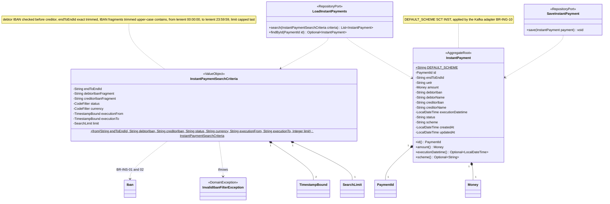
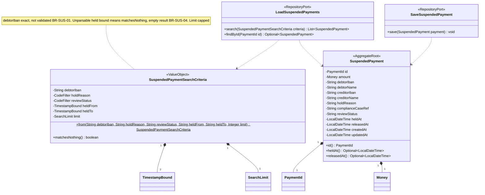
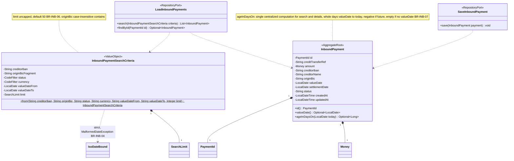
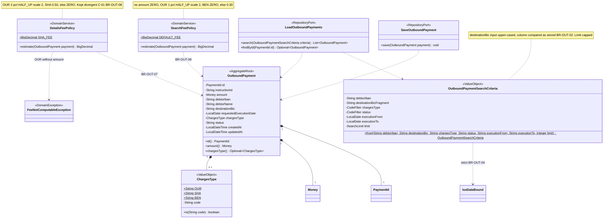
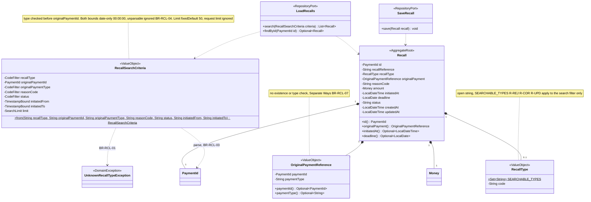
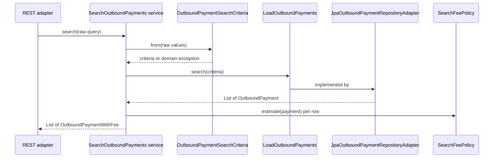
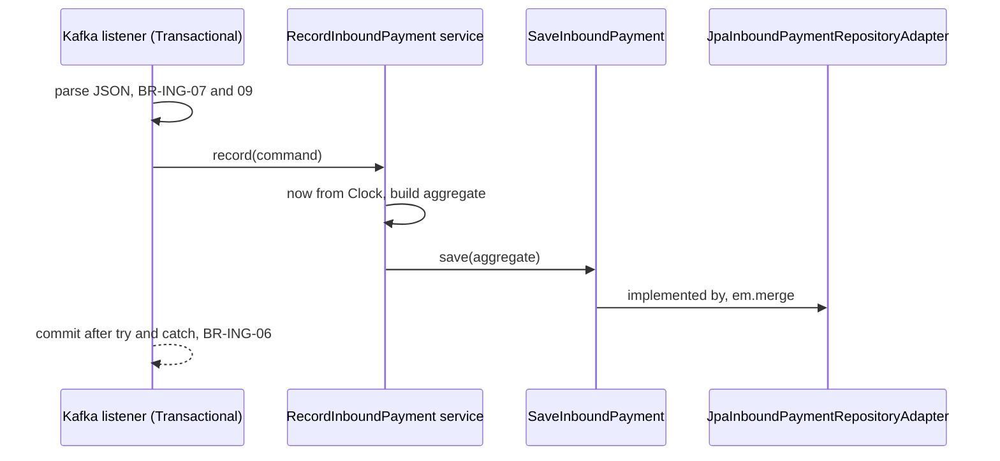
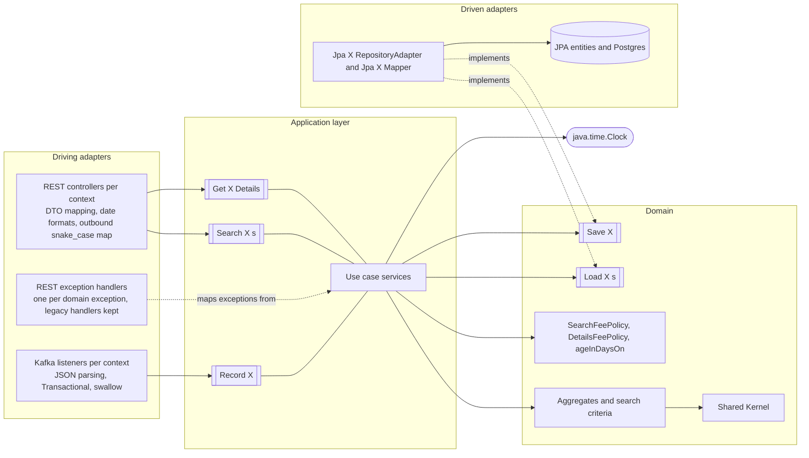

# Isolated Domain Design — realistic-mess-based-on-jpa-entities-challenge

- **Status:** FINAL. Gate 1 (domain model) and Gate 2 (port design) approved on 2026-11-12 (user answers relayed verbatim by `hexagonal-architecture-migration-orchestrator`).
- **Produced by:** `isolated-domain-architect`, Phase 3 of the hexagonal-architecture migration. Design only: no source, test or build file was modified.
- **Primary reference:** [`ddd-domain-analysis.md`](ddd-domain-analysis.md) (75 validated rules, conflicts C-01..C-06, risks R-01..R-11, OQ-01). Secondary: [`ddd-test-coverage.md`](ddd-test-coverage.md) (307 tests, MAC-01..MAC-08).
- **Constraints read:** `../AGENTS.md`, `./AGENTS.md`, `docs/java-coding-conventions.md`.
- **Downstream consumer:** `technical-layer-adapter-design-architect` (Phase 4), then `incremental-hexagonal-architecture-migration` (Phase 5).

---

## 1. Executive Summary

The module is a read-only payment back-office: five record types are upserted from Kafka and queried over REST. Business logic is thin and currently scattered across controllers, services, `@Repository` JPQL builders, Kafka listeners and the static `PaymentUtils`; JPA entities with public mutable fields act as the domain model.

This design defines, for each of the five unchanged Bounded Contexts plus the Shared Kernel:

- an **isolated, framework-free domain** (immutable final classes with `Optional` accessors, `java.time`, open-string codes) that owns search-criteria semantics, limit policy, date grammars, IBAN-length and recall-type validation, the two outbound fee policies and the inbound age computation;
- **25 ports**: per context 3 application-owned input ports (`Search<X>s`, `Get<X>Details`, `Record<X>`) and 2 domain-owned repository ports (`Load<X>s`, `Save<X>`); time comes from an injected JDK `java.time.Clock` (no custom port);
- a **mapping boundary** `Domain aggregate <-> Jpa<X>Mapper <-> existing JPA entity`; entities, `schema.sql` and `data.sql` stay unchanged;
- an **error contract** preserved bit-for-bit through independent domain exceptions (`RuntimeException`) with one explicit REST handler each, plus the unchanged legacy handlers as a safety net;
- an **incremental extraction strategy** (one context per iteration, lowest risk first) with design risks DR-R1..DR-R11.

Every existing behaviour, including the intentional quirks (C-01..C-06), is expressible by the target design and must stay pinned by the 307 Phase 2 tests (MAC-01..MAC-08).

## 2. Reference to the Domain Analysis and Baseline Business Model

Baseline taken from `ddd-domain-analysis.md` (FINAL, all 75 rules **V**):

| Item | Baseline used |
|---|---|
| Business model | Read model of payments processed elsewhere (A-01); Kafka is the only write path, HTTP is GET-only (BR-API-01). |
| Rules | BR-SHR-01..10, BR-API-01..09, BR-ING-01..12, BR-INS-01..09, BR-SUS-01..06, BR-INB-01..08, BR-OUT-01..10, BR-RCL-01..08, BR-DAT-01..03. |
| Conflicts kept | C-01 two fee tables, C-02 malformed id 400 vs outbound 404, C-03 limits per type, C-04 date bounds per type, C-05 IBAN filter per type, C-06 field naming. |
| Phase 2 decision P2-Q1 | Malformed ids/dates/negative limit return 400 (`Invalid UUID string: ...`, `Bad request`, `max-results cannot be negative`); outbound malformed id 404; non-GET 500 (N-01); non-integer limit 500 (BR-API-08). |
| Open question | OQ-01: business meaning of every code (statuses, hold reasons, review statuses, charges types, recall types, reason codes) is unknown; codes are modelled as observed values. |

Confirmed vs inferred: all rules are confirmed by tests (Phase 2). The design adds no business semantics beyond them.

## 3. Existing Bounded Contexts and Responsibilities

Unchanged (decisions G2-Q1..G2-Q6). No boundary was merged, split or renamed.

| Context | Class. | Responsibility | Aggregate root | Owned rules |
|---|---|---|---|---|
| Instant Payments | Supporting | Query instant payment executions; validate IBAN filters | `InstantPayment` | BR-INS-01..09, BR-ING-10 |
| Suspended Payments | Supporting | Query held payments and their release | `SuspendedPayment` | BR-SUS-01..06 |
| Inbound Payments | Supporting | Query incoming transfers; age in days | `InboundPayment` | BR-INB-01..08 |
| Outbound Payments | Supporting | Query outgoing transfers; two fee policies | `OutboundPayment` | BR-OUT-01..10 |
| Recalls | Supporting | Query recalls; recall-type filter validation | `Recall` | BR-RCL-01..08, BR-ING-11 |
| Shared Kernel | Generic | PaymentId, Money, API date/time formats, limit policy, IBAN length validation, code-filter normalization | — | BR-SHR-01..10 |

Cross-cutting: BR-API-* owned by each context's REST adapter, BR-ING-* by each context's Kafka adapter, BR-DAT-* by persistence adapters and test infrastructure. Recalls → Instant/Inbound/Outbound: Separate Ways (id + type reference, no integrity check, BR-RCL-07).

## 4. Current-State Technical Architecture

Flow: controller → service → hand-written `EntityManager` repository (string-built JPQL) → JPA entity. Kafka listeners bypass the flow and `em.merge` entities inside a `@Transactional` listener method. `OutboundPaymentController.get` bypasses the service and uses `EntityManager.find`.

| Concern | Where today | Coupled to |
|---|---|---|
| Filter semantics, ordering, limits, UUID/date parsing | 5 `@Repository` classes | `EntityManager`, request DTOs, `java.sql` types, Spring exception translation |
| IBAN filter check / recall-type check | `InstantPaymentService` / `RecallService` | `IllegalArgumentException` → `GlobalExceptionHandler` |
| Search fee policy | `OutboundPaymentService.estimateFee` | JPA entity |
| Details fee policy + snake_case payload | `OutboundPaymentController.get` | `EntityManager`, JPA entity, `Map` |
| Age in days | `InboundPaymentController.search` and `InboundPaymentService.getById` | `LocalDate.now()` |
| Response mapping | instant/inbound repositories (return DTOs); suspended/outbound/recall services | DTOs, shared `SimpleDateFormat` |
| Event parsing and upsert | 5 listeners | Jackson, `EntityManager.merge`, `@Transactional` |
| Domain state | 5 entities, public mutable fields | `jakarta.persistence`, `java.sql.Timestamp`/`Date` |

Findings that constrain the design:

1. **Implicit error precedence.** Service checks first (IBAN debtor → creditor; recall type), then repository parsing in field order, then `setMaxResults` (limit) last. Example: inbound with a malformed date and a negative limit returns `Bad request`.
2. **Legacy grammars.** `Timestamp.valueOf` / `Date.valueOf` accept 1-digit month/day and fractional seconds; `PaymentUtils.parseTimestamp` uses a lenient `SimpleDateFormat` (prefix parsing, field roll-over, trailing garbage ignored); `UUID.fromString` messages vary (`Invalid UUID string: x`, `UUID string too large`).
3. **BR-ING-06 depends on the transaction boundary.** The flush happens at commit, after the listener's `try/catch`, so constraint violations propagate.
4. **BigDecimal scale is observable** (`BigDecimal.ZERO` renders `0`, `0.30` renders `0.30`; DB amounts keep scale 2).
5. **Outbound details render `created_at`/`updated_at` via Jackson's `java.sql.Timestamp` serialization** (UTC, milliseconds, `+00:00`; N-02).
6. **Stored data is never validated** (BR-ING-12, BR-SHR-10); text fields can be `null`, `""` or the literal `"null"` (BR-ING-07); constraints (length, NOT NULL, scale) are enforced only by Postgres.
7. **LIKE wildcards are not escaped**; user `%`/`_` act as wildcards.

Undocumented technical constraints: none reported beyond the above.

## 5. Design Goals and Constraints

| ID | Goal / constraint |
|---|---|
| G-01 | Preserve all 75 rules and C-01..C-06 bit-for-bit (MAC-01..MAC-06). |
| G-02 | Domain free of Spring, Jakarta Persistence, Hibernate, Jackson, Kafka, JDBC and `java.sql` (conventions "Framework isolation"; AC-04). |
| G-03 | Domain objects immutable; public domain methods never return `null` (Gate 1 Q1). |
| G-04 | Codes remain open strings (BR-SHR-10, OQ-01); no closed enums for statuses or codes. |
| G-05 | The domain does not enforce persistence constraints (keeps BR-ING-05 vs BR-ING-06 split). |
| G-06 | No abstraction without a concrete benefit (DIP R10/R17, AC-06). |
| G-07 | Legacy code is not cleaned up outside a migration iteration (`AGENTS.md` "one rule"). |
| G-08 | Hand-written `EntityManager` + string-built JPQL style kept in the persistence adapter (module `AGENTS.md`). |

## 6. Proposed Isolated Domain Models

### 6.1 Package structure and dependency rules

```
fr.kevin.llps.payments.domain.sharedkernel
fr.kevin.llps.payments.domain.<ctx>            aggregate (and policies) and use-case services (*Service)
fr.kevin.llps.payments.domain.<ctx>.command    commands (*Command)
fr.kevin.llps.payments.domain.<ctx>.query      search queries (*Query) and search criteria (*Criteria)
fr.kevin.llps.payments.domain.<ctx>.port.in    input-port interfaces only
fr.kevin.llps.payments.domain.<ctx>.port.out   output (repository) port interfaces only: Load<X>s, Save<X>
```

<ctx> is one of instant, suspended, inbound, outbound, recall. Example (suspended, template for every context): `domain.suspended` holds `SuspendedPayment`, `SearchSuspendedPaymentsService`, `GetSuspendedPaymentDetailsService`, `RecordSuspendedPaymentService`; `domain.suspended.command` holds `RecordSuspendedPaymentCommand`; `domain.suspended.query` holds `SuspendedPaymentSearchCriteria` and `SuspendedPaymentSearchQuery`; `domain.suspended.port.in` holds `SearchSuspendedPayments`, `GetSuspendedPaymentDetails`, `RecordSuspendedPayment`; `domain.suspended.port.out` holds `LoadSuspendedPayments`, `SaveSuspendedPayment`. Views such as `InboundPaymentView` / `OutboundPaymentWithFee` are use-case outputs and will be placed when their contexts migrate.

The physical split was decided in Phase 4/5: the Maven `domain` module holds the model, the use-case services and both port packages (layout revised at the Phase 5 IT-02 gate, 2026-11-12: no `usecase` package). The rules below hold; "domain model" means every domain class outside the `port` packages that is not a use-case service (`*Service`): aggregates, the `command` and `query` packages and the shared kernel (IT-02 gate, 3rd presentation).

| Rule | Statement |
|---|---|
| DR-1 | Domain imports only `java.lang`, `java.util`, `java.math`, `java.time`. No `java.sql`, `jakarta.*`, `org.springframework.*`, `org.hibernate.*`, `com.fasterxml.*`, `org.apache.kafka.*`; no annotations. |
| DR-2 | A context package (including its `command`, `query`, `port.in` and `port.out` sub-packages) depends only on itself and `sharedkernel`; no context-to-context import. |
| DR-3 | `sharedkernel` depends on no other domain package. |
| DR-4 | The domain never depends on adapter or bootstrap code. |
| DR-6 | The domain model (aggregates, `command`, `query`, shared kernel) never depends on use-case services (`*Service`) or on `port.in` / `port.out`; use-case services depend on the model and the ports of their own context; `port.out` depends only on the model (reworded at the Phase 5 IT-02 gate, 2026-11-12). |
| DR-5 | No static utility classes; static factory methods on value objects are allowed (`PaymentId.parse`, `SearchLimit.capped`). |

### 6.2 Cross-cutting modelling choices

- **Classes:** immutable `final` classes, `private final` fields, `Optional<T>` accessors for every nullable attribute; `PaymentId` is the only mandatory attribute of an aggregate. Text attributes keep `null`, `""` and `"null"` distinct.
- **Codes:** `String` unless behaviour exists; value types only for `ChargesType` (fee tables) and `RecallType` (search allow-list). IBAN and BIC are stored as raw `String` in aggregates.
- **Time:** `LocalDateTime` / `LocalDate` in the JVM default zone (A-03). Audit timestamps `createdAt`, `updatedAt` are plain aggregate attributes.
- **Exceptions:** independent domain exceptions, each `extends RuntimeException`, no shared base (Gate 2 Q3). Messages reproduce today's bodies exactly.
- **No domain events** (none exist; ingestion events are upsert commands handled by adapters).

### 6.3 Class catalog

| Class | Context | Category | Purpose / behaviour | Rules | Notes |
|---|---|---|---|---|---|
| `PaymentId` | SK | Value object | Wraps `UUID`. `of(UUID)`, `parse(String)` delegating to `UUID.fromString` and reusing its message in `InvalidPaymentIdException`. No trim (adapters decide, BR-API-06). | BR-SHR-01, BR-API-05, BR-RCL-03 | DR-R4 |
| `Money` | SK | Value object | `amount()` `Optional<BigDecimal>`, `currency()` `Optional<String>`. No scale normalization, no NOT NULL check. | BR-SHR-09 (persistence-enforced) | Recall amount/currency nullable |
| `SearchLimit` | SK | Value object | `capped(Integer)`: null→50, >200→200, else as is; `uncapped(Integer)`: null→50; `fixedDefault()`: 50 ignoring input. Negative → `NegativeSearchLimitException("max-results cannot be negative")`; 0 allowed. | BR-SHR-02, BR-SHR-03, BR-INB-06, BR-RCL-05 | Gate 1 Q3 |
| `CodeFilter` | SK | Value object | `from(String raw)`: blank/null → empty, else trim + upper-case. | BR-SHR-08 | |
| `Iban` | SK | Value object | `of(raw)`, `hasValidLength()`: non-null, 15..34 after removing `' '`. Non-enforcing. | BR-SHR-04 | |
| `TimestampBound` | SK | Value object | `absent()`; `lenient(raw, dateOnlyTime)`: trim, `T`→space, 10 chars + time, `Timestamp.valueOf` grammar, unparsable → absent; `strictApiFormat(raw)`: BR-SHR-06 lenient-`SimpleDateFormat` grammar, unparsable → unsatisfiable. `value()`, `isUnsatisfiable()`. | BR-SHR-06, BR-INS-06/07, BR-SUS-03/04, BR-RCL-04 | Exact grammars (Gate 1 Q7) |
| `IsoDateBound` | SK | Value object | `parse(raw)`: blank → empty; `Date.valueOf` grammar after trim; malformed → `MalformedDateException` (no message for a shape/range error; the number-format message for a non-numeric field, note 2026-11-12). | BR-INB-04, BR-OUT-04 | |
| `ApiDateTimeFormat` | SK | Constants | `TIMESTAMP_PATTERN = yyyy-MM-dd'T'HH:mm:ss`, `DATE_PATTERN = yyyy-MM-dd`; used by REST adapters for rendering. | BR-SHR-05 | |
| `InvalidPaymentIdException`, `NegativeSearchLimitException`, `MalformedDateException` | SK | Domain exceptions | See §11.3 for mapping. | | |
| `InstantPayment` | INS | Aggregate root | 13 attributes; `DEFAULT_SCHEME = "SCT INST"` (applied by the Kafka adapter). | BR-INS-09, BR-ING-10 | |
| `InstantPaymentSearchCriteria` | INS | Value object + factory | `from(...)`: debtor IBAN then creditor IBAN check (`InvalidIbanFilterException` `Invalid debtor IBAN` / `Invalid creditor IBAN`, blanks ignored), endToEndId exact trimmed, IBAN fragments trimmed upper-case (contains, inner spaces kept), status/currency `CodeFilter`, `executionFrom` lenient 00:00:00, `executionTo` lenient 23:59:59, limit `capped` last. | BR-INS-01..08 | N-03 kept |
| `SuspendedPayment` | SUS | Aggregate root | 13 attributes; `releasedAt` empty while not released. | BR-SUS-06 | |
| `SuspendedPaymentSearchCriteria` | SUS | Value object + factory | debtorIban exact trimmed (no validation), holdReason/reviewStatus `CodeFilter`, held bounds `strictApiFormat`, limit `capped`; `matchesNothing()` when a held bound is unsatisfiable. | BR-SUS-01..05 | |
| `InboundPayment` | INB | Aggregate root | 11 attributes; `ageInDaysOn(LocalDate today)` → `Optional<Long>`: `ChronoUnit.DAYS.between(valueDate, today)`, negative if future, empty when no value date. **Single centralized computation** used by both search and details. | BR-INB-07, BR-INB-08 | Gate 2 Q2 (reverses Gate 1 Q4) |
| `InboundPaymentSearchCriteria` | INB | Value object + factory | creditorIban exact, originBic fragment (case-insensitive contains), status/currency `CodeFilter`, `valueDateFrom` then `valueDateTo` via `IsoDateBound`, limit `uncapped` last. | BR-INB-01..06 | |
| `OutboundPayment` | OUT | Aggregate root | 11 attributes; `chargesType()` `Optional<ChargesType>`. | BR-OUT-09 (data) | |
| `ChargesType` | OUT | Value object | Open string; constants `OUR`, `SHA`, `BEN`; `is(String)` exact, case-sensitive. | BR-OUT-06/07, BR-SHR-10 | Meanings unknown (OQ-01) |
| `SearchFeePolicy` | OUT | Domain service | No amount → `BigDecimal.ZERO`; `OUR` → amount × 0.01, HALF_UP, scale 2; `BEN` → `BigDecimal.ZERO`; else `0.30`. | BR-OUT-06, BR-OUT-08 | |
| `DetailsFeePolicy` | OUT | Domain service | `OUR` → amount × 0.02, HALF_UP, scale 2 (no amount → `FeeNotComputableException`); `SHA` → `0.50`; else `BigDecimal.ZERO`. | BR-OUT-07, BR-OUT-08 | No shared interface with `SearchFeePolicy` (LSP) |
| `OutboundPaymentSearchCriteria` | OUT | Value object + factory | debtorIban exact, destinationBic fragment upper-cased (column compared as stored), chargesType/status `CodeFilter`, `executionFrom` then `executionTo` via `IsoDateBound`, limit `capped` last. | BR-OUT-01..05 | |
| `Recall` | RCL | Aggregate root | 11 attributes incl. `OriginalPaymentReference`, `Money` (optional parts). | BR-RCL-07/08 | |
| `RecallType` | RCL | Value object | Open string; `SEARCHABLE_TYPES = {R-REJ, R-COR, R-UPD}` for the search filter only. | BR-RCL-01, BR-SHR-10 | |
| `OriginalPaymentReference` | RCL | Value object | `paymentId()` `Optional<PaymentId>`, `paymentType()` `Optional<String>`; no existence or type check. | BR-RCL-07 | Separate Ways |
| `RecallSearchCriteria` | RCL | Value object + factory | recallType checked first (`UnknownRecallTypeException("Unknown recall type: " + raw)`), then originalPaymentId (`PaymentId.parse(trimmed)`), codes via `CodeFilter`, both initiated bounds lenient 00:00:00, limit `fixedDefault()` (request limit ignored, never rejected). | BR-RCL-01..06 | |
| `InvalidIbanFilterException`, `UnknownRecallTypeException`, `FeeNotComputableException` | INS / RCL / OUT | Domain exceptions | See §11.3. | | |

**Implementation notes (2026-11-12, Phase 5 IT-01 gate, user-approved):**
- **F-01:** `MalformedDateException` carries the `NumberFormatException` message for a non-numeric date field (e.g. `Error at index 1 in: "1x"`) and `null` for a shape/range error; the REST adapter renders the message, or `Bad request` when null, exactly like the legacy handler.
- **F-02:** `IsoDateBound` is a record `IsoDateBound(LocalDate value)` whose `parse(String)` returns `Optional<IsoDateBound>` (value object rather than static utility, DR-5).
- **F-03:** `TimestampBound` values are wall-clock `LocalDateTime`s; resolving a DST gap or overlap is left to the persistence adapter (`Timestamp.valueOf(LocalDateTime)`, same lenient resolution as the legacy `Timestamp` construction), to be pinned by JPA adapter tests.
- **F-04:** exotic inputs accepted as unpinned divergences: years before 1583 (Julian vs proleptic Gregorian), `+` in an exponent, numeric overflow or exponents producing years beyond ±999,999,999, locale-specific minus signs.

Classes from the analysis's proposal **not** retained (they were proposals, not approved decisions): per-field value objects `EndToEndId`, `Uetr`, `Scheme`, status types, `HoldPeriod`, `Bic` (no behaviour, replaced by `String`); `IbanFilterValidation` and `RecallTypeFilterValidation` (folded into criteria factories); `AgeInDaysCalculator` (replaced by an aggregate method).

## 7. Mermaid Class Diagrams per Isolated Domain

### 7.1 Shared Kernel

```mermaid
classDiagram
    class PaymentId {
        <<ValueObject>>
        -UUID value
        +of(UUID value)$ PaymentId
        +parse(String raw)$ PaymentId
        +value() UUID
    }
    class Money {
        <<ValueObject>>
        -BigDecimal amount
        -String currency
        +of(BigDecimal amount, String currency)$ Money
        +amount() Optional~BigDecimal~
        +currency() Optional~String~
    }
    class SearchLimit {
        <<ValueObject>>
        +int DEFAULT_LIMIT$
        +int MAX_LIMIT$
        -int value
        +capped(Integer requested)$ SearchLimit
        +uncapped(Integer requested)$ SearchLimit
        +fixedDefault()$ SearchLimit
        +value() int
    }
    class CodeFilter {
        <<ValueObject>>
        -String value
        +from(String raw)$ Optional~CodeFilter~
        +value() String
    }
    class Iban {
        <<ValueObject>>
        +int MIN_LENGTH$
        +int MAX_LENGTH$
        -String value
        +of(String raw)$ Iban
        +hasValidLength() boolean
    }
    class TimestampBound {
        <<ValueObject>>
        +absent()$ TimestampBound
        +lenient(String raw, LocalTime dateOnlyTime)$ TimestampBound
        +strictApiFormat(String raw)$ TimestampBound
        +value() Optional~LocalDateTime~
        +isUnsatisfiable() boolean
    }
    class IsoDateBound {
        <<ValueObject>>
        +parse(String raw)$ Optional~LocalDate~
    }
    class ApiDateTimeFormat {
        <<Constants>>
        +String TIMESTAMP_PATTERN$
        +String DATE_PATTERN$
    }
    class InvalidPaymentIdException {
        <<DomainException>>
    }
    class NegativeSearchLimitException {
        <<DomainException>>
    }
    class MalformedDateException {
        <<DomainException>>
    }
    PaymentId ..> InvalidPaymentIdException : throws, message from UUID.fromString
    SearchLimit ..> NegativeSearchLimitException : throws on negative value
    IsoDateBound ..> MalformedDateException : throws, no message
    note for SearchLimit "capped BR-SHR-02, uncapped BR-INB-06, fixedDefault 50 ignores input BR-RCL-05, negative rejected BR-SHR-03"
    note for TimestampBound "lenient: Timestamp.valueOf grammar, unparsable means absent. strictApiFormat: BR-SHR-06 grammar, unparsable means unsatisfiable BR-SUS-04"
    note for Money "no invariant beyond carrying values, DB enforces scale and NOT NULL BR-SHR-09"
```



### 7.2 Instant Payments



### 7.3 Suspended Payments



### 7.4 Inbound Payments



### 7.5 Outbound Payments



### 7.6 Recalls



## 8. Business Rule and Invariant Ownership Mapping

| Rule(s) | Owner in target | Today |
|---|---|---|
| BR-SHR-01 | `PaymentId` (domain) | entities, listeners |
| BR-SHR-02, BR-INB-06, BR-RCL-05 | `SearchLimit.capped` / `uncapped` / `fixedDefault` | `PaymentUtils`, repositories |
| BR-SHR-03 | `SearchLimit` (negative rejected, message `max-results cannot be negative`) | Hibernate `setMaxResults` |
| BR-SHR-04 | `Iban.hasValidLength` | `PaymentUtils.isValidIban` |
| BR-SHR-05 | `ApiDateTimeFormat` constants + REST adapters | `PaymentUtils.FMT`/`DAY_FMT` |
| BR-SHR-06, BR-INS-06/07, BR-SUS-03/04, BR-RCL-04 | `TimestampBound` + criteria factories | repositories |
| BR-SHR-07 | `PaymentUtils` kept untouched until the last iteration, then deleted with unused-helper tests (Gate 1 Q6) | `PaymentUtils` |
| BR-SHR-08 | `CodeFilter` | repositories |
| BR-SHR-09 | Postgres (`schema.sql`), not the domain | `schema.sql` |
| BR-SHR-10, BR-ING-12 | Open strings; no validation in domain or ingestion | entities, listeners |
| BR-INS-01/02 | `InstantPaymentSearchCriteria.from` | `InstantPaymentService` |
| BR-INS-03..05, BR-SUS-01/02, BR-INB-01..03, BR-OUT-01..03, BR-RCL-02 | Criteria (normalized values) + persistence adapter (JPQL operator) | repositories |
| BR-INS-08, BR-SUS-05, BR-INB-05, BR-OUT-05, BR-RCL-06 | Persistence adapter (ordering) | repositories |
| BR-INS-09, BR-SUS-06, BR-RCL-08 | Aggregates + REST adapter (same DTO for search and details, formats) | services / repositories |
| BR-INB-04, BR-OUT-04 | `IsoDateBound` → `MalformedDateException` | `Date.valueOf` in repositories |
| BR-INB-07, BR-INB-08 | `InboundPayment.ageInDaysOn(today)`: one computation, used by both search and details use cases; BR-INB-08 met by observable behaviour | controller + service |
| BR-OUT-06 | `SearchFeePolicy` | `OutboundPaymentService` |
| BR-OUT-07 | `DetailsFeePolicy` (OUR without amount → `FeeNotComputableException` → 500) | `OutboundPaymentController` (NPE → 500) |
| BR-OUT-08 | Both policies, no shared interface | service + controller |
| BR-OUT-09 | Outbound REST adapter (snake_case map) | controller |
| BR-OUT-10 | **Dropped** (Gate 1 Q5); `outboundGetById_foundAndMissing` retired | unused service method |
| BR-RCL-01, BR-RCL-03 | `RecallSearchCriteria.from` (+ `PaymentId.parse`) | service + repository |
| BR-RCL-07 | `OriginalPaymentReference` (no check) | entity, listener |
| BR-API-01..09 | REST adapters + exception handlers (§11.3) | controllers, `GlobalExceptionHandler` |
| BR-ING-01..12 | Kafka adapters (+ `Record<X>` use cases for BR-ING-03/04) | listeners |
| BR-DAT-01..03 | Persistence adapter / test infrastructure, unchanged | `schema.sql`, `data.sql`, IT |

Invariants: aggregates carry no cross-field invariant today; the only domain-enforced constraints are the search-input rules above. Persistence constraints (lengths, NOT NULL, scale 2) are deliberately **not** enforced in the domain (G-05, DR-R7).

## 9. JPA and Persistence Separation Strategy

- The 5 JPA entities (`fr.kevin.llps.payments.entity.*`, public fields, `java.sql` types, snake_case `@Column`) stay as they are and become **persistence-adapter classes**; they are never referenced by domain or application code.
- `ddl-auto: none`, `schema.sql` and `data.sql` unchanged (BR-DAT-01..03, MAC-06).
- Repository ports (`Load<X>s`, `Save<X>`) are owned by the domain and expose only domain types.
- Business rules never live in JPA callbacks; there are none today and none are added.
- The persistence adapter keeps hand-written `EntityManager` access with string-built JPQL and named parameters (module `AGENTS.md`), now driven by typed criteria instead of request DTOs.

## 10. Domain-to-Persistence Mapping Responsibilities

`Domain aggregate <-> Jpa<X>Mapper <-> JPA entity`, one mapper per context, in the persistence adapter.

| Domain | JPA entity | Conversion |
|---|---|---|
| `PaymentId` | `UUID id` | `PaymentId.of(uuid)` / `value()` |
| `Money` | `BigDecimal amount`, `String currency` | as is, no rescaling |
| `LocalDateTime` | `java.sql.Timestamp` | `toLocalDateTime()` / `Timestamp.valueOf(ldt)` (JVM default zone, A-03) |
| `LocalDate` | `java.sql.Date` | `toLocalDate()` / `Date.valueOf(ld)` |
| `ChargesType`, `RecallType` | `String` | wrap / unwrap code |
| `OriginalPaymentReference` | `UUID originalPaymentId`, `String originalPaymentType` | wrap / unwrap |
| `Optional` accessors | nullable fields | `orElse(null)` on the way to the entity |

`Jpa<X>RepositoryAdapter` responsibilities:

- `search(criteria)`: build JPQL clauses only for present criteria; keep each operator exactly: exact match, `UPPER(col) LIKE %x%` (instant IBANs, inbound BIC), `col LIKE %X%` without `UPPER` (outbound BIC, BR-OUT-02), code equality; inclusive bounds; ordering per context; `setMaxResults(criteria.limit().value())`; no LIKE escaping (DR-R10); for suspended, return an empty list when `criteria.matchesNothing()` (BR-SUS-04).
- `findById(id)`: `em.find`, mapped, `Optional`.
- `save(aggregate)`: map then `em.merge` (full-replace upsert, BR-ING-03); no explicit `flush` (DR-R3).

## 11. Port Catalog and Interface Responsibilities

Ports per context `<X>` ∈ {Instant (INS), Suspended (SUS), Inbound (INB), Outbound (OUT), Recall (RCL)}: 5 × 5 = **25 ports**.

### 11.1 Catalog

| ID | Name | Category | Owner | Operations (conceptual) | Input / output types |
|---|---|---|---|---|---|
| P-INS-IN-1 | `SearchInstantPayments` | Input | Application | `search(InstantPaymentSearchQuery)` | raw filter strings + `Integer limit` → `List<InstantPayment>` |
| P-INS-IN-2 | `GetInstantPaymentDetails` | Input | Application | `getDetails(PaymentId)` | → `Optional<InstantPayment>` |
| P-INS-IN-3 | `RecordInstantPayment` | Input | Application | `record(RecordInstantPaymentCommand)` | parsed `java.time`/`UUID`/`BigDecimal` values → `void` |
| P-INS-OUT-1 | `LoadInstantPayments` | Repository | Domain | `search(InstantPaymentSearchCriteria)`, `findById(PaymentId)` | → `List<InstantPayment>`, `Optional<InstantPayment>` |
| P-INS-OUT-2 | `SaveInstantPayment` | Repository | Domain | `save(InstantPayment)` | full-replace upsert |
| P-SUS-IN-1 | `SearchSuspendedPayments` | Input | Application | `search(SuspendedPaymentSearchQuery)` | → `List<SuspendedPayment>` |
| P-SUS-IN-2 | `GetSuspendedPaymentDetails` | Input | Application | `getDetails(PaymentId)` | → `Optional<SuspendedPayment>` |
| P-SUS-IN-3 | `RecordSuspendedPayment` | Input | Application | `record(RecordSuspendedPaymentCommand)` | → `void` |
| P-SUS-OUT-1 | `LoadSuspendedPayments` | Repository | Domain | `search(SuspendedPaymentSearchCriteria)`, `findById(PaymentId)` | |
| P-SUS-OUT-2 | `SaveSuspendedPayment` | Repository | Domain | `save(SuspendedPayment)` | |
| P-INB-IN-1 | `SearchInboundPayments` | Input | Application | `search(InboundPaymentSearchQuery)` | → `List<InboundPaymentView>` |
| P-INB-IN-2 | `GetInboundPaymentDetails` | Input | Application | `getDetails(PaymentId)` | → `Optional<InboundPaymentView>` |
| P-INB-IN-3 | `RecordInboundPayment` | Input | Application | `record(RecordInboundPaymentCommand)` | → `void` |
| P-INB-OUT-1 | `LoadInboundPayments` | Repository | Domain | `search(InboundPaymentSearchCriteria)`, `findById(PaymentId)` | |
| P-INB-OUT-2 | `SaveInboundPayment` | Repository | Domain | `save(InboundPayment)` | |
| P-OUT-IN-1 | `SearchOutboundPayments` | Input | Application | `search(OutboundPaymentSearchQuery)` | → `List<OutboundPaymentWithFee>` (search fee) |
| P-OUT-IN-2 | `GetOutboundPaymentDetails` | Input | Application | `getDetails(PaymentId)` | → `Optional<OutboundPaymentWithFee>` (details fee) |
| P-OUT-IN-3 | `RecordOutboundPayment` | Input | Application | `record(RecordOutboundPaymentCommand)` | → `void` |
| P-OUT-OUT-1 | `LoadOutboundPayments` | Repository | Domain | `search(OutboundPaymentSearchCriteria)`, `findById(PaymentId)` | |
| P-OUT-OUT-2 | `SaveOutboundPayment` | Repository | Domain | `save(OutboundPayment)` | |
| P-RCL-IN-1 | `SearchRecalls` | Input | Application | `search(RecallSearchQuery)` | → `List<Recall>` (query limit ignored) |
| P-RCL-IN-2 | `GetRecallDetails` | Input | Application | `getDetails(PaymentId)` | → `Optional<Recall>` |
| P-RCL-IN-3 | `RecordRecall` | Input | Application | `record(RecordRecallCommand)` | → `void` |
| P-RCL-OUT-1 | `LoadRecalls` | Repository | Domain | `search(RecallSearchCriteria)`, `findById(PaymentId)` | |
| P-RCL-OUT-2 | `SaveRecall` | Repository | Domain | `save(Recall)` | |

Application result types (final classes, `Optional` accessors, no `Optional` fields):

- `InboundPaymentView(InboundPayment payment, Long ageInDays)`: `ageInDays` computed by `payment.ageInDaysOn(LocalDate.now(clock))` in both the search and details use cases.
- `OutboundPaymentWithFee(OutboundPayment payment, BigDecimal estimatedFee)`: search use case applies `SearchFeePolicy` only; details use case applies `DetailsFeePolicy` only.

Not a port: **time**. Use cases receive the JDK `java.time.Clock` by constructor (Gate 2 Q1); bootstrap provides `Clock.systemDefaultZone()`, tests use `Clock.fixed`. Rationale: `Clock` is already a stable JDK abstraction (DIP R17); it also removes risk R-03 (midnight flakiness).

### 11.2 Use-case behaviour (application services)

| Use case | Steps |
|---|---|
| `Search<X>s` | 1. `<X>SearchCriteria.from(raw query)` (domain validation, legacy error order, limit last). 2. `Load<X>s.search(criteria)`. 3. Inbound: add `ageInDaysOn(today)`; Outbound: add `SearchFeePolicy.estimate`. |
| `Get<X>Details` | 1. `Load<X>s.findById(id)`. 2. Inbound: add `ageInDaysOn(today)`; Outbound: add `DetailsFeePolicy.estimate`. |
| `Record<X>` | 1. `now = LocalDateTime.now(clock)` (one reading for `createdAt` and `updatedAt`, BR-ING-04). 2. Build the aggregate from the command. 3. `Save<X>.save(aggregate)`. |

### 11.3 REST error mapping (Gate 2 Q3: independent exceptions, one explicit handler each)

| Exception (`extends RuntimeException`) | Thrown by | HTTP status / body | Rule |
|---|---|---|---|
| `InvalidIbanFilterException` | `InstantPaymentSearchCriteria` | 400 `{"error":"Invalid debtor IBAN"}` / `{"error":"Invalid creditor IBAN"}` | BR-INS-01/02, BR-API-02 |
| `UnknownRecallTypeException` | `RecallSearchCriteria` | 400 `{"error":"Unknown recall type: <raw>"}` | BR-RCL-01 |
| `InvalidPaymentIdException` | `PaymentId.parse` | 400 `{"error":"<UUID.fromString message>"}` (instant, suspended, inbound, recall details; recall `originalPaymentId` filter). **Outbound details:** the REST adapter catches it and returns 404, empty body. | BR-API-05, BR-RCL-03, C-02 |
| `NegativeSearchLimitException` | `SearchLimit` | 400 `{"error":"max-results cannot be negative"}` | BR-SHR-03 |
| `MalformedDateException` | `IsoDateBound` | 400 `{"error":"Bad request"}`, or `{"error":"<message>"}` when it carries the number-format message (note 2026-11-12) | BR-API-07, BR-INB-04, BR-OUT-04 |
| `FeeNotComputableException` | `DetailsFeePolicy` | no dedicated handler: generic 500 `{"error":"Something went wrong, contact support with the trace id"}`, logged at ERROR | BR-OUT-07, BR-API-03 |

Kept unchanged (Gate 2 Q5): `GlobalExceptionHandler` handlers for `IllegalArgumentException` (400, message or `Bad request`), `InvalidDataAccessApiUsageException` caused by `IllegalArgumentException` (400) and `Exception` (500). They remain a safety net and `GlobalExceptionHandlerTest` stays green. Also unchanged: non-integer `limit` → 500 (BR-API-08), non-GET → 500 (N-01), unknown id → 404 empty (BR-API-04).

## 12. Port Justifications and Architectural Ownership

| Port group | Justification | Ownership rationale |
|---|---|---|
| `Search<X>s`, `Get<X>Details` | Two REST endpoints per type with different results (outbound fee policies, C-01); keeps business validation inside the hexagon (criteria built from the raw query in the use case, so error order is centrally controlled). | Application: they expose use cases. |
| `Record<X>` | Kafka is the only write path; separates JSON parsing (adapter) from aggregate construction and audit timestamps (application). | Application. |
| `Load<X>s` | Read side for search and details; ISP split from save because the read use cases never write. | Domain, per context package (Gate 2 Q4): collection-like abstraction of the aggregate in domain types. |
| `Save<X>` | Write side for ingestion only. | Domain (Gate 2 Q4). |
| (no clock port) | JDK `Clock` suffices (Gate 2 Q1). | — |
| (no event publisher, no external API port) | The application emits no events and calls no external system. | — |

Alternatives considered and rejected are listed in §20.

## 13. Technical Layers Impacted by Each Port

| Port | REST controllers | Kafka listeners | Application services | Repositories / JPA | Entities | Exception handler |
|---|---|---|---|---|---|---|
| `Search<X>s` | `<X>Controller.search` calls the port instead of `<X>Service`; maps results to the existing `*Response` DTOs (formats per BR-SHR-05) | — | new `Search<X>sService` replaces `<X>Service.search` | — | — | new handlers §11.3 |
| `Get<X>Details` | `<X>Controller.get`: trims id (4 types) or not (outbound), `PaymentId.parse`, 404 when empty; outbound builds the snake_case map (BR-OUT-09) and stops injecting `EntityManager` | — | new `Get<X>DetailsService` | — | — | idem |
| `Record<X>` | — | listener keeps JSON parsing, defaults, group id, `@Transactional`, swallow; calls the port instead of `em.merge` | new `Record<X>Service` | — | — | — |
| `Load<X>s` | — | — | used by search/details services | `<X>Repository` becomes `Jpa<X>RepositoryAdapter` (criteria in, aggregates out) | read via `Jpa<X>Mapper` | — |
| `Save<X>` | — | — | used by record service | same adapter, `em.merge` | written via `Jpa<X>Mapper` | — |

Scheduled jobs and external API clients: none exist; no impact.

## 14. Adapter Responsibilities and Interaction Flows

### 14.1 REST adapter (per context)

- Same URLs, query parameter names, `Integer limit` binding (non-integer → 500), JSON field names, null serialization.
- Builds the raw query record; for details, trims (except outbound) and parses the id.
- Formats `LocalDateTime` with `ApiDateTimeFormat.TIMESTAMP_PATTERN` and `LocalDate` with `DATE_PATTERN` (JVM default zone, thread-safe `DateTimeFormatter`, R-01).
- Outbound details: snake_case `Map` with exactly `id, instruction_id, amount, currency, debtor_iban, debtor_name, destination_bic, requested_execution_date, charges_type, status, created_at, updated_at, estimatedFee`; `created_at`/`updated_at` rendered exactly as Jackson renders `java.sql.Timestamp` today (DR-R6).

### 14.2 Kafka adapter (per context)

- Same topic and own `groupId` (`jpa-*-group`), payload parsing rules BR-ING-07/08/09, instant scheme default `InstantPayment.DEFAULT_SCHEME`, recall dropped on invalid `originalPaymentId` (BR-ING-11), `catch (Exception)` + WARN (BR-ING-05).
- **Transaction constraint (DR-R3, BR-ING-06):** `@Transactional` stays on the listener method; any transactional use case joins it (REQUIRED); no flush inside the `try`, so commit-time violations still propagate to the container.

### 14.3 Interaction flows





## 15. Architecture Diagram: Domain, Ports and Adapters



## 16. Dependency Direction and Clean Architecture Compliance

- Source dependencies point inward: driving adapters → application (input ports) → domain; driven adapters → domain (repository ports). The domain depends on nothing outside itself (DR-1..DR-5).
- Construction and wiring happen in the composition root (bootstrap) with constructor injection only; no service locator, no static access to collaborators; `EntityManager` / `@PersistenceContext` only in persistence adapters.
- ArchUnit (Phase 5, `archunit-test` skill) should enforce: DR-1..DR-5; adapters not accessed by application/domain; entities only in the persistence adapter; no `java.sql` outside adapters.
- Testability: domain and use cases are unit-tested with plain JUnit and Mockito/fakes, a fixed `Clock`, no Spring/Docker/Kafka (MAC-08).

## 17. SOLID and Clean Code Design Rationale

| Principle | Application |
|---|---|
| SRP | One criteria factory per context (input semantics); one policy per fee table; mappers separate from adapters' query building; parsing of Kafka payloads stays in Kafka adapters. |
| OCP | No speculative extension points: no generic "payment" base class, no fee-policy interface; adding a context adds new packages without modifying others (DR-2). |
| LSP | `SearchFeePolicy` and `DetailsFeePolicy` deliberately share no interface (different preconditions for a missing amount). No inheritance among aggregates. |
| ISP | `Load<X>s` and `Save<X>` split by client; input ports split per use case. |
| DIP | Use cases depend on domain-owned repository ports; JPA adapters implement them; `Clock` injected; pure helpers (criteria, policies) stay concrete (skill `dependency-inversion-principle`, R16/R17). |
| Clean code | Immutable classes, `Optional` instead of `null`, named constants (`DEFAULT_LIMIT`, `MAX_LIMIT`, `DEFAULT_FEE`, `SHA_FEE`, `SEARCHABLE_TYPES`, `DEFAULT_SCHEME`), domain-specific exceptions, no static utility classes (DR-5). |

## 18. Approved Design Decisions

| ID | Decision | Source |
|---|---|---|
| D-01 | Five contexts + Shared Kernel unchanged; "Suspended Payments" name kept; Recalls Separate Ways | Phase 1 (G2-Q1..Q4) |
| D-02 | Kafka ingestion and REST error contract are adapter concerns per context | Phase 1 (G2-Q6) |
| D-03 | P2-Q1 400 contract preserved; outbound malformed id 404; N-01 and BR-API-08 500 | Phase 2 |
| D-04 | Immutable final classes with `Optional<T>` accessors for nullable attributes | Gate 1 Q1 |
| D-05 | Independent domain exceptions extending `RuntimeException`, explicit REST handlers with identical status and body | Gate 1 Q2, Gate 2 Q3 |
| D-06 | Negative limit rejected in `SearchLimit` with `max-results cannot be negative`; 0 allowed | Gate 1 Q3 |
| D-07 | Single centralized `InboundPayment.ageInDaysOn(today)` for search and details; BR-INB-08 met by observable behaviour; the two structural tests remapped to equivalent use-case tests | Gate 2 Q2 (reverses Gate 1 Q4) |
| D-08 | BR-OUT-10 dropped; `outboundGetById_foundAndMissing` retired | Gate 1 Q5 |
| D-09 | `PaymentUtils` untouched until the last context is migrated, then deleted with the unused-helper tests | Gate 1 Q6 |
| D-10 | Legacy date/timestamp/UUID grammars reproduced exactly; pinned by new characterization tests in Phase 5 | Gate 1 Q7 |
| D-11 | Time from injected JDK `java.time.Clock`; no custom port | Gate 2 Q1 |
| D-12 | Repository ports `Load<X>s` / `Save<X>` owned by the domain, per context package | Gate 2 Q4 |
| D-13 | Legacy `IllegalArgumentException` / `InvalidDataAccessApiUsageException` handlers kept unchanged | Gate 2 Q5 |
| D-14 | Domain model approved | Gate 1 Q8 |
| D-15 | Port design approved (25 ports) | Gate 2 Q6 |
| D-16 | Both outbound fee tables kept, no shared abstraction | C-01, Phase 3 |
| D-17 | Codes modelled as observed open strings | OQ-01, G1-Q3 |

## 19. Deviations from the Existing Domain Analysis

No Bounded Context boundary, name or rule was changed. Approved deviations from the analysis's **proposals** and **structure** (not from validated behaviour):

| Deviation | Approved by |
|---|---|
| Proposed per-field value objects (`EndToEndId`, `Uetr`, `Scheme`, status types, `HoldPeriod`, `Bic`) replaced by `String`; `IbanFilterValidation` / `RecallTypeFilterValidation` folded into criteria factories; `AgeInDaysCalculator` replaced by `InboundPayment.ageInDaysOn` | Gate 1 Q8 |
| BR-INB-08 satisfied by observable behaviour only (one computation instead of two) | Gate 2 Q2 |
| BR-OUT-10 (unused `getById`) not carried over | Gate 1 Q5 |
| BR-SHR-03 enforced by the domain instead of Hibernate (same status and body) | Gate 1 Q3 |
| BR-OUT-07 null-amount failure becomes an explicit domain exception instead of an NPE (same 500 response) | Gate 1 Q8 |
| `createdAt` and `updatedAt` set from one clock reading instead of two `currentTimeMillis()` calls (≤ 1 ms difference today, never asserted) | Gate 2 Q6 |

## 20. Rejected Alternatives and Unresolved Questions

Rejected alternatives:

- Domain exceptions extending `IllegalArgumentException` (Gate 1 Q2 a) — rejected for explicit handlers.
- Negative limit left to Hibernate + `@Repository` translation (Gate 1 Q3 b).
- Records with nullable components (Gate 1 Q1 b).
- Two separate `ageInDays` computations (Gate 1 Q4 b, then reversed by Gate 2 Q2).
- Keeping an unused outbound "get with search fee" use case (Gate 1 Q5 b).
- Stricter java.time parsing (Gate 1 Q7 b).
- Custom `CurrentTime` port (Gate 2 Q1 b).
- Shared abstract `InvalidSearchInputException` base (Gate 2 Q3 a).
- Application-owned repository ports (Gate 2 Q4 b).
- Removing the legacy exception handlers (Gate 2 Q5 b).
- A common `FeePolicy` interface (LSP violation) and a generic `Payment` base class (no shared behaviour; would couple contexts).

Unresolved:

- OQ-01 business meaning of codes — unchanged, codes stay observed values.
- OQ-02 recall reference validation — not added (Separate Ways).
- Physical Maven module split and adapter class names (e.g. whether `OutboundPaymentMessageConsumer` is renamed) — Phase 4/5 decisions.

## 21. Validation History and Change Summary

| Date | Gate | Question | Answer (relayed verbatim by the orchestrator) |
|---|---|---|---|
| 2026-11-12 | Gate 1 Q1 | Nullable attributes | (a) immutable final classes with `Optional<T>` accessors |
| 2026-11-12 | Gate 1 Q2 | Domain exception base type | (b) extend `RuntimeException`, with new explicit REST handlers producing identical status + body; outbound invalid id stays 404; NOT `IllegalArgumentException` |
| 2026-11-12 | Gate 1 Q3 | Negative limit | (a) rejected in domain `SearchLimit` with exact message `max-results cannot be negative`, before persistence; `limit=0` allowed |
| 2026-11-12 | Gate 1 Q4 | BR-INB-08 `ageInDays` | (b) NO — keep two separate computations. **Superseded by Gate 2 Q2.** |
| 2026-11-12 | Gate 1 Q5 | BR-OUT-10 | (a) drop it; retire `outboundGetById_foundAndMissing` (approved) |
| 2026-11-12 | Gate 1 Q6 | `PaymentUtils` | (a) leave untouched until last context migrated, then delete with the unused-helper tests (approved) |
| 2026-11-12 | Gate 1 Q7 | Date/timestamp parsing | (a) reproduce legacy grammars exactly; pin with new characterization tests in Phase 5 |
| 2026-11-12 | Gate 1 Q8 | Domain model | (a) APPROVED with answers 1-7 applied |
| 2026-11-12 | Gate 2 Q1 | Time source | (a) inject JDK `java.time.Clock` via constructor (`systemDefaultZone` in prod, `Clock.fixed` in tests); no custom port |
| 2026-11-12 | Gate 2 Q2 | Placement of the two `ageInDays` computations | Free text: "centralize ageInDays" — **reverses Gate 1 Q4**: a single centralized computation (`InboundPayment.ageInDaysOn(today)`) serves search and details; the two structural tests are remapped to equivalent use-case tests (BR-INB-08 met by observable behaviour) |
| 2026-11-12 | Gate 2 Q3 | Exception structure | (b) independent exceptions (each extends `RuntimeException`), each with its own explicit REST handler producing the identical status + body; no shared abstract base; outbound details still 404 for invalid id |
| 2026-11-12 | Gate 2 Q4 | Repository port ownership | (a) owned by the domain, in each context's package |
| 2026-11-12 | Gate 2 Q5 | Legacy IAE / `InvalidDataAccessApiUsageException` handlers | (a) keep unchanged as safety net; `GlobalExceptionHandlerTest` stays green |
| 2026-11-12 | Gate 2 Q6 | Port design | (a) APPROVED with answers 1-5 applied |
| 2026-11-12 | Phase 5 IT-01 gate (user-approved) | Shared Kernel implementation notes | F-01..F-04 recorded in §6.3 |
| 2026-11-12 | Phase 5 IT-02 gate, 3rd presentation (user-approved) | Ring of `command` / `query` | (b) `command` and `query` belong entirely to the domain model; user: "adapters can use queries and commands". DR-6 reworded. |
| 2026-11-12 | Phase 5 IT-02 gate, 2nd presentation (user-approved change) | `command` and `query` packages | User: "can you move commands classes in command package and do the same for criteria", then "replace package criteria package by query". Per context: `command` (`*Command`) and `query` (`*Query`, `*Criteria`); `port.in` / `port.out` hold interfaces only; template for every context. |
| 2026-11-12 | Phase 5 IT-02 gate (user-approved change) | Package layout per context | User: "do not use usecase package. port.out package is missing". Use-case services move to the context package `domain.<ctx>` (`*Service`), input ports to `domain.<ctx>.port.in`, output ports to `domain.<ctx>.port.out`; supersedes the IT-00 `usecase` layout; DR-2 and DR-6 reworded. |
| 2026-11-12 | Phase 5 IT-00 gate (user-approved change) | Location of input ports and use cases | (superseded at the IT-02 gate) (b) `fr.kevin.llps.payments.domain.<ctx>.usecase` (services) and `...domain.<ctx>.usecase.port.in` (input ports, queries, commands, views), inside the Maven `domain` module; DR-2 extended, DR-4 reworded, DR-6 added. Port ownership is unchanged (input ports: application layer; repository ports: domain model). |

Change summary:

- Gate 1 proposal: model, packages, DR-1..DR-5, rule ownership, mapping, extraction strategy, DR-R1..DR-R10.
- After Gate 1: `Optional` accessors; `RuntimeException` exceptions; negative limit in domain; `ageInDaysOn` removed pending placement; BR-OUT-10 dropped; `PaymentUtils` retirement plan; exact grammars.
- Gate 2 proposal: 25-port catalog, error mapping, transaction constraint, DR-R11.
- After Gate 2: `Clock` injected; `ageInDaysOn` reinstated as the single centralized computation (Gate 1 Q4 reversed); independent exception handlers; domain-owned repository ports; legacy handlers kept. This document produced.

## 22. Scope Limitations and Implementation Considerations

### 22.1 Scope limitations

- Design only: no class, port, adapter or mapping was implemented; no schema change.
- Adapter internals (class names, Spring configuration, Maven modules) are Phase 4 scope.
- Business code meanings remain unknown (OQ-01).
- Mermaid diagrams were reviewed manually; no renderer was run.

### 22.2 Incremental extraction strategy (input to Phases 4–5)

0. Domain package(s) + ArchUnit skeleton for DR-1..DR-5.
1. Shared Kernel, test-first: `PaymentId`, `Money`, `SearchLimit`, `CodeFilter`, `Iban`, `TimestampBound`, `IsoDateBound`, `ApiDateTimeFormat`, exceptions. Replicate `PaymentUtilsTest` cases plus new grammar characterization tests (D-10). `PaymentUtils` untouched.
2. One context per iteration, lowest risk first: **Suspended → Recalls → Instant → Inbound → Outbound**. Per iteration:
   1. domain classes (TDD, pure unit tests);
   2. `Jpa<X>RepositoryAdapter` + `Jpa<X>Mapper` behind `Load<X>s` / `Save<X>`;
   3. use cases (`Search`, `Get`, `Record`) with a fixed `Clock`;
   4. REST adapter switch + explicit exception handlers for the context's exceptions;
   5. Kafka adapter switch (keep `@Transactional` on the listener);
   6. delete the legacy classes of that context, remap their tests (assertions unchanged, MAC-07);
   7. full `mvn test` (≥ 307 minus approved retirements) before the commit gate.
3. Final iteration: delete `PaymentUtils` and its unused-helper tests (D-09); keep the legacy exception handlers (D-13).

### 22.3 Test remapping

- `PaymentServiceUnitTest` → domain and use-case tests.
- `KafkaListenerUnitTest` → Kafka adapter tests mocking `Record<X>`.
- `PaymentControllerWebTest` → `@MockitoBean` on input ports; the `EntityManager` mocks become removable only once outbound details no longer injects `EntityManager` (approval needed then).
- `PaymentRepositoryUnitTest` → JPA adapter tests (Docker).
- Approved retirements: `outboundGetById_foundAndMissing`; the two BR-INB-08 structural tests (remapped to use-case tests); `PaymentUtilsTest` unused-helper tests at the end.

### 22.4 Design risks

| ID | Risk | Mitigation |
|---|---|---|
| DR-R1 | Error precedence changes | Criteria factories keep legacy field order with the limit last; combination tests. |
| DR-R2 | Grammar narrowing when replacing `Timestamp.valueOf`, `Date.valueOf`, lenient `SimpleDateFormat` | D-10: exact reproduction pinned by characterization tests. |
| DR-R3 | BR-ING-06 lost if the commit moves inside the listener's `try` | `@Transactional` stays on the listener; no flush in the adapter. |
| DR-R4 | UUID message divergence (`UUID string too large`) | `PaymentId.parse` reuses the `UUID.fromString` message. |
| DR-R5 | BigDecimal scale / `ZERO` rendering of fees | Exact constants; no rescaling of amounts. |
| DR-R6 | Outbound `created_at`/`updated_at` rendering drift with `LocalDateTime` | REST adapter reproduces Jackson's `Timestamp` output (UTC, millis, `+00:00`, not `Z`). |
| DR-R7 | Domain validation turning propagated commit failures into swallowed events | No persistence constraints in the domain (G-05). |
| DR-R8 | Suspended `matchesNothing` short-circuit before the limit error | Closed: limit validated in the domain first (D-06). |
| DR-R9 | `createdAt` equals `updatedAt` exactly (one clock reading) | Never asserted; accepted (§19). |
| DR-R10 | LIKE wildcards in user input | Preserved unescaped intentionally. |
| DR-R11 | A domain exception without an explicit handler would silently become a 500 | One handler per exception (D-05) and one test per exception per endpoint in Phase 5. |

Phase 1 risks R-01..R-11 remain applicable; R-03 is mitigated by D-11 and R-11 by D-05/D-06/D-10/D-13.
