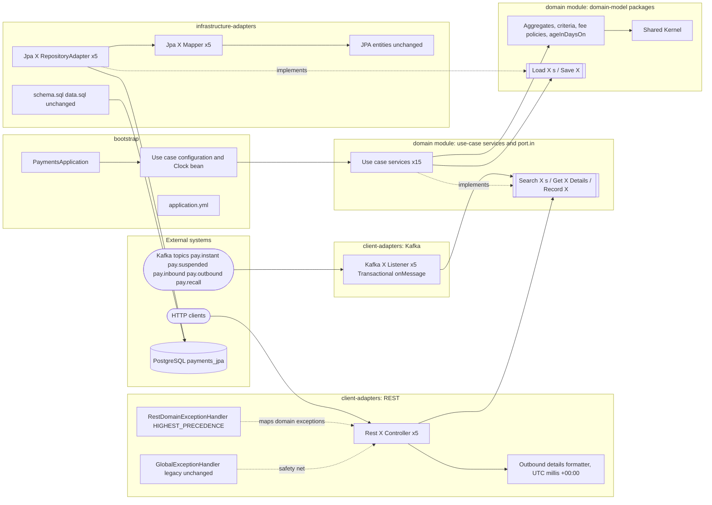
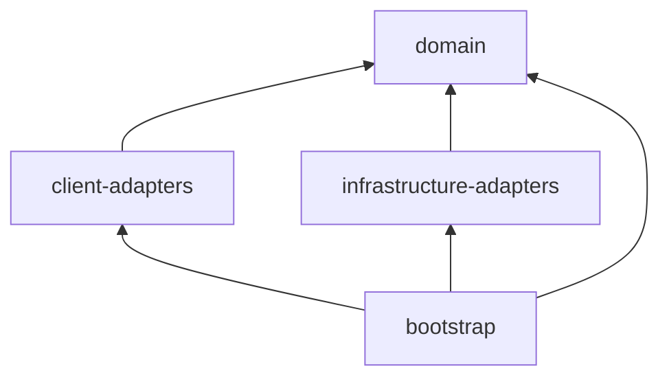
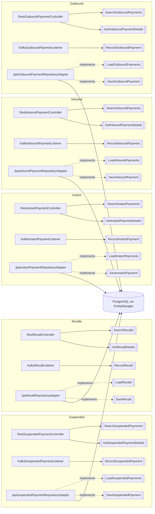
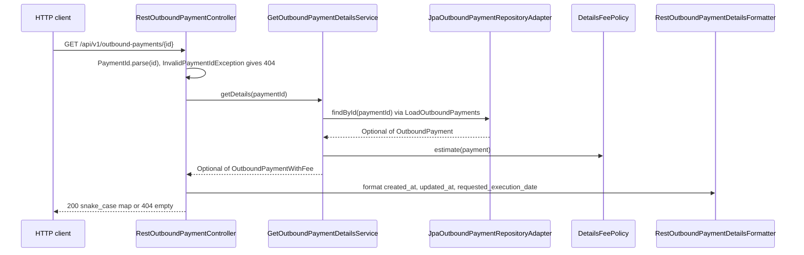
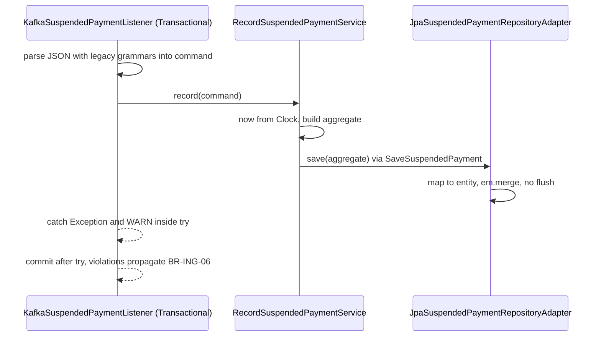

# Technical Layer and Adapter Design — realistic-mess-based-on-jpa-entities-challenge

- **Status:** FINAL. Phase 4 gate approved on 2026-11-12. The user's answers were relayed verbatim by `hexagonal-architecture-migration-orchestrator` (see §15).
- **Produced by:** `technical-layer-adapter-design-architect`, Phase 4 of the hexagonal-architecture migration.
- **Nature:** this document describes the **proposed target architecture**. Nothing in it is implemented yet. No source, test, build, configuration or schema file was modified in Phase 4.
- **Authoritative input:** [`isolated-domain-design.md`](isolated-domain-design.md) (Phase 3: domain packages, DR-1..DR-5, 25 ports, error contract, DR-R1..DR-R11, decisions D-01..D-17).
- **Other inputs:**
  - [`ddd-domain-analysis.md`](ddd-domain-analysis.md): 75 rules, C-01..C-06, R-01..R-11.
  - [`ddd-test-coverage.md`](ddd-test-coverage.md): 307 tests, MAC-01..MAC-08, N-01..N-03.
  - `../AGENTS.md`, `./AGENTS.md`, `docs/java-coding-conventions.md`.
- **Downstream consumers:** `incremental-hexagonal-architecture-migration` (Phase 5, with the `archunit-test` skill) and `hexagonal-architecture-compliance-auditor` (Phase 6).

---

## 1. Purpose and Scope

This document defines the technical layers, adapters, module structure, dependency rules and feature-preservation strategy that implement the 25 ports approved in Phase 3. It covers:

- the target hexagonal architecture and its Maven modules;
- the port-to-adapter inventory and the application use-case inventory;
- the layer responsibility matrix: transactions, authorization, validation, persistence, messaging and external integrations;
- dependency direction rules and ArchUnit-enforceable constraints;
- a feature-preservation matrix for every existing technical feature;
- the persistence mapping boundary and the outbound-details rendering design;
- the transition strategy for legacy code.

Out of scope: implementation, test code, POM edits and the iteration plan. Those belong to Phase 5, under user sub-gates.

Invariant constraints, carried over unchanged:
- Existing behaviour, including the intentional quirks C-01..C-06, is the acceptance criterion.
- Entities, `schema.sql` and `data.sql` keep their content.
- The five Kafka topics and the per-listener `groupId`s are unchanged.
- URLs and JSON shapes are unchanged.
- The persistence adapter keeps hand-written `EntityManager` code with string-built JPQL; no Spring Data JPA interfaces.

## 2. Existing Architecture Inventory (current state)

| Layer today | Classes | Technical features carried |
|---|---|---|
| Entry point | `PaymentsApplication` (`@SpringBootApplication`, package `fr.kevin.llps.payments`) | component scan of every sub-package |
| REST | `InstantPaymentController`, `SuspendedPaymentController`, `InboundPaymentController`, `OutboundPaymentController`, `RecallController`, `GlobalExceptionHandler` | 10 GET endpoints under `/api/v1/*`; field injection; inbound search adds `ageInDays`; outbound details uses `EntityManager.find`, a snake_case `HashMap` and its own fee table; error mapping: IAE → 400, `InvalidDataAccessApiUsageException` caused by IAE → 400, anything else → 500 |
| Services | 5 `*Service` classes | IBAN filter check (instant), recall-type check, entity → DTO mapping (suspended, outbound, recall), search fee (outbound), `ageInDays` (inbound details) |
| Repositories | 5 `@Repository` classes, `@PersistenceContext EntityManager` | string-built JPQL, named parameters, operators, ordering, limits, UUID/date parsing; instant/inbound return DTOs, the others return entities |
| Kafka | `InstantPaymentListener`, `SuspendedPaymentListener`, `InboundPaymentListener`, `OutboundPaymentMessageConsumer`, `RecallListener` | `@KafkaListener(topics, groupId)` + `@Transactional`; private `new ObjectMapper()`; legacy grammars; `em.merge`; `catch (Exception)` + WARN |
| DTOs | 5 `*SearchRequest`, 5 `*Response` (public mutable fields) | JSON response shapes |
| Entities | `fr.kevin.llps.payments.entity.*` (5, public fields, `java.sql` types) | mapping to the 5 tables |
| Utilities | `PaymentUtils` | shared `SimpleDateFormat`s, limits, IBAN check, LIKE pattern, default fee |
| Resources | `application.yml`, `schema.sql`, `data.sql` | port 8082, Postgres 5435, Kafka 9094, `ddl-auto: none`, `sql.init.mode: always`, `open-in-view: false`, String deserializers, auto-commit, `earliest` |
| Build | one Maven module (parent `spring-boot-starter-parent` 3.5.7), listed by the root aggregator `pom.xml` | — |

None of the following exist today: scheduled jobs, external API clients, security or authorization, actuator, metrics, tracing, feature flags, event publishing. The user confirmed this inventory as complete at the gate (Q6).

## 3. Target Architecture Overview

Dependencies point inward:

- **Driving adapters** (REST controllers and the REST exception handler; Kafka listeners) call **application input ports** (`Search<X>s`, `Get<X>Details`, `Record<X>`).
- **Plain-Java use-case services** implement those ports. They orchestrate the **isolated domain**: aggregates, criteria, fee policies, `ageInDaysOn` and the Shared Kernel.
- The use cases reach persistence through **domain-owned repository ports** (`Load<X>s`, `Save<X>`), which the **JPA persistence adapter** implements.
- Per context, the `domain` Maven module holds the aggregate and the use-case services (`*Service`) in `domain.<ctx>`, commands in `domain.<ctx>.command`, search queries and criteria in `domain.<ctx>.query`, input-port interfaces in `domain.<ctx>.port.in` and output-port interfaces in `domain.<ctx>.port.out`, next to `domain.sharedkernel`; the REST and Kafka adapters in `client-adapters`; the JPA adapter in `infrastructure-adapters`.
- **`bootstrap`** is the composition root. It holds the Spring Boot application, bean wiring, `Clock`, `application.yml`, the integration tests and the ArchUnit tests.

### 3.1 Technical architecture diagram

## 4. Module and Package Structure (approved: Q1 = a, Q2 = a, Q3 = a; module set revised at the Phase 5 IT-00 gate, see §15)

### 4.1 Maven modules

> **Revision 2026-11-12 (Phase 5 IT-00 gate, user-approved change).** The six-module layout originally approved (Q1) was replaced by the user with **four modules**: `domain`, `client-adapters`, `infrastructure-adapters`, `bootstrap`, with plain artifactIds (no `jpa-payments-` prefix). The planned `application` module is merged into `domain`; `adapter-rest` and `adapter-kafka` become `client-adapters`; `adapter-persistence-jpa` becomes `infrastructure-adapters`. Java package names are unchanged. Separations that Maven no longer enforces are enforced by ArchUnit (§4.2, §9).

`realistic-mess-based-on-jpa-entities-challenge/pom.xml` becomes a `packaging=pom` parent:

- It keeps `spring-boot-starter-parent` 3.5.7 as its parent and its artifactId `realistic-mess-based-on-jpa-entities-challenge`.
- It lists the four child modules.
- It manages the internal artifacts and `com.tngtech.archunit:archunit-junit5` in `dependencyManagement`.
- Properties: `surefire.failIfNoSpecifiedTests=false` (module-root `-Dtest=` commands keep working) and `spring-boot.run.skip=true` (overridden to `false` in `bootstrap`).
- The repository root aggregator `pom.xml` is **unchanged** and still lists the module directory.
- `cd <module> && mvn test` keeps running every test; `mvn spring-boot:run` from the module directory still starts the app (verified in IT-00, so README / module `AGENTS.md` are unchanged).
- ArtifactIds are the plain module names. Within the repository reactor they share groupId `fr.kevin.llps.payments` with the other two apps, which currently have different artifactIds (see TL-R8).

| Module dir = artifactId | Compile dependencies | Contents |
|---|---|---|
| `domain` | none (JDK only) | **domain packages** `fr.kevin.llps.payments.domain.{sharedkernel,instant,suspended,inbound,outbound,recall}` (shared kernel and contexts); per context `fr.kevin.llps.payments.domain.<ctx>` (aggregate and use-case services `*Service`), `...<ctx>.command` (`*Command`), `...<ctx>.query` (`*Query`, `*Criteria`), `...<ctx>.port.in` (input-port interfaces) and `...<ctx>.port.out` (output-port interfaces `Load<X>s`, `Save<X>`); layout set at the Phase 5 IT-02 gate (no `usecase` package). Use-case views (`InboundPaymentView`, `OutboundPaymentWithFee`) are placed when their contexts migrate. Plain Java, no annotations; services wired as `@Bean`s in `bootstrap`. |
| `client-adapters` | `domain`, `spring-boot-starter-web`, `spring-kafka`, `spring-tx` | driving side: `fr.kevin.llps.payments.adapter.in.rest` (`RestDomainExceptionHandler`; in the final iteration also the legacy handler, renamed `RestGlobalExceptionHandler`, body unchanged); `fr.kevin.llps.payments.adapter.in.rest.<ctx>` (controllers, response records, response mappers, outbound details formatter); `fr.kevin.llps.payments.adapter.in.kafka.<ctx>` (listeners) |
| `infrastructure-adapters` | `domain`, `spring-boot-starter-data-jpa`; `postgresql` runtime | driven side: `fr.kevin.llps.payments.adapter.out.persistence.<ctx>` (adapters, mappers); entities **unchanged in package `fr.kevin.llps.payments.entity`**; `src/main/resources/schema.sql` and `data.sql` (**content unchanged**, Q3) |
| `bootstrap` | all modules above | `fr.kevin.llps.payments.PaymentsApplication`; `fr.kevin.llps.payments.bootstrap.config` (`ClockConfiguration`, one `<X>UseCaseConfiguration` per context); `application.yml`; tests `integration/*` and `architecture/*` (ArchUnit, test scope only) |

`<ctx>` is one of `instant`, `suspended`, `inbound`, `outbound`, `recall`. `docker-compose.yml` stays at the module root.

Test dependencies are added per module only where needed:
- `domain`: JUnit 5, AssertJ, Mockito only (no Spring, MAC-08);
- `spring-boot-starter-test` in `client-adapters`, `infrastructure-adapters`, `bootstrap`;
- Testcontainers in `infrastructure-adapters` and `bootstrap`;
- `spring-kafka-test` in `bootstrap` (and in `client-adapters` if a slice needs it).

### 4.2 Maven-enforced dependency graph

Maven makes the following uncompilable:
- the `domain` module (domain-model and use-case packages) depending on any framework or other module;
- client adapters depending on infrastructure adapters and vice versa;
- any adapter depending on `bootstrap`.

With four modules, Maven **no longer** separates the following; ArchUnit enforces them instead (§9):

| Separation | Previously enforced by | Now enforced by |
|---|---|---|
| domain model must not depend on use-case services (`*Service`) or ports | `domain` / `application` modules | AR-04 (name + package based), AR-06 |
| use-case packages framework-free | `application` module POM | `domain` module POM (no dependencies) + AR-01 + AR-05 |
| REST adapter must not depend on Kafka adapter and vice versa | `adapter-rest` / `adapter-kafka` modules | AR-10 |
| persistence adapter must not depend on use-case packages | `adapter-persistence-jpa` → `domain` only | AR-09 |
| driving adapters use the use cases only through `..port.in..` | (ArchUnit already) | AR-08 |

ArchUnit (§9) also covers the other package-level rules.

### 4.3 Legacy code during the transition (Q2 = a)

1. **Iteration 0 is a structural move only. No content changes.**
   - All legacy classes move into `bootstrap` with their packages unchanged: `controller` including `GlobalExceptionHandler`, `service`, `repository`, `kafka`, `dto`, `util`.
   - Entities move to `infrastructure-adapters` (package `fr.kevin.llps.payments.entity` unchanged).
   - `schema.sql` and `data.sql` move to `infrastructure-adapters/src/main/resources`.
   - `application.yml` moves to `bootstrap/src/main/resources`.
   - Every existing test moves into `bootstrap/src/test/java` with its package unchanged.
   - Exit criterion: the full `mvn test` stays green with the same 307 tests.
2. **Each context iteration** (Suspended → Recalls → Instant → Inbound → Outbound) adds the context's domain and application classes (both in the `domain` module) and adapter classes, then deletes the context's legacy controller, service, repository, listener and DTOs from `bootstrap`. Tests are remapped per MAC-07.
3. **Final iteration:**
   - delete `PaymentUtils` and its unused-helper tests (D-09);
   - move `GlobalExceptionHandler` to `client-adapters` (`fr.kevin.llps.payments.adapter.in.rest`), renamed `RestGlobalExceptionHandler` with its body unchanged, together with its test renamed `RestGlobalExceptionHandlerTest` (Phase 5 gate answer);
   - `bootstrap` then contains only the entry point, configuration, resources, integration and ArchUnit tests.

### 4.4 Spring test slices outside bootstrap

- `@WebMvcTest` in `client-adapters` needs a test-only `@SpringBootConfiguration` class in its test sources.
- `@DataJpaTest` in `infrastructure-adapters` needs the same. It also needs Testcontainers, `@AutoConfigureTestDatabase(replace = NONE)`, and `schema.sql`/`data.sql` from the module's own resources.
- See TL-R4.

## 5. Layer Responsibility Matrix

| Concern | REST adapter | Kafka adapter | Application | Domain | Persistence adapter | Bootstrap |
|---|---|---|---|---|---|---|
| HTTP binding: URLs, param names, `Integer limit` (non-integer → 500, BR-API-08), GET only (non-GET → 500, N-01) | **owns** | — | — | — | — | — |
| Id trimming before `PaymentId.parse` (instant, suspended, inbound, recall trim; outbound does not, BR-API-06) | **owns** | — | — | — | — | — |
| **Validation** of business input: IBAN filter, recall type, UUID, dates, negative limit, and the legacy error order | — | — | invokes the criteria factory | **owns** | — | — |
| Validation of ingested data | none (BR-ING-12) | parsing only | none | none (G-05) | none; Postgres constraints at commit | — |
| Response rendering: DTO shapes, `ApiDateTimeFormat` patterns, outbound snake_case map and its UTC timestamp format | **owns** | — | — | pattern constants | — | — |
| Exception → HTTP status and body | **owns** (`RestDomainExceptionHandler` + legacy `GlobalExceptionHandler`) | — | propagates | throws | — | — |
| JSON payload parsing, legacy grammars (BR-ING-07/08/09), scheme default, recall dropped on bad `originalPaymentId` (BR-ING-11) | — | **owns** | — | `InstantPayment.DEFAULT_SCHEME` | — | — |
| Error swallowing on ingestion (`catch (Exception)` + WARN, BR-ING-05) | — | **owns** | — | — | — | — |
| **Transactions** | none: reads stay non-transactional as today (`open-in-view: false`, shared `EntityManager`) | **`@Transactional` on `onMessage`**, unchanged | no Spring annotations; runs inside the caller's transaction | — | none: `em.merge` joins the listener transaction; no flush (DR-R3) | `JpaTransactionManager` auto-configuration |
| **Authorization / security** | none exists, none added | none | none | none | none | none |
| Audit timestamps `createdAt`/`updatedAt` | — | — | **owns** (`LocalDateTime.now(clock)`, one reading) | attributes | — | provides `Clock.systemDefaultZone()` |
| Fee policies, `ageInDaysOn` | — | — | invokes | **owns** | — | — |
| **Persistence**: JPQL text, operators, ordering, `setMaxResults`, `em.find`/`em.merge`, entity ↔ domain mapping, `java.sql` conversions | — | — | — | port contracts | **owns** | — |
| DDL and seed | — | — | — | — | `schema.sql`, `data.sql` | `spring.sql.init.mode: always`, `ddl-auto: none` in `application.yml` |
| **Messaging**: topics, `groupId`s, deserializers, auto-commit, offset reset | — | **owns** (annotation literals) | — | — | — | `spring.kafka.*` in `application.yml` |
| **External integrations** | none exist | — | — | — | — | — |
| Logging | ERROR on generic 500 (legacy handler) | WARN on skipped event | — | — | — | `logging.level` |
| Bean creation and wiring of plain-Java services and domain policies | — | — | — | — | — | **owns** |

## 6. Port and Adapter Inventory

### 6.1 Generic mapping per context `<X>` (25 ports, all accounted for)

| Port ID | Port | Direction | Owner | Adapter (layer) | Replaces / connects to | Input/output mapping | Error handling | Features preserved |
|---|---|---|---|---|---|---|---|---|
| P-<X>-IN-1 | `Search<X>s` | inbound | application | `Rest<X>Controller.search` (REST, driving) calls it; `Search<X>sService` implements it | `<X>Controller.search` + `<X>Service.search` (+ `<X>Repository.search` parsing) | request params → `<X>SearchQuery` record (raw `String`s + `Integer limit`); domain results → `<X>Response` record (same JSON field names, null values serialized) | domain exceptions → `RestDomainExceptionHandler` (§7) | URL, params, error order, limits, ordering, formats |
| P-<X>-IN-2 | `Get<X>Details` | inbound | application | `Rest<X>Controller.get`; `Get<X>DetailsService` | `<X>Controller.get` + `<X>Service.getById` (outbound: controller + `EntityManager.find`) | path id → trim (not outbound) → `PaymentId.parse`; `Optional` empty → 404 empty body | `InvalidPaymentIdException` → 400 (4 contexts) / caught → 404 (outbound, C-02) | details payloads, 404 contract |
| P-<X>-IN-3 | `Record<X>` | inbound | application | `Kafka<X>Listener.onMessage` (Kafka, driving); `Record<X>Service` | legacy listener body up to `em.merge` | raw JSON → `Record<X>Command` record (`UUID`, `java.time`, `BigDecimal`, raw `String`s incl. `""`/`"null"` per BR-ING-07) | all exceptions inside the `try` swallowed + WARN; commit-time failures propagate | topic, `groupId`, BR-ING-01..12 |
| P-<X>-OUT-1 | `Load<X>s` | outbound | domain | `Jpa<X>RepositoryAdapter` (persistence, driven) | `<X>Repository.search`/`findById` | criteria → JPQL clauses + named params (`Timestamp`/`Date` built here) → `setMaxResults(criteria limit)` → entities → `Jpa<X>Mapper.toDomain`; `findById` → `em.find` → `Optional` | `@Repository` exception translation kept (A-T3) | operators, inclusive bounds, ordering, unescaped LIKE (DR-R10) |
| P-<X>-OUT-2 | `Save<X>` | outbound | domain | same `Jpa<X>RepositoryAdapter` | listener `em.merge` | aggregate → `Jpa<X>Mapper.toEntity` → `em.merge` | none in the adapter; no flush, so violations surface at commit (BR-ING-06) | full-replace upsert keyed by payload id |

### 6.2 Concrete adapters per context

| Context | REST controller | Kafka listener | Persistence adapter / mapper | Topic / groupId (unchanged) | URL base (unchanged) | Legacy classes removed in the iteration |
|---|---|---|---|---|---|---|
| Suspended | `RestSuspendedPaymentController` | `KafkaSuspendedPaymentListener` | `JpaSuspendedPaymentRepositoryAdapter` / `JpaSuspendedPaymentMapper` | `pay.suspended` / `jpa-suspended-group` | `/api/v1/suspended-payments` | `SuspendedPaymentController`, `SuspendedPaymentService`, `SuspendedPaymentRepository`, `SuspendedPaymentListener`, `SuspendedPayment{SearchRequest,Response}` |
| Recalls | `RestRecallController` | `KafkaRecallListener` | `JpaRecallRepositoryAdapter` / `JpaRecallMapper` | `pay.recall` / `jpa-recall-group` | `/api/v1/recalls` | `RecallController`, `RecallService`, `RecallRepository`, `RecallListener`, `Recall{SearchRequest,Response}` |
| Instant | `RestInstantPaymentController` | `KafkaInstantPaymentListener` | `JpaInstantPaymentRepositoryAdapter` / `JpaInstantPaymentMapper` | `pay.instant` / `jpa-instant-group` | `/api/v1/instant-payments` | `InstantPayment{Controller,Service,Repository,Listener}`, `InstantPayment{SearchRequest,Response}` |
| Inbound | `RestInboundPaymentController` | `KafkaInboundPaymentListener` | `JpaInboundPaymentRepositoryAdapter` / `JpaInboundPaymentMapper` | `pay.inbound` / `jpa-inbound-group` | `/api/v1/inbound-payments` | `InboundPayment{Controller,Service,Repository,Listener}`, `InboundPayment{SearchRequest,Response}` |
| Outbound | `RestOutboundPaymentController` | **`KafkaOutboundPaymentListener`** (Q4: retires the `OutboundPaymentMessageConsumer` misnaming at migration time) | `JpaOutboundPaymentRepositoryAdapter` / `JpaOutboundPaymentMapper` | `pay.outbound` / `jpa-outbound-group` | `/api/v1/outbound-payments` | `OutboundPaymentController`, `OutboundPaymentService`, `OutboundPaymentRepository`, `OutboundPaymentMessageConsumer`, `OutboundPayment{SearchRequest,Response}` |

Supporting REST classes:
- **Response records:** one per context in `adapter.in.rest.<ctx>`, named `<X>Response`, with the same component names and order as the legacy DTO fields.
- **Response mappers:** package-private `Rest<X>ResponseMapper`, formatting dates with `DateTimeFormatter.ofPattern(ApiDateTimeFormat.TIMESTAMP_PATTERN / DATE_PATTERN)` in the JVM default zone. These formatters are thread-safe (R-01).
- **`RestOutboundPaymentDetailsFormatter`**: see §8.3.
- **`RestDomainExceptionHandler`**: see §7.

### 6.3 Port-to-adapter diagram

The diagram has 25 port nodes and 15 adapter classes, matching §6.1, §6.2 and §10.

### 6.4 Application use-case inventory (15 services)

All services are plain Java `final` classes named `*Service` in the context package `domain.<ctx>` (commands in `domain.<ctx>.command`, queries and criteria in `domain.<ctx>.query`, input ports in `domain.<ctx>.port.in`, output ports in `domain.<ctx>.port.out`). They use constructor injection with `private final` fields, carry no Spring annotations, and are instantiated as `@Bean`s in `bootstrap.config.<X>UseCaseConfiguration`.

| Service | Implements | Collaborators | Behaviour |
|---|---|---|---|
| `SearchSuspendedPaymentsService` | `SearchSuspendedPayments` | `LoadSuspendedPayments` | `SuspendedPaymentSearchCriteria.from(...)` → `load.search` |
| `GetSuspendedPaymentDetailsService` | `GetSuspendedPaymentDetails` | `LoadSuspendedPayments` | `load.findById` |
| `RecordSuspendedPaymentService` | `RecordSuspendedPayment` | `SaveSuspendedPayment`, `Clock` | `now(clock)` once → aggregate → `save` |
| `SearchRecallsService` | `SearchRecalls` | `LoadRecalls` | `RecallSearchCriteria.from(...)` (query `limit` ignored, `fixedDefault`) → `load.search` |
| `GetRecallDetailsService` | `GetRecallDetails` | `LoadRecalls` | `load.findById` |
| `RecordRecallService` | `RecordRecall` | `SaveRecall`, `Clock` | as above |
| `SearchInstantPaymentsService` | `SearchInstantPayments` | `LoadInstantPayments` | `InstantPaymentSearchCriteria.from(...)` → `load.search` |
| `GetInstantPaymentDetailsService` | `GetInstantPaymentDetails` | `LoadInstantPayments` | `load.findById` |
| `RecordInstantPaymentService` | `RecordInstantPayment` | `SaveInstantPayment`, `Clock` | as above |
| `SearchInboundPaymentsService` | `SearchInboundPayments` | `LoadInboundPayments`, `Clock` | criteria → `load.search` → `InboundPaymentView(p, p.ageInDaysOn(LocalDate.now(clock)))` |
| `GetInboundPaymentDetailsService` | `GetInboundPaymentDetails` | `LoadInboundPayments`, `Clock` | `load.findById` → same `InboundPaymentView` (single computation, D-07) |
| `RecordInboundPaymentService` | `RecordInboundPayment` | `SaveInboundPayment`, `Clock` | as above |
| `SearchOutboundPaymentsService` | `SearchOutboundPayments` | `LoadOutboundPayments`, `SearchFeePolicy` | criteria → `load.search` → `OutboundPaymentWithFee(p, searchFeePolicy.estimate(p))` |
| `GetOutboundPaymentDetailsService` | `GetOutboundPaymentDetails` | `LoadOutboundPayments`, `DetailsFeePolicy` | `load.findById` → `OutboundPaymentWithFee(p, detailsFeePolicy.estimate(p))` |
| `RecordOutboundPaymentService` | `RecordOutboundPayment` | `SaveOutboundPayment`, `Clock` | as above |

`SearchFeePolicy` and `DetailsFeePolicy` are concrete, stateless domain classes injected without an interface (DIP R17, LSP, D-16).

## 7. Error Handling Design

`RestDomainExceptionHandler` lives in `adapter.in.rest`. It is a `@RestControllerAdvice` annotated **`@Order(Ordered.HIGHEST_PRECEDENCE)`**, with one `@ExceptionHandler` method per domain exception (D-05):

| Exception | Status | Body |
|---|---|---|
| `InvalidIbanFilterException` | 400 | `{"error":"Invalid debtor IBAN"}` / `{"error":"Invalid creditor IBAN"}` |
| `UnknownRecallTypeException` | 400 | `{"error":"Unknown recall type: <raw>"}` |
| `InvalidPaymentIdException` | 400 | `{"error":"<UUID.fromString message>"}` (outbound details never reaches it: the controller catches it → 404 empty) |
| `NegativeSearchLimitException` | 400 | `{"error":"max-results cannot be negative"}` |
| `MalformedDateException` | 400 | `{"error":"<message>"}` when the exception carries a message (non-numeric date field, e.g. `{"error":"Error at index 1 in: \"1x\""}`), otherwise `{"error":"Bad request"}` (note 2026-11-12, IT-01 gate F-01: identical to the legacy IAE rendering; pinned by `PaymentApplicationIntegrationTest.should_return_400_with_number_format_message_when_a_date_filter_field_is_not_numeric`) |
| `FeeNotComputableException` | no handler | falls to legacy `Exception` handler → 500 generic body, ERROR log |

`GlobalExceptionHandler` stays **unchanged** (D-13) as the safety net for IAE, `InvalidDataAccessApiUsageException` and the generic 500.

The precedence matters because Spring consults advices in bean order and takes the first advice with any matching handler. The legacy advice's `Exception.class` handler matches everything, so without `@Order` it could win and turn every domain exception into a 500 (TL-R1).

## 8. Persistence and Data-Mapping Design

### 8.1 JPA adapters

- `@Repository` (exception translation unchanged).
- `EntityManager` is constructor-injected, using Spring's shared, transaction-aware proxy. There is no field injection.
- The JPQL style is unchanged: a `StringBuilder` starting `SELECT p FROM <EntityName> p WHERE 1=1`, then `AND` clauses only for present criteria, then named parameters bound from a `Map`.
- Operators per context:
  - exact `=` for ids, IBANs (suspended, inbound, outbound) and `endToEndId`;
  - `UPPER(col) LIKE :p` with `%X%` for instant IBANs and inbound `originBic`;
  - `col LIKE :p` without `UPPER` for outbound `destinationBic` (BR-OUT-02);
  - `=` for code filters;
  - inclusive bounds.
- Ordering is unchanged:

| Context | ORDER BY |
|---|---|
| instant | `executionDatetime DESC` |
| suspended | `heldAt DESC` |
| inbound | `valueDate DESC, createdAt DESC` |
| outbound | `requestedExecutionDate DESC` |
| recall | `initiatedAt DESC` |

- `setMaxResults(criteria limit value)`.
- Suspended returns `List.of()` without querying when `criteria.matchesNothing()` (BR-SUS-04).
- `save` calls `em.merge(mapper.toEntity(aggregate))` with no `flush`.

### 8.2 Mappers (`Jpa<X>Mapper`, package-private, in `adapter.out.persistence.<ctx>`)

| Domain | Entity | Conversion |
|---|---|---|
| `PaymentId` | `UUID id` | `PaymentId.of(uuid)` / `value()` |
| `Money` | `BigDecimal amount`, `String currency` | as is, no rescaling (DR-R5) |
| `LocalDateTime` | `java.sql.Timestamp` | `toLocalDateTime()` / `Timestamp.valueOf(ldt)` |
| `LocalDate` | `java.sql.Date` | `toLocalDate()` / `Date.valueOf(ld)` |
| `ChargesType`, `RecallType` | `String` | wrap / unwrap |
| `OriginalPaymentReference` | `UUID originalPaymentId`, `String originalPaymentType` | wrap / unwrap |
| `Optional` accessors | nullable fields | `orElse(null)` toward the entity |

Entities and aggregates share simple names (e.g. `SuspendedPayment`), so mappers and adapters refer to the entity by its fully qualified name `fr.kevin.llps.payments.entity.<X>`. JPQL entity names are unchanged (TL-R5).

Entities, `schema.sql`, `data.sql` and `ddl-auto: none` are unchanged. Only `adapter.out.persistence` sees `jakarta.persistence` and `java.sql` among production classes, besides the entities themselves.

### 8.3 Outbound details rendering (Q5 = b, DR-R6)

**What happens today.** `OutboundPaymentController.get` puts the entity's `java.sql.Timestamp createdAt`/`updatedAt` and `java.sql.Date requestedExecutionDate` into a `HashMap`, and Spring Boot's Jackson renders them:

- `Timestamp` goes through Jackson's `StdDateFormat`. With Spring Boot defaults (`WRITE_DATES_AS_TIMESTAMPS` disabled, no `spring.jackson.time-zone` set) Jackson uses **UTC**. The instant (the `Timestamp` built from the stored local value in the JVM default zone) is rendered as `yyyy-MM-dd'T'HH:mm:ss.SSS` followed by the offset **`+00:00`** (not `Z`), with **exactly 3 millisecond digits** and sub-millisecond precision truncated. N-02 example: seed local `2026-10-16 08:00:00` in `Europe/Paris` gives `"2026-10-16T06:00:00.000+00:00"`.
- `java.sql.Date` is rendered as its local `toString()`, `yyyy-MM-dd` (e.g. `"2026-10-16"`), with no zone conversion.

**Target.** The REST adapter must contain no `java.sql`. `RestOutboundPaymentDetailsFormatter` (package-private, `adapter.in.rest.outbound`) produces the same strings from the domain values:

- `created_at` / `updated_at`:
  1. `ldt.atZone(zone).withLaterOffsetAtOverlap()`. "Later offset at overlap" reproduces `java.util`/`Timestamp.valueOf` resolution of ambiguous fall-back times; non-existent spring-forward times shift forward by the gap length in both APIs.
  2. Convert to UTC: `.withZoneSameInstant(ZoneOffset.UTC)`.
  3. Format with `DateTimeFormatter.ofPattern("yyyy-MM-dd'T'HH:mm:ss.SSS")`, then append the literal `"+00:00"`.
  4. `null` stays `null`, and the key is kept.
- `zone` is the JVM default zone. It comes from the injected `Clock` (`clock.getZone()`, where `Clock.systemDefaultZone()` is provided by bootstrap), so unit tests can fix it. This matches today's `TimeZone.getDefault()` as long as the default zone is not changed after startup.
- `requested_execution_date`: `DateTimeFormatter.ofPattern(ApiDateTimeFormat.DATE_PATTERN)` on the `LocalDate`, no zone conversion. `null` stays `null`.
- The other values are unchanged:
  - `id` as `String`;
  - `amount` as the `BigDecimal`, with no rescaling;
  - `estimatedFee` as the `BigDecimal` from `DetailsFeePolicy`;
  - the other text fields as raw `String` or `null`.
  - The container stays a `HashMap<String,Object>` with exactly the 13 keys `id, instruction_id, amount, currency, debtor_iban, debtor_name, destination_bic, requested_execution_date, charges_type, status, created_at, updated_at, estimatedFee`.

**Pinning tests (Phase 5, written before the switch, MAC-04/MAC-07). Output must stay byte-identical.**
1. **Characterization parity test** (`client-adapters` unit test, parameterized). For a set of `LocalDateTime` values × zones, assert that the formatter output equals the string Spring Boot's auto-configured `ObjectMapper` produces for `java.sql.Timestamp.valueOf(ldt)` under the same default zone.
   - Zones: `UTC`, `Europe/Paris` winter and summer, `America/New_York`, `Asia/Kolkata` (fractional offset).
   - Values: zero millis, non-zero millis, sub-millisecond nanos (truncation), and DST gap and overlap instants in `Europe/Paris`.
   - `java.sql` may appear in this test code only.
   - The test temporarily sets the default `TimeZone` and restores it in a `finally` block or extension.
2. **`requested_execution_date` parity:** formatter output equals the Jackson rendering of `java.sql.Date.valueOf(ld)`.
3. **Web slice test:** `GET /api/v1/outbound-payments/{id}` via `@WebMvcTest` with a mocked `GetOutboundPaymentDetails`. It asserts the 13 keys, the null values, the exact date strings and the fee.
4. **Integration test:** the existing N-02 assertion stays green and unchanged.

## 9. Dependency Direction Rules and ArchUnit Constraints

### 9.1 Rules

DR-1..DR-5 from Phase 3 still hold. In addition:

| ID | Rule |
|---|---|
| TL-DR-1 | Driving adapters (`..adapter.in..`) use the use cases only through `..port.in..`; they may use aggregates, `command`, `query` and shared-kernel types; they never depend on `*Service` classes or `..port.out..`. |
| TL-DR-2 | Driven adapters (`..adapter.out..`) depend on `..port.out..` and on model types (aggregates, `command`, `query`, shared kernel); never on `*Service` or `..port.in..`. |
| TL-DR-3 | Use-case services and both port packages (and, through AR-01/AR-01b, the whole domain module) depend only on the domain module and the JDK: no Spring, `jakarta.*`, `java.sql`, Jackson, Kafka or Hibernate. |
| TL-DR-4 | Adapters never depend on each other (`adapter.in.rest`, `adapter.in.kafka`, `adapter.out.persistence`). |
| TL-DR-5 | `fr.kevin.llps.payments.entity..` is accessed only by `..adapter.out.persistence..` among production classes. |
| TL-DR-6 | `EntityManager` / `@PersistenceContext` appear only in `..adapter.out.persistence..`. |
| TL-DR-7 | A context (`domain.<ctx>` with `command`, `query`, `port.in`, `port.out`) depends only on itself and `domain.sharedkernel`; the domain model never depends on `*Service` or on the ports (extends DR-2, DR-6). |
| TL-DR-8 | Only `bootstrap` depends on every module; nothing depends on `bootstrap`. |
| TL-DR-9 | `java.sql` is used only in `..adapter.out.persistence..` and `..adapter.in.kafka..` (legacy grammars) among new production packages; never in `..adapter.in.rest..` (Q5). |
| TL-DR-10 | `@Transactional` appears only on Kafka listener methods (no new transaction boundaries). |

### 9.2 ArchUnit catalogue (Phase 5, `archunit-test` skill)

The tests go in `bootstrap/src/test/java/fr/kevin/llps/payments/architecture/`, with ArchUnit in test scope in `bootstrap` only and its version managed in the module parent POM.

| ID | Rule | Family | Source |
|---|---|---|---|
| AR-01 | `..domain..` (model, use-case services and ports) does not depend on `org.springframework..`, `jakarta..`, `org.hibernate..`, `com.fasterxml..`, `org.apache.kafka..`, `java.sql..`; AR-01b: it only depends on `java.lang..`, `java.util..`, `java.math..`, `java.time..`, `fr.kevin.llps.payments.domain..` | DomainIsolationTest | DR-1 |
| AR-02 | `domain.(*)..` context slices (each including its `command`, `query`, `port.in`, `port.out` sub-packages) do not depend on each other; only `sharedkernel` is shared | DomainIsolationTest | DR-2 |
| AR-03 | `domain.sharedkernel` depends on no other domain package | DomainIsolationTest | DR-3 |
| AR-04 | the domain model (aggregates, `command`, `query`, shared kernel) does not depend on `*Service` or `..port..`; the whole `..domain..` does not depend on `..adapter..`, `..bootstrap..`, `fr.kevin.llps.payments.entity..` | DomainIsolationTest | DR-4, DR-6 |
| AR-05 | use-case services, `port.in` and `port.out` do not depend on Spring, `jakarta..`, `java.sql..`, Jackson, Kafka, Hibernate, `..adapter..`, `..entity..` (commands and queries are covered by AR-01/AR-01b) | HexagonalArchitectureTest | TL-DR-3 |
| AR-06 | `onionArchitecture()` with class predicates (`architecture/DomainLayout`): domainModels = aggregates + `command` + `query` + shared kernel; domainServices = `..domain.*.port.out..`; applicationServices = `*Service` + `..port.in..`; adapters `rest` / `kafka` / `persistence` / `composition root` (`fr.kevin.llps.payments.bootstrap..`). No optional layers. | HexagonalArchitectureTest | §3 |
| AR-07 | a context's `*Service` classes and ports depend only on that context, `domain.sharedkernel..` and the JDK (covered by AR-02 slices since the IT-02 layout) | HexagonalArchitectureTest | TL-DR-7 |
| AR-08 | `..adapter.in..` does not depend on `*Service` classes or `..port.out..` | AdapterDependenciesTest | TL-DR-1 |
| AR-09 | `..adapter.out..` does not depend on `*Service` classes or `..port.in..` | AdapterDependenciesTest | TL-DR-2 |
| AR-10 | Adapter packages do not depend on each other | AdapterDependenciesTest | TL-DR-4 |
| AR-11 | `fr.kevin.llps.payments.entity..` and `jakarta.persistence.EntityManager` only accessed from `..adapter.out.persistence..` | AdapterDependenciesTest | TL-DR-5/6 |
| AR-12 | `..adapter.in.rest..` does not depend on `java.sql..` | AdapterDependenciesTest | TL-DR-9, Q5 |
| AR-13 | `*RepositoryAdapter` classes in `..adapter.out.persistence..` implement a `Load*` and a `Save*` interface of `..domain.*.port.out..` | AdapterDependenciesTest | §6 |
| AR-14 | every top-level type of `..port.in..` and `..port.out..` is an interface; `..command..` only holds `*Command`, `..query..` only `*Query` / `*Criteria`; input-port implementations are named `*Service` outside the port packages | PortsTest | Phase 3 §11, IT-02 gate |
| AR-15 | No cycles between `fr.kevin.llps.payments.(*)..` slices | CyclesTest | §4.2 |
| AR-16 | Classes annotated `@RestController`/`@RestControllerAdvice` in new packages are prefixed `Rest`; classes with `@KafkaListener` methods prefixed `Kafka`; classes in `..adapter.out.persistence..` prefixed `Jpa` | CodingConventionsTest | conventions |
| AR-17 | No `@Autowired` fields and no `System.out`/`System.err` in new packages; no public non-final fields in `..domain..` | CodingConventionsTest | conventions |
| AR-18 | `@Transactional` only on methods of classes in `..adapter.in.kafka..` | CodingConventionsTest | TL-DR-10 |

Rules about the legacy packages (`controller`, `service`, `repository`, `kafka`, `dto`, `util`) are outside these rules' targets until those packages are deleted.

A rule on a package is added in the iteration that creates the package (the skill keeps `failOnEmptyShould`).

Since the Phase 5 IT-00 gate, AR-04, AR-05, AR-08, AR-09 and AR-10 also carry the separations that the removed `application`, `adapter-rest` and `adapter-kafka` modules used to enforce at compile time (§4.2).

Any temporary exception must be narrow and reference its removal iteration. Known in advance:
- AR-11 and AR-18 temporarily tolerate the legacy `controller`/`service`/`repository`/`kafka` packages until they are deleted (IT-06).
- AR-16 needs no exception: AR-16 targets the adapter packages only, and the legacy handler is renamed `RestGlobalExceptionHandler` when it moves there (IT-07).

## 10. Feature-Preservation Matrix

| Existing feature | Current component | Target component | Related port(s) | Preservation strategy |
|---|---|---|---|---|
| `GET /api/v1/instant-payments/search`, `/{id}` | `InstantPaymentController`, `InstantPaymentService`, `InstantPaymentRepository` | `RestInstantPaymentController`, `SearchInstantPaymentsService`, `GetInstantPaymentDetailsService`, `JpaInstantPaymentRepositoryAdapter` | P-INS-IN-1/2, P-INS-OUT-1 | same params and fields; IBAN check debtor → creditor in criteria; `UPPER LIKE` contains; lenient bounds 00:00:00 / 23:59:59; capped limit; `executionDatetime DESC` |
| `GET /api/v1/suspended-payments/search`, `/{id}` | `SuspendedPayment*` | `RestSuspendedPaymentController`, services, `JpaSuspendedPaymentRepositoryAdapter` | P-SUS-IN-1/2, P-SUS-OUT-1 | strict API-format bounds; `matchesNothing` → `[]`; capped limit; `heldAt DESC` |
| `GET /api/v1/inbound-payments/search`, `/{id}` with `ageInDays` | controller (search) + service (details) | `RestInboundPaymentController`, services with `Clock` | P-INB-IN-1/2, P-INB-OUT-1 | `ageInDaysOn(LocalDate.now(clock))` in both use cases; `IsoDateBound` strict dates → 400 `Bad request`; uncapped limit; `valueDate DESC, createdAt DESC` |
| `GET /api/v1/outbound-payments/search` (fee OUR 1 %, BEN 0, else 0.30; no amount → 0) | `OutboundPaymentService` | `RestOutboundPaymentController.search`, `SearchOutboundPaymentsService` | P-OUT-IN-1 | `SearchFeePolicy`; exact `BigDecimal` constants; `col LIKE` BIC without `UPPER`; `requestedExecutionDate DESC` |
| `GET /api/v1/outbound-payments/{id}` (snake_case map, fee OUR 2 %, SHA 0.50, else 0; bad id → 404) | `OutboundPaymentController.get` + `EntityManager` | `RestOutboundPaymentController.get`, `GetOutboundPaymentDetailsService`, `RestOutboundPaymentDetailsFormatter` | P-OUT-IN-2 | `DetailsFeePolicy`; 13-key `HashMap`; UTC `.SSS+00:00` timestamps and `yyyy-MM-dd` date via explicit formatter (§8.3); `InvalidPaymentIdException` caught → 404; no `EntityManager` in the controller; OUR without amount → `FeeNotComputableException` → 500 |
| `GET /api/v1/recalls/search`, `/{id}` | `Recall*` | `RestRecallController`, services, `JpaRecallRepositoryAdapter` | P-RCL-IN-1/2, P-RCL-OUT-1 | type check before UUID; fixed limit 50 (request ignored); lenient bounds 00:00:00; `initiatedAt DESC` |
| 400 bodies (IBAN, recall type, UUID, negative limit, malformed date) | `GlobalExceptionHandler` (IAE + `InvalidDataAccessApiUsageException`) | `RestDomainExceptionHandler` (highest precedence) + legacy handler kept | all IN-1/2 | one handler per exception; identical status and body; one test per exception per endpoint (DR-R11, TL-R1) |
| 404 unknown id, empty body | controllers | REST controllers | IN-2 | `Optional.empty()` → `ResponseEntity.notFound().build()` |
| 500 generic (non-integer limit, non-GET, DB errors, fee not computable) | `GlobalExceptionHandler.handleGeneric` | same class, unchanged | — | kept verbatim (D-13) |
| Error precedence (service checks, then field order, then limit last) | service + repository + `setMaxResults` | criteria factories | IN-1 | Phase 3 DR-R1 mitigation; combination tests |
| Kafka ingestion on 5 topics with own `groupId`s | 5 listeners | 5 `Kafka<X>Listener` | P-<X>-IN-3 | `@KafkaListener(topics = "...", groupId = "jpa-*-group")` literals unchanged |
| Consumer config (String deserializers, auto-commit, `earliest`, `bootstrap-servers`) | `application.yml` | `bootstrap/src/main/resources/application.yml` | — | file moved, content unchanged |
| Payload parsing: `asText()`, `""`/`"null"` → null for dates, `Timestamp.valueOf`/`Date.valueOf` grammars, `Z` stripping, 10-char date padding, scheme default `SCT INST`, recall dropped on bad `originalPaymentId` | listeners | Kafka listeners | P-<X>-IN-3 | parsing code kept identical in the adapter, including a private `new ObjectMapper()` per listener (not Spring's, so `decimalValue()` behaviour cannot drift); conversion to `java.time` after legacy parsing |
| Upsert by payload id (full replace) | `em.merge` | `Jpa<X>RepositoryAdapter.save` | P-<X>-OUT-2 | `em.merge` of a freshly mapped entity |
| Swallow + WARN on parse/persist error; commit-time violations propagate (BR-ING-06) | listeners | Kafka listeners | P-<X>-IN-3 | `try` covers parse + `record(...)`; `@Transactional` on `onMessage`; no flush anywhere |
| `createdAt`/`updatedAt` = consumer time | listener (`currentTimeMillis` ×2) | `Record<X>Service` + `Clock` | P-<X>-IN-3 | one clock reading (DR-R9 accepted) |
| DDL + destructive seed at every startup | `schema.sql`, `data.sql`, `sql.init.mode: always`, `ddl-auto: none` | `infrastructure-adapters` resources + bootstrap yml | — | contents unchanged (MAC-06); on bootstrap classpath via the jar |
| Response date formats `yyyy-MM-dd'T'HH:mm:ss` / `yyyy-MM-dd` (local zone) | `PaymentUtils.FMT` / `DAY_FMT` | REST response mappers | — | `DateTimeFormatter` from `ApiDateTimeFormat` patterns, JVM default zone |
| `PaymentUtils` helpers | `util` | deleted in the final iteration | — | D-09 |
| Logging (`fr.kevin.llps.payments: INFO`, WARN skip messages, ERROR on 500) | yml, listeners, handler | same | — | messages and levels unchanged |
| Ports 8082 / Postgres 5435 `payments_jpa` / Kafka 9094; `docker-compose.yml` | yml, compose | bootstrap yml; compose at module root | — | unchanged |
| Scheduled jobs, external APIs, security, metrics, tracing, feature flags | none | none | — | confirmed absent (Q6) |

## 11. Integration and Wiring

- `PaymentsApplication` stays in `fr.kevin.llps.payments` in `bootstrap`. Its default component scan covers `adapter.in.rest`, `adapter.in.kafka` and `adapter.out.persistence` from the adapter jars. Entity scanning finds `fr.kevin.llps.payments.entity` (a sub-package of the application package) automatically.
- Domain and application classes carry no stereotypes. They are created in `bootstrap.config`:
  - `ClockConfiguration`: `@Bean Clock clock()` returning `Clock.systemDefaultZone()`.
  - `<X>UseCaseConfiguration` (×5): `@Bean`s for the three services of the context, plus `SearchFeePolicy` / `DetailsFeePolicy` for outbound. The beans are exposed as their input-port interfaces.
- Constructor injection everywhere; no service locator and no static collaborator access.

### 11.1 Interaction flows

## 12. Proposed Changes to Existing Components (target, not implemented)

| Component | Change | When |
|---|---|---|
| Module `pom.xml` | becomes a `packaging=pom` parent with 6 modules and ArchUnit `dependencyManagement` | iteration 0 |
| 4 child POMs (`domain`, `client-adapters`, `infrastructure-adapters`, `bootstrap`) | created | iteration 0 |
| Root `pom.xml` | unchanged | — |
| All legacy classes and tests | moved into `bootstrap`, content unchanged | iteration 0 |
| Entities | moved to `infrastructure-adapters`, package and content unchanged | iteration 0 |
| `schema.sql`, `data.sql` | moved to `infrastructure-adapters/src/main/resources`, content unchanged | iteration 0 |
| `application.yml` | moved to `bootstrap/src/main/resources`, content unchanged | iteration 0 |
| Legacy controller, service, repository, listener and DTOs per context | replaced by the §6.2 classes, then deleted; tests remapped (MAC-07) | iterations 1–5 (Suspended, Recalls, Instant, Inbound, Outbound) |
| `OutboundPaymentMessageConsumer` | replaced by `KafkaOutboundPaymentListener` (Q4) | Outbound iteration |
| `OutboundPaymentController` `EntityManager` usage | removed; the `PaymentControllerWebTest` `EntityManager` mocks become removable (approve then) | Outbound iteration |
| `PaymentUtils` + unused-helper tests | deleted | final iteration |
| `GlobalExceptionHandler` + its test | moved to `client-adapters`, renamed `RestGlobalExceptionHandler` / `RestGlobalExceptionHandlerTest`, body unchanged | final iteration |
| README / module `AGENTS.md` run command | one-line update (to confirm with the user then) | iteration 0 or final |
| ArchUnit tests | added rule by rule as packages appear | from iteration 0 |

## 13. Architectural Decisions, Assumptions and Trade-offs

| ID | Decision | Rationale / trade-off |
|---|---|---|
| TD-01 | Maven multi-module inside the module directory (Q1; four modules since the Phase 5 IT-00 gate) | compile-time enforcement and fit with the `archunit-test` skill and conventions, at the cost of a large structural iteration 0 (TL-R3) |
| TD-02 | Legacy code moves into `bootstrap` unchanged, deleted per context (Q2) | keeps the app runnable and the 307 tests green at every step |
| TD-03 | `schema.sql`/`data.sql` in `infrastructure-adapters` resources (Q3) | DDL is a persistence concern; `@DataJpaTest` in the module can use them |
| TD-04 | `KafkaOutboundPaymentListener` (Q4) | naming convention; the intentional misnaming smell is retired at migration time with user approval |
| TD-05 | Explicit UTC formatter for outbound details, no `java.sql` in REST (Q5) | REST adapter free of legacy types; byte-identical output enforced by Jackson parity tests (§8.3) |
| TD-06 | Application services carry no Spring annotations; wired in bootstrap | conventions ("wiring lives in bootstrap"); keeps the application framework-free |
| TD-07 | Transactions only on Kafka listener methods; reads non-transactional | identical to today; BR-ING-06 preserved (DR-R3) |
| TD-08 | Persistence adapters keep `@Repository` | exception translation unchanged (no behaviour drift) |
| TD-09 | One JPA adapter implements both `Load<X>s` and `Save<X>` | Phase 3 §13; ports stay segregated for clients |
| TD-10 | Queries and commands are Java `record`s with nullable raw components | conventions recommend records for commands; they are application carriers, not domain objects (Phase 3's "no nullable records" applied to the domain) |
| TD-11 | Each Kafka listener keeps its private `new ObjectMapper()` | avoids drift from Spring's configured mapper |
| TD-12 | `RestDomainExceptionHandler` at `HIGHEST_PRECEDENCE`; legacy handler unchanged | needed for the explicit handlers to win (TL-R1) |
| TD-13 | Entities keep package `fr.kevin.llps.payments.entity`; mappers use FQNs | "entities unchanged"; avoids simple-name collisions |
| TD-14 | Outbound formatter zone from the injected `Clock` (`systemDefaultZone`) | testable with fixed zones; equal to Jackson's `TimeZone.getDefault()` unless the default zone changes after startup |

## 14. Risks and Unresolved Issues

| ID | Risk | Mitigation |
|---|---|---|
| TL-R1 | Advice ordering: without `HIGHEST_PRECEDENCE`, the legacy `Exception.class` handler would turn domain exceptions into 500 | `@Order(Ordered.HIGHEST_PRECEDENCE)`; per-endpoint 400 tests (MAC-04) |
| TL-R2 | Outbound details timestamp drift: zone conversion, DST overlap resolution, millisecond truncation, `+00:00` vs `Z`, years outside 4 digits | explicit formatter per §8.3 (`withLaterOffsetAtOverlap`, UTC, `.SSS`, literal `+00:00`); parameterized Jackson parity test incl. DST gap/overlap and several zones; N-02 IT unchanged. Years outside 0000–9999 are not present in data and not pinned. |
| TL-R3 | Iteration 0 (multi-module move) is large | pure move with no content change; full `mvn test` (307) green before any migration; `git mv` to keep history |
| TL-R4 | Spring test slices in non-bootstrap modules need a `@SpringBootConfiguration` | test-only configuration class per module; documented in Phase 5 |
| TL-R5 | Entity/aggregate simple-name collisions | FQN entity references in mappers/adapters; JPQL entity names unchanged |
| TL-R6 | `Timestamp` → `LocalDateTime` → `Timestamp` round trip in the mapper for ambiguous local times | stored values are local timestamps; identical through `Timestamp.valueOf`/`toLocalDateTime` except within a DST gap (never in seeds); accepted and covered by repository adapter tests |
| TL-R8 | Plain artifactIds (`domain`, `bootstrap`, ...) under the groupId `fr.kevin.llps.payments` shared by the three apps in the root reactor: a future multi-module migration of another app with the same module names would clash | today no clash (root `mvn -q validate` exit 0); revisit if another app is split |
| TL-R7 | Classpath resource lookup of `schema.sql`/`data.sql` from the persistence jar | integration test in bootstrap asserts seeded rows (BR-DAT-*), which fails fast if the scripts are not found |

Carried over unchanged: DR-R1..DR-R11 (Phase 3) and R-01..R-11 (Phase 1). Unresolved and unchanged: OQ-01 (meaning of business codes) and OQ-02 (recall reference validation). The Mermaid diagrams were reviewed manually; no renderer was run.

## 15. User Validation Status

| Date | Gate question | Answer (relayed verbatim by the orchestrator) |
|---|---|---|
| 2026-11-12 | Q1 Physical structure | (a) Maven multi-module inside the module dir (domain, application, adapter-rest, adapter-kafka, adapter-persistence-jpa, bootstrap; artifactIds prefixed jpa-payments-). README / module AGENTS.md one-line run-command updates in Phase 5 are acceptable (still confirm at that time). |
| 2026-11-12 | Q2 Legacy code during transition | (a) iteration 0 moves legacy classes + tests into bootstrap unchanged, entities into adapter-persistence-jpa; delete legacy context by context. |
| 2026-11-12 | Q3 schema.sql / data.sql | (a) adapter-persistence-jpa main resources, content unchanged. |
| 2026-11-12 | Q4 Outbound Kafka adapter name | (a) KafkaOutboundPaymentListener (user approves retiring the misnaming smell at migration time). |
| 2026-11-12 | Q5 Outbound details date rendering (DR-R6) | (b) explicit DateTimeFormatter producing yyyy-MM-dd'T'HH:mm:ss.SSS+00:00 in UTC (and requested_execution_date as yyyy-MM-dd), no java.sql in the REST adapter. Output must remain byte-identical to today; pin with tests. |
| 2026-11-12 | Q6 Feature inventory | (a) complete as listed. |
| 2026-11-12 | Q7 Technical layer design | (a) APPROVED with answers 1-6 applied — write technical-layer-design.md. |

Changes after the gate:
- §8.3 was rewritten for Q5 (b): the explicit UTC formatter replaces the proposed `java.sql` values; `withLaterOffsetAtOverlap`; zone from `Clock`; Jackson parity tests.
- TL-DR-9 / AR-12 were added (no `java.sql` in the REST adapter).
- TL-R2 was reworded and TL-R6/TL-R7 added.
- TD-01..TD-14 now record the answers.

| 2026-11-12 | Phase 5 IT-00 gate: module structure (user-approved change) | Changes requested: "only two adapters modules must exist : client-adapters and infrastructure-adapters. Domain must be named domain only"; clarified "Drop prefixes, keep application"; then corrected: "application must be merged in domain". Result: four modules `domain`, `client-adapters`, `infrastructure-adapters`, `bootstrap`, plain artifactIds, Java packages unchanged. |
| 2026-11-12 | Phase 5 IT-02 gate, 3rd presentation (user-approved) | (b) `command` and `query` belong entirely to the domain-model ring (package-based); user: "adapters can use queries and commands". AR-08 keeps forbidding `*Service` and `port.out` to driving adapters, AR-09 keeps forbidding `*Service` and `port.in` to driven adapters; the `*Query` / `*Criteria` restrictions are removed. AR-14 package-content rules kept. |
| 2026-11-12 | Phase 5 IT-02 gate, 2nd presentation: `command` / `query` packages (user-approved change) | User: "can you move commands classes in command package and do the same for criteria", then "replace package criteria package by query". Commands in `domain.<ctx>.command`, `*Query` and `*Criteria` in `domain.<ctx>.query`; port packages hold interfaces only; template for IT-03..IT-06. Ring assignment (AR-06) proposed then: `command` and `*Query` in the application ring, `*Criteria` in the domain-model ring (superseded at the 3rd presentation). Also answered: model/use-case split by `*Service` naming (a); intra-context package cycle accepted, `CyclesTest` stays at top-level packages (a); AR-06 approved. |
| 2026-11-12 | Phase 5 IT-02 gate: package layout (user-approved change) | User: "do not use usecase package. port.out package is missing". Per context: model and `*Service` use-case services in `domain.<ctx>`, input ports in `domain.<ctx>.port.in`, output ports in `domain.<ctx>.port.out`; no `usecase` package. Supersedes the IT-00 `usecase` layout. TL-DR-1/2/3/7 and AR-01..AR-09, AR-13, AR-14 retargeted; AR-06 uses class predicates (output ports as the domain-service ring), so `withOptionalLayers` is no longer needed; the composition-root ring stays. |
| 2026-11-12 | Phase 5 IT-00 gate: use-case / input-port packages (user-approved change) | (superseded at the IT-02 gate) (b) `fr.kevin.llps.payments.domain.<ctx>.usecase` for use-case services and `fr.kevin.llps.payments.domain.<ctx>.usecase.port.in` for input ports, queries, commands and views; AR-01..AR-08, DR-2, TL-DR-7 retargeted; the model must not depend on `usecase` packages (ArchUnit). |
| 2026-11-12 | Phase 5 IT-01 gate F-01 (user-approved) | (a) `MalformedDateException` keeps the number-format message; `RestDomainExceptionHandler` renders it, or `Bad request` when null (§7). |
| 2026-11-12 | Phase 5 plan gate: `GlobalExceptionHandler` naming (AR-16) | (a) rename to `RestGlobalExceptionHandler` (and its test) when it moves in the final iteration, body unchanged; no ArchUnit exception. |

Changes after the Phase 5 IT-02 gate (3rd presentation): `command` / `query` in the model ring; TL-DR-1/2/3/7, AR-04, AR-05, AR-06, AR-08, AR-09.

Changes after the Phase 5 IT-02 gate (2nd presentation): `command` and `query` packages (§3, §4.1, §6.4, TL-DR-1/2/3/7, AR-02, AR-04..AR-09, AR-14).

Changes after the Phase 5 IT-02 gate: `usecase` package removed; `*Service` in `domain.<ctx>`, `port.in`, `port.out` (§3, §4.1, §4.2, §6.4, TL-DR-1/2/3/7, AR-01..AR-09, AR-13, AR-14).

Changes after the Phase 5 IT-00 gate: use-case packages moved from `application.<ctx>[.port.in]` to `domain.<ctx>.usecase[.port.in]` (§3, §4.1, §4.2, §6.4, TL-DR-1/2/3/7, AR-01..AR-09, AR-14); §3 diagram labels, §4.1 (four modules), §4.2 (graph and ArchUnit takeover table), §4.3, §4.4, §8.3, §9.2 exceptions, §10, §12, TD-01, TD-03, TL-R8.

**Status: APPROVED.** This document is the Phase 4 deliverable and an input to Phase 5.
