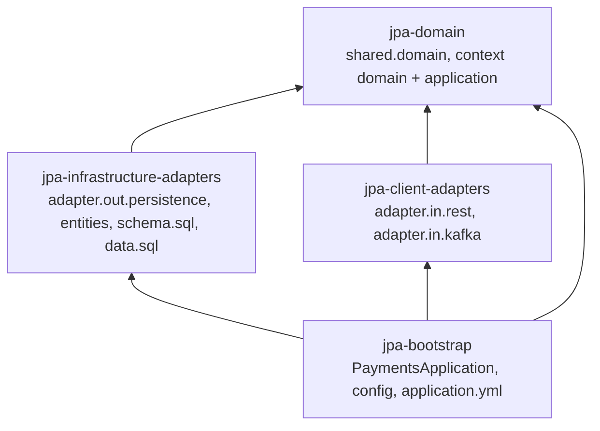

# Hexagonal Migration Plan — realistic-mess-based-on-jpa-entities-challenge

- **Status:** plan approved · S-0 `APPROVED` · I-0 `IN_PROGRESS`
- **Architecture inputs:** [`isolated-domain-design.md`](isolated-domain-design.md) (domains, ports), [`technical-layer-design.md`](technical-layer-design.md) (adapters, layers, TD-06 module structure)
- **Business rules source:** [`ddd-domain-analysis.md`](ddd-domain-analysis.md) — used only for the BR inventory
- **Test baseline:** 167 tests green (`ddd-test-coverage.md`, commit `2085e20`)

## 1. Objective

Migrate the module to Hexagonal Architecture in small, TDD-driven, user-validated iterations, one bounded context at a time, preserving every behavior asserted by the test suite (only approved deviation: D-01).

## 2. Current-State Summary

Single Spring Boot app, layered by technology: controllers → services → hand-written `EntityManager` repositories → entities with public fields; Kafka listeners `em.merge` entities directly. Business rules are spread over controllers, services, JPQL string-building, `PaymentUtils` and listeners (`isolated-domain-design.md` §4).

## 3. Target Architecture

| Module | Production dependencies | Holds |
|---|---|---|
| `jpa-domain` | none | Shared Kernel, aggregates, criteria, policies, output ports, input ports, application services |
| `jpa-infrastructure-adapters` | domain, `spring-boot-starter-data-jpa`, `postgresql` (runtime) | `Jpa*Adapter`, mappers, entities, SQL init scripts |
| `jpa-client-adapters` | domain, `spring-boot-starter-web`, `spring-kafka` | controllers, REST mappers, response DTOs, listeners, `GlobalExceptionHandler` |
| `jpa-bootstrap` | all three; `spring-boot-maven-plugin` | `PaymentsApplication`, `<Context>Configuration`, `ClockConfiguration`, `application.yml`; legacy code until migrated |

Parent POM properties: `spring-boot.run.skip=true` (overridden to `false` in bootstrap) so `mvn spring-boot:run` works from the module directory; `surefire.failIfNoSpecifiedTests=false` so `mvn test -Dtest=X` works from the module directory.

## 4. Business-Rule Inventory

| BR | Summary | Iteration(s) |
|---|---|---|
| BR-01 | blank filters ignored; enum filters trimmed + uppercased exact | I-1 … I-5 |
| BR-02 | default 50, cap 200 | I-0 (`SearchLimit`), I-2, I-3, I-5 |
| BR-03 | inbound default 50, no cap | I-0, I-4 |
| BR-04 | recalls fixed 50 | I-0, I-1 |
| BR-05 | sort orders | I-1 … I-5 |
| BR-06 | instant IBAN contains, case-insensitive | I-3 |
| BR-07 | instant IBAN 15–34 → else 400 | I-0 (`IbanFilter`), I-3 |
| BR-08 | exact IBANs (suspended / inbound / outbound) | I-2, I-4, I-5 |
| BR-09 | BIC matching quirks | I-4, I-5 |
| BR-10 | exact `endToEndId` / `originalPaymentId` | I-1, I-3 |
| BR-11 | date-only upper bounds (23:59:59 / 00:00:00) | I-1, I-3 |
| BR-12 | unparseable timestamps dropped | I-1, I-3 |
| BR-13 | suspended strict format → no rows | I-2 |
| BR-14 | malformed date / id filter → 500 | I-0 (`MalformedValueException`), I-1, I-4, I-5 |
| BR-15 | recall type filter → 400 | I-1 |
| BR-16 | unknown id → 404 | I-1 … I-5 |
| BR-17 | malformed details id → 500 / 404 outbound | I-0 (`PaymentId.parse`), I-1 … I-5 |
| BR-18 | outbound details snake_case map | I-5 |
| BR-19 | search fee | I-5 (+ D-01) |
| BR-20 | detail fee | I-5 (+ D-01) |
| BR-21 | `ageInDays` | I-4 |
| BR-22 | rendering formats (REST adapter, D-02) | I-1 … I-5 |
| BR-23 | upsert by id; invalid id dropped | I-1 … I-5 |
| BR-24 | audit timestamps reset on upsert | I-0 (`AuditTimestamps`, `Clock`), I-1 … I-5 |
| BR-25 | errors logged WARN and dropped | I-1 … I-5 |
| BR-26 | consumer groups `jpa-<type>-group` | I-1 … I-5 |
| BR-27 | scheme default `SCT INST` | I-3 |
| BR-28 | recall requires valid `originalPaymentId`, no existence check | I-1 |
| BR-29 | `""` / `"null"` strings | I-1 … I-5 |
| BR-30 | missing amount → 0 | I-1 … I-5 |
| BR-31 | date truncation, `Z` stripped, date-only → 00:00:00 | I-1 … I-5 |
| BR-32 … BR-34 | assumed value sets | not enforced — no iteration |

## 5. Iterations

Common completion criteria for every iteration: TDD (red → green → refactor) for new domain / application / adapter behavior; all re-targeted legacy assertions kept; `mvn test` from the module directory green (Docker-backed suites included); no framework dependency in `jpa-domain` (`mvn -pl domain dependency:tree`); no reference to replaced legacy classes left; this plan updated; user approval before the commit and before the next iteration.

**Test placement during iterations:** new domain / application tests go to `domain/src/test`. Re-targeted legacy tests stay in `bootstrap/src/test` (which sees every module) until I-6 moves them into their modules, organized by context.

| ID | Name | Context | Rules | Affected (legacy) | Target classes / ports / adapters | Tests | Risks |
|---|---|---|---|---|---|---|---|
| S-0 | Maven module structure | — | — (all preserved) | `pom.xml`; all sources moved unchanged to `bootstrap/`; SQL to `infrastructure-adapters/` | 4 module POMs; `AGENTS.md` (module + root) updated | 167 existing, unchanged | classpath / resource resolution across modules |
| I-0 | Shared Kernel and cross-cutting | Shared Kernel | BR-02/03/04, BR-07, BR-14, BR-17, BR-24 (building blocks) | `controller.GlobalExceptionHandler` (moved) | `shared.domain`: `PaymentId`, `Money`, `AuditTimestamps`, `SearchLimit`, `IbanFilter`, 3 exceptions; `shared.adapter.in.rest.GlobalExceptionHandler` (+ `InvalidSearchFilterException` → 400); `shared.config.ClockConfiguration` | new domain unit tests; web + integration suites unchanged | handler move must keep both mappings |
| I-1 | Recall / Investigations | Recall | BR-01, 04, 05, 10, 11, 12, 14, 15, 16, 17, 22, 23 … 26, 28 … 31 | `RecallController`, `RecallListener`, `RecallService`, `RecallRepository`, `entity.Recall`, `dto.Recall*` | `Recall`, `OriginalPaymentRef`, `RecallType`, `RecallSearchCriteria`; IP-09, IP-10; OP-09, OP-10; `RecallQueryService`, `RecordRecallService`; `JpaRecallAdapter`, `RecallJpaMapper`; `RecallRestMapper`; `RecallConfiguration` | domain tests; recall parts of web / listener / repository / service tests re-targeted | null recall amount (optional `Money`); 400 message preserved |
| I-2 | Compliance Hold | Compliance Hold | BR-01, 02, 05, 08, 13, 16, 17, 22, 23 … 26, 29 … 31 | `SuspendedPayment*` controller / listener / service / repository / entity / DTOs | `SuspendedPayment`, `SuspendedPaymentSearchCriteria`; IP-07, IP-08; OP-07, OP-08; `JpaSuspendedPaymentAdapter`; `ComplianceHoldConfiguration` | as I-1 | BR-13 unsatisfiable criteria must return no rows |
| I-3 | Instant payments | Processing | BR-01, 02, 05, 06, 07, 10, 11, 12, 16, 17, 22, 23 … 27, 29 … 31 | `InstantPayment*` | `InstantPayment`, `InstantPaymentSearchCriteria`; IP-01, IP-02; OP-01, OP-02; `JpaInstantPaymentAdapter`; `ProcessingConfiguration` (created) | as I-1 | IBAN contains vs validation message order |
| I-4 | Inbound payments | Processing | BR-01, 03, 05, 08, 09, 14, 16, 17, 21, 22, 23 … 26, 29 … 31 | `InboundPayment*`; `ageInDays` in controller + service | `InboundPayment`, `InboundPaymentSearchCriteria`, `InboundPaymentView`; IP-03, IP-04; OP-03, OP-04; `JpaInboundPaymentAdapter` | as I-1, plus fixed-`Clock` tests | uncapped limit; real-clock tests stay valid |
| I-5 | Outbound payments | Processing | BR-01, 02, 05, 08, 09, 14, 16, 17, 18, 19, 20, 22, 23 … 26, 29 … 31; D-01 | `OutboundPayment*`, `OutboundPaymentMessageConsumer`; `em.find` + fee table in controller | `OutboundPayment`, `ChargesType`, `OutboundFeeEstimate`, `SearchFeeEstimate`, `DetailFeeEstimate`, `OutboundPaymentSearchCriteria`, `PricedOutboundPayment`; IP-05, IP-06; OP-05, OP-06; `JpaOutboundPaymentAdapter` | as I-1; D-01 replaces 2 null-amount cases | C-01 / BR-18 contract; column-case BIC quirk |
| I-6 | Cleanup and test reorganization | all | — (regression only) | `util.PaymentUtils`, `PaymentUtilsTest`, leftover legacy packages | tests moved to their modules by context (test `@SpringBootConfiguration` in adapter modules); integration suite in bootstrap | full suite | test-slice configuration per module |

**Sequencing rationale:** S-0 and I-0 are prerequisites for every context. Recall is the smallest and self-contained, so it proves the pattern; Compliance Hold reuses it; Processing comes last, outbound at the very end because of C-01, BR-18 and D-01.

## 6. Traceability Matrix (iteration → ports → tests)

| Iteration | Ports | Test classes touched |
|---|---|---|
| S-0 | — | none (moved only) |
| I-0 | — (Shared Kernel) | new `shared.domain` tests |
| I-1 | IP-09, IP-10, OP-09, OP-10 | `PaymentControllerWebTest`, `KafkaListenerUnitTest`, `PaymentRepositoryUnitTest`, `PaymentServiceUnitTest` (recall parts); new `recall.*` tests |
| I-2 | IP-07, IP-08, OP-07, OP-08 | same classes (suspended parts); new `compliancehold.*` tests |
| I-3 | IP-01, IP-02, OP-01, OP-02 | same classes (instant parts); new `processing.*` tests |
| I-4 | IP-03, IP-04, OP-03, OP-04 | same classes (inbound parts) |
| I-5 | IP-05, IP-06, OP-05, OP-06 | same classes (outbound parts) |
| I-6 | all | all (moved); `PaymentApplicationIntegrationTest` never edited |

## 7. Test Strategy

- **Acceptance suite:** `PaymentApplicationIntegrationTest` is never edited; it must stay green after every iteration.
- **Re-targeted tests:** each legacy assertion is kept at the new seam (`isolated-domain-design.md` / `technical-layer-design.md` §9). The only approved assertion change is D-01.
- **New tests:** written first (red) for every new domain object, criteria factory, policy, application service, mapper and adapter.
- **Fast loop:** `mvn test -Dtest='PaymentServiceUnitTest,KafkaListenerUnitTest,PaymentControllerWebTest,PaymentUtilsTest'` plus `mvn -pl domain test`; Docker-backed suites before each validation request.

## 8. Risks

| ID | Risk | Mitigation |
|---|---|---|
| MR-01 | Behavior drift while moving rules from JPQL building into criteria | Repository-slice tests re-targeted to the adapter with identical inputs / expectations |
| MR-02 | Spring slice tests break when beans change (`@WebMvcTest` needs input-port mocks; EM mocks kept per `AGENTS.md`) | Re-target per iteration; keep `lenient()` EMF wiring |
| MR-03 | Legacy and new code coexist in bootstrap during I-1 … I-5 | Each iteration deletes the legacy classes it replaces |
| MR-04 | Real clock in `ageInDays` tests | Kept valid; fixed-`Clock` tests added in I-4 |
| MR-05 | Transaction boundary moves from listener to adapter | Listener tests + integration Kafka tests (redelivery, malformed message) |

## 9. Acceptance Criteria

AC-01 … AC-19 of the migration agent apply; in short: approved module structure, domain without framework dependencies, one approved iteration at a time, TDD, results recorded exactly, commit only after approval.

## 10. Iteration Tracking

| ID | Status | Verification | Final compilation | User validation | Commit | Issues |
|---|---|---|---|---|---|---|
| S-0 | APPROVED | `mvn test` (module dir): reactor SUCCESS, 167 tests, 0 failures, 0 errors (bootstrap: 28 + 17 + 31 + 24 + 29 + 38). `mvn -q validate` OK. `mvn -pl domain dependency:tree`: test-scope only (junit-jupiter, assertj-core, mockito-junit-jupiter). `mvn test -Dtest=PaymentUtilsTest` OK from module dir. `mvn spring-boot:run` starts `PaymentsApplication` from `bootstrap` (stopped at DB connection, compose stack not running — expected). | `mvn test` → BUILD SUCCESS | approved 2026-10-25 | see git log (`build(jpa): split module…`) | — |
| I-0 | IN_PROGRESS | | | | | |
| I-1 | NOT_STARTED | | | | | |
| I-2 | NOT_STARTED | | | | | |
| I-3 | NOT_STARTED | | | | | |
| I-4 | NOT_STARTED | | | | | |
| I-5 | NOT_STARTED | | | | | |
| I-6 | NOT_STARTED | | | | | |

## 11. Validation History

| Date | Gate | Decision |
|---|---|---|
| 2026-10-25 | Module structure | Approved: 4 Maven modules, application layer in `domain`, legacy into bootstrap first, SQL in `infrastructure-adapters`, update `AGENTS.md` in S-0. |
| 2026-10-25 | S-0 | Approved and committed. |
| 2026-10-25 | Plan | Approved. Re-targeted legacy tests stay in `bootstrap/src/test` until I-6. |
