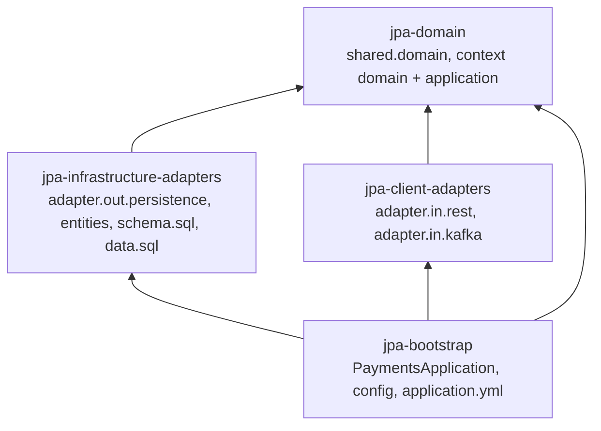

# Hexagonal Migration Plan — realistic-mess-based-on-jpa-entities-challenge

- **Status:** plan approved · S-0 `APPROVED` · I-0 `APPROVED` · I-1 `APPROVED` · I-2 `APPROVED` · I-3 `APPROVED` · I-4 `APPROVED` · all iterations `APPROVED` · migration complete
- **Architecture inputs:** [`isolated-domain-design.md`](isolated-domain-design.md) (domains, ports), [`technical-layer-design.md`](technical-layer-design.md) (adapters, layers, TD-06 module structure)
- **Business rules source:** [`ddd-domain-analysis.md`](ddd-domain-analysis.md) — used only for the BR inventory
- **Test baseline:** 167 tests green (`ddd-test-coverage.md`, commit `2085e20`)

## 1. Objective

Migrate the module to Hexagonal Architecture in small, TDD-driven, user-validated iterations, one bounded context at a time, preserving every behavior asserted by the test suite (only approved deviation: D-01).

## 2. Current-State Summary

Single Spring Boot app, layered by technology: controllers → services → hand-written `EntityManager` repositories → entities with public fields; Kafka listeners `em.merge` entities directly. Business rules are spread over controllers, services, JPQL string-building, `PaymentUtils` and listeners (`isolated-domain-design.md` §4).

## 3. Target Architecture

| Module | Production dependencies | Holds |
|---|---|---|
| `jpa-domain` | none | Shared Kernel, aggregates, criteria, policies, output ports, input ports, application services |
| `jpa-infrastructure-adapters` | domain, `spring-boot-starter-data-jpa`, `postgresql` (runtime) | `Jpa*Adapter`, mappers, entities, SQL init scripts |
| `jpa-client-adapters` | domain, `spring-boot-starter-web`, `spring-kafka` | controllers, REST mappers, response DTOs, listeners, `GlobalExceptionHandler` |
| `jpa-bootstrap` | all three; `spring-boot-maven-plugin` | `PaymentsApplication`, `<Context>Configuration`, `ClockConfiguration`, `application.yml`; legacy code until migrated |

Parent POM properties: `spring-boot.run.skip=true` (overridden to `false` in bootstrap) so `mvn spring-boot:run` works from the module directory; `surefire.failIfNoSpecifiedTests=false` so `mvn test -Dtest=X` works from the module directory.

## 4. Business-Rule Inventory

| BR | Summary | Iteration(s) |
|---|---|---|
| BR-01 | blank filters ignored; enum filters trimmed + uppercased exact | I-1 … I-5 |
| BR-02 | default 50, cap 200 | I-0 (`SearchLimit`), I-2, I-3, I-5 |
| BR-03 | inbound default 50, no cap | I-0, I-4 |
| BR-04 | recalls fixed 50 | I-0, I-1 |
| BR-05 | sort orders | I-1 … I-5 |
| BR-06 | instant IBAN contains, case-insensitive | I-3 |
| BR-07 | instant IBAN 15–34 → else 400 | I-0 (`IbanFilter`), I-3 |
| BR-08 | exact IBANs (suspended / inbound / outbound) | I-2, I-4, I-5 |
| BR-09 | BIC matching quirks | I-4, I-5 |
| BR-10 | exact `endToEndId` / `originalPaymentId` | I-1, I-3 |
| BR-11 | date-only upper bounds (23:59:59 / 00:00:00) | I-1, I-3 |
| BR-12 | unparseable timestamps dropped | I-1, I-3 |
| BR-13 | suspended strict format → no rows | I-2 |
| BR-14 | malformed date / id filter → 500 | I-0 (`MalformedValueException`), I-1, I-4, I-5 |
| BR-15 | recall type filter → 400 | I-1 |
| BR-16 | unknown id → 404 | I-1 … I-5 |
| BR-17 | malformed details id → 500 / 404 outbound | I-0 (`PaymentId.parse`), I-1 … I-5 |
| BR-18 | outbound details snake_case map | I-5 |
| BR-19 | search fee | I-5 (+ D-01) |
| BR-20 | detail fee | I-5 (+ D-01) |
| BR-21 | `ageInDays` | I-4 |
| BR-22 | rendering formats (REST adapter, D-02) | I-1 … I-5 |
| BR-23 | upsert by id; invalid id dropped | I-1 … I-5 |
| BR-24 | audit timestamps reset on upsert | I-0 (`AuditTimestamps`, `Clock`), I-1 … I-5 |
| BR-25 | errors logged WARN and dropped | I-1 … I-5 |
| BR-26 | consumer groups `jpa-<type>-group` | I-1 … I-5 |
| BR-27 | scheme default `SCT INST` | I-3 |
| BR-28 | recall requires valid `originalPaymentId`, no existence check | I-1 |
| BR-29 | `""` / `"null"` strings | I-1 … I-5 |
| BR-30 | missing amount → 0 | I-1 … I-5 |
| BR-31 | date truncation, `Z` stripped, date-only → 00:00:00 | I-1 … I-5 |
| BR-32 … BR-34 | assumed value sets | not enforced — no iteration |

## 5. Iterations

Common completion criteria for every iteration: TDD (red → green → refactor) for new domain / application / adapter behavior; all re-targeted legacy assertions kept; `mvn test` from the module directory green (Docker-backed suites included); no framework dependency in `jpa-domain` (`mvn -pl domain dependency:tree`); no reference to replaced legacy classes left; this plan updated; user approval before the commit and before the next iteration.

**Test placement during iterations:** new domain / application tests go to `domain/src/test`. Re-targeted legacy tests stay in `bootstrap/src/test` (which sees every module) until I-6 moves them into their modules, organized by context.

| ID | Name | Context | Rules | Affected (legacy) | Target classes / ports / adapters | Tests | Risks |
|---|---|---|---|---|---|---|---|
| S-0 | Maven module structure | — | — (all preserved) | `pom.xml`; all sources moved unchanged to `bootstrap/`; SQL to `infrastructure-adapters/` | 4 module POMs; `AGENTS.md` (module + root) updated | 167 existing, unchanged | classpath / resource resolution across modules |
| I-0 | Shared Kernel and cross-cutting | Shared Kernel | BR-02/03/04, BR-07, BR-14, BR-17, BR-24 (building blocks) | `controller.GlobalExceptionHandler` (moved) | `shared.domain`: `PaymentId`, `Money`, `AuditTimestamps`, `SearchLimit`, `IbanFilter`, 3 exceptions; `shared.adapter.in.rest.GlobalExceptionHandler` (+ `InvalidSearchFilterException` → 400); `shared.config.ClockConfiguration` | new domain unit tests; web + integration suites unchanged | handler move must keep both mappings |
| I-1 | Recall / Investigations | Recall | BR-01, 04, 05, 10, 11, 12, 14, 15, 16, 17, 22, 23 … 26, 28 … 31 | `RecallController`, `RecallListener`, `RecallService`, `RecallRepository`, `entity.Recall`, `dto.Recall*` | `Recall`, `OriginalPaymentRef`, `RecallType`, `RecallSearchCriteria`; IP-09, IP-10; OP-09, OP-10; `RecallQueryService`, `RecordRecallService`; `JpaRecallAdapter`, `RecallJpaMapper`; `RecallRestMapper`; `RecallConfiguration` | domain tests; recall parts of web / listener / repository / service tests re-targeted | null recall amount (optional `Money`); 400 message preserved |
| I-2 | Compliance Hold | Compliance Hold | BR-01, 02, 05, 08, 13, 16, 17, 22, 23 … 26, 29 … 31 | `SuspendedPayment*` controller / listener / service / repository / entity / DTOs | `SuspendedPayment`, `SuspendedPaymentSearchCriteria`; IP-07, IP-08; OP-07, OP-08; `JpaSuspendedPaymentAdapter`; `ComplianceHoldConfiguration` | as I-1 | BR-13 unsatisfiable criteria must return no rows |
| I-3 | Instant payments | Processing | BR-01, 02, 05, 06, 07, 10, 11, 12, 16, 17, 22, 23 … 27, 29 … 31 | `InstantPayment*` | `InstantPayment`, `InstantPaymentSearchCriteria`; IP-01, IP-02; OP-01, OP-02; `JpaInstantPaymentAdapter`; `ProcessingConfiguration` (created) | as I-1 | IBAN contains vs validation message order |
| I-4 | Inbound payments | Processing | BR-01, 03, 05, 08, 09, 14, 16, 17, 21, 22, 23 … 26, 29 … 31 | `InboundPayment*`; `ageInDays` in controller + service | `InboundPayment`, `InboundPaymentSearchCriteria`, `InboundPaymentView`; IP-03, IP-04; OP-03, OP-04; `JpaInboundPaymentAdapter` | as I-1, plus fixed-`Clock` tests | uncapped limit; real-clock tests stay valid |
| I-5 | Outbound payments | Processing | BR-01, 02, 05, 08, 09, 14, 16, 17, 18, 19, 20, 22, 23 … 26, 29 … 31; D-01 | `OutboundPayment*`, `OutboundPaymentMessageConsumer`; `em.find` + fee table in controller | `OutboundPayment`, `ChargesType`, `OutboundFeeEstimate`, `SearchFeeEstimate`, `DetailFeeEstimate`, `OutboundPaymentSearchCriteria`, `PricedOutboundPayment`; IP-05, IP-06; OP-05, OP-06; `JpaOutboundPaymentAdapter` | as I-1; D-01 replaces 2 null-amount cases | C-01 / BR-18 contract; column-case BIC quirk |
| I-6 | Cleanup and test reorganization | all | — (regression only) | `util.PaymentUtils`, `PaymentUtilsTest`, leftover legacy packages | tests moved to their modules by context (test `@SpringBootConfiguration` in adapter modules); integration suite in bootstrap | full suite | test-slice configuration per module |

**Sequencing rationale:** S-0 and I-0 are prerequisites for every context. Recall is the smallest and self-contained, so it proves the pattern; Compliance Hold reuses it; Processing comes last, outbound at the very end because of C-01, BR-18 and D-01.

## 6. Traceability Matrix (iteration → ports → tests)

| Iteration | Ports | Test classes touched |
|---|---|---|
| S-0 | — | none (moved only) |
| I-0 | — (Shared Kernel) | new `shared.domain` tests |
| I-1 | IP-09, IP-10, OP-09, OP-10 | `PaymentControllerWebTest`, `KafkaListenerUnitTest`, `PaymentRepositoryUnitTest`, `PaymentServiceUnitTest` (recall parts); new `recall.*` tests |
| I-2 | IP-07, IP-08, OP-07, OP-08 | same classes (suspended parts); new `compliancehold.*` tests |
| I-3 | IP-01, IP-02, OP-01, OP-02 | same classes (instant parts); new `processing.*` tests |
| I-4 | IP-03, IP-04, OP-03, OP-04 | same classes (inbound parts) |
| I-5 | IP-05, IP-06, OP-05, OP-06 | same classes (outbound parts) |
| I-6 | all | all (moved); `PaymentApplicationIntegrationTest` never edited |

## 7. Test Strategy

- **Acceptance suite:** `PaymentApplicationIntegrationTest` is never edited; it must stay green after every iteration.
- **Re-targeted tests:** each legacy assertion is kept at the new seam (`isolated-domain-design.md` / `technical-layer-design.md` §9). The only approved assertion change is D-01.
- **New tests:** written first (red) for every new domain object, criteria factory, policy, application service, mapper and adapter.
- **Fast loop:** `mvn test -Dtest='PaymentServiceUnitTest,KafkaListenerUnitTest,PaymentControllerWebTest,PaymentUtilsTest'` plus `mvn -pl domain test`; Docker-backed suites before each validation request.

## 8. Risks

| ID | Risk | Mitigation |
|---|---|---|
| MR-01 | Behavior drift while moving rules from JPQL building into criteria | Repository-slice tests re-targeted to the adapter with identical inputs / expectations |
| MR-02 | Spring slice tests break when beans change (`@WebMvcTest` needs input-port mocks; EM mocks kept per `AGENTS.md`) | Re-target per iteration; keep `lenient()` EMF wiring |
| MR-03 | Legacy and new code coexist in bootstrap during I-1 … I-5 | Each iteration deletes the legacy classes it replaces |
| MR-04 | Real clock in `ageInDays` tests | Kept valid; fixed-`Clock` tests added in I-4 |
| MR-05 | Transaction boundary moves from listener to adapter | Listener tests + integration Kafka tests (redelivery, malformed message) |

## 9. Acceptance Criteria

AC-01 … AC-19 of the migration agent apply; in short: approved module structure, domain without framework dependencies, one approved iteration at a time, TDD, results recorded exactly, commit only after approval.

## 10. Iteration Tracking

| ID | Status | Verification | Final compilation | User validation | Commit | Issues |
|---|---|---|---|---|---|---|
| S-0 | APPROVED | `mvn test` (module dir): reactor SUCCESS, 167 tests, 0 failures, 0 errors (bootstrap: 28 + 17 + 31 + 24 + 29 + 38). `mvn -q validate` OK. `mvn -pl domain dependency:tree`: test-scope only (junit-jupiter, assertj-core, mockito-junit-jupiter). `mvn test -Dtest=PaymentUtilsTest` OK from module dir. `mvn spring-boot:run` starts `PaymentsApplication` from `bootstrap` (stopped at DB connection, compose stack not running — expected). | `mvn test` → BUILD SUCCESS | approved 2026-10-25 | `b7e25c5` | — |
| I-0 | APPROVED | TDD per method (16 rules RED → GREEN). `mvn test` (module dir): domain 30, client-adapters 3, bootstrap 168 (167 legacy + `ClockConfigurationTest`) = 201 tests, 0 failures, 0 errors. `jpa-domain` dependency tree: test scope only; no Spring / JPA / Jackson / `java.sql` import in `domain/src/main`. | `mvn test` → BUILD SUCCESS | approved 2026-10-25 | `850d4e2` | `PaymentId.parse` does not trim (design §6.3 corrected). Shared Kernel not yet consumed by legacy code (used from I-1). |
| I-1 | APPROVED | TDD for `LenientTimestamp.parse` (5 rules + 36-case conformance vs `Timestamp.valueOf`), `RecallType.validateFilter` (2), `RecallSearchCriteria.from` (7 + 4 regression checks), `Recall.record` (2), `RecallQueryService` (2), `RecordRecallService` (1 + regression). Re-targeted recall tests RED against stub adapter / mapper / no-op upsert, then GREEN. `mvn test`: domain 121, client-adapters 3, bootstrap 168 = 292, 0 failures. Integration suite unchanged (`git diff` empty). Domain: no framework / `java.sql` / adapter imports; recall imports no other context. | `mvn test` → BUILD SUCCESS | approved 2026-10-25 | `83a2429` | Kafka listener and application service were written before their re-targeted tests, so those tests had no RED run; the integration ingestion tests provided RED for `upsert`. Re-targeted inputs: UUID ids instead of `r1` / `nope` / `missing`; `IllegalArgumentException` → `InvalidSearchFilterException` (400 unchanged). `recallSearch_mapsFieldsAndFormatsDates` moved from the service test to the web test. |
| I-2 | APPROVED | TDD for `LenientIsoTimestamp.parse` (5 rules + 32-case conformance vs lenient `SimpleDateFormat`), `SuspendedPaymentSearchCriteria.from` (5 + 1 regression), `SuspendedPaymentQueryService` (2), `RecordSuspendedPaymentService` (1 + regression). Re-targeted tests RED against stub adapter / mapper / listener (web 4, Kafka 1, repository 4), then GREEN. `mvn test`: domain 191, client-adapters 3, bootstrap 170 = 364, 0 failures. Integration suite unchanged. Domain: no framework / `java.sql` / adapter imports; no cross-context imports. | `mvn test` → BUILD SUCCESS | approved 2026-10-25 | `3c1a269` | Already GREEN on stubs (no RED possible): repository `heldBound…returnsNoRows`, Kafka `malformedJson_swallowed`. Mapping / formatting assertions of the 2 service tests moved to 2 new web tests (bootstrap +2). Fixture of `suspendedGetById_foundAndMissing` now has an amount (D-01). |
| I-3 | APPROVED | TDD for `InstantPayment.record` (2 rules), `InstantPaymentSearchCriteria.from` (9 + 3 regression), `InstantPaymentQueryService` (2), `RecordInstantPaymentService` (1 + regression). Re-targeted tests RED against stub adapter / mapper / listener (web 4, Kafka 8 runs, repository 7), then GREEN. `mvn test`: domain 218, client-adapters 3, bootstrap 172 = 393, 0 failures. Integration suite unchanged. Domain: no framework / `java.sql` / adapter imports; no cross-context imports. | `mvn test` → BUILD SUCCESS | approved 2026-10-25 | `d817d1d` | Instant listener tests use the real `RecordInstantPaymentService` with a mocked `InstantPaymentRecordRepository` (keeps scheme-default and audit-time assertions verbatim). Repository tests assert `LocalDateTime`; the 2 formatted `executionDatetime` assertions moved to 2 new web tests. `instantSearch_ibanFilters_matchAnySubstringIgnoringCase` builds criteria directly (short substrings are rejected by BR-07). Already GREEN on stubs: web 500 test, Kafka malformed / invalid id. |
| I-4 | APPROVED | TDD for `LenientDate.parse` (4 rules + 32-case conformance vs `Date.valueOf`), `InboundPayment.ageInDays` (2 + 1 regression), `InboundPaymentSearchCriteria.from` (5 + 1 regression), `InboundPaymentQueryService` (2, fixed clock), `RecordInboundPaymentService` (1 + regression). Re-targeted tests RED against stub adapter / mapper / listener (web 5, Kafka 2, repository 5), then GREEN. `mvn test`: domain 289, client-adapters 3, bootstrap 175 = 467, 0 failures. Integration suite unchanged. Domain: no framework / `java.sql` / adapter imports; no cross-context or cross-aggregate imports. | `mvn test` → BUILD SUCCESS | approved 2026-10-25 | `5aeaeba` | Web tests now render a pre-computed `ageInDays` (mocked `InboundPaymentView`); the search-level age computation assertions moved to `PaymentServiceUnitTest.inboundSearch_computesAgeInDays` (real clock, as before). Date rendering assertions of 2 repository tests moved to 2 new web tests. `inboundSearch_delegatesToRepository` passes an empty query instead of `null`. |
| I-5 | APPROVED | TDD for `ChargesType` (3 rules), `SearchFeeEstimate` (3), `DetailFeeEstimate` (3), `OutboundPaymentSearchCriteria.from` (5 + 1 regression), `OutboundPaymentQueryService` (2, distinct tariffs), `RecordOutboundPaymentService` (1 + regression). Re-targeted tests RED against stub adapter / mapper / consumer (web 10, Kafka 2, repository 5), then GREEN. `mvn test`: domain 337, client-adapters 3, bootstrap 176 = 516, 0 failures. Integration suite unchanged. Domain: no framework / `java.sql` / adapter imports; no cross-context or cross-aggregate imports; no JPA left in client-adapters / bootstrap. | `mvn test` → BUILD SUCCESS | approved 2026-10-25 | `b8bbd3a` | Outbound web and Kafka tests wire the real query / record services with mocked repository ports (HTTP-level fee and contract assertions kept verbatim; `EntityManager` mock removed from the Kafka test). D-01 applied. Dead `getById` not migrated (approved). Bootstrap now holds only `PaymentsApplication`, configuration and `util.PaymentUtils` (unused since I-5, removed in I-6). |
| I-6 | APPROVED | Tests split per component into their modules (generated verbatim by member extraction from the 4 legacy multi-context classes; only the per-listener topic/group test was rewritten from the parameterized one): domain 375 (incl. 5 `*QueryServiceCharacterizationTest`), infrastructure-adapters 28 (5 `Jpa*AdapterTest` on `JpaAdapterTestSupport`, one shared Postgres container), client-adapters 64 (5 `*ControllerWebTest`, 5 listener tests, `GlobalExceptionHandlerTest`), bootstrap 32 (integration 31 + `ClockConfigurationTest`) = 499, 0 failures (516 − 17 `PaymentUtilsTest`). `util.PaymentUtils` + `PaymentUtilsTest` deleted (coverage map §12). Module and root `AGENTS.md` updated; documented commands verified (`mvn test -pl domain,client-adapters`, `-pl domain,infrastructure-adapters`, `-Dtest=…`). | `mvn test` → BUILD SUCCESS (reactor: 4 modules SUCCESS) | approved 2026-10-25 | `a43488c` | `EntityManagerFactory` / `EntityManager` web-test mocks dropped (no JPA on the client-adapters classpath; no controller uses JPA since I-5). README untouched (documents the exercise's starting point). |

## 11. Validation History

| Date | Gate | Decision |
|---|---|---|
| 2026-10-25 | Module structure | Approved: 4 Maven modules, application layer in `domain`, legacy into bootstrap first, SQL in `infrastructure-adapters`, update `AGENTS.md` in S-0. |
| 2026-10-25 | S-0 | Approved and committed. |
| 2026-10-25 | Plan | Approved. Re-targeted legacy tests stay in `bootstrap/src/test` until I-6. |
| 2026-10-25 | I-0 | Approved and committed. |
| 2026-10-25 | I-1 | Changes requested: drop `recall.domain` / `recall.application` sub-packages. Applied (`recall`, `recall.port.in`, `recall.port.out`; Recall only). `mvn test` re-run: 292 tests, 0 failures. |
| 2026-10-25 | I-1 | Approved and committed. |
| 2026-10-25 | I-2 | Approved and committed (Recall package layout reused). |
| 2026-10-25 | I-3 | Approved and committed (Processing: one package per aggregate). |
| 2026-10-25 | I-4 | Approved and committed. |
| 2026-10-25 | I-5 | Approved and committed (dead `getById` not migrated; D-01 applied). |
| 2026-10-25 | I-6 + final verification | Approved and committed. Next: compliance audit (orchestrator Phase 6). |
| 2026-10-25 | Compliance audit | Independent audit of `a43488c`: **COMPLIANT** (Rules 1–4 pass, no confirmed dead code, `mvn clean install` exit 0, 499 tests). Report: `hexagonal-compliance-audit.md`. User decision: no follow-up. |

## 12. PaymentUtils Removal — Coverage Map

| `PaymentUtils` member | Production callers after I-5 | Behavior now owned by | Covering tests |
|---|---|---|---|
| `isValidIban` | none | `IbanFilter.isPlausible` | `IbanFilterTest` (null, too short, too long, spaces, valid) |
| `limitOrDefault`, `DEFAULT_LIMIT`, `MAX_LIMIT` | none | `SearchLimit.capped` | `SearchLimitTest` |
| `parseTimestamp`, `FMT` (parsing) | none | `compliancehold.LenientIsoTimestamp` | `LenientIsoTimestampTest` (incl. conformance vs `SimpleDateFormat`) |
| `FMT` / `DAY_FMT` (rendering) | none | `RestDateFormats` | `*ControllerWebTest` formatting tests |
| `likePattern` | none | instant criteria (trim + upper case) + `JpaInstantPaymentAdapter` (`%…%`) | `InstantPaymentSearchCriteriaTest`, `JpaInstantPaymentAdapterTest` |
| `DEFAULT_FEE` | none | `SearchFeeEstimate` | `SearchFeeEstimateTest`, `OutboundPaymentQueryServiceCharacterizationTest` |
| `formatAmount`, `now`, `randomId` | none — never called by production code, even before the migration | — (deleted) | — (their 4 `PaymentUtilsTest` cases deleted with the class, approved) |

## 13. Final Verification (migration Phase 5)

| Check | Result |
|---|---|
| Full test suite | `mvn test` → BUILD SUCCESS, 499 tests, 0 failures, 0 errors |
| Maven reactor | parent + `jpa-domain`, `jpa-infrastructure-adapters`, `jpa-client-adapters`, `jpa-bootstrap` all SUCCESS; no circular dependency (Maven would refuse it) |
| Domain without framework dependencies | `mvn -pl domain dependency:tree`: no non-test dependency; no `org.springframework` / `jakarta` / `com.fasterxml` / `java.sql` import in `domain/src/main` |
| Adapters implement the approved ports | 10 input ports implemented by the 10 application services; 10 repository ports by the 5 `Jpa*Adapter`s; `OutboundFeeEstimate` by `SearchFeeEstimate` / `DetailFeeEstimate` |
| Boundaries | no cross-context and no cross-aggregate import in `jpa-domain`; no JPA in `jpa-client-adapters` / `jpa-bootstrap` main code |
| Business-rule traceability | BR-01 … BR-31 covered by the iteration tests listed in §4 / §10; BR-32 … BR-34 not enforced by design |
| Technical features | 10 REST endpoints, 5 Kafka consumers (topics / groups unchanged), error mapping, upsert, schema / seed init — all exercised by the unchanged `PaymentApplicationIntegrationTest` (31 / 31) |
| Approved deviations | D-01 (amount mandatory), D-02 (rendering in REST adapter), dead `OutboundPaymentService.getById` not migrated, `PaymentUtils` dead helpers deleted |

