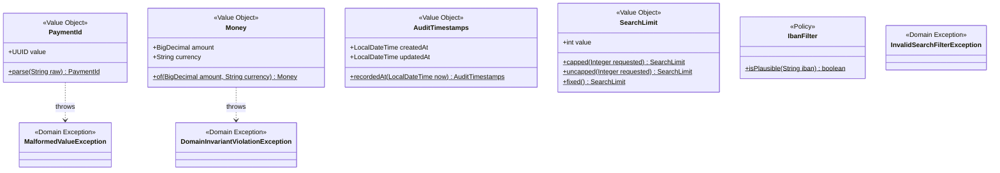
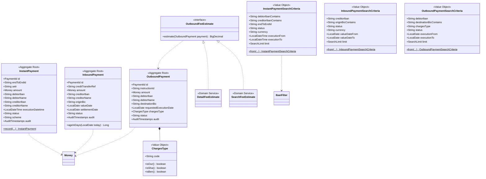
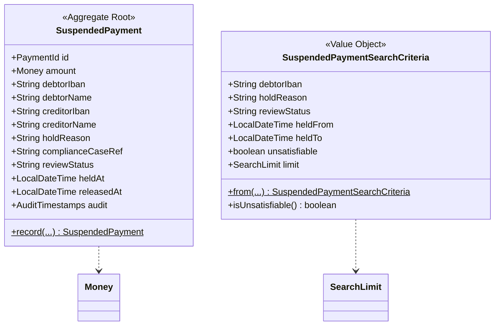
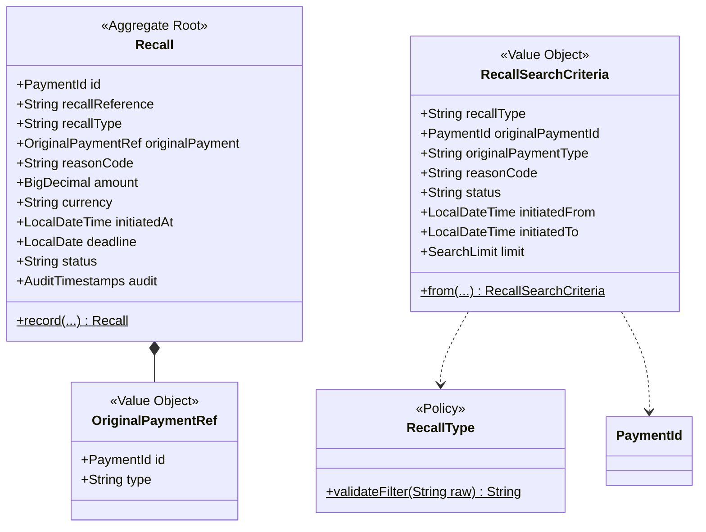
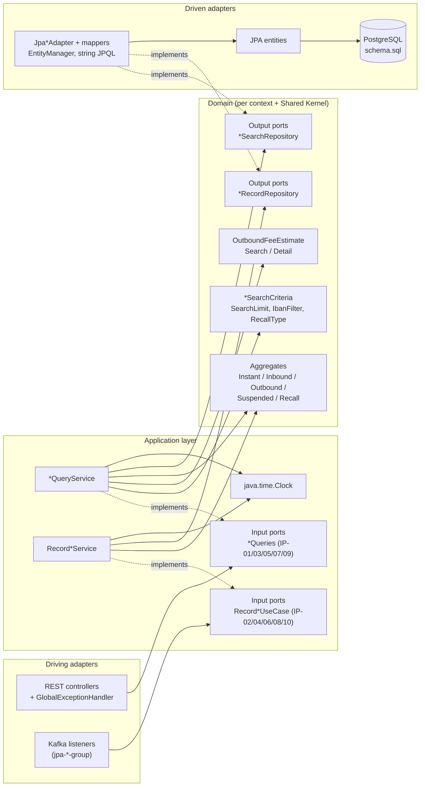

# Isolated Domain Design — realistic-mess-based-on-jpa-entities-challenge

- **Status:** Approved (gate 1: domain model, gate 2: ports), 2026-10-25
- **Business reference:** [`ddd-domain-analysis.md`](ddd-domain-analysis.md) (BR-01 … BR-34, C-01 … C-05, R-01 … R-08)
- **Test baseline:** [`ddd-test-coverage.md`](ddd-test-coverage.md) — 167 tests, all green (commit `2085e20`)
- **Nature of this document:** design only. No source code was changed while producing it.

---

## 1. Executive Summary

The module is a **read-only payment inquiry service**: Kafka feeds five projections and REST offers search and details over them. There are no commands, state transitions or domain events. The design therefore isolates **read-model aggregates** — immutable records built at ingestion or reconstitution — and moves the business rules that are today scattered across controllers, services, string-built JPQL and Kafka listeners into:

- five aggregate roots across three bounded contexts plus a Shared Kernel;
- a small set of value objects (only where behavior exists);
- domain-owned **search criteria** that state the query semantics (match mode, case handling, date-bound interpretation, limit) the JPA adapter only translates;
- one fee interface `OutboundFeeEstimate` with two implementations, `SearchFeeEstimate` and `DetailFeeEstimate` (C-01 preserved);
- 10 domain-owned output ports (read/write split per aggregate) and 10 application-owned input ports (queries + record per aggregate).

The domain depends on `java.time`, `java.math` and `java.util` only. Two approved deviations from the Phase 1 analysis are recorded (§19): **D-01** non-null `Money.amount`, **D-02** BR-22 formatting moves to the REST adapter.

## 2. Reference to `ddd-domain-analysis.md` and Baseline Business Model

| Baseline element | Used here as |
|---|---|
| Contexts: Payment Processing (Core), Compliance Hold, Recall / Investigations, Shared Kernel (§8) | Package boundaries (§6) — unchanged |
| BR-01 … BR-31 (enforced rules) | Ownership mapping (§8) |
| BR-32 … BR-34 (assumed value sets) | Kept as plain `String`, **never validated** |
| C-01 (two fee tables) | `SearchFeeEstimate` / `DetailFeeEstimate` |
| C-02 … C-05 (quirks) | Preserved; owner listed in §8 |
| R-03 (system clock) | Fixed by injecting `java.time.Clock` |
| R-04 (shared `SimpleDateFormat`) | Removed from the domain; adapters use `DateTimeFormatter` |
| R-05 (listeners bypass domain) | Listeners call `Record*UseCase` |
| R-06 (outbound details exposes persistence shape) | Contract preserved; shape built in the REST adapter |
| R-08 (500 depends on `@Repository` translation) | Made explicit by `MalformedValueException` → 500 |

## 3. Existing Bounded Contexts and Responsibilities

| Context | Aggregates | Responsibility | Relationship |
|---|---|---|---|
| Payment Processing (Core) | InstantPayment, InboundPayment, OutboundPayment | Inquiry on executed, received and requested payments; fee estimates; payment age | Upstream of Recall (referenced by id) |
| Compliance Hold (Supporting) | SuspendedPayment | Inquiry on payments held for compliance review | Independent |
| Recall / Investigations (Supporting) | Recall | Inquiry on recall requests; references an original payment by id + type only | Conformist reference to Processing ids; existence not checked (BR-28) |
| Shared Kernel | — | `PaymentId`, `Money`, `AuditTimestamps`, `SearchLimit`, `IbanFilter`, domain exceptions | Used by all three |

## 4. Current-State Technical Architecture

```
HTTP ─► *Controller ─► *Service ─► *Repository (EntityManager + string JPQL) ─► entity.* (public fields)
Kafka ─► *Listener / OutboundPaymentMessageConsumer ─► em.merge(entity)          (bypasses services)
```

Business logic currently mixed with technical concerns:

| Rule(s) | Current location | Coupled to |
|---|---|---|
| BR-19 search fee | `OutboundPaymentService.estimateFee`, `PaymentUtils.DEFAULT_FEE` | service + DTO mapping |
| BR-20 detail fee, BR-18 contract | `OutboundPaymentController.get` (`EntityManager.find`, snake_case `Map`) | controller + JPA |
| BR-21 `ageInDays` | `InboundPaymentController.search`, `InboundPaymentService.getById` (duplicated) | controller, `new Date()` |
| BR-07, BR-15 filter validation | `InstantPaymentService`, `RecallService` | services |
| BR-01 … BR-13 filter / limit / ordering semantics | JPQL string-building in five repositories, `PaymentUtils.likePattern/limitOrDefault/parseTimestamp` | JPA, `SimpleDateFormat` |
| BR-23 … BR-31 ingestion rules | Five Kafka listeners | Jackson, JPA, Spring Kafka |
| BR-22 formatting | `PaymentUtils.FMT/DAY_FMT`, repositories and services | `SimpleDateFormat` (R-04) |
| BR-14, BR-17 error statuses | `UUID.fromString` inside repositories + `@Repository` translation + `GlobalExceptionHandler` | Spring DAO translation (R-08) |

Inconsistent repository return types (DTOs for instant/inbound, entities for the others) are intentional and disappear behind the new ports: every search port returns domain aggregates.

## 5. Design Goals and Constraints

**Goals**
- G-1: Business rules live in domain objects and are testable without Spring, JPA, Kafka or the system clock.
- G-2: Persistence, HTTP and Kafka concerns live in adapters behind ports owned by the core.
- G-3: Every observable behavior asserted by the 167 tests is preserved, except the approved D-01.
- G-4: Each context can be migrated independently (Phase 5 increments).

**Constraints**
- No JPA/ORM annotations, `EntityManager`, `java.sql.*`, Jackson or Spring types in `*.domain` packages.
- Repository ports never expose entities, `Timestamp`, `Date`, JPQL or `Query`.
- Input ports belong to the application layer.
- `schema.sql` remains the only DDL; table shapes do not change; JPA entities stay as persistence models.
- The three repo modules share no code; this design applies to this module only.
- Stored data contains `""`, `"null"`, unknown charges types and unvalidated statuses (BR-29, BR-32 … BR-34): the domain must be lenient and lossless on these fields.

## 6. Proposed Isolated Domain Models

### 6.1 Design principles

1. **Read-model aggregates as immutable `record`s**, created via `record(...)` factories (ingestion) or reconstitution (adapter). No setters, no transitions, no domain events — nothing would consume them.
2. **Minimal value-object set.** VOs only where behavior or an invariant exists. Statuses, IBANs, BICs, names, references, hold reasons and reason codes stay `String`.
3. **Domain-owned query semantics.** `*SearchCriteria` value objects carry normalized filter values, the match mode and the limit; the JPA adapter translates them mechanically.
4. **Time as values.** Timestamps are `LocalDateTime` (no zone; matches BR-31 "Z stripped, not converted"), dates are `LocalDate`. "Now" and "today" are passed in by the application from an injected `Clock`.

### 6.2 Packages

```
fr.kevin.llps.payments.shared.domain             PaymentId, Money, AuditTimestamps, SearchLimit, IbanFilter,
                                                 InvalidSearchFilterException, MalformedValueException,
                                                 DomainInvariantViolationException
fr.kevin.llps.payments.processing.domain         InstantPayment, InboundPayment, OutboundPayment, ChargesType,
                                                 OutboundFeeEstimate, SearchFeeEstimate, DetailFeeEstimate,
                                                 *SearchCriteria
fr.kevin.llps.payments.processing.domain.port    output ports (§11)
fr.kevin.llps.payments.processing.application    use-case services
fr.kevin.llps.payments.processing.application.port.in   input ports (§11)
fr.kevin.llps.payments.compliancehold.{domain, domain.port, application, application.port.in}
fr.kevin.llps.payments.recall.{domain, domain.port, application, application.port.in}
```

**Recall (I-1 change request):** `recall` (aggregate, value objects, policies, criteria, application services), `recall.port.in` (input ports, queries, commands), `recall.port.out` (repository ports) — no `domain` / `application` sub-packages. Other contexts are decided when migrated.

New packages are added alongside the legacy `controller/service/repository/entity/kafka/dto/util` packages, so contexts migrate one at a time.

### 6.3 Shared Kernel

| Class | Kind | Behavior / invariant | Rules |
|---|---|---|---|
| `PaymentId(UUID value)` | VO | `parse(String)` delegates to `UUID.fromString` **without trimming** (Kafka ids are not trimmed today; REST adapters and criteria trim before parsing, as the legacy repositories do) and throws `MalformedValueException` if not a UUID | BR-14, BR-17, BR-23 |
| `Money(BigDecimal amount, String currency)` | VO | **`amount` non-null** (D-01) — `Money.of(null, …)` throws `DomainInvariantViolationException`; `currency` lenient `String` | BR-19, BR-20, BR-30 |
| `AuditTimestamps(LocalDateTime createdAt, LocalDateTime updatedAt)` | VO | `recordedAt(now)` sets both to `now`; nullable on reconstitution (columns nullable) | BR-18, BR-24 |
| `SearchLimit(int value)` | VO | `capped(Integer)`: null → 50, > 200 → 200, else as given; `uncapped(Integer)`: null → 50, else as given; `fixed()` → 50 | BR-02, BR-03, BR-04 |
| `IbanFilter` | Policy | `isPlausible(String)`: 15 … 34 chars after removing spaces | BR-07 |
| `InvalidSearchFilterException` | Domain exception | carries the user message; REST → **400** with that message | BR-07, BR-15 |
| `LenientTimestamp` | Policy | `parse(String)` re-implements `java.sql.Timestamp.valueOf` with `java.time` (same accepted formats, range checks and roll-over); conformance-tested against it. Adapters bind bounds via `Timestamp.valueOf(LocalDateTime)`, keeping DST-gap normalization identical | BR-11, BR-12 |
| `MalformedValueException` | Domain exception | REST → **500** generic body; deliberately **not** an `IllegalArgumentException` (R-08) | BR-14, BR-17 |
| `DomainInvariantViolationException` | Domain exception | REST → **500** generic body | D-01 |

Exception hierarchy note: all three extend `RuntimeException` directly. `GlobalExceptionHandler` keeps `IllegalArgumentException` → 400 for legacy code until it is migrated, and gains `InvalidSearchFilterException` → 400 (message preserved); everything else stays → 500.

### 6.4 Payment Processing (Core)

| Class | Kind | Behavior / invariant | Rules |
|---|---|---|---|
| `InstantPayment` | Aggregate Root | `record(...)`: `scheme` null → `"SCT INST"`; `id`, `amount` mandatory | BR-27, BR-23, BR-30 |
| `InboundPayment` | Aggregate Root | `ageInDays(LocalDate today)` → `Long` days from `valueDate` to `today`; negative for future dates; `null` without `valueDate` | BR-21 |
| `OutboundPayment` | Aggregate Root | holds `Money`, `ChargesType`, `AuditTimestamps` | BR-18 |
| `ChargesType(String code)` | VO | raw code kept as-is (may be `""`, `"null"`, unknown, or null); `isOur()`, `isSha()`, `isBen()` | BR-19, BR-20, BR-32 |
| `OutboundFeeEstimate` | Domain Service interface | `BigDecimal estimate(OutboundPayment)` — total for any valid aggregate, never null | C-01 |
| `SearchFeeEstimate` | Domain Service | OUR → 1 % HALF_UP scale 2; BEN → 0; else → 0.30 | BR-19 |
| `DetailFeeEstimate` | Domain Service | OUR → 2 % HALF_UP scale 2; SHA → 0.50; else → 0 | BR-20 |
| `InstantPaymentSearchCriteria` | VO + factory | debtor/creditor IBAN: validated via `IbanFilter` (else `InvalidSearchFilterException("Invalid debtor IBAN" / "Invalid creditor IBAN")`), **contains, case-insensitive**; `endToEndId` exact; `executionFrom/To` lenient — unparseable dropped, date-only `to` → 23:59:59; status trimmed + uppercased exact; `SearchLimit.capped` | BR-01, BR-06, BR-07, BR-10, BR-11, BR-12 |
| `InboundPaymentSearchCriteria` | VO + factory | creditor IBAN trimmed exact (case-sensitive); `originBic` contains case-insensitive; value-date bounds strict ISO, else `MalformedValueException`; `SearchLimit.uncapped` | BR-01, BR-03, BR-08, BR-09, BR-14 |
| `OutboundPaymentSearchCriteria` | VO + factory | debtor IBAN trimmed exact; `destinationBic` contains with **parameter uppercased, column compared as-is**; execution-date bounds strict ISO, else `MalformedValueException`; `SearchLimit.capped` | BR-01, BR-08, BR-09, BR-14 |

Why `OutboundFeeEstimate` is a valid interface (Liskov): with D-01 both implementations are total over every valid `OutboundPayment` and return a non-null 2-decimal amount. They differ only in tariff, which is the variation point; no caller relies on one tariff's specific values through the interface. Each use case is wired with exactly one implementation (§11).

Ordering (BR-05) is part of each criteria object as a declared `SortOrder` constant (e.g. instant: `executionDatetime DESC`; inbound: `valueDate DESC, createdAt DESC`) so the adapter does not choose it.

### 6.5 Compliance Hold

| Class | Kind | Behavior / invariant | Rules |
|---|---|---|---|
| `SuspendedPayment` | Aggregate Root | read model; `heldAt`, `releasedAt` (nullable) | — |
| `SuspendedPaymentSearchCriteria` | VO + factory | debtor IBAN trimmed exact; `heldFrom/heldTo` accept **only** `yyyy-MM-dd'T'HH:mm:ss`; any other non-blank format makes the criteria **unsatisfiable** (`isUnsatisfiable()` → adapter returns no rows); hold reason / review status trimmed + uppercased exact; `SearchLimit.capped`; order `heldAt DESC` | BR-01, BR-02, BR-05, BR-08, BR-13 |

### 6.6 Recall / Investigations

| Class | Kind | Behavior / invariant | Rules |
|---|---|---|---|
| `Recall` | Aggregate Root | `record(...)` (ingestion) requires the original `PaymentId` (BR-28); reconstitution is lossless (nullable columns stay null). `amount` (`BigDecimal`, nullable) and `currency` are separate fields: a stored recall without amount still exposes its currency | BR-28 |
| `OriginalPaymentRef(PaymentId id, String type)` | VO | reference only; existence never checked | BR-28 |
| `RecallType` | Policy | `validateFilter(String)`: trims, uppercases, accepts `R-REJ`, `R-COR`, `R-UPD`; else `InvalidSearchFilterException("Unknown recall type: <value>")`. **Not applied on ingestion** | BR-15, BR-33 |
| `RecallSearchCriteria` | VO + factory | `originalPaymentId` exact via `PaymentId.parse` (→ `MalformedValueException`); `initiatedFrom/To` lenient — unparseable dropped, date-only `to` → **00:00:00**; `SearchLimit.fixed()`; order `initiatedAt DESC` | BR-04, BR-05, BR-10, BR-11, BR-12, BR-14 |

## 7. Individual Mermaid Class Diagrams for Every Isolated Domain

### 7.1 Shared Kernel



### 7.2 Payment Processing



(Criteria field lists match the existing request parameters one-to-one — corrected during Phase 4, see §21.)

### 7.3 Compliance Hold



### 7.4 Recall / Investigations



## 8. Business Rule and Invariant Ownership Mapping

| Rule | Owner after migration | Layer |
|---|---|---|
| BR-01 blank filters ignored, enum filters trimmed + uppercased exact | `*SearchCriteria.from` | Domain |
| BR-02 / BR-03 / BR-04 limits | `SearchLimit` (used by each criteria) | Domain (Shared Kernel) |
| BR-05 sort orders | `*SearchCriteria` sort declaration; translated by JPA adapter | Domain → adapter |
| BR-06 / BR-07 instant IBAN contains + validation | `InstantPaymentSearchCriteria`, `IbanFilter` | Domain |
| BR-08 exact IBANs | criteria of suspended / inbound / outbound | Domain |
| BR-09 BIC matching (incl. outbound column case-sensitive quirk) | inbound / outbound criteria (match mode), JPA adapter (translation) | Domain → adapter |
| BR-10 exact `endToEndId` / `originalPaymentId` | instant / recall criteria | Domain |
| BR-11 date-only upper bounds (23:59:59 vs 00:00:00) | instant / recall criteria | Domain |
| BR-12 unparseable timestamps dropped | instant / recall criteria | Domain |
| BR-13 suspended strict format → no rows | `SuspendedPaymentSearchCriteria.isUnsatisfiable` | Domain |
| BR-14 malformed date / id filter → 500 | `MalformedValueException` from criteria / `PaymentId.parse`; REST handler | Domain + REST adapter |
| BR-15 recall type filter | `RecallType.validateFilter` | Domain |
| BR-16 unknown id → 404 | `*Queries.get` returns `Optional.empty`; REST adapter → 404 | Application + REST adapter |
| BR-17 malformed details id → 500 (4 types) / 404 (outbound) | REST adapter parses `PaymentId`; outbound controller maps failure → 404 | REST adapter |
| BR-18 outbound details snake_case `Map` incl. audit + fee | REST adapter (shape); `DetailFeeEstimate` (fee) | Adapter + Domain |
| BR-19 search fee | `SearchFeeEstimate` | Domain |
| BR-20 detail fee | `DetailFeeEstimate` (+ D-01 for null amounts) | Domain |
| BR-21 `ageInDays` | `InboundPayment.ageInDays(today)`; `today` from `Clock` in application | Domain + Application |
| BR-22 rendering | REST adapter mappers (`DateTimeFormatter`) — **D-02** | REST adapter |
| BR-23 upsert by id | `*RecordRepository.upsert` → `em.merge` | Domain port → JPA adapter |
| BR-24 audit reset to now on each upsert | `Record*UseCase` with `AuditTimestamps.recordedAt(clock)` | Application |
| BR-25 errors logged WARN and dropped | Kafka adapter | Kafka adapter |
| BR-26 consumer groups `jpa-<type>-group` | Kafka adapter | Kafka adapter |
| BR-27 scheme default | `InstantPayment.record` | Domain |
| BR-28 recall needs valid `originalPaymentId`, no existence check | `Recall` invariant + `OriginalPaymentRef` | Domain |
| BR-29 `""` / `"null"` strings | Kafka adapter JSON reading (values passed through unchanged) | Kafka adapter |
| BR-30 missing amount → 0 | Kafka adapter (`decimalValue()` of a missing node) | Kafka adapter |
| BR-31 date truncation, `Z` stripped, date-only → 00:00:00 | Kafka adapter parsing to `LocalDate` / `LocalDateTime` | Kafka adapter |
| BR-32 … BR-34 assumed value sets | Not enforced (plain `String`) | — |

Invariants: `PaymentId` non-null UUID; `Money.amount` non-null (payments); `Recall.originalPayment` non-null; `SearchLimit` ≥ value rules above; `InstantPayment.scheme` non-null after `record`.

## 9. JPA and Persistence Separation Strategy

- JPA entities (`entity.*`) remain the **persistence model**, owned by the JPA adapter. They keep public fields, `Timestamp`/`Date`, and their `@Column` mappings; `schema.sql` is not changed.
- The domain never imports `jakarta.persistence`, `java.sql`, `EntityManager` or entities.
- Each aggregate gets one **JPA adapter class** implementing both its `*SearchRepository` and `*RecordRepository` ports, plus a **mapper** entity ↔ aggregate.
- JPQL stays hand-written and string-built (module rule); the adapter builds it from criteria fields only — no business decisions (no defaulting, no capping, no parsing of user input).
- Exception translation: the adapter is annotated `@Repository`, so DAO exception translation still applies to database failures (500 preserved). Malformed user input no longer reaches the adapter: it fails earlier with `MalformedValueException` (500 preserved, R-08 made explicit).

## 10. Domain-to-Persistence Mapping Responsibilities

| Direction | Responsibility | Owner |
|---|---|---|
| Entity → aggregate | `UUID` → `PaymentId`; `amount` + `currency` → `Money` (null amount → `DomainInvariantViolationException`, D-01; recall null amount → `Optional.empty()`); `Timestamp` → `LocalDateTime`; `Date` → `LocalDate`; `chargesType` → `ChargesType` | JPA mapper |
| Aggregate → entity | inverse conversions; `AuditTimestamps` → `created_at` / `updated_at` | JPA mapper |
| Criteria → JPQL | match mode → `=` / `LIKE` / `UPPER(...)`; bounds → parameters; `SortOrder` → `ORDER BY`; `limit` → `setMaxResults`; unsatisfiable → return empty list without querying | JPA adapter |
| Aggregate → REST DTO | existing `dto.*Response` shapes, BR-22 formatting, outbound snake_case `Map` | REST mapper |
| Kafka JSON → command | BR-29 / BR-30 / BR-31 parsing | Kafka adapter |

The existing DTO classes stay the REST contract; no response field is added, renamed or removed.

## 11. Port Catalog and Interface Responsibilities

Naming: `<Agg>` ∈ {InstantPayment, InboundPayment, OutboundPayment, SuspendedPayment, Recall}.

### 11.1 Output (repository) ports — owned by the domain

| ID | Name | Context | Operations | Types in / out |
|---|---|---|---|---|
| OP-01 | `InstantPaymentSearchRepository` | Processing | `List<InstantPayment> search(InstantPaymentSearchCriteria)`; `Optional<InstantPayment> findById(PaymentId)` | domain only |
| OP-02 | `InstantPaymentRecordRepository` | Processing | `void upsert(InstantPayment)` | domain only |
| OP-03 | `InboundPaymentSearchRepository` | Processing | `search(InboundPaymentSearchCriteria)`, `findById(PaymentId)` | domain only |
| OP-04 | `InboundPaymentRecordRepository` | Processing | `upsert(InboundPayment)` | domain only |
| OP-05 | `OutboundPaymentSearchRepository` | Processing | `search(OutboundPaymentSearchCriteria)`, `findById(PaymentId)` | domain only |
| OP-06 | `OutboundPaymentRecordRepository` | Processing | `upsert(OutboundPayment)` | domain only |
| OP-07 | `SuspendedPaymentSearchRepository` | Compliance Hold | `search(SuspendedPaymentSearchCriteria)`, `findById(PaymentId)` | domain only |
| OP-08 | `SuspendedPaymentRecordRepository` | Compliance Hold | `upsert(SuspendedPayment)` | domain only |
| OP-09 | `RecallSearchRepository` | Recall | `search(RecallSearchCriteria)`, `findById(PaymentId)` | domain only |
| OP-10 | `RecallRecordRepository` | Recall | `upsert(Recall)` | domain only |

### 11.2 Input ports — owned by the application layer

| ID | Name | Context | Operations | Types in / out |
|---|---|---|---|---|
| IP-01 | `InstantPaymentQueries` | Processing | `List<InstantPayment> search(InstantPaymentSearchQuery)`; `Optional<InstantPayment> get(PaymentId)` | query = raw `String` filters + `Integer limit` |
| IP-02 | `RecordInstantPaymentUseCase` | Processing | `void record(RecordInstantPaymentCommand)` | command = parsed values (`UUID`, `BigDecimal`, `LocalDateTime`, `String`s) |
| IP-03 | `InboundPaymentQueries` | Processing | `List<InboundPaymentView> search(InboundPaymentSearchQuery)`; `Optional<InboundPaymentView> get(PaymentId)` | `InboundPaymentView(InboundPayment payment, Long ageInDays)` |
| IP-04 | `RecordInboundPaymentUseCase` | Processing | `record(RecordInboundPaymentCommand)` | |
| IP-05 | `OutboundPaymentQueries` | Processing | `List<PricedOutboundPayment> search(OutboundPaymentSearchQuery)`; `Optional<PricedOutboundPayment> get(PaymentId)` | `PricedOutboundPayment(OutboundPayment payment, BigDecimal estimatedFee)` — search uses `SearchFeeEstimate`, get uses `DetailFeeEstimate` |
| IP-06 | `RecordOutboundPaymentUseCase` | Processing | `record(RecordOutboundPaymentCommand)` | |
| IP-07 | `SuspendedPaymentQueries` | Compliance Hold | `search(SuspendedPaymentSearchQuery)`, `get(PaymentId)` | |
| IP-08 | `RecordSuspendedPaymentUseCase` | Compliance Hold | `record(RecordSuspendedPaymentCommand)` | |
| IP-09 | `RecallQueries` | Recall | `search(RecallSearchQuery)`, `get(PaymentId)` | |
| IP-10 | `RecordRecallUseCase` | Recall | `record(RecordRecallCommand)` | command `originalPaymentId` is a raw `String`; `PaymentId.parse` in the use case enforces BR-28 |

No port is introduced for time: the application services receive `java.time.Clock` (JDK abstraction, approved).

## 12. Port Justifications and Architectural Ownership

| Port family | Owner | Justification |
|---|---|---|
| `*SearchRepository` (OP-01/03/05/07/09) | Domain | Expresses a domain-required capability — "find aggregates satisfying these criteria" — in domain terms; lets criteria semantics stay in the domain. |
| `*RecordRepository` (OP-02/04/06/08/10) | Domain | Upsert of a read model is the only write capability; separated so query use cases cannot write (ISP). |
| `*Queries` (IP-01/03/05/07/09) | Application | One port per driving REST controller; groups the two operations the controller needs (search, get). |
| `Record*UseCase` (IP-02/04/06/08/10) | Application | One port per Kafka listener; the listener needs nothing else (ISP). |

Dependency inversion: application services depend on `*Repository` interfaces; JPA adapters implement them. Driving adapters depend on input-port interfaces; application services implement them.

## 13. Technical Layers Impacted by Each Port

| Port family | Implemented by (new) | Invoked by (new) | Legacy classes replaced |
|---|---|---|---|
| OP `*SearchRepository` | `Jpa<Agg>Adapter` + `<Agg>JpaMapper` | `<Agg>QueryService` | `repository.<Agg>Repository` search / `findById`; `em.find` in `OutboundPaymentController` |
| OP `*RecordRepository` | `Jpa<Agg>Adapter` | `Record<Agg>Service` | `em.merge` in the five listeners |
| IP `*Queries` | `<Agg>QueryService` | `<Agg>Controller` (REST adapter) | `service.<Agg>Service`; fee / age logic in controllers |
| IP `Record*UseCase` | `Record<Agg>Service` | `<Agg>Listener` / `OutboundPaymentMessageConsumer` (names kept) | entity building in listeners |

Layers touched: REST controllers + `GlobalExceptionHandler`, Kafka listeners, services (replaced), repositories (replaced by adapters), `util.PaymentUtils` (rules move out; class can be removed once unused), Spring configuration (bean wiring, `Clock` bean, fee implementation selection).

## 14. Adapter Responsibilities and Interaction Flows

**REST adapter**
- Bind request params into `*SearchQuery` (raw strings, unchanged binding).
- Parse path ids with `PaymentId.parse`; outbound: catch `MalformedValueException` → 404 (BR-17); others propagate → 500.
- Map results to the existing `dto.*Response` (BR-22 formatting) and, for outbound details, to the snake_case `Map` incl. `created_at`, `updated_at`, `estimatedFee` (BR-18).
- `GlobalExceptionHandler`: `InvalidSearchFilterException` → 400 with message; others → 500 generic body.

**Kafka adapter**
- Same topics, `@KafkaListener` group ids (BR-26) and listener class names.
- Parse JSON with today's quirks (BR-29, BR-30, BR-31) into a `Record*Command`; call `Record*UseCase.record`.
- Catch and log every exception at WARN, then drop (BR-25), including `MalformedValueException` from an invalid id (BR-23) or recall reference (BR-28).

**JPA adapter**
- Translate criteria to JPQL; map entities ↔ aggregates; `em.merge` for upsert; `@Repository` + `@Transactional` as today.

**Flows**

```
GET /api/v1/outbound-payments?…   Controller → OutboundPaymentQueries.search(query)
                                  → OutboundPaymentSearchCriteria.from(query) → OP-05.search
                                  → SearchFeeEstimate.estimate(each) → PricedOutboundPayment → DTO
GET /api/v1/outbound-payments/{id} Controller: PaymentId.parse (fail → 404) → get(id) → OP-05.findById
                                  → DetailFeeEstimate.estimate → snake_case Map | 404
pay.inbound message               Listener: JSON → RecordInboundPaymentCommand → record(cmd)
                                  → InboundPayment.record(..., AuditTimestamps.recordedAt(now(clock))) → OP-04.upsert
```

## 15. Mermaid Architecture Diagram Showing Domain, Ports, and Adapters



## 16. Dependency Direction and Clean Architecture Compliance

- `adapter → application → domain`; `domain` depends on nothing outside the JDK.
- Output ports are declared in `*.domain.port` and implemented in adapters — source dependency points inward.
- Input ports are declared in `*.application.port.in`; adapters depend on the interface, never on the service class.
- Contexts depend only on `shared.domain`; Recall does not import Processing (it holds `PaymentId` + type only).
- Verifiable rules for Phase 6: no `jakarta.persistence`, `org.springframework`, `com.fasterxml`, `java.sql` imports in `*.domain..`; no `*.adapter..` imports from `*.application..` or `*.domain..`; no cross-context imports except `shared.domain`.

## 17. SOLID and Clean Code Design Rationale

- **SRP:** criteria own query semantics, fee services own tariffs, aggregates own their invariants, adapters own I/O shapes; each has one reason to change.
- **OCP:** a new tariff is a new `OutboundFeeEstimate` implementation; no speculative extension points elsewhere (no generic repository, no generic criteria base class).
- **LSP:** `SearchFeeEstimate` and `DetailFeeEstimate` are both total and non-null over valid aggregates (enabled by D-01).
- **ISP:** read/write output ports split; REST sees only `*Queries`, Kafka only `Record*UseCase`.
- **DIP:** application and domain depend on ports; JPA, Kafka, REST and the clock are supplied from the outside.
- **Clean code:** immutable records, intention-revealing names from the ubiquitous language, no `PaymentUtils` grab-bag in the core.

## 18. Approved Design Decisions

| ID | Decision | Gate |
|---|---|---|
| AD-01 | Read-model aggregates as immutable records; no domain events | Gate 1 |
| AD-02 | Minimal VO set; statuses, IBANs, BICs, codes stay `String` (lenient, lossless) | Gate 1 |
| AD-03 | Shared `OutboundFeeEstimate` interface with `SearchFeeEstimate` / `DetailFeeEstimate` | Gate 1 |
| AD-04 | Non-null `Money.amount` (D-01); recall amount optional | Gate 1 |
| AD-05 | BR-22 formatting in the REST adapter (D-02) | Gate 1 |
| AD-06 | Domain-owned `*SearchCriteria` carry query semantics | Gate 1 |
| AD-07 | `MalformedValueException` (→ 500) is not an `IllegalArgumentException` | Gate 1 |
| AD-08 | Output ports split read / write per aggregate (10 ports) | Gate 2 |
| AD-09 | Input ports `*Queries` + `Record*UseCase` per aggregate (10 ports) | Gate 2 |
| AD-10 | Inject `java.time.Clock`; no custom time port | Gate 2 |
| AD-11 | Raw id → `PaymentId` parsing in the REST adapter; outbound maps failure to 404 | Gate 2 |

## 19. Deviations from Existing Domain Analysis (approved)

| ID | Deviation | Behavioral effect | Follow-up |
|---|---|---|---|
| D-01 | `Money.amount` non-null for the four payment aggregates | Reconstituting a payment with a null amount throws `DomainInvariantViolationException` → 500. Changes BR-19 "null amount → 0" and BR-20 SHA/other-with-null-amount (0.50 / 0) to 500; BR-20 OUR-with-null stays 500. **Unreachable in production**: `amount NOT NULL` on all four tables and BR-30 stores a missing Kafka amount as 0. | Phase 5: replace `PaymentServiceUnitTest` cases `outboundSearch_computesFeePerChargesType` (4th row, null amount + SHA) and `outboundSearch_feeEstimate_followsSearchFeeTable` row `"OUR, , 0.00"` with a test asserting the rejection. `PaymentControllerWebTest.outboundDetails_ourWithoutAmount_returns500` keeps passing. Logged in `ddd-domain-analysis.md` §15. |
| D-02 | BR-22 owner moves from Shared Kernel to the REST adapter | None: rendered strings unchanged | Logged in `ddd-domain-analysis.md` §15. |
| — | Refinement (not a deviation): C-01's two named policies now share the `OutboundFeeEstimate` interface | None | — |

## 20. Rejected Alternatives and Unresolved Questions

**Rejected**
- Rich typed VOs (`Iban`, `Bic`, `Status`…), validating or not: would reject stored data (BR-29, BR-32) or add mapping cost without behavior.
- Two fee services without a common interface: superseded by AD-03.
- Nullable `Money.amount`: superseded by AD-04.
- BR-22 formatter in the Shared Kernel: presentation in the core.
- One repository per aggregate (read + write): ingestion would see query methods.
- One input port per use case (15 ports) or one per aggregate (REST and Kafka see each other's operations).
- Custom `TimeProvider` port: `Clock` already is the abstraction.
- Parsing ids in the application layer: would move an HTTP-specific 404 quirk into the use case.
- Domain events on ingestion: no consumer exists.

**Unresolved (inherited, non-blocking):** Q-01 … Q-03 from `ddd-domain-analysis.md` §7 — unchanged by this design.

## 21. Validation History and Change Summary

| Date | Gate | Decision |
|---|---|---|
| 2026-10-25 | Gate 1 — domain model | Approved with: BR-22 in REST adapter; minimal VO set; shared `FeeEstimate` interface; non-null `Money.amount`. |
| 2026-10-25 | Gate 1 — follow-up | D-01 recorded: replace the 2 null-amount search-fee test cases in Phase 5; update BR-19 note. |
| 2026-10-25 | Gate 2 — ports | Approved: read/write split output ports; `*Queries` + `Record*UseCase` input ports; injected `java.time.Clock`; id parsing in REST adapter. |
| 2026-10-25 | Phase 5 I-1 change request | Recall package flattened in `jpa-domain`: domain objects and application services in `fr.kevin.llps.payments.recall`, input ports + queries / commands in `recall.port.in`, repository ports in `recall.port.out` (the Maven module already marks the domain / application boundary, so `recall.domain` / `recall.application` were redundant). Applies to Recall only; `shared.domain` and the remaining contexts are decided per iteration. |
| 2026-10-25 | Phase 5 I-1 refinements | `LenientTimestamp` added to the Shared Kernel (approved: port `Timestamp.valueOf`). `Recall` keeps nullable `amount` + `currency` (instead of `Optional<Money>`) and enforces BR-28 in `record(...)` only (approved). `RecordRecallCommand.id` is raw text, parsed by the use case like `originalPaymentId`. |
| 2026-10-25 | Phase 5 I-0 refinement | `PaymentId.parse` does not trim (preserves Kafka behavior for padded ids); trimming stays with the callers that trim today. |
| 2026-10-25 | Phase 4 correction (documentation only) | Criteria field lists aligned with the real request parameters: instant and inbound `+currency`; outbound `+chargesType`; recall `+originalPaymentType`, `+reasonCode`; suspended filters are `debtorIban`, `holdReason`, `reviewStatus`, `heldFrom/To` (no creditor IBAN). All extra filters are trimmed, uppercased, exact matches (BR-01). No design change. |

Documentation changed in this phase: `isolated-domain-design.md` (new), `ddd-domain-analysis.md` §15 (two change-history rows). No source or test file changed.

## 22. Scope Limitations and Implementation Considerations

- **Out of scope here:** adapter class design details, Spring wiring and package layout of adapters (Phase 4 — Technical Layers Design), code changes (Phase 5).
- **Mermaid** diagrams were written by hand; `mmdc` is not installed, so they were not machine-rendered.
- **Criteria field lists** in §7 match the existing request parameters (corrected in Phase 4).
- **Clock:** a `Clock` bean (`Clock.systemDefaultZone()`) keeps today's behavior; tests may switch to `Clock.fixed`, which also removes the date-dependence of the `ageInDays` tests (R-03). Existing tests using the real clock stay valid.
- **R-04:** removing `SimpleDateFormat` from the domain path fixes thread-safety as a side effect without changing rendered values.
- **Incremental migration order (suggestion for Phase 5):** Shared Kernel → Recall (smallest, self-contained) → Compliance Hold → Processing (instant, inbound, outbound last because of C-01 / BR-18 / D-01). Each increment keeps the full suite green.
- **Test organization (AC-08 from Phase 2)** — by context instead of by layer — is deferred to Phase 5.
