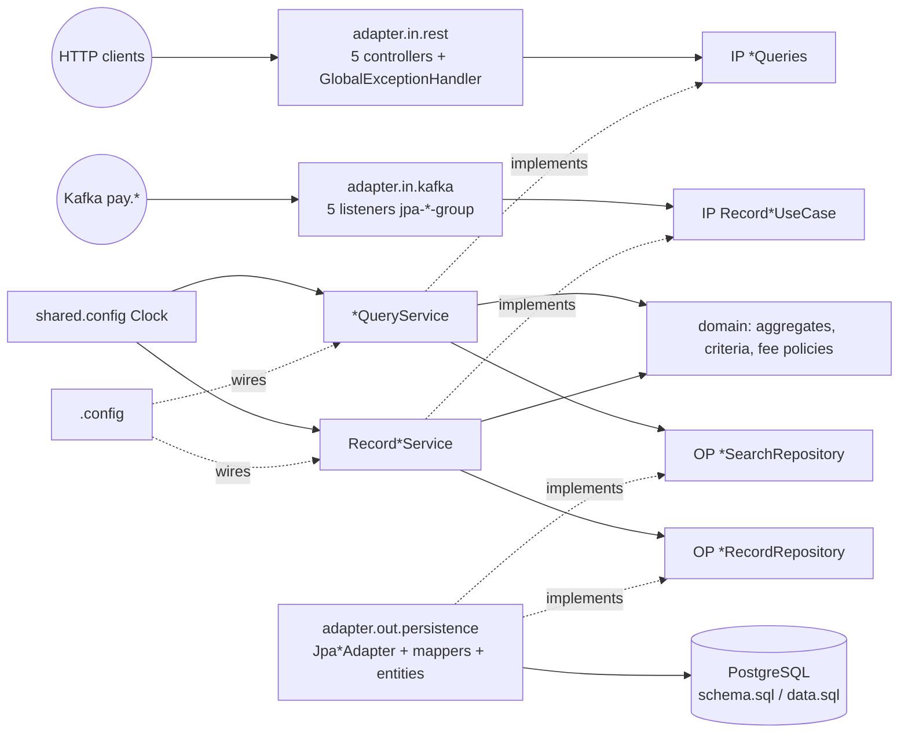
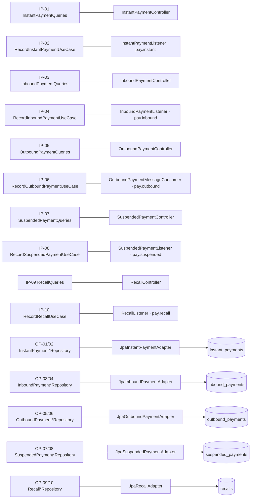

# Technical Layer & Adapter Design — realistic-mess-based-on-jpa-entities-challenge

- **Status:** Approved by the user, 2026-10-25. Describes the **proposed target architecture**; nothing here is implemented yet.
- **Authoritative input:** [`isolated-domain-design.md`](isolated-domain-design.md) (ports OP-01 … OP-10, IP-01 … IP-10, decisions AD-01 … AD-11, deviations D-01, D-02)
- **Business reference:** [`ddd-domain-analysis.md`](ddd-domain-analysis.md) · **Test baseline:** [`ddd-test-coverage.md`](ddd-test-coverage.md)

---

## 1. Purpose and Scope

Define the technical layers and adapters that implement or invoke every approved port, so that the Phase 5 migration can proceed context by context while preserving every existing technical feature. Scope: this module only. Design only — no code, test, configuration, build or schema change was made while producing this document.

## 2. Existing Architecture Inventory (current state)

| Component | Count | Technology | Notes |
|---|---|---|---|
| REST controllers | 5 (`controller.*Controller`) | Spring MVC | 10 GET endpoints: `/api/v1/{instant,suspended,inbound,outbound}-payments/{search,{id}}`, `/api/v1/recalls/{search,{id}}`; `@RequestParam`s bound into `dto.*SearchRequest` |
| Error handler | 1 (`controller.GlobalExceptionHandler`) | `@RestControllerAdvice` | `IllegalArgumentException` → 400 `{"error": msg}`; `Exception` → 500 `{"error": "Something went wrong, contact support with the trace id"}` + `LOG.error("unexpected error", e)` |
| Services | 5 (`service.*Service`) | Spring `@Service` | validation (BR-07, BR-15), fee BR-19, `ageInDays`, entity → DTO mapping |
| Repositories | 5 (`repository.*Repository`) | `@Repository` + `EntityManager`, string-built JPQL | filter / limit / sort semantics; mixed return types (DTOs vs entities) |
| Entities | 5 (`entity.*`) | JPA, public fields, `Timestamp` / `Date` | `@Id` without generation |
| Kafka consumers | 5 (`kafka.*Listener`, `kafka.OutboundPaymentMessageConsumer`) | `@KafkaListener(topics = "pay.*", groupId = "jpa-<type>-group")` + `@Transactional` + `em.merge` | own `ObjectMapper`; catch-all `LOG.warn(..., e)` |
| Utilities | `util.PaymentUtils` | static | formats (`SimpleDateFormat`), limits, IBAN length, like-pattern, timestamp parsing |
| Configuration | `application.yml` | Spring Boot | port 8082; datasource; `sql.init.mode: always`; `ddl-auto: none`; `open-in-view: false`; Kafka String (de)serializers, `enable-auto-commit: true`, `auto-offset-reset: earliest` |
| Schema / seed | `schema.sql`, `data.sql` | SQL init | `data.sql` destructive reseed at every startup |

Not present (and not introduced): Kafka producers, scheduled jobs, external HTTP clients, security, actuator / metrics, tracing (the "trace id" in the 500 body is a static string), retries / DLQ.

## 3. Approved Ports and Proposed Adapter Mappings

### 3.1 Output ports (owned by the domain)

| Port | Direction | Owning domain | Adapter (layer) | Existing component replaced | Data transformations | Error handling | Features preserved |
|---|---|---|---|---|---|---|---|
| OP-01 `InstantPaymentSearchRepository` | outbound | Processing | `JpaInstantPaymentAdapter` (`processing.adapter.out.persistence`) | `repository.InstantPaymentRepository` | criteria → JPQL `UPPER(p.debtorIban) LIKE :debtorIban`, `=` for `endToEndId` / `status` / `currency`, `Timestamp` bounds, `ORDER BY p.executionDatetime DESC`, `setMaxResults(limit.value())`; entity → `InstantPayment` | `@Repository` translation (DB failure → 500); null amount → `DomainInvariantViolationException` (D-01) | instant search + details |
| OP-02 `InstantPaymentRecordRepository` | outbound | Processing | same adapter, `@Transactional upsert` | `em.merge` in `InstantPaymentListener` | aggregate → entity → `em.merge` | propagates to listener (logged + dropped) | idempotent upsert by id |
| OP-03 `InboundPaymentSearchRepository` | outbound | Processing | `JpaInboundPaymentAdapter` | `repository.InboundPaymentRepository` | `=` creditor IBAN; `UPPER(p.originBic) LIKE`; `=` status / currency; `Date` bounds; `ORDER BY p.valueDate DESC, p.createdAt DESC`; uncapped limit | as OP-01 | inbound search + details |
| OP-04 `InboundPaymentRecordRepository` | outbound | Processing | same adapter | `em.merge` in `InboundPaymentListener` | as OP-02 | as OP-02 | upsert |
| OP-05 `OutboundPaymentSearchRepository` | outbound | Processing | `JpaOutboundPaymentAdapter` | `repository.OutboundPaymentRepository`; `em.find` in `OutboundPaymentController` | `=` debtor IBAN; `p.destinationBic LIKE` (column **not** uppercased, BR-09); `=` chargesType / status; `Date` bounds; `ORDER BY p.requestedExecutionDate DESC`; capped limit | as OP-01 | outbound search + details |
| OP-06 `OutboundPaymentRecordRepository` | outbound | Processing | same adapter | `em.merge` in `OutboundPaymentMessageConsumer` | as OP-02 | as OP-02 | upsert |
| OP-07 `SuspendedPaymentSearchRepository` | outbound | Compliance Hold | `JpaSuspendedPaymentAdapter` (`compliancehold.adapter.out.persistence`) | `repository.SuspendedPaymentRepository` | `=` debtor IBAN / holdReason / reviewStatus; `Timestamp` bounds; `ORDER BY p.heldAt DESC`; **unsatisfiable criteria → empty list without querying** (today: `:heldFrom = null` → no rows) | as OP-01 | suspended search + details |
| OP-08 `SuspendedPaymentRecordRepository` | outbound | Compliance Hold | same adapter | `em.merge` in `SuspendedPaymentListener` | as OP-02 | as OP-02 | upsert |
| OP-09 `RecallSearchRepository` | outbound | Recall | `JpaRecallAdapter` (`recall.adapter.out.persistence`) | `repository.RecallRepository` | `=` recallType / originalPaymentId / originalPaymentType / reasonCode / status; `Timestamp` bounds; `ORDER BY p.initiatedAt DESC`; `setMaxResults(50)`; null amount → `Optional.empty()` | `@Repository` translation | recall search + details |
| OP-10 `RecallRecordRepository` | outbound | Recall | same adapter | `em.merge` in `RecallListener` | as OP-02 | as OP-02 | upsert |

### 3.2 Input ports (owned by the application layer)

| Port | Direction | Implemented by | Invoked by (adapter, layer) | Existing component replaced | Data transformations | Error handling | Features preserved |
|---|---|---|---|---|---|---|---|
| IP-01 `InstantPaymentQueries` | inbound | `InstantPaymentQueryService` | `InstantPaymentController` (`processing.adapter.in.rest`) | `service.InstantPaymentService` | `@RequestParam`s → `InstantPaymentSearchQuery`; path id → `PaymentId.parse`; aggregate → `InstantPaymentResponse` (BR-22) | `InvalidSearchFilterException` → 400; `MalformedValueException` → 500; empty → 404 | `/api/v1/instant-payments/search`, `/{id}` |
| IP-02 `RecordInstantPaymentUseCase` | inbound | `RecordInstantPaymentService` | `InstantPaymentListener` (`processing.adapter.in.kafka`) | entity building in listener | JSON → `RecordInstantPaymentCommand` (BR-29 … BR-31 quirks kept) | catch-all → `LOG.warn` + drop | topic `pay.instant`, group `jpa-instant-group` |
| IP-03 `InboundPaymentQueries` | inbound | `InboundPaymentQueryService` | `InboundPaymentController` | `service.InboundPaymentService`; `ageInDays` in controller | `InboundPaymentView` → `InboundPaymentResponse` incl. `ageInDays` | as IP-01 | `/api/v1/inbound-payments/*` |
| IP-04 `RecordInboundPaymentUseCase` | inbound | `RecordInboundPaymentService` | `InboundPaymentListener` | listener | as IP-02 (date truncation BR-31) | as IP-02 | `pay.inbound`, `jpa-inbound-group` |
| IP-05 `OutboundPaymentQueries` | inbound | `OutboundPaymentQueryService` (search → `SearchFeeEstimate`, get → `DetailFeeEstimate`) | `OutboundPaymentController` | `service.OutboundPaymentService`; `em.find` + fee table in controller | search → `OutboundPaymentResponse`; details → snake_case `Map` incl. `created_at`, `updated_at`, `estimatedFee` (BR-18) | malformed path id → **404** (BR-17); others as IP-01 | `/api/v1/outbound-payments/*` |
| IP-06 `RecordOutboundPaymentUseCase` | inbound | `RecordOutboundPaymentService` | `OutboundPaymentMessageConsumer` (name kept) | listener | as IP-02 | as IP-02 | `pay.outbound`, `jpa-outbound-group` |
| IP-07 `SuspendedPaymentQueries` | inbound | `SuspendedPaymentQueryService` | `SuspendedPaymentController` (`compliancehold.adapter.in.rest`) | `service.SuspendedPaymentService` | → `SuspendedPaymentResponse` | as IP-01 | `/api/v1/suspended-payments/*` |
| IP-08 `RecordSuspendedPaymentUseCase` | inbound | `RecordSuspendedPaymentService` | `SuspendedPaymentListener` (`compliancehold.adapter.in.kafka`) | listener | as IP-02 | as IP-02 | `pay.suspended`, `jpa-suspended-group` |
| IP-09 `RecallQueries` | inbound | `RecallQueryService` | `RecallController` (`recall.adapter.in.rest`) | `service.RecallService` | → `RecallResponse` | `Unknown recall type: …` → 400 | `/api/v1/recalls/*` |
| IP-10 `RecordRecallUseCase` | inbound | `RecordRecallService` | `RecallListener` (`recall.adapter.in.kafka`) | listener | JSON → `RecordRecallCommand` (raw `originalPaymentId`) | invalid / missing reference → `MalformedValueException` → logged + dropped (BR-28) | `pay.recall`, `jpa-recall-group` |

### 3.3 Other approved abstractions

| Abstraction | Provided by | Consumers |
|---|---|---|
| `OutboundFeeEstimate` (`SearchFeeEstimate`, `DetailFeeEstimate`) | `ProcessingConfiguration` instantiates both and passes them as two explicit constructor arguments to `OutboundPaymentQueryService` (no qualifiers needed) | IP-05 |
| `java.time.Clock` | `shared.config.ClockConfiguration` → `Clock.systemDefaultZone()` | `InboundPaymentQueryService` (`ageInDays`), all `Record*Service` (audit timestamps) |

## 4. Technical Layer Responsibilities

```
fr.kevin.llps.payments
├─ shared.domain                          Shared Kernel (isolated-domain-design.md §6.3)
├─ shared.adapter.in.rest                 GlobalExceptionHandler (moved)
├─ shared.config                          ClockConfiguration
└─ <context> ∈ {processing, compliancehold, recall}
   ├─ domain, domain.port                 aggregates, criteria, policies, output ports
   ├─ application, application.port.in    *QueryService, Record*Service (plain Java), input ports, queries / commands / views
   ├─ config                              <Context>Configuration (@Configuration: application services, fee policies)
   ├─ adapter.in.rest                     controllers (names kept), <Agg>RestMapper, dto/*Response (moved)
   ├─ adapter.in.kafka                    listeners (names kept, incl. OutboundPaymentMessageConsumer)
   └─ adapter.out.persistence             Jpa<Agg>Adapter (@Repository), <Agg>JpaMapper, entity/* (moved)
```

| Layer | Responsibility | May depend on | Must not depend on |
|---|---|---|---|
| Domain | business rules, invariants, criteria semantics, output port contracts | JDK, `shared.domain` | Spring, JPA, Jackson, `java.sql`, application, adapters, other contexts |
| Application | use-case orchestration: build criteria, call ports, apply fee policy / clock, stamp audit timestamps | domain, `java.time.Clock` | Spring (framework-free; wired by `config`), adapters |
| Config | Spring wiring of plain application classes | application, domain | — |
| REST adapter | HTTP binding, id parsing quirks, DTO / map shaping, BR-22 formatting, HTTP error mapping | input ports, domain types (read) | output ports, JPA |
| Kafka adapter | topic subscription, consumer groups, JSON quirks, swallow + WARN | input ports | output ports, JPA |
| Persistence adapter | JPQL, entity mapping, transactions, DAO exception translation | output ports, domain, JPA | application, REST, Kafka |

## 5. Feature-Preservation Matrix

| Existing feature | Current component | Proposed target component | Related port | Preservation strategy |
|---|---|---|---|---|
| 5 search endpoints, same params & response shape | controllers → services → repositories | controllers → `*Queries` → `Jpa*Adapter` | IP-01/03/05/07/09, OP-01/03/05/07/09 | Same `@RequestMapping` / `@RequestParam`; response DTO classes moved, not changed |
| 5 details endpoints, 404 unknown, 500 / 404 malformed | controllers (+ `em.find` for outbound) | controllers + `PaymentId.parse` | same | BR-16 / BR-17 handled in REST adapter |
| Outbound details snake_case `Map` + detail fee | `OutboundPaymentController` | same controller + `OutboundPaymentRestMapper` + `DetailFeeEstimate` | IP-05 | Same keys and values (BR-18, BR-20) |
| Outbound search fee | `OutboundPaymentService` | `SearchFeeEstimate` via IP-05 | IP-05 | Same tariff (BR-19); D-01 for null amounts |
| `ageInDays` (search + details) | controller + service, `new Date()` | `InboundPayment.ageInDays(LocalDate.now(clock))` | IP-03 | Same arithmetic (BR-21) |
| Validation messages 400 | services → `IllegalArgumentException` | domain → `InvalidSearchFilterException` → handler | IP-01, IP-09 | Same `{"error": msg}` body |
| Generic 500 + ERROR log | `GlobalExceptionHandler` | same handler (moved) | — | Unchanged |
| Malformed filter / id → 500 (R-08) | `@Repository` translation of `IllegalArgumentException` | `MalformedValueException` → generic handler | — | Same status and body |
| DB failure → 500 | `@Repository` translation | `@Repository` on `Jpa*Adapter` | OP-* | Unchanged |
| 5 Kafka consumers, topics, `jpa-*-group` | listeners | same classes / annotations, new packages | IP-02/04/06/08/10 | `@KafkaListener` attributes copied verbatim |
| Auto-commit, earliest offset, String deserializers | `application.yml` | unchanged | — | No configuration change |
| Swallow + WARN, no retry | listeners | listeners | — | Same catch-all and log messages |
| Idempotent upsert by id | `em.merge` | `Jpa*Adapter.upsert` | OP-02/04/06/08/10 | Same `merge`; `@Transactional` moves from listener to adapter (one message = one merge) |
| Audit timestamps reset at each ingestion | `new Timestamp(System.currentTimeMillis())` | `AuditTimestamps.recordedAt(LocalDateTime.now(clock))` | IP-even | Same semantics (BR-24) |
| Schema / seed init, `ddl-auto: none`, `open-in-view: false` | resources, yml | unchanged | — | Untouched |
| Logging levels | yml | unchanged | — | Untouched |

## 6. Persistence and Data-Mapping Design

- **Mapping boundary:** `<Agg>JpaMapper` (stateless, package-private to the persistence adapter) is the only place converting entity ↔ aggregate: `UUID` ↔ `PaymentId`, `amount` + `currency` ↔ `Money` (D-01 rejection for payments; `Optional` for recall), `Timestamp` ↔ `LocalDateTime`, `Date` ↔ `LocalDate`, `chargesType` ↔ `ChargesType`, `created_at` / `updated_at` ↔ `AuditTimestamps`.
- **Entities** keep public fields, `@Column` names and types; `schema.sql` / `data.sql` are not changed. They move to `<context>.adapter.out.persistence.entity`; entity scanning still covers them (below `fr.kevin.llps.payments`), so no `@EntityScan` is needed.
- **JPQL** remains hand-written and string-built (module rule). The adapter reads only criteria fields; it performs no defaulting, capping, trimming, uppercasing or parsing of user input — those are done by the criteria factories with identical results.
- **Transactions:** `upsert` is `@Transactional`; searches run without an explicit transaction, as today.
- **REST mapping:** `<Agg>RestMapper` converts aggregates / views into the existing `*Response` DTOs with `DateTimeFormatter` patterns `yyyy-MM-dd'T'HH:mm:ss` / `yyyy-MM-dd` (D-02; removes the `SimpleDateFormat` thread-safety risk R-04).
- **Kafka mapping:** each listener keeps its current parsing helpers (`asText()`, `decimalValue()`, `timestampOf`, `dateOf`) and produces a command instead of an entity.

## 7. Integration and Dependency Rules

1. `adapter.* → application.port.in` (driving) and `adapter.out.* → domain.port` (driven); never the reverse.
2. `application` → `domain` only; no `org.springframework`, `jakarta.persistence`, `com.fasterxml`, `java.sql` imports in `application` or `domain`.
3. Contexts import only `shared.domain` from each other; Recall never imports Processing.
4. Controllers and listeners depend on input-port interfaces, never on `*Service` classes.
5. Only `adapter.out.persistence` imports entities or `EntityManager`.
6. Configuration classes are the only place where application services are instantiated.

These rules are the checklist for the Phase 6 compliance audit.

## 8. Mermaid Diagrams

### 8.1 Technical architecture



### 8.2 Port to adapter



## 9. Proposed Changes to Existing Components

| Kind | Components |
|---|---|
| **Moved** (no behavior change) | `controller.*Controller` → `<context>.adapter.in.rest`; `kafka.*` → `<context>.adapter.in.kafka`; `dto.*Response` → `<context>.adapter.in.rest.dto`; `entity.*` → `<context>.adapter.out.persistence.entity`; `GlobalExceptionHandler` → `shared.adapter.in.rest` |
| **Rewired** | controllers depend on `*Queries`; listeners depend on `Record*UseCase` instead of `EntityManager`; `OutboundPaymentController` drops `@PersistenceContext`; `@Transactional` moves from listeners to `Jpa*Adapter.upsert`; `GlobalExceptionHandler` gains `InvalidSearchFilterException` → 400 |
| **Deleted when replaced** | `service.*`, `repository.*`, `dto.*SearchRequest` (controllers build `*SearchQuery`), `util.PaymentUtils` (once unused) |
| **New** | domain and application classes (`isolated-domain-design.md`); `Jpa*Adapter`, `*JpaMapper`; `*RestMapper`; `ProcessingConfiguration`, `ComplianceHoldConfiguration`, `RecallConfiguration`, `ClockConfiguration` |
| **Unchanged** | `application.yml`, `schema.sql`, `data.sql`, `pom.xml`, `PaymentsApplication` |

**Tests** (re-targeted, every assertion kept except D-01):

| Test class | Target seam |
|---|---|
| `PaymentControllerWebTest` | `@MockitoBean` input ports; keeps the `EntityManagerFactory` / `EntityManager` mock beans and `lenient()` wiring required by `AGENTS.md` (harmless once unused) |
| `KafkaListenerUnitTest` | mock `Record*UseCase`, capture the command; topic / group-id reflection test kept |
| `PaymentRepositoryUnitTest` | `@DataJpaTest` importing `Jpa*Adapter` + mappers, driven by criteria |
| `PaymentServiceUnitTest` | split into application-service tests (mocked ports, fixed `Clock`) and domain tests (criteria, policies, aggregates); D-01 replaces 2 null-amount cases |
| `PaymentUtilsTest` | migrated with the rules it covers (`SearchLimit`, `IbanFilter`, formatting); removed with `PaymentUtils` |
| `PaymentApplicationIntegrationTest` | **not edited** — the end-to-end acceptance suite |

**Increment order (proposal for Phase 5):** (0) Shared Kernel, `Clock`, exception handler → (1) Recall → (2) Compliance Hold → (3) Instant → (4) Inbound → (5) Outbound → (6) `PaymentUtils` removal and test reorganization by context. Full suite green at the end of every increment.

## 10. Architectural Decisions, Assumptions, Trade-offs, Unresolved Issues

| ID | Decision | Trade-off |
|---|---|---|
| TD-01 | Per-context adapter packages; entities move with their persistence adapter | Larger diff (imports in tests change), but each context is self-contained |
| TD-02 | Framework-free application layer, wired by `@Configuration` | A little more wiring code; application testable without Spring |
| TD-03 | `@Transactional` on `Jpa*Adapter.upsert` | Equivalent to today since parsing has no side effects |
| TD-04 | Delete legacy classes as each increment replaces them | No parallel path to keep consistent; rollback is per-commit |
| TD-05 | Re-target tests to new seams, keep assertions; integration suite untouched | Test diffs are larger, but behavior evidence is continuous |
| TD-06 | **Amendment (Phase 5, approved):** the packages of §4 are distributed over four Maven modules — `domain/` (`jpa-domain`: `shared.domain`, `<context>.domain*`, `<context>.application*`), `infrastructure-adapters/` (`jpa-infrastructure-adapters`: `<context>.adapter.out.persistence`, `schema.sql`, `data.sql`), `client-adapters/` (`jpa-client-adapters`: `<context>.adapter.in.rest`, `<context>.adapter.in.kafka`, `shared.adapter.in.rest`), `bootstrap/` (`jpa-bootstrap`: `PaymentsApplication`, `<context>.config`, `shared.config`, `application.yml`). Package names are unchanged. | Dependency rules of §7 become compiler-enforced; module POMs to maintain |

**Assumptions**
- A-1: entity scanning covers moved entities (base package unchanged).
- A-2: moving the transaction boundary is behavior-neutral (one `merge` per message).
- A-3: criteria fields match the real request parameters (documentation correction applied to `isolated-domain-design.md` §21).

**Unresolved:** none blocking. Inherited Q-01 … Q-03 (`ddd-domain-analysis.md` §7) unchanged.

## 11. User Validation Status

| Date | Gate | Decision |
|---|---|---|
| 2026-10-25 | Structural decisions | Per-context adapter packages; framework-free application with transactions in the persistence adapter; delete legacy when replaced; re-target tests keeping assertions. |
| 2026-10-25 | Design approval | Technical layer and adapter design approved; write and commit this document. |
| 2026-10-25 | Phase 5 module structure | TD-06 approved: four Maven modules (application layer inside `domain`); legacy code moved unchanged into `bootstrap` first; SQL files in `infrastructure-adapters`. |
